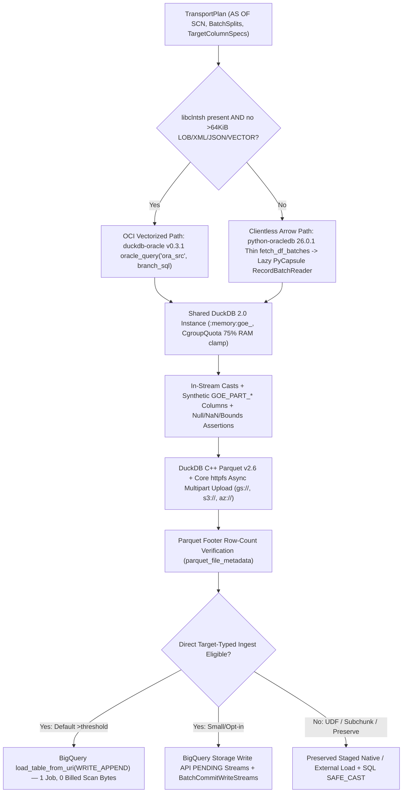

# DuckDB 2.0 LTS, `duckdb-oracle` v0.3.1, Arrow Streaming, and Cloud Storage Data Plane

This chapter synthesizes primary-source findings across `src/goe/offload/transport/`, `src/goe/offload/staging/`, `src/goe/filesystem/`, `tools/`, `duckdb==2.0.0` ("Cyanoptera" LTS), `cofin/duckdb-oracle` `v0.3.1` (published in `duckdb/community-extensions`), `oracledb==26.0.1`, `pyarrow==26.0.0`, and `sqlspec==0.68.0`.

## Recommended Decision

1. **Unblock and Harden DuckDB 2.0.0 + Official Community `oracle` v0.3.1 + Core `httpfs`**:
   - Replace the broken `1.5.5` exact/prefix version gate (`src/goe/offload/transport/duckdb_constants.py:6`, `src/goe/offload/transport/duckdb_availability.py:42-60`, `src/goe/config/orchestration_defaults.py:782`) with `Version(duckdb.__version__) >= Version("2.0.0")`.
   - Remove `allow_unsigned_extensions="true"` and custom extension repository `https://cofin.github.io/duckdb-oracle` (`src/goe/offload/transport/duckdb_engine.py:89, 108-110`, `orchestration_defaults.py:795-797`), installing signed `oracle` `v0.3.1` directly via `INSTALL oracle FROM community; LOAD oracle;` (with air-gapped `LOAD oracle` try-first support when pre-seeded in `extension_directory`).
   - Retire `northpolesec/duckdb-gcs` (`gcss://`, unported to DuckDB 2.0.0) and `to_duckdb_gcs_uri()` (`duckdb_engine.py:75-80, 112-120`), switching to DuckDB 2.0 built-in `LOAD parquet; LOAD httpfs;` with `CREATE OR REPLACE TEMPORARY SECRET goe_gcs (TYPE gcs, BEARER_TOKEN '<oauth_token>')` over canonical `gs://` URIs (and `TYPE s3` / `TYPE azure` for `s3://` and `az://`/`abfss://`).
   - Fix the container OOM defect (`src/goe/offload/transport/duckdb_transport.py:164-220`) by sharing **one** execution-scoped `:memory:goe_<execution_id>` DuckDB instance per offload run with lightweight `conn.cursor()` handles per worker thread, `CgroupQuota`-clamped `memory_limit` (75% of container memory), `SET oracle_call_timeout_ms = 0;`, `SET preserve_insertion_order = false;`, and disk-backed `temp_directory`.
2. **Unify Non-Spark Extraction into One DuckDB 2.0 Parquet + `httpfs` Sink with Automatic OCI vs Clientless Arrow Routing**:
   - **OCI Vectorized Extraction Path** (when `libclntsh` is loadable and table has no unbounded >64 KiB LOB/XML/JSON/VECTOR columns): streams Oracle `AS OF SCN` splits through `duckdb-oracle` v0.3.1 `oracle_query('ora_src', ...)` directly into DuckDB Parquet -> `httpfs`, unlocking SEPS Wallet, TNS aliases, and `RAW(1..32767)` (`SQLT_BIN`) while preserving RDBMS-side `TO_CHAR` casts for unbounded/high-precision `NUMBER`, nanosecond `TIMESTAMP(7..9)`, and offset-preserving `TIMESTAMPTZ`.
   - **Clientless PyCapsule Arrow Extraction Path** (when running in a pure-Thin distroless/Cloud Run container without `libclntsh`, or when the table contains `CLOB`/`NCLOB`/`BLOB`/`LONG`/`XMLTYPE`/`JSON`/`VECTOR` columns exceeding `duckdb-oracle`'s 65,535-byte `ub2` fetch buffer): executes parallel `AS OF SCN` batch splits via `python-oracledb` 26.0.1 Thin `conn.fetch_df_batches(...)`, wraps `pa.RecordBatchReader.from_stream(ora_df)` in a lazy batch generator (avoiding `sqlspec==0.68.0` `OracleSyncDriver.select_to_arrow`'s eager list materialization), registers the lazy `RecordBatchReader` on a DuckDB 2.0 cursor (with mandatory `cursor.unregister()` in `finally:` to prevent DuckDB 2.0 `nanobind` reference leaks), and streams Parquet directly to cloud storage with zero `/tmp` disk staging — retiring row-by-row Python `ParquetEncoder` (`src/goe/util/parquet_encoder.py`) and `avro-python3` (`src/goe/util/avro_encoder.py`).
3. **Promote `DUCKDB` into `GCP_AUTO_TRANSPORT_METHODS` and Enable Direct Target-Typed BigQuery Ingestion**:
   - Raise `OFFLOAD_TRANSPORT_DUCKDB_MAX_BYTES` from `20G` to `100G` and place `DUCKDB` ahead of `QUERY_IMPORT` (and ahead of remote Spark/Dataproc below the configurable bytes threshold) when `libclntsh` is present.
   - Emit target-typed Parquet/Arrow with in-stream synthetic partition column projection (`GOE_PART_*`) and null/NaN/range assertions so BigQuery ingests via a **single** atomic `load_table_from_uri(..., WRITE_APPEND)` job (0 SQL scan bytes billed, 0 paid query slots) or Storage Write API `PENDING` streams, automatically falling back to staged `<load_db>.<load_table>` SQL casts when legacy transports, backend UDF partition functions, `--offload-chunk-column`, or `--preserve-load-table` are active.
4. **Consolidate `src/goe/filesystem/` onto `sqlspec.storage` (`ObStoreBackend` + `LocalStore`)**:
   - Back `GOEGcs`, `GOES3`, `GOEAzure`, and `GOELogFileHandle` with `sqlspec.storage` (`obstore` Rust `object_store` prebuilt wheels) behind the preserved `GOEDfs` contract (`if_generation_match=0`, `dry_run`, scheme-exact `gs`/`s3`/`s3a`/`abfs`/`abfss`/`wasb`/`wasbs`, and `@traced_storage_call`), fixing active bugs in `GOEGcs.stat()`, `GOEAzure` exception handling, and `GOES3.delete()` 1,000-key chunking while dropping `fsspec[gcs]`, `boto3`, `azure-storage-blob`, and `azure-common` from core dependencies.

---

## Active Defects and Obsolescence Audit

### 1. DuckDB Transport Blockers and Resource Bugs

| Location | Verified Defect at `HEAD` | Root Cause & Runtime Consequence | Fix in Target Design |
| :--- | :--- | :--- | :--- |
| `src/goe/offload/transport/duckdb_constants.py:6`, `duckdb_availability.py:42-60`, `orchestration_defaults.py:782` | `SUPPORTED_DUCKDB_VERSION_PREFIX = "1.5.5"` and `OFFLOAD_TRANSPORT_DUCKDB_VERSION = "1.5.5"` | `pyproject.toml:26` declares `duckdb>=2.0.0` (`.venv` has `duckdb==2.0.0`), so `has_duckdb_dependencies()` returns `False` unconditionally and disables DuckDB transport 100% of the time. | Validate `Version(duckdb.__version__) >= Version("2.0.0")` (targeting the DuckDB 2.x LTS ABI). |
| `src/goe/offload/transport/duckdb_engine.py:75-120`, `duckdb_transport.py:95` | `INSTALL gcs FROM community; LOAD gcs;` + `to_duckdb_gcs_uri()` (`gs://` -> `gcss://`) | `northpolesec/duckdb-gcs` (`v0.0.8`) is not ported to the DuckDB 2.0.0 C++ ABI (`DUCKDB_CPP_EXTENSION_ENTRY`) and cached a static C++ client per connection that ignored `CREATE OR REPLACE SECRET`. | Use DuckDB 2.0 core `LOAD parquet; LOAD httpfs;` with `CREATE OR REPLACE TEMPORARY SECRET goe_gcs (TYPE gcs, BEARER_TOKEN '<token>')` over canonical `gs://` URIs, dynamically refreshing tokens in-place on long offloads (>45 min). |
| `src/goe/offload/transport/duckdb_engine.py:89, 108-110`, `orchestration_defaults.py:795-797` | `allow_unsigned_extensions="true"` + `https://cofin.github.io/duckdb-oracle` | `cofin/duckdb-oracle` `v0.3.1` (`fa61951bdd3edf18bb6bf8e7169255d5ca6de635`) is signed in official `duckdb/community-extensions` (`extensions/oracle/description.yml:1-58`) for DuckDB `v2.0.0` across `linux_amd64`, `linux_arm64`, `osx_arm64`, and `windows_amd64`. | Default `allow_unsigned_extensions="false"` (enabled only if an explicit local `OFFLOAD_TRANSPORT_DUCKDB_EXTENSION_PATH` override is set) and run `INSTALL oracle FROM community; LOAD oracle;`. |
| `src/goe/offload/transport/duckdb_transport.py:164-220` | Opens a separate `duckdb.connect(":memory:")` per worker thread in `ThreadPoolExecutor(max_workers=parallelism)` | Allocates $N$ independent DuckDB `BufferManager` and thread-pool instances, multiplying `memory_limit` and `threads` by `parallelism` (`8 * 4 GiB = 32 GiB`), triggering container OOMKills. Also mutates `os.environ["ORA_SDTZ"] = "UTC"` unsafely from worker threads (`line 209`). | Open **one** `:memory:goe_<execution_id>` connection per offload, clamp `memory_limit` via `CgroupQuota` (75% of cgroup limit), spawn lightweight `root_conn.cursor()` per worker thread, and move `ORA_SDTZ` initialization to process/transport startup. |
| `cofin/duckdb-oracle` `src/include/oracle_settings.hpp:23`, `src/oracle_connection_manager.cpp:365-383` | `oracle_call_timeout_ms` defaults to `30000` (30s) via `OCI_ATTR_CALL_TIMEOUT` | Large Oracle partition/extent full scans blocking >30s on disk I/O or sort/hash work abort mid-transport with `ORA-03136` / `ORA-01013` unless overridden. | Always execute `SET oracle_call_timeout_ms = 0;` (or bind a configurable transport call timeout in ms) alongside `SET oracle_array_size = 10000;` and `SET oracle_connection_limit = <parallelism + 2>;`. |
| `duckdb==2.0.0` `parquet_metadata_cache` initialization | Passing `config={"parquet_metadata_cache": "true"}` to `duckdb.connect()` raises `InvalidInputException` | Verified live in `.venv`: DuckDB 2.0.0 requires the `parquet` extension to be loaded before setting `parquet_metadata_cache`. | Execute `LOAD parquet; LOAD httpfs;` first, then issue `SET parquet_metadata_cache = true; SET httpfs_connection_caching = true; SET enable_http_metadata_cache = true; SET http_keep_alive = true; SET preserve_insertion_order = false;`. |
| `src/goe/offload/transport/duckdb_availability.py:21-29, 65-68` | Rejects `use_oracle_wallet`, non-EZConnect TNS aliases, and `ORACLE_TYPE_RAW` | `duckdb-oracle` v0.3.1 (`oracle_secret.cpp:67-196`, `oracle_scan.cpp:638-642`) natively supports SEPS Wallet (`/@alias` via `OCI_CRED_EXT`), `WALLET_PATH` + `SERVICE` TNS alias resolution (under mutex-guarded `ScopedTnsAdmin`), and binary `RAW` via `SQLT_BIN` -> `LogicalType::BLOB`. | Enable Wallet, TNS alias, and `ORACLE_TYPE_RAW` (`PARQUET_TYPE_BINARY: "BLOB"`) in OCI extraction; route >64 KiB-capable LOB/XML/JSON/VECTOR tables to the Clientless Arrow path. |

### 2. `QueryImport`, Encoders, `transport/base.py`, Cloud Filesystem, and `tools/` Defects

- **`QueryImport` Bottlenecks (`src/goe/offload/transport/query_import.py:42-177`, `src/goe/util/parquet_encoder.py:81-170`, `src/goe/util/avro_encoder.py:1-190`)**:
  - Hard-locks `parallelism = 1` (`query_import.py:67`), uses tiny `1,000–10,000` fetch sizes, installs a Python `str` `cx.outputtypehandler` (`src/goe/offload/oracle/oracle_offload_transport_rdbms_api.py:707-725`), transposes Python tuples into lists of column lists (`col_data = [[row[i] for row in rows] for i in ...]`), runs quadratic `pyarrow.concat_tables` with Parquet v1.0 (`parquet_encoder.py:120-152`) or row-by-row pure-Python `avro-python3`, and stages entire files on local `/tmp` before uploading.
  - Logs `"Consistent read will not be used"` when `consistent_read` is disabled while still passing `consistent_read_scn` down when `AS OF SCN` extraction runs (`query_import.py:113-134`).
- **`transport/base.py` (1,215 LOC) and Copy-Pasted `*Canary` Subclasses**:
  - `OffloadTransport` (`src/goe/offload/transport/base.py:1-1215`) is a 55-attribute base class mixing split planning, RDBMS `gv$sql` polling, SSH/SCP execution (with duplicate SCP method definitions around `base.py:473`), raw `%` string interpolation into generated PySpark scripts (`base.py:948-983`, fragile against embedded quotes in hints/predicates), and nearly identical `*Canary` subclasses (~330 LOC across `spark_submit.py`, `spark_thrift.py`, `spark_livy.py`, `dataproc.py`, and the Sqoop transport that the redesign removes) that omit `DUCKDB` and `QUERY_IMPORT`.
- **Cloud Filesystem Bugs (`src/goe/filesystem/`, 2,266 LOC)**:
  - `GOEGcs.stat()` (`src/goe/filesystem/goe_gcs.py:258`) calls `list_blobs(prefix=...)` without `max_results=2` when checking virtual directory prefixes, enumerating thousands of objects for an existence/directory check.
  - `GOEAzure` (`src/goe/filesystem/goe_azure.py:14, 159, 326`) imports and catches deprecated v2 SDK `azure.common.AzureMissingResourceHttpError` while using v12 `BlobServiceClient`, which raises `azure.core.exceptions.ResourceNotFoundError`.
  - `GOES3.delete()` (`src/goe/filesystem/goe_s3.py:137`) calls `delete_objects` without chunking keys into S3's mandatory 1,000-key batch limit.
  - `GOELogFileHandle` (`src/goe/util/goe_log_fh.py:8`) is the sole consumer of `fsspec[gcs]` / `gcsfs` in the repository.
- **`tools/` Modernization Gaps**:
  - `tools/spark-listener/src/main/scala/com/gluent/spark/GOETaskListener.scala` imports Log4j 1.x (`org.apache.log4j.Logger`), which was removed in Spark 3.3+ / 4.0 (Log4j2 / SLF4J).
  - `tools/transport/Makefile` builds against EOL Spark `3.2.4` instead of `3.5.3`+.
  - `tools/goe-shell-functions.sh` (`Makefile:187`) is dead shell glue left over from removed `bin/*` scripts, and `tools/bundle_python.py:64` contains a stray non-GOE product reference in a docstring/comment.

---

## Precision-Safe Type Boundary Matrix Across Extraction and BigQuery Ingestion

Cross-referencing `src/goe/offload/column_metadata.py:1-566`, `src/goe/offload/oracle/oracle_offload_transport_rdbms_api.py:172-225`, `src/goe/offload/staging/parquet/parquet_staging_file.py:135-185`, `src/goe/offload/bigquery/bigquery_backend_api.py:1527-1738`, and `cofin/duckdb-oracle` `src/oracle_type_registry.cpp:24-32, 188, 205-283` + `src/oracle_type_conversion.cpp:94-268`:

| Oracle Source Type | GOE Canonical Type | BigQuery Physical Type | Raw `duckdb-oracle` v0.3.1 Type | Precision-Preserving Extraction & Parquet Strategy |
| :--- | :--- | :--- | :--- | :--- |
| `NUMBER(1..18, 0)` (`safe_mapping=True`) | `GOE_TYPE_INTEGER_1/2/4/8` | `INT64` | `DECIMAL(p, 0)` | Native OCI `DECIMAL(p, 0)` (or Thin Arrow `int64`/`decimal128`) cast in DuckDB to `BIGINT` -> Parquet `INT64` -> BigQuery `INT64`. |
| `NUMBER(19..38, 0)` & bounded `NUMBER(p, s)` (`1 <= p <= 38`, `0 <= s <= p`, `safe_mapping=True`) | `GOE_TYPE_INTEGER_38` / `GOE_TYPE_DECIMAL(p, s)` | `NUMERIC(p, s)` ($p \le 38, s \le 9$) or `BIGNUMERIC` | `DECIMAL(p, s)` | Native OCI `SQLT_STR` -> DuckDB `DECIMAL(p, s)` (or Thin `fetch_decimals=True` `decimal128(p, s)`) -> Parquet `DECIMAL(p, s)` loaded with `DecimalTargetTypes = [NUMERIC, BIGNUMERIC, STRING]`. Zero precision loss. |
| **Unbounded `NUMBER`**, `FLOAT(p)`, `NUMBER(p, -s)` ($s < 0$), `NUMBER(p, s)` ($s > p$), or `safe_mapping=False` `BIGNUMERIC` | `GOE_TYPE_DECIMAL` (`safe_mapping=False`) | `BIGNUMERIC` (up to `76` digits, `scale <= 38`) | **`DOUBLE` (lossy beyond 15–17 digits)** | **Mandatory RDBMS-side `TO_CHAR(col, 'TM')`** -> UTF-8 `VARCHAR` in both OCI and Thin Arrow paths. In DuckDB, validate via `TRY_CAST` / decimal regex and emit Arrow `DECIMAL256(76, 38)` or `STRING` (staged load casts via `SAFE_CAST(col AS BIGNUMERIC)` when >38-digit Parquet decimal is unsupported by direct load). Never fetch raw unbounded `NUMBER` through OCI `DOUBLE`. |
| `BINARY_FLOAT` / `BINARY_DOUBLE` | `GOE_TYPE_FLOAT` / `GOE_TYPE_DOUBLE` | `FLOAT64` | `FLOAT` / `DOUBLE` | Native `FLOAT` / `DOUBLE` with DuckDB in-stream `CASE WHEN isnan(col) OR isinf(col) THEN NULL ELSE col END` when `nan_values_as_null=True`. |
| `DATE` & `TIMESTAMP(0..6)` | `GOE_TYPE_DATE` / `GOE_TYPE_TIMESTAMP` | `DATE` / `DATETIME` | `TIMESTAMP` (microseconds) | Native `DATE32` / `TIMESTAMP_NTZ` (`TIMESTAMP(MICROS)`) when year `0001..9999` bounds are verified in DuckDB (`EXTRACT(YEAR FROM col) BETWEEN 1 AND 9999`), or RDBMS `TO_CHAR` when staged string diagnostics are required. |
| **`TIMESTAMP(7..9)`** (nanoseconds) | `GOE_TYPE_TIMESTAMP` (`scale=7..9`) | `DATETIME` (scale 6, gated by `--allow-nanosecond-timestamp-columns`) or `STRING` override | **`TIMESTAMP` (truncates `FF7..FF9` to microseconds)** | When target is `STRING` override (preserving all 9 fractional digits), **mandatory RDBMS `TO_CHAR(col, 'YYYY-MM-DD HH24:MI:SS.FF9')`**. When target is `DATETIME` with `--allow-nanosecond-timestamp-columns`, microsecond `TIMESTAMP(MICROS)` matches BigQuery's 6-digit ceiling. |
| **`TIMESTAMP WITH TIME ZONE`** & **`LOCAL TIME ZONE`** | `GOE_TYPE_TIMESTAMP_TZ` | `TIMESTAMP` (UTC) or `STRING` | **`TIMESTAMP` (UTC-naive, drops TZ offset)** | Emit deterministic RDBMS `TO_CHAR(col, 'YYYY-MM-DD HH24:MI:SS.FF6 TZH:TZM')` for `TSTZ` and **`TO_CHAR(SYS_EXTRACT_UTC(col), 'YYYY-MM-DD HH24:MI:SS.FF6') || ' UTC'`** for `TSLTZ` (eliminating session `ALTER SESSION` sensitivity in `duckdb-oracle`'s OCI connection pool), parsed in DuckDB to `TIMESTAMPTZ` (`TIMESTAMP(MICROS, UTC)`) for direct load or kept as `STRING` for staged load. |
| `INTERVAL YEAR TO MONTH` / `DAY TO SECOND` | `GOE_TYPE_INTERVAL_YM` / `GOE_TYPE_INTERVAL_DS` | `STRING` | `VARCHAR` (`SQLT_STR`) | RDBMS `TO_CHAR(col)` canonical formatting -> Parquet `UTF8` -> BigQuery `STRING`. |
| `CHAR`, `NCHAR`, `VARCHAR2`, `NVARCHAR2` | `GOE_TYPE_FIXED_STRING` / `GOE_TYPE_VARIABLE_STRING` | `STRING` | `VARCHAR` (UTF-8) | Native vectorized UTF-8 `VARCHAR` -> Parquet `UTF8`. |
| **`RAW(1..32767)`** | `GOE_TYPE_BINARY` | `BYTES` | **`BLOB` (`SQLT_BIN`)** | Native binary `BLOB` in both OCI `duckdb-oracle` v0.3.1 (max 32,767B < 65,535B `ub2` cap) and Thin Arrow -> Parquet `BYTE_ARRAY` -> BigQuery `BYTES`. |
| **`BLOB`, `LONG RAW`, `CLOB`, `NCLOB`, `LONG`, `XMLTYPE`, `JSON`/`OSON`, `VECTOR`** | `GOE_TYPE_LARGE_BINARY` / `GOE_TYPE_LARGE_STRING` | `BYTES` / `STRING` | **Capped at 65,535 bytes (`ub2` `OCIDefineByPos`)** | **Automatically route table to Clientless PyCapsule Arrow Path**: `python-oracledb` 26.0.1 streams arbitrary-size LOBs, OSON, and 23ai/26ai `VECTOR` columns into Arrow `large_binary` / `large_utf8` batches -> DuckDB 2.0 Parquet writer -> `httpfs`. |

---

## Unified Zero-JVM Transport Blueprint



### Reference Implementation: Cgroup-Clamped Shared DuckDB Engine & Lazy PyCapsule Arrow Stream

```python
from collections.abc import Iterator
from contextlib import contextmanager
from typing import Any
import uuid

import duckdb
import oracledb
import pyarrow as pa

from goe.typing import FrozenBaseStruct
from goe.util.platform import CgroupQuota


class DuckDBSessionConfig(FrozenBaseStruct):
    """Immutable resource and extension settings for a single offload execution."""

    execution_key: str
    parallelism: int
    configured_memory_bytes: int | None = None
    temp_directory: str = "/tmp/goe_duckdb"
    oracle_array_size: int = 10_000
    oracle_call_timeout_ms: int = 0
    allow_unsigned_extensions: bool = False

    def effective_memory_limit(self) -> str:
        """Clamp DuckDB buffer pool to 75% of container cgroup memory headroom."""
        quota = CgroupQuota.detect()
        cgroup_cap = int(quota.available_memory_bytes * 0.75) if quota.available_memory_bytes else None
        candidates = [v for v in (self.configured_memory_bytes, cgroup_cap) if v is not None and v > 0]
        limit_mib = max(256, min(candidates) // (1024 * 1024)) if candidates else 2048
        return f"{limit_mib}MiB"

    def effective_threads(self) -> int:
        """Clamp DuckDB worker threads to container CPU quota."""
        quota = CgroupQuota.detect()
        cpu_cap = max(1, int(quota.effective_cpus()))
        return max(1, min(self.parallelism * 2, cpu_cap))


class DuckDBTransportSession:
    """Manages one shared execution-scoped DuckDB 2.0 instance across parallel batch cursors."""

    def __init__(self, settings: DuckDBSessionConfig) -> None:
        self._settings = settings
        self._conn: duckdb.DuckDBPyConnection | None = None

    def open(self, *, load_oracle_extension: bool, gcs_bearer_token: str | None = None) -> duckdb.DuckDBPyConnection:
        """Initialize extensions, core httpfs caching, and cloud secrets once per offload."""
        db_uri = f":memory:goe_{self._settings.execution_key}"
        connect_cfg: dict[str, str] = {
            "memory_limit": self._settings.effective_memory_limit(),
            "threads": str(self._settings.effective_threads()),
            "temp_directory": self._settings.temp_directory,
        }
        if self._settings.allow_unsigned_extensions:
            connect_cfg["allow_unsigned_extensions"] = "true"
        conn = duckdb.connect(db_uri, config=connect_cfg)
        conn.execute("LOAD parquet; LOAD httpfs;")
        conn.execute(
            "SET parquet_metadata_cache = true; "
            "SET httpfs_connection_caching = true; "
            "SET enable_http_metadata_cache = true; "
            "SET http_keep_alive = true; "
            "SET preserve_insertion_order = false; "
            "SET max_temp_directory_size = '90%';"
        )
        if load_oracle_extension:
            self._ensure_oracle_extension(conn)
            conn.execute(
                f"SET oracle_call_timeout_ms = {self._settings.oracle_call_timeout_ms}; "
                f"SET oracle_array_size = {self._settings.oracle_array_size}; "
                f"SET oracle_connection_limit = {self._settings.parallelism + 2};"
            )
        if gcs_bearer_token:
            self.refresh_gcs_secret(gcs_bearer_token, conn=conn)
        self._conn = conn
        return conn

    def refresh_gcs_secret(self, bearer_token: str, *, conn: duckdb.DuckDBPyConnection | None = None) -> None:
        """Create or rotate the temporary core httpfs GCS bearer token secret in-place."""
        target = conn or self._conn
        if target is None:
            raise RuntimeError("DuckDBTransportSession is not open")
        target.execute(
            "CREATE OR REPLACE TEMPORARY SECRET goe_gcs (TYPE gcs, BEARER_TOKEN ?);",
            [bearer_token],
        )

    @staticmethod
    @contextmanager
    def stream_oracle_arrow_to_cursor(
        ora_conn: oracledb.Connection,
        duck_conn: duckdb.DuckDBPyConnection,
        sql_text: str,
        binds: dict[str, Any] | None,
        *,
        batch_size: int = 65_536,
    ) -> Iterator[tuple[duckdb.DuckDBPyConnection, str]]:
        """Lazily bridge python-oracledb PyCapsule batches into a DuckDB cursor without nanobind leaks."""
        df_iter = iter(
            ora_conn.fetch_df_batches(
                statement=sql_text,
                parameters=binds or {},
                size=batch_size,
                fetch_decimals=True,
            )
        )
        first_df = next(df_iter, None)
        cursor = duck_conn.cursor()
        view_name = f"ora_batch_{uuid.uuid4().hex}"
        registered = False
        try:
            if first_df is None:
                yield cursor, ""
                return
            first_reader = pa.RecordBatchReader.from_stream(first_df)
            schema = first_reader.schema

            def _iter_batches() -> Iterator[pa.RecordBatch]:
                yield from first_reader
                for ora_df in df_iter:
                    yield from pa.RecordBatchReader.from_stream(ora_df)

            lazy_reader = pa.RecordBatchReader.from_batches(schema, _iter_batches())
            cursor.register(view_name, lazy_reader)
            registered = True
            yield cursor, view_name
        finally:
            if registered:
                cursor.unregister(view_name)
            cursor.close()

    def close(self) -> None:
        """Close the shared DuckDB instance cleanly."""
        if self._conn is not None:
            self._conn.close()
            self._conn = None

    @staticmethod
    def _ensure_oracle_extension(conn: duckdb.DuckDBPyConnection) -> None:
        """Load pre-installed oracle extension first for air-gapped hosts, installing from community if absent."""
        try:
            conn.execute("LOAD oracle;")
        except duckdb.Error:
            conn.execute("INSTALL oracle FROM community; LOAD oracle;")
```

---

## Cloud Filesystem Unification via `sqlspec.storage` (`ObStoreBackend`)

Replacing bespoke cloud SDK wrappers (`src/goe/filesystem/goe_gcs.py`, `goe_s3.py`, `goe_azure.py`) and `fsspec[gcs]` (`src/goe/util/goe_log_fh.py`) with `sqlspec.storage` (`ObStoreBackend` + `LocalStore`) while preserving the `GOEDfs` interface (`src/goe/filesystem/goe_dfs.py`):
1. **Preserved GOE Invariants**:
   - `if_generation_match=0` atomic `overwrite=False` upload protection on GCS (`put(..., mode="create")`).
   - Full `dry_run=True` logging without mutating remote buckets.
   - Scheme-exact URI generation (`gs://`, `s3://`, `s3a://`, `abfs://`, `abfss://`, `wasb://`, `wasbs://`, `adl://`) required by Spark, Dataproc, Hive, Impala, Snowflake Stages, and Synapse PolyBase/`COPY INTO`.
   - `@traced_storage_call` OpenTelemetry spans (`goe.storage.<scheme>.<op>`) extended uniformly from GCS-only today to GCS, S3, and Azure Blob/ADLS.
   - Keyless GCP credential forwarding from `resolve_gcp_credentials()` (`src/goe/util/gcp_credentials.py`).
2. **Bugs Eliminated & Dependency Footprint Reduced**:
   - Fixes `GOEGcs.stat()` unbounded prefix enumeration (`max_results=2` / `head` + 1-item prefix probe).
   - Fixes `GOEAzure` deprecated v2 `AzureMissingResourceHttpError` crash.
   - Fixes `GOES3.delete()` >1,000-key batch deletion limit.
   - Removes `fsspec[gcs]`, `gcsfs`, `boto3`, `azure-storage-blob`, and `azure-common` from core dependencies, and isolates `hdfs` / `requests-kerberos` (`WebHdfs`, `CliHdfs`) strictly under `[project.optional-dependencies] hadoop`.
   - Avro staging (`--offload-staging-format=AVRO`) stays available for Spark and Hadoop runs, and the replacement `QUERY_IMPORT` engine writes Avro through `fastavro` (replacing the pure-Python `avro` package) from the same Arrow batches it writes to Parquet; Parquet through DuckDB 2.0 remains the default for every cloud warehouse.

---

## `QUERY_IMPORT` Replacement and Parity Verification

The `QUERY_IMPORT` transport keeps its option name, configuration keys, staging locations, and staged file contract while its engine changes from row-by-row Python encoding to Arrow streaming:

1. **Engine**: `python-oracledb` Thin `fetch_df_batches` over the existing extraction SQL (same projection, `TO_CHAR` casts, `AS OF SCN`, predicate, and split logic) feeds a lazy `RecordBatchReader`. Parquet output goes through a DuckDB 2.0 cursor (`COPY ... TO ... (FORMAT parquet)`) and Avro output goes through `fastavro` with the schema the current encoder emits. Parallelism follows `--offload-transport-parallelism` instead of the hard-coded `1`.
2. **Parity harness**: before the old encoders are deleted, a differential suite runs both engines against the same inputs and asserts equivalence of the staged output:
   - **Unit parity** feeds deterministic rows (every Oracle type GOE maps: `NUMBER` bounded and unbounded, `BINARY_FLOAT`/`BINARY_DOUBLE` with `NaN`/`Inf`, `DATE`, `TIMESTAMP(0..9)`, `TIMESTAMP WITH TIME ZONE`, `TIMESTAMP WITH LOCAL TIME ZONE`, `INTERVAL`, `CHAR`/`VARCHAR2`/`NCHAR`/`NVARCHAR2` with multibyte data, `RAW`, `CLOB`/`NCLOB`/`BLOB` above and below 64 KiB, `ROWID`, and `NULL` in every column) through both engines and compares the Arrow schema, row count, and a canonical per-row rendering (exact decimal strings, ISO timestamps with nanoseconds, hex for binary).
   - **Golden fixtures** captured from the current engine (Parquet and Avro schemas plus canonical row digests) are committed under `tests/unit/offload/transport/fixtures/query_import_parity/`, so parity stays enforced after the old engine is removed.
   - **Oracle Free integration parity** offloads the same test tables with each engine into separate staging prefixes and compares the staged files with the same canonical rendering, and with BigQuery ADC available, the loaded table contents.
3. **Cutover**: once the parity suites pass, the row-by-row `QueryImport` path, `src/goe/util/parquet_encoder.py`, and `src/goe/util/avro_encoder.py` are deleted in the same change that keeps the golden-fixture parity tests.

---

## Primary Sources, Contradictions, and Limitations

### Cited Primary Sources
- `duckdb/community-extensions`: `extensions/oracle/description.yml:1-58`.
- `cofin/duckdb-oracle` (`v0.3.1`, commit `fa61951bdd3edf18bb6bf8e7169255d5ca6de635`): `CMakeLists.txt:46-49`, `src/oracle_oci_api.cpp:85-196`, `src/include/oracle_oci_api.hpp:1-200`, `src/oracle_secret.cpp:67-196`, `src/oracle_connection_resolver.cpp:1-220`, `src/oracle_connection_manager.cpp:18-58, 365-413`, `src/include/oracle_settings.hpp:20-35`, `src/oracle_scan.cpp:318-422, 620-715`, `src/oracle_pushdown.cpp:1-546`, `src/oracle_type_registry.cpp:24-32, 188, 205-283`, `src/oracle_type_conversion.cpp:94-268`.
- `litestar-org/sqlspec` (`0.68.0`): `sqlspec/adapters/oracledb/{driver.py:757-769, 1053-1085, core.py:846-864}`, `sqlspec/adapters/bigquery/{driver.py:534-547, 704-798, 904-1015, core.py:417-422}`, `sqlspec/adapters/duckdb/{config.py:265-310, core.py:322-350, pool.py:66-399}`, `sqlspec/storage/pipeline.py:1-603`.
- GOE repository: `pyproject.toml:26-48`, `src/goe/config/orchestration_defaults.py:780-810`, `src/goe/offload/transport/{base.py:1-1215, availability.py:1-338, factory.py:1-381, duckdb_constants.py:1-10, duckdb_availability.py:21-95, duckdb_engine.py:33-167, duckdb_transport.py:53-222, query_import.py:1-177}`, `src/goe/offload/staging/parquet/{parquet_column.py:1-90, parquet_staging_file.py:1-252}`, `src/goe/offload/oracle/oracle_offload_transport_rdbms_api.py:63-75, 172-324, 706-762`, `src/goe/offload/bigquery/{bigquery_backend_api.py:1527-1738, bigquery_backend_table.py:94-551, bigquery_load_job.py:1-40}`, `src/goe/filesystem/{goe_dfs.py:1-390, goe_gcs.py:1-283, goe_s3.py:1-210, goe_azure.py:1-360, web_hdfs.py:1-260}`, `src/goe/util/{parquet_encoder.py:1-170, avro_encoder.py:1-190, goe_log_fh.py:1-180}`, `tools/{bundle_python.py:1-325, transport/Makefile:1-50, spark-listener/src/main/scala/com/gluent/spark/GOETaskListener.scala:1-120}`.

### Contradictions Resolved
1. **`pyproject.toml` DuckDB `>=2.0.0` vs `duckdb_constants.py` `1.5.5` Pin**: `pyproject.toml` upgraded DuckDB to `2.0.0` while `duckdb_constants.py` and `orchestration_defaults.py` kept `1.5.5` and `northpolesec/duckdb-gcs` `gcss://`. Resolved by targeting DuckDB `>=2.0.0`, signed community `oracle` `v0.3.1`, and core `httpfs` `TYPE gcs, BEARER_TOKEN`.
2. **Direct Target-Typed BigQuery Load vs `duckdb-oracle` Unbounded `NUMBER` `DOUBLE` Mapping**: Emitting typed Parquet directly unlocks single-job `load_table_from_uri(..., WRITE_APPEND)` with 0 SQL scan bytes billed, whereas raw `duckdb-oracle` fetches unbounded `NUMBER` as lossy `DOUBLE` and caps buffers at 65,535 bytes. Resolved by keeping RDBMS-side `TO_CHAR(..., 'TM')` for unbounded/high-precision `NUMBER` (parsed/validated losslessly in DuckDB or routed to `DecimalTargetTypes`) and routing >64 KiB LOB tables to the Clientless PyCapsule Arrow path.
3. **`sqlspec==0.68.0` `OracleSyncDriver.select_to_arrow(return_format="reader")` Streaming Contract vs Eager Buffering**: Although `return_format="reader"` returns a `RecordBatchReader`, `oracledb/driver.py:1053-1085` calls `collect_oracle_arrow_batches`, buffering all batches in RAM first. Resolved in GOE by chaining `pa.RecordBatchReader.from_stream(ora_df)` lazily over `ora_conn.fetch_df_batches(...)` and upstreaming the lazy generator fix to `sqlspec`.

### Limitations
- Live throughput benchmarks against external Oracle RAC and GCS buckets were not executed during this read-only research pass; OCI fetch buffer limits (`ub2` 65,535 bytes), `oracle_call_timeout_ms = 30000`, `parquet_metadata_cache` initialization ordering, lazy `RecordBatchReader` pull behavior, and `nanobind` reference cleanup were verified directly from C++/Python source and local `.venv` runtime probes.
