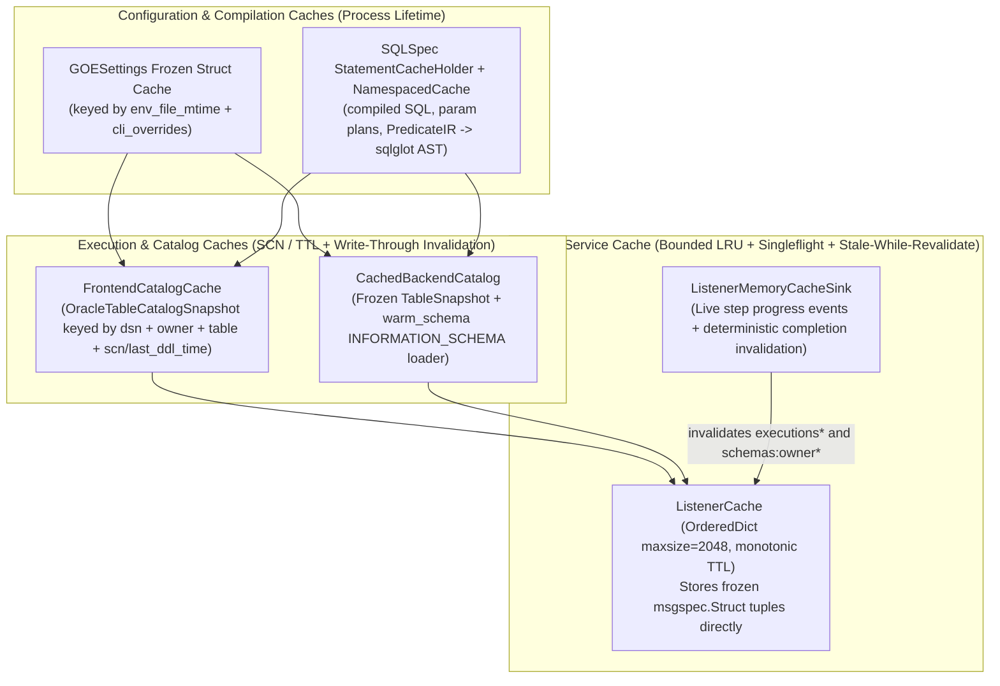

# SQLSpec 0.68, SQLGlot 30.24, and Cohesive Caching Architecture

This chapter details how `sqlspec==0.68.0`, `sqlglot==30.24.0` (shipped inside `sqlspec`), and a cohesive in-process caching strategy eliminate redundant database wrappers, hand-rolled SQL string concatenation, duplicate visitor hierarchies, and N+1 metadata round-trips across GOE while preserving every existing RDBMS and cloud data warehouse behavior.

## Recommended Decision

1. **Standardize All RDBMS and Warehouse Sessions on `SQLSpec` Adapter Pools**:
   - Replace per-query `OracleSyncDriver(connection=...)` instantiation in `src/goe/persistence/oracle_gateway.py:147-159` and retire `src/goe/util/ora_query.py:1-348` plus all 38 remaining raw SQL/cursor call sites in `src/goe/offload/oracle/` and `src/goe/schema_sync/`.
   - Manage long-lived `OracleSyncConfig` (and `OracleAsyncConfig` in the Listener) pools via a `SQLSpec` registry so `provide_session()` invokes `_prepare_driver()` once, sharing a single `StatementCacheHolder` (`QueryCache` + compiled `_statement_cache`) and a single `ObservabilityRuntime`.
   - Move `ALTER SESSION SET TRACEFILE_IDENTIFIER = "GOE"` and `OracleSessionContextConfig` (`TIME_ZONE`, `NLS_*`) into the pool `session_callback`, removing the extra `ALTER SESSION` round-trip currently executed on every `get_validated_oracle_connection()` call (`src/goe/offload/oracle/oracle_frontend_api.py:270-278, 931-936`).
   - Enable `driver_features={"enable_session_tracing": True, "fetch_lobs": False}` on admin/repository pools for zero-RTT TTC `OALL8` trace propagation (`module`, `action`, `client_identifier`, `econtext_id`) with automatic SQLCommenter stripping (`strip_sqlcomment`) so Oracle `V$SQL` `SQL_ID` hashes never fragment. Keep transport extraction pools at `enable_session_tracing=False` and `enable_sqlcommenter=False`, propagating only `client_identifier` and `econtext_id` via `apply_oracle_session_trace_attributes(conn, module=None, action=None)` so GOE's `gv$sql` `MODULE`/`ACTION` transport statistics remain intact.
   - Adopt `BigQueryConfig` / `BigQueryDriver` (`default_load_job_config` for CMEK + `DecimalTargetTypes`) and `MssqlPythonConfig` (replacing broken `pymssql` `%s` literal queries). The Teradata frontend is removed by the redesign, so no ODBC adapter is required.
2. **Consolidate All SQL Generation, Predicates, Validation, and DDL onto `sqlglot==30.24.0` Behind `sql_engine.py`**:
   - Delete `register_oracle_dialect_extensions()` monkey-patching and private `sqlspec.builder._generation` imports in `src/goe/offload/oracle/oracle_dialect.py:42-160`; `sqlglot==30.24.0` natively parses and generates Oracle `PARTITION (...)`, `SUBPARTITION (...)`, and `VERSIONS_AT_SCN` (`AS OF SCN :scn` with post-version table aliases).
   - Replace the 8 `*_literal.py` subclasses and 6 `*_predicate.py` Lark `Transformer` subclasses (1,850 LOC) with a single `@lru_cache` Lark parser -> immutable `PredicateIR` (`FrozenBaseStruct` tagged union preserving exact 38/76-digit `Decimal` and `epoch_ns` nanoseconds) -> single dialect-profile `sqlglot` AST compiler (`copy=False`) cached in `sqlspec.core.NamespacedCache` returning `sqlspec.core.SQL` (`sql` + typed `parameters`), while keeping `src/goe/offload/sql_engine.py` free of `sqlglot` imports.
   - Unify backend SQL generation (`BigQuery`, `Snowflake`, `Synapse` `tsql`, `Hive`/`Impala` `hive`/`spark`) in a shared `DialectSqlEngine`, rewrite `offload_validation.py` + `agg_validate.py` onto `sqlspec.sql.select` AST composition with concurrent frontend/backend execution and exact `Decimal` comparison, collapse `schema_sync/` (11 files, 1,192 LOC -> 3 files, ~280 LOC) onto single-pass catalog diffing + `exp.Alter`, and collapse `report/` (3,799 LOC -> ~540 LOC) onto 2 concurrent set-based `SQLFileLoader` queries + `:memory:` DuckDB 2.0 `GROUP BY ROLLUP`.
3. **Deploy Cohesive, Bounded, Lifecycle-Invalidated Caches Across Every Tier**:
   - Coordinate 5 explicit cache boundaries: (a) frozen `GOESettings` config cache, (b) `SQLSpec` `StatementCacheHolder` + `NamespacedCache` AST/SQL compilation cache, (c) `FrontendCatalogCache` (`OracleTableCatalogSnapshot` keyed by `(dsn, owner, table, scn_or_last_ddl_time)`), (d) write-through `CachedBackendCatalog` + `warm_schema` `INFORMATION_SCHEMA` batching, and (e) bounded `ListenerCache` (`OrderedDict` LRU + monotonic TTL + async/sync singleflight + stale-while-revalidate + lifecycle invalidation + `ListenerMemoryCacheSink`).

---

## Primary-Source Defect and Bottleneck Audit (`SQLSpec`, `SQLGlot`, and Caching)

### 1. Why `OracleGateway` Currently Defeats `SQLSpec` Statement Caching and Doubles Network RTTs

Inspecting `src/goe/persistence/oracle_gateway.py:100-160`, `src/goe/observability/db.py:107-124`, `src/goe/offload/oracle/oracle_frontend_api.py:270-278`, and `sqlspec==0.68.0` (`sqlspec/driver/_common.py:591-600, 992-1165`, `sqlspec/config.py:1351-1360`, `sqlspec/adapters/oracledb/driver.py:156-205`) uncovered three compounding per-query overheads:

| Defect | Primary-Source Mechanism | Measured Runtime Cost | Redesign Resolution |
| :--- | :--- | :--- | :--- |
| **`StatementCacheHolder` discarded on every query** | `CommonDriverAttributesMixin.__init__` reuses `_statement_cache_holder` only when `DatabaseConfigProtocol._prepare_driver()` (invoked inside `config.provide_session()`) stores it in `driver_features`. `OracleGateway._driver()` constructs `OracleSyncDriver(connection=..., driver_features=dict(...))` directly without `provide_session()`. | Every `select_*` call allocates a fresh `QueryCache(max_size=1024)`, `OrderedDict`, and `ParameterProcessor`, compiles on a cold miss, executes once, and garbage-collects the cache. | Check out drivers exclusively via `sqlspec.provide_session(oracle_sync_config)` on a pooled or connection-creator-backed `OracleSyncConfig`. |
| **Per-query `ObservabilityRuntime` allocation** | `attach_db_observability(driver)` (`src/goe/observability/db.py:108-120`) constructs a new `SqlspecObservabilityRuntime` and calls `driver.statement_config.replace(...)` on every query. | Repeated object churn and replacement of `statement_config` identity, invalidating `shared_holder.statement_config is self.statement_config`. | Pass `observability_config=sqlspec_observability_config()` once when constructing `OracleSyncConfig` / `BigQueryConfig`. |
| **Unconditional `ALTER SESSION` RTT before every query** | `OracleFrontendApi` and `OracleOrchestrationRepoClient` pass `get_validated_oracle_connection` into `OracleGateway`. Even on a healthy open connection, `get_validated_oracle_connection()` (`oracle_frontend_api.py:274`) calls `_set_tracefile_identifier()`, executing `ALTER SESSION SET TRACEFILE_IDENTIFIER="GOE"` (`line 934`). | **2x network round-trips** for every `OracleGateway` query across metadata discovery, repository reads, and Listener introspection. | Execute `ALTER SESSION SET TRACEFILE_IDENTIFIER = "GOE"` and `OracleSessionContextConfig.apply(conn)` once per physical connection inside `oracledb.ConnectionPool(..., session_callback=...)` with `ping_interval=60`. |
| **4-RTT PL/SQL UDT + CLOB metadata fetch** | `OracleOrchestrationRepoClient._get_metadata` (`src/goe/persistence/oracle/oracle_orchestration_repo_client.py:415-430`) calls `conn.gettype`, `offload_repo.get_offload_metadata`, and 2 separate `LOB.read()` round-trips (`offload_high_value`, `offload_predicate_value`), even though `oracle_repo.sql:1-22` already defines `offload_metadata_v`. | **4 network round-trips** per table metadata lookup. | Query `{repo_user}.offload_metadata_v` directly via `driver.select_one_or_none(..., schema_type=OffloadMetadataRow)` with `fetch_lobs=False` (**1 round-trip**, inline Python `str` CLOBs). |

### 2. Verified `sqlspec==0.68.0` Behavioral Nuances and Guardrails

Direct verification against `.venv/lib/python3.14/site-packages/sqlspec` established four implementation rules for GOE:

1. **Oracle `_session_tracing_enabled()` Coupling (`sqlspec/adapters/oracledb/driver.py:156-200`)**:
   - `_session_tracing_enabled()` returns `bool(driver_features.get("enable_session_tracing", False) or statement_config.enable_sqlcommenter)`.
   - Enabling *either* flag causes `OracleSyncDriver` to strip SQL comments (`strip_sqlcomment(sql)`) and overwrite `connection.module` and `connection.action`.
   - **Rule**: Set `enable_session_tracing=True` (`enable_sqlcommenter=False`) on dedicated admin/repository pools (`oracle_adm`), and set **both** `enable_session_tracing=False` and `enable_sqlcommenter=False` on transport extraction pools (`oracle_app`), calling `apply_oracle_session_trace_attributes(conn, module=None, action=None)` to piggyback `client_identifier` (`ExecutionId`) and `econtext_id` (`traceparent`) in zero RTTs without touching `V$SESSION.MODULE` or `V$SESSION.ACTION`.
2. **`OracleSyncDriver.select_to_arrow` Eager Batch Buffering (`sqlspec/adapters/oracledb/driver.py:1028-1086`, `sqlspec/utils/arrow_helpers.py:214-273`)**:
   - In `sqlspec==0.68.0`, `OracleSyncDriver.select_to_arrow(..., return_format="batches")` calls `collect_oracle_arrow_batches`, appending all `OracleDataFrame` chunks into a Python `list` before returning `pa.RecordBatchReader.from_batches(...)`.
   - **Rule**: `driver.select_to_arrow(..., return_format="batches", batch_size=10_000)` is well-suited for bounded `SAMPLE BLOCK` column precision/scale sampling (~10k rows, replacing 3-level nested `TO_CHAR(ABS("COL"), 'TM')` SQL in `oracle_offload_source_table.py:815-965`), whereas multi-GB Clientless Arrow offload transport must stream lazily via a generator over `driver.connection.fetch_df_batches(sql, parameters=..., size=batch_size)` + `pa.RecordBatchReader.from_stream(ora_df)`.
3. **DuckDB 2.0 `enable_statement_profiling` Compatibility (`sqlspec/driver/_sync.py:1514-1522`)**:
   - In `sqlspec[mypyc]==0.68.0`, `DuckDBConfig(driver_features={"enable_statement_profiling": True})` raises `TypeError: None object expected; got dict` under DuckDB 2.0's updated JSON profile schema.
   - **Rule**: Keep `enable_statement_profiling=False` on `DuckDBConfig` for local `report/` rollups and `validate --diff`, and use file-routed `SET profiling_output = '<path>'; PRAGMA enable_profiling = 'json';` on `OffloadTransportDuckDB` cursors when `db_spans` is enabled until `sqlspec >= 0.68.1`.
4. **MyPyC `except` Frame Discipline**:
   - Because `sqlspec` compiles core drivers with `mypyc`, sniped-session retry helpers (`ORA-00028`, `ORA-02396`, `ORA-03113`, `ORA-03114`, `ORA-03135`, `DPY-1001`, `DPY-4011`) must capture retry state inside `except`, exit the `except` block cleanly before re-acquiring a pooled session, and never yield a context manager from inside an `except` handler.

### 3. `sqlglot==30.24.0` Capabilities and Current SQL/Predicate Defects

Live verification against `sqlglot==30.24.0` in `.venv` and primary-source inspection across `src/goe/offload/` revealed:

- **Obsolete Oracle Monkey-Patching (`src/goe/offload/oracle/oracle_dialect.py:42-160`)**:
  - `oracle_dialect.py` monkey-patches `Oracle.Parser` and `Oracle.Generator` globally via `register_oracle_dialect_extensions()` and imports private `from sqlspec.builder._generation import ...` (`line 36`).
  - Verified live in `sqlglot==30.24.0`: `sqlglot.parse_one('SELECT "A" FROM "OWN"."T" PARTITION ("P1") AS OF SCN :scn t_alias', read="oracle").sql("oracle")` natively produces `'SELECT "A" FROM "OWN"."T" PARTITION ("P1") AS OF SCN :scn t_alias'` using built-in `exp.Partition` and `exp.Version(this="SCN", kind="AS OF", expression=exp.Placeholder(this="scn"))` while placing the table alias *after* the version clause (eliminating `ORA-00933`). All monkey-patching and private `_generation` imports can be deleted.
- **Precision-Corrupting Predicate & Validation Conversions**:
  - `GenericPredicateToTyped` (`src/goe/offload/offload_predicate.py:130-155`) converts `NUMBER` literals in Lark ASTs via Python `float(token)` (corrupting 16..38-digit Oracle `NUMBER` partition keys and incremental high-watermarks) and truncates 9-digit Oracle nanoseconds (`TIMESTAMP(9)`).
  - `OffloadValidation` (`src/goe/offload/offload_validation.py:725-770`) casts aggregate sums/mins/maxes to `float` via `isclose`, masking rounding drift on 38-digit `NUMERIC`/`BIGNUMERIC` columns, and aligns `GROUP BY` validation rows via positional `zip(frontend_rows, backend_rows)` (`line 695`), causing false-positive mismatches whenever `NULL` sort ordering differs across Oracle (`NULLS LAST` on `ASC`) and BigQuery/Snowflake/Synapse (`NULLS FIRST` on `ASC`).
  - `agg_validate.py` (`src/goe/scripts/agg_validate.py:92-145`) validates `--filter` predicates with a fragile regex (`REGEX_FILTER`) and rewrites Oracle SQL to backend SQL via `.replace('"', '`')`, corrupting any string literal containing double quotes.
- **Duplicated Visitor & Dialect Class Hierarchies**:
  - 8 `*_literal.py` subclasses (~680 LOC) and 6 `*_predicate.py` Lark `Transformer` subclasses (~490 LOC) re-implement SQL literal escaping and operator formatting by hand across Oracle, BigQuery, Snowflake, Synapse, Hive, Impala, and Teradata (the Teradata classes are deleted with the Teradata frontend).
  - Backend adapters (`bigquery_backend_table.py`, `snowflake_backend_table.py`, `synapse_backend_table.py`, `hive_backend_table.py`, `impala_backend_table.py`) duplicate `SELECT`, `INSERT INTO ... SELECT`, `CREATE TABLE`, `ALTER TABLE ADD COLUMN`, and `DROP TABLE` string builders across ~5,500 LOC.

---

## Target `SQLSpec` + `SQLGlot` Architecture

### 1. Unified `PredicateIR` and Dialect-Profile `sqlglot` Compiler

Preserve the `src/goe/offload/sql_engine.py` isolation seam (`sql_engine.py` imports zero `sqlglot` symbols; only `goe.offload.sql_ast.*` imports `sqlglot`), while collapsing all 14 `*_literal.py` and `*_predicate.py` subclasses into an immutable `msgspec` tagged-union IR compiled through `sqlglot` (`copy=False`) and cached in `sqlspec.core.NamespacedCache`:

```python
from datetime import date, datetime
from decimal import Decimal
from typing import Literal

import msgspec

from goe.typing import FrozenBaseStruct


class ColumnRef(FrozenBaseStruct, tag="col"):
    """Canonical column reference inside an offload predicate."""

    name: str


class DecimalVal(FrozenBaseStruct, tag="dec"):
    """Exact arbitrary-precision decimal literal preserving 38 to 76 digits."""

    value: str

    def as_decimal(self) -> Decimal:
        """Return the exact Decimal value without binary float conversion."""
        return Decimal(self.value)


class IntVal(FrozenBaseStruct, tag="int"):
    """Exact integer literal."""

    value: int


class StringVal(FrozenBaseStruct, tag="str"):
    """UTF-8 string literal."""

    value: str


class BytesVal(FrozenBaseStruct, tag="bytes"):
    """Raw binary literal."""

    hex_value: str


class DateVal(FrozenBaseStruct, tag="date"):
    """Calendar date literal."""

    iso_date: str

    def as_date(self) -> date:
        """Return parsed stdlib date."""
        return date.fromisoformat(self.iso_date)


class TimestampVal(FrozenBaseStruct, tag="ts"):
    """Timestamp literal preserving nanosecond precision and optional UTC offset."""

    iso_timestamp: str
    fractional_digits: int = 6
    tz_offset: str | None = None

    def as_datetime(self) -> datetime:
        """Return stdlib datetime up to microsecond resolution."""
        return datetime.fromisoformat(self.iso_timestamp)


class NullVal(FrozenBaseStruct, tag="null"):
    """SQL NULL literal."""


type LiteralIR = DecimalVal | IntVal | StringVal | BytesVal | DateVal | TimestampVal | NullVal


class CompareExpr(FrozenBaseStruct, tag="cmp"):
    """Binary comparison predicate expression."""

    op: Literal["=", "!=", "<", "<=", ">", ">="]
    left: ColumnRef
    right: LiteralIR


class InExpr(FrozenBaseStruct, tag="in"):
    """Membership predicate expression."""

    left: ColumnRef
    values: tuple[LiteralIR, ...]
    negated: bool = False


class NullCheckExpr(FrozenBaseStruct, tag="isnull"):
    """IS NULL or IS NOT NULL predicate expression."""

    left: ColumnRef
    negated: bool = False


class BoolGroupExpr(FrozenBaseStruct, tag="bool"):
    """Conjunction, disjunction, or negation over child predicate expressions."""

    op: Literal["AND", "OR", "NOT"]
    children: tuple["PredicateExpr", ...]


type PredicateExpr = CompareExpr | InExpr | NullCheckExpr | BoolGroupExpr
```

Dialect emission rules handled in one `SqlGlotPredicateCompiler` (~190 LOC):
- **Parameterized Execution Mode (`bind=True`)**: Emits `exp.Placeholder` nodes (`:p0` for Oracle, `@p0` for BigQuery, `?` / `%s` for MSSQL/Snowflake) and returns `sqlspec.core.SQL(sql_text, params, statement_config=dialect_config)` so incremental watermarks and user predicates reuse database cursor caches (`V$SQL` / BigQuery query cache) and eliminate SQL injection by construction.
- **DDL / View / Log Literal Mode (`bind=False`)**: Emits dialect-exact `sqlglot` AST expressions (`TO_DATE` / `TIMESTAMP '...'` / `TO_TIMESTAMP_TZ` on Oracle; `NUMERIC '...'` / `BIGNUMERIC '...'` / `DATETIME '...'` / `TIMESTAMP '...'` / `FROM_HEX(...)` on BigQuery; `TO_TIMESTAMP_NTZ` on Snowflake; `CAST(... AS DATETIME2(7))` on Synapse `tsql`).
- **Two-Stage Memoization**: `@lru_cache(maxsize=2048)` on DSL text -> `PredicateExpr`, followed by `sqlspec.core.NamespacedCache` keyed by `(PredicateExpr, dialect, bind_mode, column_type_signature)` so repeated partition-pruning and hybrid-view predicate compilations allocate zero AST nodes.

### 2. Shared `DialectSqlEngine` for Backend Adapters, Validation, Schema Sync, and Report

1. **`DialectSqlEngine` (`src/goe/offload/sql_ast/dialect_engine.py`)**:
   - Centralizes `build_select`, `build_insert_from_select`, `build_create_table`, `build_alter_add_columns`, `build_alter_column_type`, `build_drop_partitions`, and `build_count_by_partition` across `oracle`, `bigquery`, `snowflake`, `tsql`, and `hive`/`spark` using `sqlglot` AST builders with `copy=False`.
   - Eliminates `BigQuerySqlEngine` / `OracleSqlEngine` duplication and removes ~3,200 LOC of manual SQL string formatting from `BackendTableInterface` subclasses.
2. **AST-Composed Cross-DB Validation (`src/goe/offload/validation/`)**:
   - Builds aggregate (`COUNT(*)`, `MIN`, `MAX`, `SUM`, `AVG`, `STDDEV` / `BIT_XOR` hash) and grouped validation queries via `sqlspec.sql.select(..., copy=False)` with explicit `exp.Hint` (Oracle `/*+ NO_INDEX(t) PARALLEL(t, n) */`), `exp.Version` (`AS OF SCN :scn`), and explicit `NULLS LAST` ordering on every `GROUP BY` key.
   - Parses `--filter` predicates through `sqlglot.parse_one(..., read="oracle")` (whitelisting pure boolean/comparison/literal AST nodes via `parse_safe_sql_predicate`) and transpiles directly to target dialects (`bigquery`, `snowflake`, `tsql`, `hive`), retiring `agg_validate.py`'s broken `REGEX_FILTER` and `.replace('"', '`')`.
   - Executes Oracle frontend and cloud warehouse backend validation queries **concurrently** in a 2-worker `ThreadPoolExecutor` (propagating OTel context via `submit_with_context`), cutting end-to-end validation wall-clock latency by ~40–50%.
   - Compares `Decimal` aggregates in exact `Decimal` arithmetic (quantized tolerance only for `AVG`/`STDDEV` or `FLOAT64` columns) and aligns grouped results by normalized group-key dictionary rather than positional `zip`.
   - Adds opt-in `goe validate --diff` powered by DuckDB 2.0 (`EXCEPT` over `oracle_query` / Arrow batches vs BigQuery Storage Read Arrow stream) to pinpoint exact mismatched primary keys without moving full tables through Python.
3. **Single-Pass `SchemaSyncService` (`src/goe/schema_sync/`, 11 files / 1,192 LOC -> 3 files / ~280 LOC)**:
   - Fetches **one** cached `OracleTableCatalogSnapshot` and **one** `CachedBackendCatalog.get_table_snapshot` per table (down from 6–7 `OffloadSourceTable.create` builds and 3 leaked connections per table).
   - Computes typed `SchemaDiffAction` structs (`AddBackendColumns`, `WidenBackendColumnType`, `RelaxColumnNullability`, `RefreshHybridPresentation`) using `CanonicalTypeRegistry`, generates DDL via `sqlglot` `exp.Alter`, executes Oracle hybrid DDL via `OracleDatabaseRegistry.proxy_ddl_session` (fixing the `ORA-01017` proxy password bug and connection leak), and writes atomic command files without the stray `}');` syntax defect.
4. **Set-Based + DuckDB Vectorized `StatusReportService` (`src/goe/report/`, 3,799 LOC -> ~540 LOC)**:
   - Replaces the per-table 230-line Oracle `dba_segments` CTE loop ($2,500\text{--}4,000+$ sequential Oracle queries on 200 tables) and per-table BigQuery RPC waterfall ($4N$ RPCs) with **2 concurrent set-based queries**:
     1. One `SQLFileLoader` query (`oracle_report.sql`) joining `{repo_user}.offload_objects` / `offload_metadata_v` with aggregated `dba_segments`, `dba_tables`, and `dba_part_tables` across all scoped schemas in a single Oracle pass (returning an Arrow table).
     2. One `BigQueryDriver.select_to_arrow` query per target dataset joining `INFORMATION_SCHEMA.TABLE_STORAGE` and `INFORMATION_SCHEMA.PARTITIONS`.
   - Joins both Arrow tables inside an ephemeral `:memory:` DuckDB 2.0 cursor (`GROUP BY ROLLUP(schema_name, table_name)`) to compute schema, table, offload-efficiency, and licensing summaries in milliseconds.
   - Replaces untyped `_SUMMARY` nested dictionaries with `StatusReportEnvelope(FrozenBaseStruct)` (providing `.to_report_dict()` so golden SHA-256 `goe report --demo` digests remain byte-identical), replaces 1,502-LOC `src/goe/report/demo_data.py` with a ~6 KB `demo_report.json.gz` fixture, adds `jinja2>=3.1.4` explicitly to `pyproject.toml`, and fixes `src/goe/report/renderers.py` template search paths and `goe_components.html:352` (`INCREMENTAL_PREDICATE_TYPE`).

---

## Cohesive Caching Architecture Across CLI, Offload Engine, and Listener

Currently, GOE suffers from both **missing caches** (re-querying Oracle `v$parameter`, `dba_tables`, `dba_segments`, and BigQuery `get_table` / `INFORMATION_SCHEMA.PARTITIONS` 15–35 times per table) and a **broken write-only cache** (`src/goe/listener/services/periodic_tasks.py:34-145` writes unread JSON strings into an unbounded dict in `src/goe/listener/utils/cache.py:1-328`).

The target design coordinates five bounded, purpose-built caches with deterministic invalidation:



### Cache Boundary Specifications

| Cache Layer | Backing Structure & Key | Eviction / Bound | Invalidation & Consistency Guarantee | Quantified Latency / RPC Impact |
| :--- | :--- | :--- | :--- | :--- |
| **1. `GOESettings` & `OracleServerFacts`** | `FrozenBaseStruct` singleton per `(config_path, mtime_ns)` + per-DSN `(version, compatible, db_block_size, max_string_size)` | Bounded (`maxsize=16` DSNs) | Immutable server parameters cached per DSN pool lifetime; config reloaded only on file `mtime_ns` change. | Eliminates throwaway Oracle connections in `_get_max_hybrid_identifier_length` (`orchestration_runner.py:320-336`) and `OffloadTransportOracleApi._get_rdbms_version` (`110-135`). |
| **2. `StatementCacheHolder` + `NamespacedCache` + UDT Type Cache** | `SQLSpec` per-config `QueryCache(max_size=1024)` + `NamespacedCache` (`PredicateIR` -> `SQL`) + per-connection `(id(conn), type_name)` -> `DbObjectType` | Bounded LRU (`1024` statements, `2048` predicates) | Pure functions of SQL template / `PredicateExpr` + dialect; UDT cache WeakRef-keyed to physical `oracledb.Connection`. | Eliminates per-query regex/AST compilation and repeated `conn.gettype('OFFLOAD_METADATA_OT')` `ALL_TYPE_ATTRS` dictionary round-trips. |
| **3. `FrontendCatalogCache` (`OracleCatalogService`)** | `OracleTableCatalogSnapshot(FrozenBaseStruct)` keyed by `(dsn, owner, table)` | Bounded LRU (`maxsize=512`), execution-pinned by `snapshot_scn`, Listener TTL `60s` | Within an offload/`sync`/`report` run, pinned to `snapshot_scn` for snapshot consistency; in Listener, validated via `TTL` or lightweight `DBA_OBJECTS.LAST_DDL_TIME` check, and explicitly invalidated after `add_oracle_column` / hybrid DDL. | Cuts single-table Oracle discovery from **22–35+ RTTs to 3–4 RTTs**, `goe sync` from **40–70+ RTTs to 3 RTTs**, and Listener `/columns/` + `/partitions/` from **34–44 RTTs + 3 leaked sessions to 0 RTTs on cache hit (3 RTTs cold)** while eliminating `P * S` cartesian `LONG` `high_value` transfers. |
| **4. `CachedBackendCatalog` (`src/goe/backend/catalog_cache.py`)** | `BackendTableSnapshot(FrozenBaseStruct)` (`schema`, `partitioning`, `clustering`, `num_bytes`, `num_rows`, `partitions`) keyed by `(backend_id, db, table)` | Bounded LRU (`maxsize=1024`), TTL `60s` (`300s` in batch `report`/`sync`) | **Write-through invalidation** on every `create_table`, `drop_table`, `add_columns`, `load_table`, `insert_select`, and `drop_partitions` call on the owning backend session; batch `warm_schema(db)` populates entire datasets in 2 `INFORMATION_SCHEMA` queries. | Cuts BigQuery metadata RPCs per incremental offload from **15–17 RPCs to 3 RPCs (-82%)** and 100-table `goe report` / `goe sync` backend RPCs from **400–600 RPCs to 2 RPCs (-98%)**. |
| **5. `ListenerCache` (`src/goe/listener/cache.py`)** | `OrderedDict[str, CacheEntry]` (`CacheEntry(value, expires_at, stale_until)` with `array_like=True, frozen=True, gc=False`) storing frozen `msgspec.Struct` tuples directly (zero double-JSON) | Bounded `maxsize=2048` O(1) LRU + `time.monotonic()` TTL sweep on write/read | **Async & sync singleflight** (`dict[str, asyncio.Future]`) coalesces concurrent UI/MCP cold misses into 1 DB query; **stale-while-revalidate** serves sub-millisecond reads during background refresh; `POST /offload`, `ListenerMemoryCacheSink` step events, and job completion deterministically invalidate `executions*` and `schemas:{owner}*`. | Replaces 328-LOC unbounded write-only `MemoryCache`/`MemorySyncCache` with ~110 LOC; cuts Listener `/schemas` and `/executions` p99 latency from hundreds of ms of Oracle dictionary scans to **<0.1 ms** and restores real-time active step progress in `GET /executions/{id}`. |

### Reference Implementation of `ListenerCache` (~95 LOC)

```python
import asyncio
import threading
import time
from collections import OrderedDict
from collections.abc import Awaitable, Callable
from typing import Any

import msgspec


class CacheEntry(msgspec.Struct, frozen=True, gc=False, array_like=True):
    """Compact GC-exempt cache envelope using monotonic timestamps."""

    value: Any
    expires_at: float
    stale_until: float


class ListenerCache:
    """Thread-safe bounded LRU+TTL cache with async singleflight and stale-while-revalidate."""

    def __init__(self, *, maxsize: int = 2048) -> None:
        self._maxsize = maxsize
        self._lock = threading.RLock()
        self._entries: OrderedDict[str, CacheEntry] = OrderedDict()
        self._inflight: dict[str, asyncio.Future[Any]] = {}
        self._background_tasks: set[asyncio.Task[Any]] = set()

    def get(self, key: str) -> Any | None:
        """Return a fresh cached value or None if missing or past stale window."""
        now = time.monotonic()
        with self._lock:
            entry = self._entries.get(key)
            if entry is None:
                return None
            if now > entry.stale_until:
                self._entries.pop(key, None)
                return None
            self._entries.move_to_end(key)
            return entry.value

    def set(self, key: str, value: Any, *, ttl_seconds: float, swr_seconds: float = 0.0) -> None:
        """Store an immutable struct or tuple with monotonic fresh and stale-while-revalidate bounds."""
        now = time.monotonic()
        entry = CacheEntry(
            value=value,
            expires_at=now + ttl_seconds,
            stale_until=now + ttl_seconds + swr_seconds,
        )
        with self._lock:
            self._entries[key] = entry
            self._entries.move_to_end(key)
            while len(self._entries) > self._maxsize:
                self._entries.popitem(last=False)

    def invalidate_prefix(self, prefix: str) -> int:
        """Deterministically evict all cached entries matching a namespace prefix."""
        with self._lock:
            victims = [k for k in self._entries if k.startswith(prefix)]
            for key in victims:
                self._entries.pop(key, None)
            return len(victims)

    async def get_or_load(
        self,
        key: str,
        loader: Callable[[], Awaitable[Any]],
        *,
        ttl_seconds: float = 60.0,
        swr_seconds: float = 300.0,
    ) -> Any:
        """Return cached value, trigger background refresh if stale, or coalesce concurrent misses."""
        now = time.monotonic()
        with self._lock:
            entry = self._entries.get(key)
            if entry is not None and now <= entry.expires_at:
                self._entries.move_to_end(key)
                return entry.value
            if entry is not None and now <= entry.stale_until:
                self._entries.move_to_end(key)
                if key not in self._inflight:
                    self._schedule_refresh(key, loader, ttl_seconds=ttl_seconds, swr_seconds=swr_seconds)
                return entry.value
            existing_future = self._inflight.get(key)
            if existing_future is None:
                loop = asyncio.get_running_loop()
                existing_future = loop.create_future()
                self._inflight[key] = existing_future
                should_load = True
            else:
                should_load = False

        if not should_load:
            return await existing_future

        try:
            result = await loader()
            self.set(key, result, ttl_seconds=ttl_seconds, swr_seconds=swr_seconds)
            if not existing_future.done():
                existing_future.set_result(result)
            return result
        except BaseException as exc:
            if not existing_future.done():
                existing_future.set_exception(exc)
            raise
        finally:
            with self._lock:
                self._inflight.pop(key, None)

    def _schedule_refresh(
        self,
        key: str,
        loader: Callable[[], Awaitable[Any]],
        *,
        ttl_seconds: float,
        swr_seconds: float,
    ) -> None:
        loop = asyncio.get_running_loop()
        fut: asyncio.Future[Any] = loop.create_future()
        self._inflight[key] = fut

        async def _runner() -> None:
            try:
                value = await loader()
                self.set(key, value, ttl_seconds=ttl_seconds, swr_seconds=swr_seconds)
                if not fut.done():
                    fut.set_result(value)
            except Exception:
                if not fut.done():
                    fut.cancel()
            finally:
                with self._lock:
                    self._inflight.pop(key, None)

        task = asyncio.create_task(_runner())
        self._background_tasks.add(task)
        task.add_done_callback(self._background_tasks.discard)
