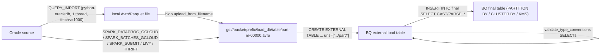

# BigQuery-First Backend Path & Integration Test Harness Audit

Branch audited: `feat/bin-files`. Research only, no source changes.

## Executive Summary

1. **CI runs no integration tests today.** [ci.yaml](../../../../.github/workflows/ci.yaml) calls [test.yaml](../../../../.github/workflows/test.yaml), and that workflow only runs `pytest tests/unit`. There is no `conftest.py` anywhere in the repo, no pytest markers, and `pytest-databases` is not in any dependency group ([pyproject.toml](../../../../pyproject.toml) `[dependency-groups].test`). `make test-integration` runs `pytest tests/integration -n 4` against whatever `offload.env` happens to resolve.
2. **The integration suite is ~146 tests in 31 test modules.** The other 12 of the 43 files are `__init__`/helper modules. Every test builds the full `OrchestrationConfig` from env vars (`ORA_CONN`, `ORA_ADM_*`, `ORA_APP_*`, `ORA_REPO_USER`, `OFFLOAD_HOME`, backend settings). About 7 modules (~12 tests) need **Oracle only**. Everything else needs **Oracle + BigQuery + GCS**, and some transport scenarios also need Spark/Dataproc.
3. **Collection fails with no environment present.** [test_orchestration_metadata.py:141](../../../../tests/integration/persistence/test_orchestration_metadata.py#L141) builds `OrchestrationConfig` inside `TestCase.__init__`, which runs at collection time. That raises `OrchestrationConfigException: Oracle connection options required` (verified with `pytest --collect-only`).
4. **Bootstrapping the Oracle schema works on Oracle Free 23ai, but the scripts are interactive SQL\*Plus.** They use `ACCEPT` prompts, a `PAUSE`, spool-generated temp scripts, and `VERSION`/`BUILD` placeholders that only `make target` substitutes. CI needs a non-interactive wrapper. The test data is self-generated (`CONNECT BY ROWNUM` from `dual`), so **the SH sample schema is not required**.
5. **BigQuery path:** the load path is `stage Avro/Parquet → GCS → CREATE EXTERNAL TABLE → validation SELECTs → INSERT…SELECT CAST(...)`. The high-value modernizations are:
   - Replace the external staging table with a native load (`LOAD DATA` or `load_table_from_uri`, which runs free on the shared slot pool) or with the Storage Write API for Query Import.
   - Remove the legacy-SQL `__PARTITIONS_SUMMARY__` queries.
   - Add job labels and `query_and_wait` for metadata and short queries.
   - Fix dry-run leakage in `_execute_query_fetch_x`.
   - Set the dataset-level default KMS key.
   - Remove `__del__`-driven client close.
6. **Coupling to the deprioritized backends lives mostly in shared config normalization and in the factories.** BigQuery itself does not depend on Snowflake, Synapse, or Hadoop code. The exceptions are `backend_table.py`, which imports `HADOOP_TYPE_STRING`, and `backend_api.py`, which defines Impala hint constants. The "keep working, no investment" scope can therefore be enforced at the factory and config layers.

---

## Part A — Integration Test Harness Audit

### A.1 Current harness facts

| Area | Finding | Evidence |
|---|---|---|
| CI | Unit tests only (py3.12/3.13/3.14 matrix), plus ruff/mypy on 3.12 | `.github/workflows/test.yaml` "Run unit tests" steps |
| Make | `test-integration: uv run pytest tests/integration -n 4` | `Makefile:99-103` |
| conftest | None in repo | `find . -name conftest.py` (excluding `.venv`) is empty |
| Fixtures | Module-local `config`/`schema`/`data_db` fixtures, copy-pasted in every scenario module | e.g. `tests/integration/scenarios/test_offload_basic.py:71-80` |
| Test user | `GOE_TEST_USER` (default `GOE_TEST`) and `GOE_TEST_USER_PASS` (default `GOE_TEST`) | `tests/integration/test_functions.py:46-56` |
| OFFLOAD_HOME | Asserted by `get_offload_home()` | `tests/integration/test_functions.py:65-68` |
| Config | `OrchestrationConfig.from_dict({"verbose": False})` with all settings from env; auto-load is skipped under pytest (`PYTEST_CURRENT_TEST`), so env must be exported | `tests/integration/test_functions.py:22-28`, AGENTS.md config notes |
| Test data | Generated in the `GOE_TEST` schema via `SELECT … FROM dual CONNECT BY ROWNUM <= n`; **no SH schema dependency** | `tests/testlib/test_framework/oracle/oracle_frontend_testing_api.py:939-948` |
| Privileged reads | Test API queries `dba_tab_privs` | `oracle_frontend_testing_api.py:1916` |
| xdist | `-n 4` in Make. Tables are named per module, but the shared `GOE_TEST` schema, metadata repo, and `$OFFLOAD_HOME/run` file locks all serialize on the same database | `test_orchestration_runner.py::test_orchestration_locks` exercises the locks explicitly |
| pytest-databases | Not a dependency | `pyproject.toml` `test` group |

### A.2 Inventory of all 43 files

Legend: **O** = Oracle frontend plus GOE repo installed. **BQ** = BigQuery (ADC). **GCS** = bucket set in `OFFLOAD_FS_CONTAINER`. **SPK** = Spark/Dataproc/Livy/Thrift. Every test file also needs `OFFLOAD_HOME` and `GOE_TEST_USER_PASS`. Counts come from `pytest --collect-only`.

| # | File | Tests | Requirements | Current status / notes |
|---|---|---|---|---|
| 1 | `tests/integration/__init__.py` | – | – | package |
| 2 | `tests/integration/test_functions.py` | helper | env `GOE_TEST_USER(_PASS)`, `OFFLOAD_HOME` | `run_setup_ddl` has MSSQL/Teradata branches (deprioritized) |
| 3 | `filesystem/__init__.py` | – | – | |
| 4 | `filesystem/test_goe_dfs.py` | 2 | O (config), GCS (ADC) | `test_all` is dry-run, but `storage.Client()` is still built and needs ADC. `test_dfs_in_execute_mode` writes and deletes real objects |
| 5 | `offload/__init__.py` | – | – | |
| 6 | `offload/test_backend_api.py` | 2 | O (config), BQ | Reuses unit `TestBackendApi`. Special-cases `DBTYPE_SPARK` |
| 7 | `offload/test_backend_table.py` | 5 | O, BQ, GCS (staging URI) | Impala-only branches skipped on BQ |
| 8 | `offload/test_data_type_controls.py` | 1 | O, BQ, GCS | Synapse branch at L154 |
| 9 | `offload/test_frontend_api.py` | 1 | **O only** | Reuses `tests.unit.offload.test_frontend_api.TestFrontendApi` |
| 10 | `offload/test_offload_source_table.py` | 1 | **O only** | Bug: `if self.config == DBTYPE_ORACLE` at L121/L128 compares a config object to a string, so it is always False (stale) |
| 11 | `offload/test_predicate_offload.py` | 2 | `_dim`: O+BQ. `_fact`: **O only** | |
| 12 | `orchestration/__init__.py` | – | – | |
| 13 | `orchestration/test_command_steps.py` | 3 | **O only** (repo) | Reuses unit test base |
| 14 | `orchestration/test_orchestration_runner.py` | 2 | O, BQ, GCS | Runs a real offload and tests concurrent locks (threads) |
| 15 | `persistence/__init__.py` | – | – | |
| 16 | `persistence/test_orchestration_metadata.py` | ~6 | **O only** (repo) | **Breaks collection without env** (config built in `__init__`, L141). Metadata fixture uses legacy `HADOOP_OWNER`/`HADOOP_TABLE` keys |
| 17 | `persistence/test_orchestration_repo_client.py` | 2 | **O only** (repo) | |
| 18 | `scenarios/__init__.py` | – | – | |
| 19 | `scenarios/assertion_functions.py` | helper | O, BQ | |
| 20 | `scenarios/scenario_constants.py` | helper | – | |
| 21 | `scenarios/scenario_runner.py` | helper | O, BQ | Imports `subproc_cmd` from backend testing API |
| 22 | `scenarios/setup_functions.py` | helper | O, BQ | |
| 23 | `scenarios/test_cli_api.py` | 4 | O, BQ, GCS | Runs `connect` and the CLI offload. Validates the new click CLI end to end |
| 24 | `scenarios/test_column_controls.py` | 6 | O, BQ, GCS | |
| 25 | `scenarios/test_ddl_file.py` | 3 | O, BQ (+GCS for the `_cloud_storage` variant) | Cloud variant skips when `OFFLOAD_FS_CONTAINER` is empty |
| 26 | `scenarios/test_identifiers.py` | 5 | O, BQ, GCS | Impala skips |
| 27 | `scenarios/test_offload_backend_part_dates.py` | 7 | O, BQ, GCS | |
| 28 | `scenarios/test_offload_basic.py` | 6 | O, BQ, GCS | Includes the `STORY_GCS_DIM` GCS log test |
| 29 | `scenarios/test_offload_data.py` | 8 | O, BQ, GCS | NaN/Teradata branches |
| 30 | `scenarios/test_offload_hash_column.py` | 1 | O, BQ, GCS | BQ skip (`CAPABILITY_BUCKET_HASH_COLUMN=False`) |
| 31 | `scenarios/test_offload_list_rpa.py` | 6 | O, BQ, GCS | |
| 32 | `scenarios/test_offload_lpa.py` | 9 | O, BQ, GCS, env `NLS_LANG` | Skips some tests when `NLS_LANG` is unset |
| 33 | `scenarios/test_offload_misc.py` | 2 | O, BQ, GCS | |
| 34 | `scenarios/test_offload_part_fn.py` | 4 | O, BQ, GCS | Creates BQ UDFs |
| 35 | `scenarios/test_offload_pbo.py` | 7 | O, BQ, GCS | |
| 36 | `scenarios/test_offload_pbo_intra.py` | 3 | O, BQ, GCS | |
| 37 | `scenarios/test_offload_pbo_late.py` | 6 | O, BQ, GCS | Teradata skips |
| 38 | `scenarios/test_offload_rpa.py` | 9 | O, BQ, GCS | |
| 39 | `scenarios/test_offload_sorting.py` | 3 | O, BQ, GCS | |
| 40 | `scenarios/test_offload_subpart.py` | 4 | O, BQ, GCS | |
| 41 | `scenarios/test_offload_transport.py` | 13 | O, BQ, GCS, **SPK** for most tests | Query Import tests run with O+BQ+GCS. Sqoop/Livy/Thrift tests are Hadoop-era |
| 42 | `scenarios/test_offload_transport_oracle_iot.py` | 13 | O (IOT tables), BQ, GCS, SPK for most tests | Dataproc and Dataproc Serverless variants need `GOOGLE_DATAPROC_*` |
| 43 | `scenarios/test_orchestration_step_control.py` | 1 | O, BQ, GCS | |

**Oracle-only subset (runs on every PR):** `offload/test_frontend_api.py`, `offload/test_offload_source_table.py`, `offload/test_predicate_offload.py::test_ida_predicate_render_to_sql_fact`, `orchestration/test_command_steps.py`, `persistence/test_orchestration_metadata.py`, `persistence/test_orchestration_repo_client.py`. That is about 14 tests. Each still needs config values that pass `normalise_*` validation (`BACKEND_DISTRIBUTION=GCP`, `QUERY_ENGINE=BIGQUERY`, `OFFLOAD_FS_SCHEME=gs`, a non-empty dummy `OFFLOAD_FS_CONTAINER`) but never opens a backend connection.

**Stale or broken items found:**

- `tests/integration/persistence/test_orchestration_metadata.py:141`: collection-time config construction aborts the whole session when the env is missing.
- `tests/integration/offload/test_offload_source_table.py:121,128`: `self.config == DBTYPE_ORACLE` should be `self.config.db_type == DBTYPE_ORACLE`.
- `tests/testlib/test_framework/test_functions.py:120-124`: `text_in_log()` calls `get_line_from_log(search_text, ...)` without the `messages` argument, so it is broken if called. The scenarios use their own version in `assertion_functions`.
- `tests/testlib/test_framework/test_functions.py:111-113`: still passes `redis_publish=False` to `goe.goe.log` (signature at `src/goe/goe.py:256`). That will go stale once the Redis removal lands (see the next-goe decisions on in-process caches).
- `tests/README.md` documents only `GOE_TEST` user creation, not the repo install.
- The testlib still carries Hadoop/Hive/Impala/Snowflake/Synapse/Teradata/MSSQL testing APIs (`tests/testlib/test_framework/{hadoop,snowflake,microsoft,teradata,spark}/`, about 7.3k LOC). They load lazily through the factories, so they cost nothing at runtime, but they are maintenance surface.

### A.3 Oracle schema bootstrap on a fresh Oracle Free DB

The install order comes from [install_offload.sql](../../../../sql/oracle/source/install_offload.sql):

1. `install_env.sql`:
   - `ACCEPT goe_db_user_prefix` (default `GOE`) and `ACCEPT goe_db_user_profile` (default `DEFAULT`).
   - Derives `GOE_ADM`, `GOE_APP`, `GOE_REPO`.
   - Runs `repo_env.sql`, which spools `sql/repo_env.tmp` and calls `install_repo_env.sql`. That script prompts for `goe_repo_tablespace` (default `USERS`) and `goe_repo_ts_quota` (default `1G`).
   - Runs `verify_env.sql`, which contains **`PAUSE`**.
2. `create_offload_users.sql`: creates `GOE_ADM` and `GOE_APP` with random passwords from `gen_passwd.sql`.
3. `create_offload_privs.sql`:
   - `GOE_APP`: `CREATE SESSION`, `SELECT ANY DICTIONARY`, `SELECT ANY TABLE`, **`FLASHBACK ANY TABLE`**.
   - `GOE_ADM`: `CREATE SESSION`, `SELECT ANY DICTIONARY`, `SELECT ANY TABLE`, `SELECT_CATALOG_ROLE`.
4. `install_offload_code.sql`: types, packages, synonyms, and grants into `GOE_ADM`.
5. `create_offload_repo.sql`: spools `sql/create_offload_repo.tmp` and calls `install_offload_repo.sql`:
   - Creates `GOE_REPO` with a quota on the tablespace.
   - Runs `create_offload_repo_100.sql`, `create_offload_repo_104.sql`, and the repo code.
6. `upgrade_goe_version.sql`: writes `&goe_version`.

**Constraints for CI:**

- **Passwords are random.** The test harness must reset them afterwards with `ALTER USER goe_adm IDENTIFIED BY …` for `goe_adm`, `goe_app`, and `goe_repo` so they match `ORA_ADM_PASS`, `ORA_APP_PASS`, and the repo password in the test env.
- **The scripts write spool files** (`sql/*.tmp`) relative to the CWD, so the directory must be writable inside the container.
- **Placeholders `VERSION`/`BUILD`** in `install_env.sql`/`upgrade_env.sql`, and `'%s-SNAPSHOT'` in the package specs, are only substituted by `make target` (`Makefile:184-185`). CI should either run the same two `sed` lines on a copy or install from `target/offload/setup`.
- **The install must run as SYS/SYSTEM against the PDB** (`FREEPDB1`) through SQL\*Plus. The gvenzl images ship SQL\*Plus inside the container.
- **The test user** must exist with quota and `CONNECT, RESOURCE` (`tests/README.md`). It also needs `SELECT` on `dba_tab_privs` (or `SELECT_CATALOG_ROLE`), because the test API reads `dba_tab_privs`.
- **`NLS_LANG=.AL32UTF8`** should be exported so the LPA tests run instead of skipping.

---

## Part B — BigQuery-First Backend & Transport Audit

### B.1 Current architecture (BigQuery path)

- **Transport selection:** `choose_offload_transport_method` (`offload_transport.py:553-598`). In AUTO mode, the GOE methods are tried first (SPARK_THRIFT, QUERY_IMPORT, LIVY, SPARK_SUBMIT), then SQOOP (rejected for non-Hadoop by `is_sqoop_available` L402), then the GCP methods (`SPARK_DATAPROC_GCLOUD`, `SPARK_BATCHES_GCLOUD`).
- **Methods that apply to BigQuery:** `QUERY_IMPORT` (`offload_transport.py:2366`), the Dataproc gcloud methods (`spark/dataproc_offload_transport.py`, which shell out to `gcloud dataproc …`), and generic Spark. SQOOP and SQOOP_BY_QUERY are Hadoop only.
- **Staging types:** decimals, dates, and timestamps are staged as **strings** in both Avro and Parquet (`avro_staging_file.py:152-180`, `parquet_staging_file.py:151-163`). The final cast happens in BigQuery SQL (`bigquery_backend_table.py:269-399`).

### B.2 Findings

Priorities: P1 = do first in the BigQuery-first track. P2 = next. P3 = opportunistic.

| # | file:line | Current | Proposed | Priority | Evidence / citation |
|---|---|---|---|---|---|
| 1 | `bigquery_backend_table.py:105-138`, `bigquery_backend_api.py:238-262` | The load step runs `CREATE EXTERNAL TABLE … OPTIONS(format, uris=['…/part*'])`. Then `validate_type_conversions` (L549-554) and the final `INSERT…SELECT` each **re-scan GCS through the external table** | Load the staged files into a **native** load table with `LOAD DATA INTO … FROM FILES(...)` (SQL) or `client.load_table_from_uri(...)` (with `LoadJobConfig(source_format, write_disposition=WRITE_TRUNCATE, destination_encryption_configuration=kms)`). Validation and the final INSERT then read native columnar storage. The external table is kept as a fallback option | P1 | Batch load jobs use the free shared slot pool, while querying external tables bills bytes read under on-demand (<https://cloud.google.com/bigquery/pricing#data_ingestion_pricing>, <https://cloud.google.com/bigquery/docs/external-data-cloud-storage>). `LOAD DATA` is documented at <https://cloud.google.com/bigquery/docs/reference/standard-sql/load-statements> |
| 2 | `bigquery_backend_api.py:1510-1532` | `get_table_partition_count`/`get_table_partitions` use **legacy SQL** `[$__PARTITIONS_SUMMARY__]` with `use_legacy_sql=True`. The code itself carries a TODO saying INFORMATION_SCHEMA works | Use GoogleSQL `SELECT partition_id FROM \`proj.ds\`.INFORMATION_SCHEMA.PARTITIONS WHERE table_name=@t AND partition_id NOT IN ('__NULL__','__UNPARTITIONED__')`. Then remove the legacy branch in `_default_job_config` (L284-286) | P1 | Legacy SQL meta-tables are legacy-only. See <https://cloud.google.com/bigquery/docs/information-schema-partitions> |
| 3 | `bigquery_backend_api.py:358-433` | `_execute_query_fetch_x` **always** submits the query, even when `self._dry_run` is set. It is gated only by `not_when_dry_running` | Respect `self._dry_run` the way `_execute_ddl_or_dml` (L315) does. For read-only metadata queries, document that execution in dry-run is intentional. Optionally use `QueryJobConfig(dry_run=True)` for cost preview | P1 | Code inspection |
| 4 | `bigquery_backend_api.py:316-321, 392-410` | `client.query()` + `job.result()` for every statement, including tiny metadata queries (`SESSION_USER()`, INFORMATION_SCHEMA lookups) | Use `client.query_and_wait()` (jobs.query fast path; `google-cloud-bigquery` ≥3.15, and the lock has 3.44.0) for SELECT/metadata, optionally with `job_creation_mode=JOB_CREATION_OPTIONAL` (short-query optimized mode). Keep `query()` where `job_id`, profile stats, or KMS verification of the job are needed (DML/DDL with `profile=True`) | P2 | <https://cloud.google.com/python/docs/reference/bigquery/latest/google.cloud.bigquery.client.Client#google_cloud_bigquery_client_Client_query_and_wait>, <https://cloud.google.com/bigquery/docs/running-queries#optional-job-creation> |
| 5 | `bigquery_backend_api.py:282-287, 441-446` | No **job labels**, no `client_info` user agent. The billing project is implicit through ADC (`bigquery.Client(location=…)` without `project=`) | Add `labels={"goe_command": …, "goe_execution_id": …, "goe_version": …}` to the default `QueryJobConfig`/`LoadJobConfig`. Pass `client_info=ClientInfo(user_agent="goe/<ver>")`. Add an optional `BIGQUERY_BILLING_PROJECT` (separate from `BIGQUERY_DATASET_PROJECT`, which only affects table references) | P2 | <https://cloud.google.com/bigquery/docs/adding-labels#job-label> |
| 6 | `bigquery_backend_api.py:337-348` | Global session params are restricted to an allow-list of `maximum_bytes_billed`, `use_query_cache` | Extend the allow-list with `labels`, `priority`, `job_timeout_ms`, and `reservation` (if available in the lib version) | P3 | Code inspection |
| 7 | `bigquery_backend_api.py:828-856` | `CREATE SCHEMA` sets `description`/`location` only. CMEK is applied per table via the `OPTIONS(kms_key_name)` clause (L264-280) and per job (L180-188) | Also set `default_kms_key_name` on datasets GOE creates (load and final datasets). Staging and temporary objects are then CMEK-covered by default. Optionally add `default_table_expiration_ms` on the **load** dataset as a safety net for orphaned staging tables | P2 | <https://cloud.google.com/bigquery/docs/customer-managed-encryption#dataset_default_key>, <https://cloud.google.com/bigquery/docs/reference/standard-sql/data-definition-language#schema_option_list> |
| 8 | `bigquery_backend_api.py:173-174` | `__del__` calls `self.close()`, which closes `self._client` during GC, including on partially constructed objects | Make the API a context manager or close it explicitly from the orchestration lifecycle. Drop `__del__` | P2 | Code inspection. `__del__` runs at interpreter shutdown, when transport may already be torn down |
| 9 | `bigquery_backend_api.py:316-323, 399-401` | `if query_job.state != "DONE": raise …` after `result()`. `result()` already raises on failure | Rely on `result()`/`query_and_wait`. Pass `job_retry`/`retry` explicitly (lib defaults `DEFAULT_JOB_RETRY`) and set a `timeout` for long DDL | P3 | <https://cloud.google.com/python/docs/reference/bigquery/latest/google.cloud.bigquery.retry> |
| 10 | `offload_transport.py:2366-2508` | **Query Import** goes Oracle cursor → local file → GCS upload → external table → INSERT. It is single-threaded with `fetch_size ≤ 1000` (L2388-2390) and shells out `rm -f` (L2479) | BigQuery-first option: stream Arrow batches from python-oracledb (`fetch_df_batches`/Arrow in oracledb ≥3, lock pins 4.0.2) **directly** into a load table through the **Storage Write API** (`AppendRowsRequest.arrow_rows`, `COMMITTED`/`PENDING` stream). This removes the local file, the GCS round trip, and the external table for small tables. Short of that, at minimum use `os.remove` and raise the fetch-size cap | P2 | <https://cloud.google.com/bigquery/docs/write-api>. Requires adding `google-cloud-bigquery-storage` (not currently a dependency; grep confirms) |
| 11 | `avro_staging_file.py:152-180`, `parquet_staging_file.py:151-163`, `bigquery_backend_table.py:269-399` | DECIMAL, DATE, and TIMESTAMP are staged as strings and converted with `CAST`/`PARSE_*`. That is correct for Oracle `NUMBER` without a declared precision, but it costs CPU and bytes | For Parquet staging with known `NUMBER(p,s)` where p ≤ 38/76: write Parquet DECIMAL and load with `decimal_target_types=['NUMERIC','BIGNUMERIC','STRING']`. For Avro, use `enable_logical_types` / `use_avro_logical_types`. Keep string staging for unbounded NUMBER and TZ timestamps. Default `OFFLOAD_STAGING_FORMAT` to `PARQUET` for BigQuery (template currently has `AVRO`) | P3 | <https://cloud.google.com/bigquery/docs/loading-data-cloud-storage-parquet#decimal_target_types>, <https://cloud.google.com/bigquery/docs/loading-data-cloud-storage-avro#logical_types> |
| 16 | `goe_gcs.py:68, 97-111, 137-184` | `storage.Client()` (ADC). Uploads use `upload_from_filename` with default chunking. `delete` lists blobs and deletes them one by one with exists checks plus a post-delete wait-and-retry loop | Use `bucket.delete_blobs(...)` or the transfer manager for bulk delete and upload (`google.cloud.storage.transfer_manager`). Drop the redundant `blob.exists()` round trips, which GCS strong consistency no longer needs. Pass `if_generation_match=0` for no-overwrite semantics instead of `exists()`+upload (TOCTOU) | P2 | <https://cloud.google.com/storage/docs/consistency>, <https://cloud.google.com/python/docs/reference/storage/latest/google.cloud.storage.transfer_manager> |
| 17 | `offload_transport.py:575-595` | AUTO rule order: GOE methods → SQOOP methods → GCP methods. On `BACKEND_DISTRIBUTION=GCP`, every large-table offload pays for failed SPARK_THRIFT/LIVY/SPARK_SUBMIT/SQOOP validations before reaching Dataproc | For `BACKEND_DISTRO_GCP`, order rules as QUERY_IMPORT (small) → GCP methods → generic Spark, and never evaluate Sqoop | P2 | Code inspection |
| 19 | `bigquery_backend_api.py:148-149` + template | `BIGQUERY_DATASET_LOCATION` blank means the BigQuery default (US). The bucket and dataset must be co-located | Validate co-location at `connect` time: compare bucket `location` with dataset location. Cross-region loads fail or incur egress | P2 | <https://cloud.google.com/bigquery/docs/batch-loading-data#data-locations> |

---

## Deprioritized Backend Coupling Map ("keep working, no investment")

| Coupling point | File | Nature | Impact on BigQuery-first work | Containment |
|---|---|---|---|---|
| Backend factory | `src/goe/offload/factory/backend_api_factory.py:38-105`, `backend_table_factory.py` | Lazy `if backend_type == …` imports per backend | None; lazy | Keep. Add no new branches |
| Abstract interfaces | `src/goe/offload/backend_api.py` (`BackendApiInterface`, ~1.8k LOC), `backend_table.py` (`BackendTableInterface`, ~2.2k LOC) | Any new abstract method forces implementations in Hive/Impala/Spark/Snowflake/Synapse | **High**: adding e.g. `load_from_uri()` as abstract breaks five backends | Add new BigQuery capabilities as **non-abstract** methods with `NotImplementedError` defaults, gated by a new capability flag in `offload_constants.py` (`CAPABILITY_*` dicts L369+) |
| Capability matrices | `src/goe/offload/offload_constants.py` (`*_BACKEND_CAPABILITIES`) | New capability keys must be added to every dict or lookups KeyError | Medium | Default new capabilities to `False` through `.get()` in the accessor, or add the key to all dicts in one commit |
| Shared Hadoop type | `backend_table.py:36` (`HADOOP_TYPE_STRING`) | Import-time coupling | Low | Move the constant into `column_metadata.py` |
| Config normalization | `src/goe/config/config_validation_functions.py:82-86, 124-143, 153-181, 414-460`; `orchestration_config.py` (~109 backend refs, e.g. L769) | All backends' options are parsed and validated in one pass | Medium: config tests touch every backend | Keep. Add BigQuery options (billing project, labels, load mode) in `normalise_bigquery_options` only |
| Transport rules | `src/goe/offload/offload_transport.py:95-145, 393-488, 553-598` | Sqoop/Thrift/Livy validation in the AUTO path; Synapse branch at L1093 | Medium (finding B.2 #17) | GCP-specific rule order behind `backend_distribution == GCP` |
| Staging file factory | `src/goe/offload/factory/staging_file_factory.py` | Avro/Parquet shared by all backends | Changes to decimal staging (B.2 #11) affect Snowflake/Synapse/Hadoop | Make the new typed-decimal staging opt-in per backend capability |
| Filesystem | `src/goe/filesystem/goe_dfs_factory.py`, `goe_s3.py`, `goe_azure.py`, `web_hdfs.py`, `cli_hdfs.py` | Selected by `OFFLOAD_FS_SCHEME` | None for GCS work | Keep untouched |
| Hadoop utilities | `src/goe/util/{better_impyla,hive_table_stats,hs2_connection}.py` | Hadoop-only | None | Optional deps (`[hadoop]` extra) |
| Connect | `src/goe/connect/connect_backend.py` (22 refs) | Per-backend health checks | Low | Add only the BigQuery co-location check (B.2 #19) |
| Testlib | `tests/testlib/test_framework/{hadoop,snowflake,microsoft,teradata,spark}` (~7.3k LOC) | Factory-loaded | None at runtime | Exclude from CI. Keep in tree |
| Optional deps | `pyproject.toml` `[project.optional-dependencies]` `hadoop`, `snowflake`, `synapse`, `teradata`, `sql_server` | Not installed by default (`uv sync --dev` without extras) | Good isolation already | Note that `azure-storage-blob`/`boto3` remain **core** deps and could move to extras later |

---

## Part C — Verified External Facts (spec review 2026-10-10T18:35:00Z)

These facts supersede conflicting statements in Parts A/B and drive `plan_revision: 2`.

| # | Fact | Source |
|---|---|---|
| C1 | `google-cloud-bigquery` locked `3.44.0` (`uv.lock:1346-1347`; PyPI latest `3.46.1`). `Client.query_and_wait(query, *, job_config, location, project, api_timeout, wait_timeout, retry, job_retry, page_size, max_results, query_results_format, compression_codec) -> RowIterator`, added in `3.14.0`; merges `default_query_job_config`. | https://cloud.google.com/python/docs/reference/bigquery/latest/google.cloud.bigquery.client.Client ; https://github.com/googleapis/python-bigquery/releases/tag/v3.14.0 ; local `inspect.signature` on 3.44.0 |
| C2 | `Client(project, credentials, _http, location, default_query_job_config, default_load_job_config, client_info: google.api_core.client_info.ClientInfo, client_options, default_job_creation_mode)`. | same as C1 |
| C3 | `LoadJobConfig` exposes `source_format`, `write_disposition`, `decimal_target_types`, `destination_encryption_configuration`, `labels`, `schema`, `parquet_options`; `DecimalTargetType.{NUMERIC,BIGNUMERIC,STRING}`. | https://cloud.google.com/python/docs/reference/bigquery/latest/google.cloud.bigquery.job.LoadJobConfig |
| C4 | Python `Dataset` has `default_encryption_configuration` (no `default_kms_key_name` attribute); DDL `CREATE SCHEMA ... OPTIONS(default_kms_key_name=...)` is the SQL equivalent GOE uses. | https://cloud.google.com/python/docs/reference/bigquery/latest/google.cloud.bigquery.dataset.Dataset ; https://cloud.google.com/bigquery/docs/reference/standard-sql/data-definition-language#schema_option_list |
| C5 | Labels: keys/values lowercase letters, digits, `_`, `-`; max 63 chars; Storage Write API ingestion cannot carry labels. | https://cloud.google.com/bigquery/docs/labels-intro |
| C6 | `INFORMATION_SCHEMA.PARTITIONS` is Preview, needs a dataset qualifier, `partition_id` is NULL for unpartitioned tables, `__UNPARTITIONED__` can appear twice (storage tiers). | https://cloud.google.com/bigquery/docs/information-schema-partitions |
| C7 | `google-cloud-storage` locked `3.13.1`; `transfer_manager` public functions are upload/download only (no delete); `Bucket.delete_blobs` deletes per blob (not a batch) with `on_error` for NotFound; `ifGenerationMatch=0` returns HTTP 412 (`PreconditionFailed`) when a live object exists. | https://cloud.google.com/python/docs/reference/storage/latest/google.cloud.storage.transfer_manager ; https://cloud.google.com/python/docs/reference/storage/latest/google.cloud.storage.bucket.Bucket ; https://cloud.google.com/storage/docs/request-preconditions |
| C8 | `google-cloud-bigquery-storage` is only the `bqstorage` extra of `google-cloud-bigquery`, not a GOE dependency. | https://pypi.org/pypi/google-cloud-bigquery/json |
| C9 | `goccy/bigquery-emulator` (`ghcr.io/goccy/bigquery-emulator`, v0.8.1, beta): supports GoogleSQL queries and load jobs from GCS; does **not** implement external tables or copy jobs; no `--gcs-endpoint` flag; `INFORMATION_SCHEMA.PARTITIONS`, `dry_run` and Parquet load support unverified. | https://github.com/goccy/bigquery-emulator (README, `docs/feature-support.md`, `cmd/bigquery-emulator/main.go`) |
| C10 | `pytest-databases` provides `pytest_databases.docker.bigquery` (emulator image above) and no GCS / `fake-gcs-server` fixture. | https://github.com/litestar-org/pytest-databases/tree/main/src/pytest_databases/docker |
| C11 | `CAPABILITY_STAGING_FILE_FORMATS` does not exist; the staging default is `orchestration_defaults.offload_staging_format_default` (`L683-691`) and the template value. `BackendApiInterface.__del__` (`backend_api.py:229-230`) also calls `close()`. | repository @ `46890a8` |
