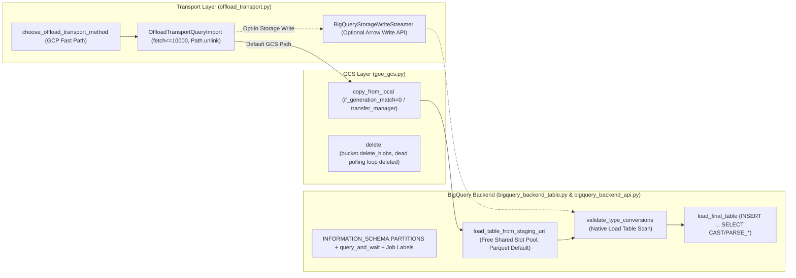

# BigQuery-First Backend & Transport Modernization

## Specification

## Problem & Goal

Google BigQuery and Google Cloud Storage (GCS) are the primary backend target for `next-goe`, while Snowflake, Azure Synapse, Teradata, and Hadoop/Impala/Hive are deprioritized under a strict "keep working, no investment" policy. Several high-value bottlenecks, legacy SQL constructs, and lifecycle defects currently degrade the BigQuery backend and transport paths:

1. **Legacy SQL & Dry-Run Correctness Defects (`BackendBigQueryApi`):**
   - `get_table_partition_count` ([`bigquery_backend_api.py:1510-1520`](file:///usr/local/google/home/codyfincher/code/gluent/next-goe/src/goe/offload/bigquery/bigquery_backend_api.py#L1510-L1520)) and `get_table_partitions` ([`bigquery_backend_api.py:1522-1532`](file:///usr/local/google/home/codyfincher/code/gluent/next-goe/src/goe/offload/bigquery/bigquery_backend_api.py#L1522-L1532)) still execute Legacy SQL (`SELECT ... FROM [%s$__PARTITIONS_SUMMARY__]`) with `query_options={"use_legacy_sql": True}`, requiring a Legacy SQL branch in `_default_job_config` ([`bigquery_backend_api.py:282-287`](file:///usr/local/google/home/codyfincher/code/gluent/next-goe/src/goe/offload/bigquery/bigquery_backend_api.py#L282-L287)).
   - `_execute_query_fetch_x` ([`bigquery_backend_api.py:358-433`](file:///usr/local/google/home/codyfincher/code/gluent/next-goe/src/goe/offload/bigquery/bigquery_backend_api.py#L358-L433)) only skips execution when `not_when_dry_running=True` is explicitly passed (`L383-L384`). Read-only metadata queries intentionally run during dry-run to inspect backend schemas, but mutating or cost-preview queries lack an explicit `dry_run_preview` contract and explicit read-only classification.
   - `BackendBigQueryApi.__del__` ([`bigquery_backend_api.py:173-174`](file:///usr/local/google/home/codyfincher/code/gluent/next-goe/src/goe/offload/bigquery/bigquery_backend_api.py#L173-L174), with `close()` at [`L813-L815`](file:///usr/local/google/home/codyfincher/code/gluent/next-goe/src/goe/offload/bigquery/bigquery_backend_api.py#L813-L815) and helper boundaries around [`L226-L229`](file:///usr/local/google/home/codyfincher/code/gluent/next-goe/src/goe/offload/bigquery/bigquery_backend_api.py#L226-L229)) invokes `self.close()` during garbage collection, which can fail on partially initialized instances (`AttributeError` on `self._client`) or during interpreter shutdown when underlying HTTP transports are already torn down.
2. **External Table Double-Scan Overhead & Avro-Default Staging (`BackendBigQueryTable`):**
   - `_create_load_table` ([`bigquery_backend_table.py:105-138`](file:///usr/local/google/home/codyfincher/code/gluent/next-goe/src/goe/offload/bigquery/bigquery_backend_table.py#L105-L138)) creates an external table (`CREATE EXTERNAL TABLE ... OPTIONS(format=..., uris=['gs://.../part*'])`), causing `validate_type_conversions` ([`L549-L554`](file:///usr/local/google/home/codyfincher/code/gluent/next-goe/src/goe/offload/bigquery/bigquery_backend_table.py#L549-L554)) and `load_final_table` ([`L456-L473`](file:///usr/local/google/home/codyfincher/code/gluent/next-goe/src/goe/offload/bigquery/bigquery_backend_table.py#L456-L473)) to repeatedly scan raw GCS files and incur on-demand external query bytes instead of using BigQuery's free shared batch-load slot pool (`load_table_from_uri` / `LOAD DATA`).
   - BigQuery staging still defaults to Avro unless overridden, and Parquet `DECIMAL` columns with known precision/scale (`p <= 38` for `NUMERIC`, `p <= 76` for `BIGNUMERIC`) are not mapped with `decimal_target_types=["NUMERIC", "BIGNUMERIC", "STRING"]`.
3. **SDK Modernization, CMEK Defaults, & GCS Transfer Manager (`BackendBigQueryApi` & `GOEGcs`):**
   - Metadata and short `SELECT` queries use two-step `client.query()` + `query_job.result()` ([`bigquery_backend_api.py:392-410`](file:///usr/local/google/home/codyfincher/code/gluent/next-goe/src/goe/offload/bigquery/bigquery_backend_api.py#L392-L410)) instead of `client.query_and_wait()`, and jobs lack attribution labels (`goe_command`, `goe_execution_id`, `goe_version`), `ClientInfo(user_agent=...)`, and optional `BIGQUERY_BILLING_PROJECT`.
   - `create_database` ([`bigquery_backend_api.py:828-856`](file:///usr/local/google/home/codyfincher/code/gluent/next-goe/src/goe/offload/bigquery/bigquery_backend_api.py#L828-L856)) does not propagate `default_kms_key_name` when `bigquery_kms_key_name()` is configured, nor `default_table_expiration_ms` on staging/load datasets.
   - `GOEGcs` ([`goe_gcs.py:97-111`](file:///usr/local/google/home/codyfincher/code/gluent/next-goe/src/goe/filesystem/goe_gcs.py#L97-L111), [`L129-184`](file:///usr/local/google/home/codyfincher/code/gluent/next-goe/src/goe/filesystem/goe_gcs.py#L129-L184)) performs TOCTOU `exists()` checks before uploads (`if_generation_match=0` should be used when `overwrite=False`) and deletes blobs one-by-one followed by a polling retry loop that GCS's strong global consistency makes redundant.
4. **GCP Transport Selection Order & Query Import Modernization (`offload_transport.py`):**
   - `choose_offload_transport_method` ([`offload_transport.py:553-598`](file:///usr/local/google/home/codyfincher/code/gluent/next-goe/src/goe/offload/offload_transport.py#L553-L598)) evaluates `SPARK_THRIFT`, `SPARK_LIVY`, `SPARK_SUBMIT`, `SQOOP`, and `SQOOP_BY_QUERY` on `BACKEND_DISTRO_GCP` before checking `SPARK_DATAPROC_GCLOUD` and `SPARK_BATCHES_GCLOUD`.
   - `OffloadTransportQueryImport` ([`offload_transport.py:2366-2508`](file:///usr/local/google/home/codyfincher/code/gluent/next-goe/src/goe/offload/offload_transport.py#L2366-L2508)) caps `fetch_size` at `1000` (`L2389-2390`), shells out to `rm -f` via `_run_os_cmd` (`L2479`) instead of `os.remove` / `Path.unlink`, and lacks an optional direct Arrow -> BigQuery Storage Write API fast path.

## Zero Feature Loss & Aggressive Dead-Code Removal Policy

1. **Mandatory Dead-Code Deletion:**
   - Delete `BackendBigQueryApi.__del__` (`src/goe/offload/bigquery/bigquery_backend_api.py:173-174`) outright; do not leave commented-out or no-op finalizer stubs.
   - Delete the Legacy SQL `[$__PARTITIONS_SUMMARY__]` queries (`bigquery_backend_api.py:1510-1532`) and delete the `use_legacy_sql` parameter branch in `_default_job_config` (`bigquery_backend_api.py:282-287`).
   - Delete the sequential single-blob `blob_to_check.delete()` loop and the 3-attempt `time.sleep(1)` + `blob_to_check.exists()` post-delete polling loop in `GOEGcs.delete` (`src/goe/filesystem/goe_gcs.py:145-182`), as well as the pre-upload `self.stat(gcs_path)` TOCTOU check in `copy_from_local` (`L97-111`) and `write` (`L275-296`).
   - Delete the subprocess `self._run_os_cmd(["rm", "-f", local_data_path], optional=True)` call in `OffloadTransportQueryImport._query_import_copy_to_dfs` (`src/goe/offload/offload_transport.py:2479`).
2. **100% Feature Preservation:**
   - Preserve all CMEK/KMS encryption features across datasets (`default_kms_key_name`), tables (`OPTIONS(kms_key_name=...)`), query jobs (`DestinationEncryptionConfiguration`), load jobs (`destination_encryption_configuration`), and `_check_bqm_job_encryption`.
   - Preserve external-table load and `_staging_to_backend_cast` (`CAST` / `PARSE_DATE` / `PARSE_DATETIME` / `PARSE_TIMESTAMP`) fallback semantics so both native load tables and external load tables execute identical downstream validation and final-table `INSERT ... SELECT` casts.
   - Preserve date/timestamp (`DAY`/`MONTH`/`YEAR` via `*_TRUNC`) and integer range (`RANGE_BUCKET`) partitioning, synthetic partition columns, clustering (`CLUSTER BY` up to 4 sort columns and `alter_sort_columns`), `NUMERIC(38,9)` and `BIGNUMERIC` precision/scale handling, UDF introspection, and dry-run SQL logging.

## Scope & Containment Rules

### In Scope
- **`BackendBigQueryApi` (`src/goe/offload/bigquery/bigquery_backend_api.py`):**
  - Replace Legacy SQL `$__PARTITIONS_SUMMARY__` queries in `get_table_partition_count` and `get_table_partitions` with parameterized GoogleSQL `INFORMATION_SCHEMA.PARTITIONS` queries (`ScalarQueryParameter("table_name", "STRING", table_name)`), excluding `'__NULL__'` and `'__UNPARTITIONED__'`, and delete the `use_legacy_sql` branch from `_default_job_config`.
  - Fix dry-run handling in `_execute_query_fetch_x` with explicit `not_when_dry_running` vs `dry_run_preview` semantics (`QueryJobConfig(dry_run=True)`), ensuring non-metadata queries never execute when `self._dry_run=True`.
  - Delete `BackendBigQueryApi.__del__` and implement explicit context-manager (`__enter__`, `__exit__`) and idempotent `close()` lifecycle semantics.
  - Add native batch-load helper `load_table_from_staging_uri` using `client.load_table_from_uri(..., job_config=bigquery.LoadJobConfig(...))` with `WriteDisposition.WRITE_TRUNCATE`, `DestinationEncryptionConfiguration`, and `decimal_target_types=["NUMERIC", "BIGNUMERIC", "STRING"]` for Parquet.
  - Adopt `client.query_and_wait()` for short/metadata queries (`not profile`), inject `ClientInfo(user_agent=f"goe/{goe_version}")`, support `BIGQUERY_BILLING_PROJECT`, attach sanitized job labels (`goe_command`, `goe_execution_id`, `goe_version`), and extend `_execute_global_session_parameters` allow-list (`labels`, `priority`, `job_timeout_ms`, `reservation`).
  - Set `default_kms_key_name` and optional load-dataset `default_table_expiration_ms` in `create_database`.
- **`BackendBigQueryTable` (`src/goe/offload/bigquery/bigquery_backend_table.py`):**
  - Default staging file format for BigQuery to `FILE_STORAGE_FORMAT_PARQUET` while preserving explicit `OFFLOAD_STAGING_FORMAT=AVRO` compatibility.
  - Support native load jobs in `_create_load_table` / `post_transport_tasks` (preserving all-STRING schema expectations for string-staged columns so `validate_type_conversions` and `_staging_to_backend_cast` SQL remain 100% compatible, with external table mode retained as an explicit fallback).
- **`GOEGcs` (`src/goe/filesystem/goe_gcs.py`):**
  - Use `if_generation_match=0` when `overwrite=False` in `copy_from_local` / `write` instead of a pre-upload `exists()` RPC.
  - Use `bucket.delete_blobs(...)` / `google.cloud.storage.transfer_manager` for batch operations and delete the single-blob delete loop and post-delete `exists()` polling loop in `delete()`.
- **`OffloadTransport` (`src/goe/offload/offload_transport.py`) & Optional Storage Write Module (`src/goe/offload/bigquery/bigquery_storage_write.py`):**
  - Reorder `choose_offload_transport_method` when `config.backend_distribution == BACKEND_DISTRO_GCP` to evaluate `QUERY_IMPORT` -> `SPARK_DATAPROC_GCLOUD` -> `SPARK_BATCHES_GCLOUD` -> `SPARK_SUBMIT`, bypassing Sqoop/Livy/Thrift checks completely.
  - In `OffloadTransportQueryImport`, replace shell `rm -f` with `Path.unlink(missing_ok=True)`, raise the `fetch_size` cap from `1000` to `10000` for BigQuery targets, and provide an optional capability-gated `BigQueryStorageWriteStreamer` (`src/goe/offload/bigquery/bigquery_storage_write.py`) that streams Arrow batches via `google.cloud.bigquery_storage_v1` when installed and falls back cleanly to GCS staging when `google-cloud-bigquery-storage` is not installed.

### Out of Scope & Deprioritized Backend Containment
- **Zero modifications** to `src/goe/offload/snowflake/`, `src/goe/offload/microsoft/`, `src/goe/offload/hadoop/`, or `src/goe/offload/teradata/`.
- **No new `@abstractmethod` signatures** on `BackendApiInterface` (`src/goe/offload/backend_api.py`) or `BackendTableInterface` (`src/goe/offload/backend_table.py`). Any new capability method on base classes must provide a concrete default raising `NotImplementedError` and be gated by a capability key in `offload_constants.py` (accessed via `.get(capability, False)`).

## Architecture & Component Map



## Implementation Plan

- [ ] 1.1 Delete Legacy SQL `$__PARTITIONS_SUMMARY__` and `use_legacy_sql` plumbing in favor of GoogleSQL `INFORMATION_SCHEMA.PARTITIONS`, fix `_execute_query_fetch_x` dry-run semantics, and delete `__del__` in favor of context-manager lifecycle in `BackendBigQueryApi`
- [ ] 1.2 Adopt Parquet-default staging and native BigQuery load jobs (`load_table_from_uri`) in `BackendBigQueryTable` with external-table fallback and zero feature loss
- [ ] 1.3 Add `query_and_wait()`, job attribution labels, `ClientInfo`, `BIGQUERY_BILLING_PROJECT`, dataset `default_kms_key_name`, and `GOEGcs` bulk delete / `if_generation_match` optimizations (deleting legacy single-blob polling loops)
- [ ] 1.4 Optimize GCP `choose_offload_transport_method` ordering, modernize `OffloadTransportQueryImport` (`Path.unlink`, `10000` fetch size), and add optional `BigQueryStorageWriteStreamer`

## Verification Commands

```bash
export GOOGLE_API_USE_CLIENT_CERTIFICATE=false
uv run pytest tests/unit/offload/bigquery/ tests/unit/filesystem/test_goe_gcs_transfer_manager.py -q
uv run pytest tests/unit/offload/test_backend_api.py tests/unit/offload/test_backend_table.py tests/unit/offload/test_offload_transport.py -q
uv run ruff check src/goe/offload/bigquery/ src/goe/filesystem/goe_gcs.py src/goe/offload/offload_transport.py tests/unit/offload/bigquery/ tests/unit/filesystem/test_goe_gcs_transfer_manager.py
uv run mypy src/goe/offload/bigquery/ src/goe/filesystem/goe_gcs.py src/goe/offload/offload_transport.py
```

## Continuity Snapshot

- **Current State:** `planned` (Revision 1).
- **Task Sequence:** `1.1` -> `1.2` -> `1.3` -> `1.4`.
- **Key Invariants:**
  - All new capabilities on `BackendApiInterface` / `BackendTableInterface` are concrete methods gated by `CAPABILITY_*` constants in `offload_constants.py` so Snowflake, Synapse, Hadoop, and Teradata require zero edits.
  - Native load jobs create staging tables whose string-staged columns remain `STRING` in the load table schema so `validate_type_conversions` and `_staging_to_backend_cast` SQL run unmodified.
  - All replaced Legacy SQL, `__del__`, and GCS single-blob polling loops are deleted cleanly without leaving dead code behind.
