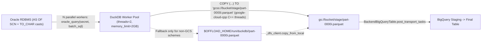

# Opt-In DuckDB + `duckdb-oracle` + `duckdb-gcs` Offload Transport

## Specification

## Problem & Goal

GOE's existing small-table transport (`OffloadTransportQueryImport` at [`src/goe/offload/offload_transport.py:2366-2512`](file:///usr/local/google/home/codyfincher/code/gluent/next-goe/src/goe/offload/offload_transport.py#L2366-L2512)) extracts rows from Oracle using a single Python thread (`offload_transport_parallelism = 1` at `L2388`), ignores `--offload-transport-consistent-read` (`L2421-L2425`), and encodes rows one-by-one in Python into a local file before uploading to GCS. Conversely, large-table offloads require external Apache Spark / Cloud Dataproc infrastructure.

GOE already locks `duckdb==1.5.5` transitively (`pyproject.toml:35`, `uv.lock:886-887`), which matches the exact DuckDB binary version targeted by `cofin/duckdb-oracle` (`v0.2.2`) and the community `northpolesec/duckdb-gcs` extension (`v0.0.8`). By combining:
1. GOE's existing Oracle split planning (`_get_transport_split_type`, `_get_transport_row_source_query` with `AS OF SCN`),
2. Oracle-side `TO_CHAR` projection expressions (`_build_offload_query_lists(convert_expressions_on_rdbms_side=True, for_qi=True)`),
3. DuckDB's `oracle_query('<secret>', '<sql>')` passthrough, and
4. The high-performance community **`gcs` DuckDB extension (`northpolesec/duckdb-gcs`)** powered by `google-cloud-cpp` native C++ storage threads (`COPY (...) TO 'gcss://<bucket>/<staging_prefix>/part-0000N.parquet' (FORMAT PARQUET, COMPRESSION SNAPPY)`),

GOE can stream split Oracle batches in parallel directly from OCI through DuckDB's C++ worker threads into GCS Parquet objects without serializing under the Python GIL or staging Parquet files to local disk first.

### Upstream Prerequisite Gate (Phase 0 — `cofin/duckdb-oracle`)

Before enabling `DUCKDB` transport on workloads requiring long single-fetch waits, SEPS wallets, or >64 KiB LOBs, the upstream `cofin/duckdb-oracle` extension provides:
- **U1 (`oracle_call_timeout_ms`):** Configurable `UBIGINT` setting (default `30000`, `0` disables) replacing the hardcoded 30s `OCI_ATTR_CALL_TIMEOUT` in `oracle_scan.cpp` and `oracle_connection_manager.cpp`.
- **U2 (`oracle_session_init_sql`):** Configurable `VARCHAR` setting (`;`-separated SQL statements executed per pooled OCI session after NLS initialization) so GOE can set `TIME_ZONE='UTC'`, NLS formats, `DBMS_APPLICATION_INFO.SET_MODULE`, and `TRACEFILE_IDENTIFIER`.
- **U3 (`EXTERNAL true` Secret Mode):** Support `OCI_CRED_EXT` in `CREATE SECRET ... (TYPE oracle, EXTERNAL true, ...)` for Oracle SEPS wallet authentication.
- **U4 (>64 KiB LOB Read Support):** Piecewise or LOB-locator fetch in `oracle_scan.cpp` lifting the 65,535-byte (`ub2`) per-value buffer ceiling, or raising an explicit column-named error instead of truncating.
- **U5 (Apache-2.0 License & Checksums):** Align `LICENSE` with `description.yml` (`Apache-2.0`) and publish SHA-256 checksums for release binaries.

The GOE transport implementation (`OffloadTransportDuckDB` and `is_duckdb_available()`) enforces these prerequisites dynamically via runtime capability probes (`duckdb_settings()`) so any missing upstream capability cleanly causes `is_duckdb_available()` to return `False` (with a `VVERBOSE` diagnostic log).

## Native DuckDB Community `gcs` Extension Architecture (`northpolesec/duckdb-gcs`)

1. **Extension Loading (`LOAD gcs` Fast Path + Thread-Locked `INSTALL gcs FROM community` Fallback):**
   - Configure `extension_directory` when `OFFLOAD_TRANSPORT_DUCKDB_EXTENSION_DIR` is set.
   - Try `connection.execute("LOAD gcs")` first (zero network call when pre-seeded in `OFFLOAD_TRANSPORT_DUCKDB_EXTENSION_DIR` or `~/.duckdb/extensions`).
   - If `LOAD gcs` raises, acquire the module-level thread lock (`_gcs_setup_lock`) and execute `connection.execute("INSTALL gcs FROM community")` followed by `connection.execute("LOAD gcs")`.
2. **Performance Pragmas:**
   Immediately after loading `gcs`, apply:
   ```sql
   SET gcs_enable_metadata_cache = true;
   SET gcs_metadata_cache_ttl = 3600;
   SET gcs_list_cache_ttl = 3600;
   SET gcs_transfer_concurrency = <threads>;
   ```
3. **`gcss://` URI Scheme (`to_duckdb_gcs_uri`):**
   - Built-in `httpfs` claims `gs://` and `gcs://` (which require S3 XML HMAC keys and fail with ADC).
   - The community `gcs` extension registers the **`gcss://`** scheme (`gcss://<bucket>/<staging_prefix>/part-0000N.parquet`).
   - Convert `gs://` and `gcs://` staging URIs to `gcss://` when executing `COPY (...) TO 'gcss://<bucket>/<staging_prefix>/part-{i:05d}.parquet' (FORMAT PARQUET, COMPRESSION SNAPPY)` so Parquet parts stream directly from DuckDB C++ threads to GCS.
   - Retain local `temp_directory` + `self._dfs_client.copy_from_local` strictly as a fallback for non-GCS staging backends (Azure, S3, HDFS, local).
4. **Dual-Mode ADC Secret Provisioning (`PROVIDER credential_chain` vs `PROVIDER access_token`):**
   - Resolve credentials via `resolve_gcp_credentials(self._orchestration_config)` (`src/goe/util/gcp_credentials.py` from Chapter 1.2, falling back to `google.auth.default()` if `src/goe/util/gcp_credentials.py` has not yet been merged in the current branch).
   - **GCP Compute / Direct Service Account (`GCECredentials`, Cloud Run `K_SERVICE`/`K_REVISION`, or `ServiceAccountCredentials` without impersonation):**
     - Check `SELECT count(*) FROM duckdb_secrets() WHERE name = 'goe_gcs'` first; if already `> 0`, skip re-executing DDL to prevent optimistic catalog write-write conflicts.
     - Otherwise execute parameterized DDL (always passing `PROJECT_ID` when known, because without `PROJECT_ID`, `google-cloud-cpp` fails to resolve billing/quotas and raises `IO Error`):
       ```sql
       CREATE OR REPLACE SECRET goe_gcs (TYPE gcp, PROVIDER credential_chain, PROJECT_ID ?)
       ```
   - **Developer Workstation User ADC (`authorized_user`) or Impersonated Service Account (`impersonated_credentials.Credentials` / `GOOGLE_IMPERSONATE_SERVICE_ACCOUNT`):**
     - Because `google-cloud-cpp` `credential_chain` does not support `authorized_user` or Python-side impersonation, mint/refresh an OAuth2 access token (`https://www.googleapis.com/auth/devstorage.read_write` scope, refreshing when within a 10-minute / 600-second expiry margin) and provision:
       ```sql
       CREATE OR REPLACE SECRET goe_gcs (TYPE gcp, PROVIDER access_token, ACCESS_TOKEN ?)
       ```
   - **`registered_state` C++ Client Caching Invariant:**
     - `northpolesec/duckdb-gcs` caches `google::cloud::storage::Client` in `client_context->registered_state` per connection and checks `registered_state` before `SecretManager`, so `OffloadTransportDuckDB` opens a fresh DuckDB connection per offload execution / batch worker (and refreshes/recycles connections if a multi-batch run approaches the 10-minute token expiry margin).

## Scope & Architecture

### Explicit Non-Goals (Out of Scope)
- **No DuckDB cross-engine aggregate validation:** `CrossDbValidator` (`src/goe/offload/offload_validation.py:506-528`) already pushes aggregates down to Oracle (`AS OF SCN`) and BigQuery concurrently via native drivers.
- **No DuckDB local dev/test backend:** Implementing `BackendApiInterface` (~1,830 LOC) and `BackendTableInterface` (~2,244 LOC) for DuckDB is out of scope.
- **No `duckdb-bigquery` or `httpfs` extensions:** GCS writes use the community `gcs` extension (`gcss://`), and BigQuery loading uses `BackendBigQueryTable`.
- **No Avro staging:** DuckDB writes Parquet only (`config.offload_staging_format == FILE_STORAGE_FORMAT_PARQUET`).
- **Not in `AUTO` transport selection:** `OFFLOAD_TRANSPORT_METHOD_DUCKDB` is strictly opt-in via `--offload-transport-method=DUCKDB` or `OFFLOAD_TRANSPORT=DUCKDB` and is **not** added to `OFFLOAD_TRANSPORT_GOE_METHODS` or `choose_offload_transport_method`'s `AUTO` candidate lists.

### End-to-End Execution Flow



## Implementation Plan

- [ ] 1.1 Register `OFFLOAD_TRANSPORT_METHOD_DUCKDB`, add `OFFLOAD_TRANSPORT_DUCKDB_*` configuration options (including `EXTENSION_DIR`), and implement the `is_duckdb_available()` availability gate
- [ ] 1.2 Implement `OffloadTransportDuckDB` in `src/goe/offload/transport/duckdb_transport.py` with `northpolesec/duckdb-gcs` (`gcss://` streaming writes, pragmas, and dual-mode `goe_gcs` ADC secret provisioning) and wire `offload_transport_factory.py`
- [ ] 1.3 Add comprehensive unit test suite in `tests/unit/offload/transport/test_duckdb_transport.py` covering split types, SCN enforcement, canonical Parquet cast projections, `gcss://` streaming writes, dual-mode `goe_gcs` secret provisioning, secret redaction, and resource cleanup

## Verification Commands

```bash
export GOOGLE_API_USE_CLIENT_CERTIFICATE=false
uv run pytest tests/unit/offload/transport/ tests/unit/offload/test_offload_transport.py -q
uv run ruff check src/goe/offload/transport/ src/goe/offload/offload_transport.py src/goe/offload/factory/offload_transport_factory.py src/goe/config/ src/goe/offload/option_validation.py src/goe/cli/commands/offload.py tests/unit/offload/transport/
uv run mypy src/goe/offload/transport/ src/goe/offload/offload_transport.py src/goe/offload/factory/offload_transport_factory.py
```

## Continuity Snapshot

- **Current State:** `planned` (Revision 1).
- **Task Sequence:** `1.1` -> `1.2` -> `1.3`.
- **Key Invariants:**
  - `os.environ["ORA_SDTZ"] = "UTC"` is set before `LOAD oracle` so `TIMESTAMP WITH LOCAL TIME ZONE` expressions evaluated inside Oracle sessions normalize to UTC.
  - Every batch query asserts `AS OF SCN <snapshot>` when `offload_transport_consistent_read` is enabled.
  - GCS staging uses the community `gcs` extension (`LOAD gcs`, `gcss://` URI scheme, `gcs_*` pragmas, and dual-mode `goe_gcs` secret provisioning with fresh connections per run to respect `registered_state` C++ client caching).
  - DuckDB secrets (`goe_ora_secret` and `goe_gcs`) never interpolate or log raw passwords or OAuth2 tokens in `messages.log()`.
  - Every temporary spill directory under `OFFLOAD_TRANSPORT_DUCKDB_TEMP_DIRECTORY` is removed in a `try ... finally` block.
