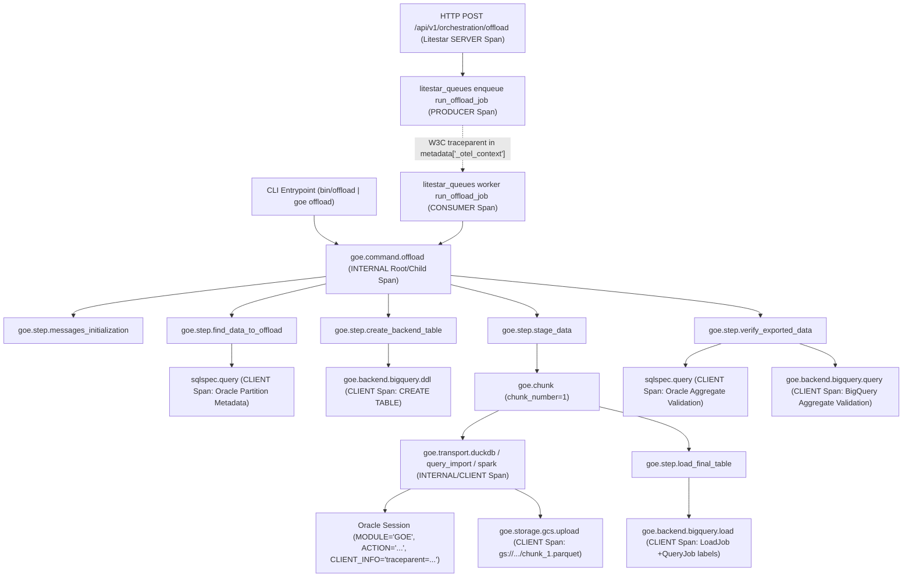

# End-to-End OpenTelemetry Observability Architecture for GOE

## 1. Executive Summary & Architectural Vision

GOE orchestrates complex, multi-system data offload, presentation, schema synchronization, and verification workflows spanning:
1. **Entrypoints**: The Rich-Click CLI (`src/goe/cli/`) and the Litestar Listener HTTP/MCP/Worker service (`src/goe/listener/`).
2. **Orchestration Core**: High-level commands (`OrchestrationRunner` in `src/goe/orchestration/orchestration_runner.py:42-166`) decomposed into ~45 canonical steps (`src/goe/orchestration/command_steps.py:21-155`) executed through `OffloadMessages.offload_step()` (`src/goe/offload/offload_messages.py:370-482`) and persisted to Oracle repository tables via `OracleOrchestrationRepoClient` (`src/goe/persistence/oracle/oracle_orchestration_repo_client.py:256-425`).
3. **Data Plane & Cloud Backends**: Oracle RDBMS metadata and extraction queries (`OracleFrontendApi` in `src/goe/offload/oracle/oracle_frontend_api.py:113-198`, `OracleOffloadTransportRdbmsApi` in `src/goe/offload/oracle/oracle_offload_transport_rdbms_api.py:66-231`), multi-engine data transport (`OffloadTransport` in `src/goe/offload/offload_transport.py:633-1268`, DuckDB transport in PRD 3 Chapter 3.4, Query Import, Spark Submit/Thrift/Livy, Dataproc GCloud/Batches), Cloud Storage staging (`GOEGcs` in `src/goe/filesystem/goe_gcs.py:63-308`), and Google BigQuery DDL/DML/Load jobs (`BigQueryBackendApi` in `src/goe/offload/bigquery/bigquery_backend_api.py:92-449`, `BigQueryBackendTable` in `src/goe/offload/bigquery/bigquery_backend_table.py:67-555`).

Historically, observability in GOE has been fragmented across three disconnected mechanisms:
- **Flat Text Logs**: `OffloadMessages.log()` (`src/goe/offload/offload_messages.py:291-327`) and `GOELogFileHandle` (`src/goe/util/goe_log_fh.py:28-74`) write unstructured text files to `$OFFLOAD_HOME/logs/` with wall-clock elapsed times per step (`Elapsed time: HH:MM:SS`), lacking machine-parseable trace/span correlation or child operation breakdown.
- **Repository Tables**: `OFFLOAD_REPO` tables (`COMMAND_EXECUTION`, `COMMAND_EXECUTION_STEP`, `OFFLOAD_CHUNK`) record coarse step timing and byte/row counts only when repository persistence is active (`execute=True` or repo logging enabled), with zero visibility into individual SQL statements, GCS object uploads, or BigQuery job slot consumption.
- **Ad-Hoc Session Tagging**: `OracleFrontendApi._connect()` (`src/goe/offload/oracle/oracle_frontend_api.py:193-197`) sets `MODULE='GOE'` and `ACTION=self._trace_action` (truncated to 32 bytes), and `BigQueryBackendApi._execute_ddl_or_dml()` (`src/goe/offload/bigquery/bigquery_backend_api.py:322`) logs `BigQuery job_id` in verbose text output without attaching structured GCP job labels or linking the BigQuery job back to the originating `ExecutionId` and step span.

This research establishes a unified, zero-overhead-by-default **OpenTelemetry (`src/goe/observability/`)** architecture that connects every layer of GOE under a single W3C Trace Context and `ExecutionId` correlation model.

---

## 2. End-to-End Trace Topology (`goe.command` -> `goe.step` -> `goe.transport` -> `sqlspec` / `gcs` / `bigquery`)

### 2.1 Unified Span Hierarchy

Every GOE operation—whether initiated from the CLI (`offload -t SH.SALES -x`) or via the Listener REST/MCP API (`POST /api/v1/orchestration/offload` -> `litestar_queues` worker `run_offload_job`)—produces a deterministic, hierarchical trace tree:



### 2.2 `ExecutionId` <-> W3C Trace Context Correlation

In `src/goe/orchestration/execution_id.py:44-89`, `ExecutionId` wraps a 16-byte `uuid.UUID` (`uuid.uuid4()`). W3C Trace Context (`traceparent`) uses a 16-byte (128-bit, 32-hex-char) `trace_id` and an 8-byte (64-bit, 16-hex-char) `span_id`.

To bridge GOE's domain identity (`ExecutionId`) with OpenTelemetry's distributed trace identity (`trace_id`, `span_id`):
1. **Baggage & ContextVar Propagation**: When a command begins (`OrchestrationRunner._init_command` at `src/goe/orchestration/orchestration_runner.py:72-82` or `OffloadOperation` initialization), `bind_execution_context(execution_id=execution_id, command_type=command_type, target_table=...)` stores the active `ExecutionId` in a module-level `contextvars.ContextVar` AND in OpenTelemetry `baggage` (`opentelemetry.baggage.set_baggage("goe.execution.id", execution_id.as_str())`).
2. **Deterministic IdGenerator Option & Bidirectional Mapping**:
   - When a command originates in the CLI without an upstream parent HTTP trace, `ExecutionId.generate()` creates the UUID4, and the root `goe.command.<type>` span records `goe.execution.id = execution_id.as_str()`.
   - When a command originates from an incoming HTTP request or `litestar-queues` worker with an active W3C `traceparent`, the parent `trace_id` is preserved as the OpenTelemetry trace ID, while `goe.execution.id` is attached to the command span and automatically copied to every descendant span via a custom `ExecutionContextSpanProcessor(SpanProcessor)` (`on_start` reads `ContextVar` / `baggage` and stamps `goe.execution.id`, `goe.command.type`, and `goe.step.id` onto every child span, including third-party `sqlspec.query` spans).
   - Conversely, the active `(trace_id, span_id)` is recorded in `OrchestrationRepoClient.start_command()` / `start_command_step()` context metadata so DBAs querying `OFFLOAD_REPO.COMMAND_EXECUTION` can jump directly to Cloud Trace / Jaeger / Grafana Tempo by `trace_id` or `goe.execution.id`.

---

## 3. OpenTelemetry SDK & Zero-Overhead No-Op Architecture

### 3.1 Dependency Stratification (`pyproject.toml`)

Inspecting `pyproject.toml:12-66` and `.venv/lib/python3.14/site-packages/` reveals that `sqlspec` and `litestar` already ship first-party OpenTelemetry hooks that lazily import `opentelemetry`:
- `sqlspec/observability/_spans.py:13-22` checks `from opentelemetry import trace` in a `try...except ImportError` block and exposes `OTEL_INSTALLED`.
- `litestar/plugins/opentelemetry/config.py:15-29` calls `MissingDependencyException("opentelemetry")` only when `OpenTelemetryPlugin` is instantiated without `opentelemetry-instrumentation-asgi`.
- `litestar_queues/observability.py:211-269` lazily imports `from opentelemetry import context, propagate, trace` inside `inject_trace_context()` and `extract_trace_context()`.

By placing `opentelemetry-api>=1.27.0` in core `dependencies` in `pyproject.toml`:
- `opentelemetry-api` is a pure-Python interface package with zero heavy transitive dependencies (only `importlib-metadata` and `typing-extensions`).
- When `GOE_OTEL_ENABLED` is `False` (the default), `opentelemetry.trace.get_tracer()` and `opentelemetry.metrics.get_meter()` return the singleton `NoOpTracer` / `NoOpMeter` from `opentelemetry-api`. Span creation (`with tracer.start_as_current_span(...)`) and metric recording (`counter.add(...)`) execute as fast in-memory no-ops with zero allocations, zero background threads, and zero network I/O.
- Full SDK providers and exporters live in `[project.optional-dependencies] otel`:
  - `opentelemetry-sdk>=1.27.0`
  - `opentelemetry-exporter-otlp-proto-grpc>=1.27.0`
  - `opentelemetry-exporter-otlp-proto-http>=1.27.0`
  - `opentelemetry-instrumentation-asgi>=0.48b0`
  - `opentelemetry-exporter-gcp-trace>=1.7.0`
  - `opentelemetry-exporter-gcp-monitoring>=1.7.0`
  - `opentelemetry-resourcedetectors-gcp>=1.7.0`
- `[dependency-groups] dev` includes the `otel` packages so unit and integration tests can always exercise `InMemorySpanExporter` and `InMemoryMetricReader`.

### 3.2 `src/goe/observability/` Package Design

The central observability package (`src/goe/observability/`) consists of:
- `src/goe/observability/__init__.py`: Public facade exporting `ObservabilitySettings`, `configure_observability`, `shutdown_observability`, `get_tracer`, `get_meter`, `bind_execution_context`, `get_current_trace_context`, `traced_step`, `traced_operation`, and metric recording helpers.
- `src/goe/observability/config.py`: `msgspec.Struct(frozen=True, kw_only=True)` configuration model `ObservabilitySettings` loaded from `OrchestrationConfig` / environment variables (`GOE_OTEL_ENABLED`, `GOE_OTEL_SERVICE_NAME`, `GOE_OTEL_EXPORTER`, `GOE_OTEL_ENDPOINT`, `GOE_OTEL_PROTOCOL`, `GOE_OTEL_SAMPLE_RATE`, `GOE_OTEL_LOG_CORRELATION`, `GOE_OTEL_SQLCOMMENTER`, `GOE_LOG_FORMAT`).
- `src/goe/observability/runtime.py`: Manages singleton/scoped `TracerProvider` and `MeterProvider` lifecycle, `Resource` construction (`service.name="goe"`, `service.version`, `service.instance.id`, `deployment.environment`, `goe.backend.target`, `goe.db.type`), `ExecutionContextSpanProcessor`, exporter registration (`none`, `console`, `jsonl`, `otlp`, `gcp`, `memory`), and W3C `TraceContextTextMapPropagator` + `W3CBaggagePropagator` composite propagator setup.
- `src/goe/observability/context.py`: Context variables (`_EXECUTION_ID_CTX`, `_COMMAND_TYPE_CTX`, `_STEP_ID_CTX`), W3C `traceparent`/`baggage` carrier injection and extraction for subprocess env vars (`inject_env_context`, `extract_env_context`) and dictionary metadata (`inject_carrier`, `extract_carrier`), and `format_sqlcommenter()`.
- `src/goe/observability/metrics.py`: Typed instruments wrapper `GOEMetrics` around `opentelemetry.metrics.Meter("goe.observability")` providing methods for all 8 canonical GOE metrics.

---

## 4. Orchestration Step & Command Lifecycle Instrumentation

### 4.1 Primary-Source Analysis of `OffloadMessages.offload_step()`

In `src/goe/offload/offload_messages.py:370-482`:
```python
# SPDX-FileCopyrightText: 2026 The GOE Authors
# SPDX-License-Identifier: Apache-2.0

def offload_step(
    self,
    command_step: str,
    action_fn,
    execute: bool = True,
    command_type: str | None = None,
    mandatory_step: bool = False,
    optional: bool = False,
):
    """Wrap a step function in standard logging, repository persistence, and telemetry."""
```
Currently, `offload_step()` performs:
1. Step title resolution via `step_title(command_step)` (`src/goe/orchestration/command_steps.py:169-174`) and step ID derivation via `step_title_to_step_id(title)` (`src/goe/offload/offload_messages.py:644-648`).
2. Skip evaluation (`if not mandatory_step and self._skip and step_id_in_list(step_id, self._skip)`).
3. Fault injection hooks (`--error-before-step` at `L421-425`, `--error-after-step` at `L457-461`).
4. Repository persistence via `self._repo_client.start_command_step(self._execution_id, command_type, command_step)` (`L429-431`) and `self._repo_client.end_command_step(command_step_id, status_code, step_details=step_details)` (`L446-455`, `L474-478`).
5. Wall-clock timing (`t1 = datetime.now()`, `ela = datetime.now() - t1` at `L428`, `L452`).

### 4.2 Non-Invasive Span & Metric Wrapping in `offload_step()` and `OrchestrationRunner`

By instrumenting `OrchestrationRunner` (`src/goe/orchestration/orchestration_runner.py:67-166`) and `OffloadMessages.offload_step()` (`src/goe/offload/offload_messages.py:370-482`):
1. **Command Root Span (`goe.command.<command_type>`)**:
   - Started in `OrchestrationRunner._command_begin()` (and in `run_offload()` / `offload_table()` when invoked directly via CLI entrypoints prior to full `OrchestrationRunner` unification).
   - Attributes:
     - `goe.execution.id`: `str(execution_id)`
     - `goe.command.type`: e.g. `"OFFLOAD"`, `"PRESENT"`, `"SCHEMA_SYNC"`, `"DIAG"`
     - `goe.command.dry_run`: `bool(not execute)`
     - `goe.source.owner`: `owner`
     - `goe.source.table`: `table_name`
     - `goe.backend.target`: `config.target` (e.g. `"bigquery"`)
   - Metrics emitted on completion/failure:
     - `goe.commands.total` (`+1`)
     - `goe.command.duration` (`elapsed_seconds`)
2. **Step Child Span (`goe.step.<step_id>`)**:
   - Started inside `OffloadMessages.offload_step()` around `action_fn()`.
   - Sets `_STEP_ID_CTX` token for the duration of the step so all log lines and SQL queries emitted inside `action_fn()` automatically carry `goe.step.id = step_id`.
   - Attributes:
     - `goe.execution.id`: `str(self._execution_id)` if present
     - `goe.step.id`: `step_id` (e.g. `"stage_data"`, `"verify_exported_data"`)
     - `goe.step.code`: `command_step` constant (e.g. `"STAGE_DATA"`)
     - `goe.step.title`: `title` (e.g. `"Stage data"`)
     - `goe.step.command_type`: `command_type`
     - `goe.step.mandatory`: `mandatory_step`
     - `goe.step.optional`: `optional`
     - `goe.step.execute`: `execute`
     - `goe.step.status`: `"skipped"` | `"success"` | `"error"`
   - If `action_fn()` returns a `tuple` `(fn_return, step_details)` where `step_details` is a `dict` (used by `STAGE_DATA` to return `{"staged_bytes": ..., "staged_rows": ...}`), each numeric/string entry in `step_details` is recorded on the span as `goe.step.detail.<key>`.
   - On exception: calls `span.record_exception(exc)`, sets `Status(StatusCode.ERROR, str(exc))`, records `goe.steps.duration` with `status="error"`, and re-raises without altering control flow.

---

## 5. Structured Log Correlation & `GOELogFileHandle` Enrichment

### 5.1 Preserving Golden CLI Output While Enabling Structured Telemetry

A critical invariant from PRD 1 Chapter 1.3 (`oracle_ci_and_bigquery_test_harness_20261010`) and existing unit tests (`tests/unit/offload/test_offload_messages.py`) is that **standard CLI stdout and text log lines must not change format** when running in default text mode (`GOE_LOG_FORMAT=text`), because tests and operator scripts regex-match messages like `"Elapsed time: "` and `"Stage data"`.

Therefore, log correlation operates on three clean tiers:
1. **Python `logging.Filter` (`TraceContextLogFilter`)**:
   - Attached to the `goe` logger hierarchy (`logging.getLogger("goe")`) and Listener's `Structlog` / `LoggingConfig` (`src/goe/listener/config/logging.py:1-58`).
   - Injects `record.trace_id`, `record.span_id`, `record.execution_id`, and `record.step_id` onto every `logging.LogRecord`.
2. **`GOELogFileHandle` & `OffloadMessages.log()` Dual-Mode Formatting**:
   - In `GOELogFileHandle` (`src/goe/util/goe_log_fh.py:28-74`) and `OffloadMessages.log()` (`src/goe/offload/offload_messages.py:291-327`):
     - **Default Mode (`GOE_LOG_FORMAT=text`)**: Writes identical human-readable text to `stdout` and the primary `.log` file, while also writing a header line at command start (`Trace ID: <trace_id> | Execution ID: <execution_id>`) when an active recording span exists and `GOE_OTEL_ENABLED=true`.
     - **Structured JSONL Mode (`GOE_LOG_FORMAT=json` or `GOE_LOG_JSON_SIDECAR=true`)**: Emits `msgspec.json.encode()` JSON lines containing `timestamp`, `level`, `message`, `execution_id`, `trace_id`, `span_id`, `step_id`, and `detail` either to the log file or to a companion `<logfile>.jsonl` sidecar file.
   - **Span Events for Warnings & Errors**: When `OffloadMessages.warning()` or `OffloadMessages.log(..., ansi_code="red")` is called while a recording span is active, `span.add_event("log.warning", attributes={"log.message": line, "goe.step.id": step_id})` attaches the warning directly to the active OpenTelemetry span timeline.

---

## 6. Listener HTTP, MCP & Background Worker Context Propagation

### 6.1 Litestar `OpenTelemetryPlugin` (`litestar.plugins.opentelemetry`)

Auditing `.venv/lib/python3.14/site-packages/litestar/plugins/opentelemetry/` confirms:
- `litestar.contrib.opentelemetry` is deprecated in Litestar 2.22+ (`warn_deprecation` in `litestar/contrib/opentelemetry/__init__.py:10-18`).
- `from litestar.plugins.opentelemetry import OpenTelemetryConfig, OpenTelemetryPlugin` is the canonical plugin.
- `OpenTelemetryConfig` accepts `tracer_provider`, `meter_provider`, `exclude=["/health", "/api/health"]` so liveness probes do not pollute traces.

### 6.2 `litestar-queues` Context Propagation (`src/goe/listener/jobs.py` & `controllers/orchestration.py`)

Auditing `.venv/lib/python3.14/site-packages/litestar_queues/observability.py:1-340` and `src/goe/listener/app.py:31-65`, `src/goe/listener/controllers/orchestration.py:110-127`, and `src/goe/listener/jobs.py:17-22` reveals:
1. `litestar_queues` has built-in OpenTelemetry support via `litestar_queues.observability.ObservabilityConfig(enable_otel=True, tracer_provider=..., meter_provider=...)` passed to `QueueConfig(observability=...)`.
2. Furthermore, in `src/goe/listener/controllers/orchestration.py:110-127`:

```python
# SPDX-FileCopyrightText: 2026 The GOE Authors
# SPDX-License-Identifier: Apache-2.0

await queues.enqueue(
    "run_offload_job",
    execution_id=str(execution_id),
    command_type=COMMAND_OFFLOAD,
    params=payload_dict,
)
```

   When `queues.enqueue("run_offload_job", ...)` is called inside the HTTP controller handler, `litestar-queues` automatically injects `_otel_context` into the task metadata when `observability.enable_otel` is enabled.
3. Inside `run_offload_job` (`src/goe/listener/jobs.py:17-22`), we also explicitly bind `ExecutionId.from_str(execution_id)` via `bind_execution_context(execution_id=..., command_type=command_type)` and extract any `traceparent` from `params.get("_otel_context")` (if passed in kwargs or task metadata) before invoking `OrchestrationRunner().offload(params, execution_id=...)`. This guarantees that the worker's `goe.command.offload` span is a direct child of the `CONSUMER` span, which is linked to the HTTP `POST /api/v1/orchestration/offload` `SERVER` span.
4. For the MCP server (`src/goe/listener/mcp.py`), tool invocations are wrapped with `goe.mcp.tool.<tool_name>` spans carrying `goe.mcp.tool_name` and `goe.execution.id`.

---

## 7. Database, Transport & Cloud Storage Telemetry

### 7.1 SQLSpec Observability Integration (`sqlspec.observability`)

Auditing `.venv/lib/python3.14/site-packages/sqlspec/observability/` reveals that `sqlspec` provides a complete observability subsystem:
- `ObservabilityConfig` (`sqlspec/observability/_config.py:160-191`) accepts:
  - `telemetry=TelemetryConfig(enable_spans=True, provider_factory=get_tracer_provider, resource_attributes=...)`
  - `redaction=RedactionConfig(mask_parameters=True, mask_literals=False)`
  - `logging=LoggingConfig(include_sql_hash=True, include_trace_context=True, include_correlation_id=True)`
  - `statement_observers=(db_statement_observer,)`
- When `OracleGateway` (`src/goe/persistence/oracle_gateway.py`) creates an `OracleSyncConfig` / `OracleAsyncConfig` (introduced in PRD 3 Chapter 3.1 `sqlspec_oracle_data_layer_migration_20261010`), passing `observability_config=build_db_observability_config()` automatically activates `SpanManager` (`sqlspec/observability/_spans.py:29-125`), which creates `sqlspec.query` `SpanKind.CLIENT` child spans under the currently active `goe.step.*` span with `db.system="oracle"`, `db.operation`, `sqlspec.driver`, `sqlspec.statement.hash`, and `sqlspec.correlation_id`.
- Entering `CorrelationContext(execution_id.as_str())` from `sqlspec.utils.correlation` inside `bind_execution_context` automatically populates `sqlspec.correlation_id` on every `sqlspec.query` span and `StatementEvent`!

### 7.2 Oracle `DBMS_APPLICATION_INFO` & `SQLCommenter` Correlation

In `src/goe/offload/oracle/oracle_frontend_api.py:193-197`, `OracleFrontendApi._connect()` currently executes:
```python
# SPDX-FileCopyrightText: 2026 The GOE Authors
# SPDX-License-Identifier: Apache-2.0

self._db_conn.module = FRONTEND_TRACE_MODULE
self._db_conn.action = self._trace_action
self._db_conn.ping()
```
And in `src/goe/offload/oracle/oracle_offload_transport_rdbms_api.py:176-231`, `get_rdbms_session_setup_commands()` generates `DBMS_APPLICATION_INFO.SET_MODULE(module, action)` commands for transport sessions, while `LOG_SQL_STATS_QUERY_TEXT` (`L66-77`) queries `v$sql` by `WHERE module = :module AND action = :action`.

**Critical Invariant**: `LOG_SQL_STATS_QUERY_TEXT` in `src/goe/offload/oracle/oracle_offload_transport_rdbms_api.py:66-77` filters `v$sql` by exact match on `module = :module AND action = :action`! Therefore, we **MUST NOT** alter the format of `module` (`"GOE"`) or `action` (`self._trace_action` / `generate_transport_action()`) in a way that breaks `v$sql` matching.
Instead:
1. **`CLIENT_INFO` (`V$SESSION.CLIENT_INFO`, up to 64 bytes)**:
   - `python-oracledb` connections expose `conn.clientinfo` (and PL/SQL provides `DBMS_APPLICATION_INFO.SET_CLIENT_INFO(...)`).
   - Setting `conn.clientinfo = f"goe:{execution_id_short}:tp:{trace_id[:16]}-{span_id}"` (or W3C `00-<trace_id>-<span_id>-01`, which is exactly 55 ASCII bytes—well within Oracle's 64-byte `V$SESSION.CLIENT_INFO` limit!) stamps the exact W3C `traceparent` into `V$SESSION.CLIENT_INFO` on every Oracle connection without touching `MODULE` or `ACTION`!
2. **`SQLCommenter` (`/*traceparent='00-...'*/`)**:
   - In `OffloadTransport._get_spark_jdbc_query_text()` (`src/goe/offload/offload_transport.py:1025-1059`) and Query Import / DuckDB extraction queries, `sql_comment` is already supported (`"sql_comment": f" /* {sql_comment} */" if sql_comment else ""`).
   - When `GOE_OTEL_SQLCOMMENTER=true`, GOE injects `traceparent='00-<trace_id>-<span_id>-01',goe_exec='<execution_id>'` into the SQL comment block so `V$SQL.SQL_TEXT` and Oracle AWR reports contain the exact trace context.

### 7.3 Offload Transport Spans (`DuckDB`, `QueryImport`, `Spark`, `Dataproc`) & Subprocess Context Propagation

1. **Chunk & Transport Spans**:
   - In `transport_and_load_offload_chunk()` (`src/goe/offload/offload_transport_functions.py:275-352`), each chunk is wrapped in a `goe.chunk` span (`goe.chunk.number = chunk_count + 1`, `goe.chunk.partition_count`), and `data_transport_client.transport()` is wrapped in a `goe.transport.<method_lower>` span (`SpanKind.CLIENT` or `SpanKind.INTERNAL`).
   - Span attributes recorded on `goe.transport.<method_lower>`:
     - `goe.execution.id`: `str(execution_id)`
     - `goe.transport.method`: `self._offload_transport_method` (`"DUCKDB"`, `"QUERY_IMPORT"`, `"SPARK_SUBMIT"`, `"SPARK_DATAPROC_GCLOUD"`, `"SPARK_BATCHES_GCLOUD"`, etc.)
     - `goe.transport.source_owner`: `self._rdbms_owner`
     - `goe.transport.source_table`: `self._rdbms_table_name`
     - `goe.transport.target_db`: `self._target_db_name`
     - `goe.transport.target_table`: `self._target_table_name`
     - `goe.transport.staging_format`: `self._staging_format` (`"PARQUET"` or `"AVRO"`)
     - `goe.transport.staging_location`: `self._staging_table_location`
     - `goe.transport.scn`: `str(self._offload_transport_snapshot)` if set
     - `goe.transport.parallelism`: `self._offload_transport_parallelism`
     - `goe.transport.rows_imported`: `rows_staged`
     - `goe.transport.bytes_staged`: `transport_bytes`
2. **Subprocess & Spark W3C Context Propagation**:
   - In `run_os_cmd()` (`src/goe/offload/offload_transport_functions.py:171-234`), `subprocess.Popen(cmd, stdout=PIPE, stderr=STDOUT, env=cmd_env)` is augmented with `inject_env_context(os.environ.copy())`, which sets `TRACEPARENT`, `TRACESTATE`, `BAGGAGE`, and `GOE_EXECUTION_ID` in the child process environment, and wraps the OS command execution in a `goe.os_cmd` child span (`process.executable.name = cmd[0]`, `process.exit_code = cmd_returncode`).
   - In `OffloadTransportSpark._prepare_spark_config_properties()` (`src/goe/offload/offload_transport.py:809-815`), when an active span context exists, `spark.driverEnv.TRACEPARENT`, `spark.executorEnv.TRACEPARENT`, and `spark.goe.executionId` are added to Spark properties so Spark jobs and `GOETaskListener` correlate back to the parent offload trace.

### 7.4 Cloud Storage (`GOEGcs`) & BigQuery (`BigQueryBackendApi` / `BigQueryBackendTable`) Spans & Job Labels

1. **`GOEGcs` (`src/goe/filesystem/goe_gcs.py:97-308`)**:
   - Each storage method (`copy_from_local`, `copy_to_local`, `delete`, `list_dir`, `read`, `stat`, `write`) is instrumented with a `goe.storage.gcs.<operation>` span (`SpanKind.CLIENT`):
     - `goe.storage.scheme`: `"gs"`
     - `goe.storage.bucket`: `container`
     - `goe.storage.path`: `path`
     - `goe.storage.uri`: `uri`
     - `goe.storage.dry_run`: `self._dry_run`
     - `goe.storage.bytes`: byte length on `read`/`write`/`copy_from_local`/`stat`
2. **`BigQueryBackendApi` (`src/goe/offload/bigquery/bigquery_backend_api.py:282-433`) & `BigQueryBackendTable` (`src/goe/offload/bigquery/bigquery_backend_table.py:105-555`)**:
   - **GCP Job Label Injection (`_default_job_config` at `bigquery_backend_api.py:282-287` and `LoadJobConfig` in `bigquery_backend_table.py` from PRD 3 Chapter 3.3)**:
     - GCP BigQuery labels allow lowercase letters, numeric characters, underscores, and dashes (up to 63 chars per value).
     - Helper `build_bigquery_job_labels() -> dict[str, str]` returns:
       - `"goe_system": "goe"`
       - `"goe_execution_id": execution_id_clean[:63]` (lowercased UUID with hyphens)
       - `"goe_command": command_type.lower()[:63]`
       - `"goe_step": step_id.lower()[:63]`
       - `"goe_trace_id": trace_id[:32]` (when a recording span is active)
     - Merging these labels into `bigquery.QueryJobConfig(labels=...)` and `bigquery.LoadJobConfig(labels=...)` enables exact FinOps and performance attribution in `region-x.INFORMATION_SCHEMA.JOBS_BY_PROJECT`!
   - **BigQuery Client Spans (`goe.backend.bigquery.ddl_dml`, `goe.backend.bigquery.query`, `goe.backend.bigquery.load`)**:
     - Wraps `client.query(...)` and `client.load_table_from_uri(...)`.
     - Records attributes from the completed `QueryJob` / `LoadJob`:
       - `db.system`: `"bigquery"`
       - `goe.bigquery.job_id`: `query_job.job_id`
       - `goe.bigquery.location`: `query_job.location`
       - `goe.bigquery.project`: `query_job.project`
       - `goe.bigquery.statement_type`: `getattr(query_job, "statement_type", None)`
       - `goe.bigquery.total_bytes_processed`: `getattr(query_job, "total_bytes_processed", None)`
       - `goe.bigquery.total_bytes_billed`: `getattr(query_job, "total_bytes_billed", None)`
       - `goe.bigquery.slot_millis`: `getattr(query_job, "slot_millis", None)`
       - `goe.bigquery.num_dml_affected_rows`: `getattr(query_job, "num_dml_affected_rows", None)`
       - `goe.bigquery.output_rows`: `getattr(query_job, "output_rows", None)`
     - Records metrics `goe.bigquery.bytes_billed` and `goe.bigquery.slot_ms`.

---

## 8. Canonical OpenTelemetry Metrics Catalog

| Metric Name | Instrument Type | Unit | Description | Attributes |
| :--- | :--- | :--- | :--- | :--- |
| `goe.commands.total` | `Counter` | `"1"` | Total number of GOE orchestration commands executed | `command_type`, `status`, `backend`, `dry_run` |
| `goe.command.duration` | `Histogram` | `"s"` | End-to-end duration of GOE orchestration commands | `command_type`, `status`, `backend`, `dry_run` |
| `goe.steps.duration` | `Histogram` | `"s"` | Duration of individual `offload_step` executions | `step_id`, `command_type`, `status`, `mandatory` |
| `goe.offload.rows_transported` | `Counter` | `"1"` | Total rows extracted and staged from source RDBMS | `transport_method`, `backend`, `source_owner` |
| `goe.offload.bytes_staged` | `Counter` | `"By"` | Total bytes written to staging storage (GCS/local) | `transport_method`, `storage_format`, `scheme` |
| `goe.offload.bytes_loaded` | `Counter` | `"By"` | Total bytes loaded into backend target tables | `backend` |
| `goe.bigquery.bytes_billed` | `Counter` | `"By"` | Total bytes billed by Google BigQuery jobs | `operation`, `project` |
| `goe.bigquery.slot_ms` | `Counter` | `"ms"` | Total slot milliseconds consumed by BigQuery jobs | `operation`, `project` |

---

## 9. Implementation Decomposition Across PRD 4

To deliver this architecture cleanly and incrementally with 100% unit and integration test coverage, Master PRD 4 (`prd_04_end_to_end_opentelemetry_observability_20261010`) is structured into 3 sequential chapters:
1. **Chapter 4.1 (`opentelemetry_foundation_and_context_propagation_20261010`)**:
   - Task 1.1: OpenTelemetry dependencies (`opentelemetry-api` in core, `otel` optional group in `pyproject.toml`), `ObservabilitySettings`, and `src/goe/observability/` core (`runtime.py`, `metrics.py`, `NoOp` / `OTLP` / `GCP` / `JSONL` / `InMemory` providers).
   - Task 1.2: `ExecutionId` <-> W3C `traceparent`/`baggage` bridge (`context.py`), `ExecutionContextSpanProcessor`, `sqlspec` `CorrelationContext` synchronization, and subprocess / dict carrier propagation helpers.
   - Task 1.3: `OrchestrationConfig` / `CommonOptions` / `offload.env` configuration wiring (`GOE_OTEL_*`, `--otel-enabled`, `--otel-exporter`, `--log-format`) and unit test suite using `InMemorySpanExporter` and `InMemoryMetricReader`.
2. **Chapter 4.2 (`orchestration_step_and_listener_telemetry_20261010`)**:
   - Task 1.1: `OrchestrationRunner` command spans (`goe.command.<type>`) and `OffloadMessages.offload_step()` step spans (`goe.step.<step_id>`) + step/command duration and count metrics + `OracleOrchestrationRepoClient` trace metadata capture.
   - Task 1.2: `TraceContextLogFilter`, `GOELogFileHandle` structured JSONL sidecar / JSON format mode, and span event attachment for warnings/errors while preserving 100% byte-for-byte CLI stdout compatibility.
   - Task 1.3: Litestar Listener `OpenTelemetryPlugin` (`litestar.plugins.opentelemetry`), `litestar-queues` worker W3C `traceparent` + `ExecutionId` context propagation (`src/goe/listener/jobs.py` and `controllers/orchestration.py`), and MCP tool span instrumentation (`src/goe/listener/mcp.py`).
3. **Chapter 4.3 (`database_transport_and_cloud_storage_spans_20261010`)**:
   - Task 1.1: `sqlspec.observability.ObservabilityConfig` wiring, Oracle `V$SESSION.CLIENT_INFO` W3C `traceparent` tagging (`OracleFrontendApi` & `OracleOffloadTransportRdbmsApi`), and `SQLCommenter` (`/*traceparent='...'*/`) injection without altering `V$SQL` `MODULE`/`ACTION` filters.
   - Task 1.2: Offload transport spans (`goe.chunk`, `goe.transport.<method>`) across `transport_and_load_offload_chunk`, `OffloadTransport` (DuckDB, Query Import, Spark, Dataproc), subprocess `TRACEPARENT` propagation in `run_os_cmd`, and `goe.offload.rows_transported` / `goe.offload.bytes_staged` metrics.
   - Task 1.3: `GOEGcs` storage spans (`goe.storage.gcs.<op>`) and `BigQueryBackendApi` / `BigQueryBackendTable` job spans (`goe.backend.bigquery.<op>`), GCP job label attribution (`goe_execution_id`, `goe_trace_id`, `goe_step`), and BigQuery slot/bytes billed metrics (`goe.bigquery.bytes_billed`, `goe.bigquery.slot_ms`).

---

## Corrections (2026-10-10 spec review)

The promoted specs supersede these research statements; sources verified 2026-10-10:

- Package floors are `opentelemetry-*>=1.40.0` / `opentelemetry-instrumentation-asgi>=0.61b0` (first Python 3.14 releases), not `1.27.0`/`0.48b0`. https://pypi.org/pypi/opentelemetry-sdk/json
- Google Cloud export uses the Telemetry (OTLP) API (`https://telemetry.googleapis.com/v1/traces`, `/v1/metrics`) via the OTLP HTTP exporter and an `AuthorizedSession` from `goe.util.gcp_credentials.resolve_gcp_credentials`; `opentelemetry-exporter-gcp-trace`/`-gcp-monitoring` are deprecated and `opentelemetry-resourcedetectors-gcp` does not exist. https://cloud.google.com/stackdriver/docs/reference/telemetry/overview
- `litestar-queues` 0.9.0 already injects/extracts W3C context in job metadata (`_otel_context`) and starts `litestar_queues.publish`/`process` spans when `ObservabilityConfig(enable_otel=True)`; GOE adds no manual carrier to job params.
- `litestar-mcp` 0.13.1 executes tools in-process inside the `/mcp` HTTP span; tool spans use `MCPConfig(before_tool_call=..., after_tool_call=...)`.
- `sqlspec` 0.62.1 `TelemetryConfig` has `enable_spans`, `provider_factory`, `resource_attributes` (no `service_name`); `sqlspec.query` spans are not made current; drivers accept a runtime via `attach_observability()`.
- `OffloadMessages.offload_step()` step functions return arbitrary values, not `(result, step_details)`; row/byte counts are recorded on `goe.chunk`/`goe.transport.*` spans instead.
- Line references in this document predate PRD 1-3; the chapter specs cite current symbols and baseline `46890a8`.
