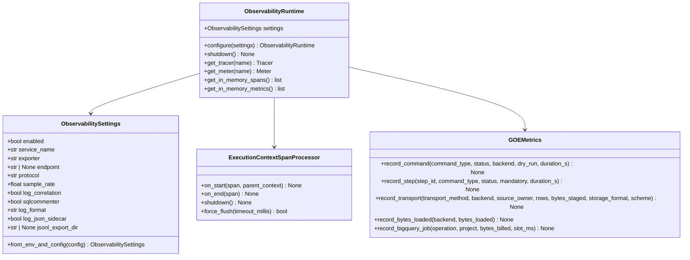

# Chapter 4.1: OpenTelemetry Foundation, Config & ExecutionId Context Bridge

## Specification

## 1. Overview & Goals

This chapter establishes the foundational OpenTelemetry package (`src/goe/observability/`), dependency stratification in `pyproject.toml`, bidirectional correlation between GOE's `ExecutionId` (`src/goe/orchestration/execution_id.py:44-89`) and W3C Trace Context (`traceparent` / `baggage`), and configuration integration across `OrchestrationConfig` (`src/goe/config/orchestration_config.py`), `CommonOptions` (`src/goe/config/options.py` from PRD 2 Chapter 2.1), `src/goe/cli/common.py`, and `templates/conf/offload.env.template`.

### Primary Goals
1. **Zero-Overhead Core Dependency + Optional Exporter Extras**:
   - Add `opentelemetry-api>=1.27.0` to `[project].dependencies` in `pyproject.toml`.
   - Add `[project.optional-dependencies].otel` containing `opentelemetry-sdk>=1.27.0`, `opentelemetry-exporter-otlp-proto-grpc>=1.27.0`, `opentelemetry-exporter-otlp-proto-http>=1.27.0`, `opentelemetry-instrumentation-asgi>=0.48b0`, `opentelemetry-exporter-gcp-trace>=1.7.0`, `opentelemetry-exporter-gcp-monitoring>=1.7.0`, and `opentelemetry-resourcedetectors-gcp>=1.7.0`, and include the SDK/exporters in `[dependency-groups].dev`.
2. **Central Observability Package (`src/goe/observability/`)**:
   - `config.py`: `ObservabilitySettings(msgspec.Struct, frozen=True, kw_only=True)` supporting `enabled`, `service_name`, `exporter` (`"none"`, `"console"`, `"jsonl"`, `"otlp"`, `"gcp"`, `"memory"`), `endpoint`, `protocol` (`"grpc"`, `"http/protobuf"`), `sample_rate`, `log_correlation`, `sqlcommenter`, `log_format` (`"text"`, `"json"`), and `log_json_sidecar`.
   - `runtime.py`: `ObservabilityRuntime` managing `TracerProvider`, `MeterProvider`, `Resource` attributes, `ExecutionContextSpanProcessor`, JSONL file span exporter (`JSONLSpanExporter`), OTLP/GCP exporters (reusing `GCPCredentialProvider` from PRD 1 Chapter 1.2 when `exporter="gcp"`), and `InMemorySpanExporter` / `InMemoryMetricReader` for test harnesses.
   - `metrics.py`: `GOEMetrics` encapsulating the 8 canonical OpenTelemetry instruments (`goe.commands.total`, `goe.command.duration`, `goe.steps.duration`, `goe.offload.rows_transported`, `goe.offload.bytes_staged`, `goe.offload.bytes_loaded`, `goe.bigquery.bytes_billed`, `goe.bigquery.slot_ms`).
3. **`ExecutionId` <-> W3C Trace Context & `sqlspec` `CorrelationContext` Bridge (`src/goe/observability/context.py`)**:
   - Context manager `bind_execution_context(execution_id, command_type=None, step_id=None, source_owner=None, source_table=None)` that synchronizes Python `contextvars.ContextVar`, OpenTelemetry `baggage`, and `sqlspec.utils.correlation.CorrelationContext`.
   - `ExecutionContextSpanProcessor` that automatically stamps `goe.execution.id`, `goe.command.type`, `goe.step.id`, `goe.source.owner`, and `goe.source.table` onto every span started within the context.
   - Carrier helpers `inject_carrier()`, `extract_carrier()`, `inject_env_context()`, `extract_env_context()`, `format_w3c_traceparent()`, and `format_sqlcommenter()`.
4. **Configuration & CLI Option Wiring**:
   - Wire `otel_enabled`, `otel_service_name`, `otel_exporter`, `otel_endpoint`, `otel_protocol`, `otel_sample_rate`, `otel_sqlcommenter`, `log_format`, and `log_json_sidecar` into `orchestration_defaults.py`, `OrchestrationConfig`, `CommonOptions`, `src/goe/cli/common.py`, and `templates/conf/offload.env.template`.

---

## 2. Technical Design

### 2.1 Module Architecture (`src/goe/observability/`)



### 2.2 JSONL Local Trace Exporter (`JSONLSpanExporter`)

For air-gapped Oracle/Linux customer environments where an external OTLP collector or Cloud Trace endpoint is not reachable during troubleshooting, `GOE_OTEL_EXPORTER=jsonl` writes completed spans as `msgspec`-serialized JSON lines to `$OFFLOAD_HOME/logs/goe_traces.jsonl` (or a per-command file). This uses zero external network calls and only requires `opentelemetry-sdk` + `msgspec`.

---

## 3. Task Breakdown

| Task ID | Title | Target Files | Dependencies |
| :--- | :--- | :--- | :--- |
| **Task 1.1** | OpenTelemetry Dependencies, `ObservabilitySettings`, Runtime Providers & `GOEMetrics` | `pyproject.toml`, `src/goe/observability/__init__.py`, `src/goe/observability/config.py`, `src/goe/observability/runtime.py`, `src/goe/observability/metrics.py`, `tests/unit/observability/test_runtime_and_metrics.py` | None |
| **Task 1.2** | `ExecutionId` <-> W3C Trace Context Bridge, `ExecutionContextSpanProcessor` & Carrier Propagation | `src/goe/observability/context.py`, `src/goe/orchestration/execution_id.py`, `tests/unit/observability/test_context_propagation.py` | Task 1.1 |
| **Task 1.3** | `OrchestrationConfig`, `CommonOptions`, CLI Flags & `offload.env.template` Wiring | `src/goe/config/orchestration_defaults.py`, `src/goe/config/orchestration_config.py`, `src/goe/config/options.py`, `src/goe/cli/common.py`, `templates/conf/offload.env.template`, `tests/unit/observability/test_config_wiring.py` | Task 1.1, Task 1.2 |

---

## 4. Verification Plan

```bash
export GOOGLE_API_USE_CLIENT_CERTIFICATE=false
uv run ruff format --check src/goe/observability tests/unit/observability
uv run ruff check src/goe/observability tests/unit/observability
uv run mypy src/goe/observability
uv run pytest tests/unit/observability/ -v
```

## Implementation Plan

- [ ] 1.1 Add `opentelemetry-api` and optional `otel` dependency group to `pyproject.toml`, and implement `ObservabilitySettings`, `ObservabilityRuntime`, `JSONLSpanExporter`, and `GOEMetrics` in `src/goe/observability/`.
- [ ] 1.2 Implement `ExecutionId` <-> W3C `traceparent`/`baggage` & `sqlspec` `CorrelationContext` bridge, `ExecutionContextSpanProcessor`, and carrier propagation helpers in `src/goe/observability/context.py` and `src/goe/orchestration/execution_id.py`.
- [ ] 1.3 Wire `otel_*` and `log_*` configuration options into `orchestration_defaults.py`, `OrchestrationConfig`, `CommonOptions`, `src/goe/cli/common.py`, and `templates/conf/offload.env.template`.

## Continuity Snapshot

- **Current State**: Planned (`plan_revision: 1`).
- **Next Action**: Execute Task `1.1` (`opentelemetry_foundation_and_context_propagation_20261010:1.1`).
