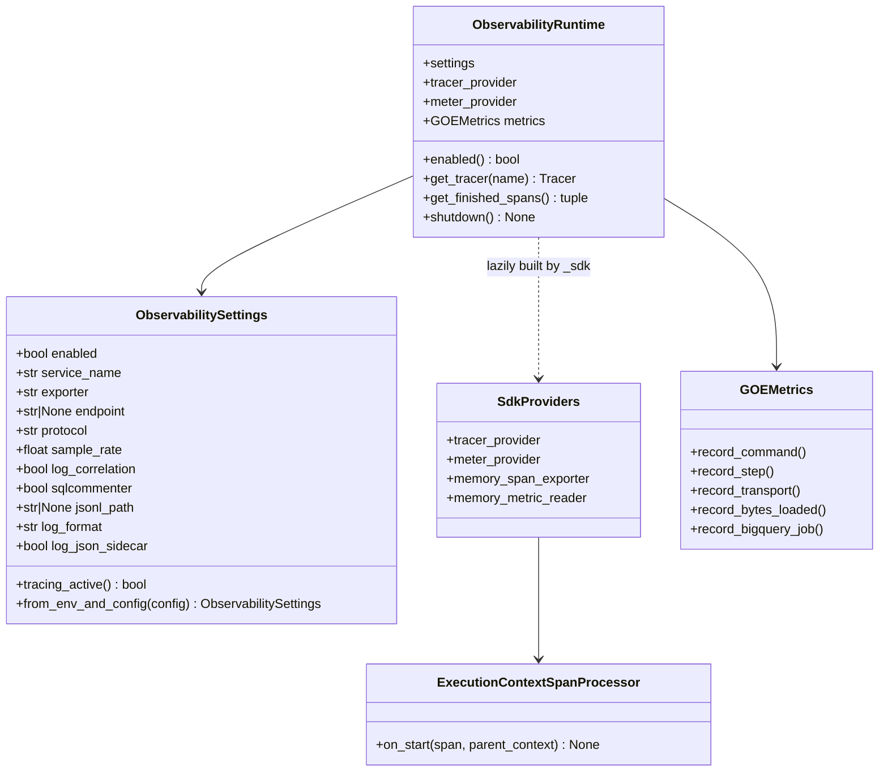

# Chapter 4.1: OpenTelemetry Foundation, Config & ExecutionId Context Bridge

## Specification

### 1. Overview & Goals

Establish `src/goe/observability/` so later chapters can instrument GOE with standard OpenTelemetry APIs at zero cost when telemetry is disabled (the default):

1. **Dependencies**: `opentelemetry-api>=1.40.0` in core `[project].dependencies`; optional `otel` extra (`opentelemetry-sdk`, `opentelemetry-exporter-otlp-proto-grpc`, `opentelemetry-exporter-otlp-proto-http` `>=1.40.0`, `opentelemetry-instrumentation-asgi>=0.61b0`); the same four in the `test` dependency group.
2. **Settings** (`config.py`): `ObservabilitySettings` resolves `GOE_OTEL_*`/`GOE_LOG_*` (config attribute > env var > default), never raising on invalid values.
3. **Metrics** (`metrics.py`): `GOEMetrics` with the 8 canonical instruments.
4. **Context bridge** (`context.py`, API-only): `ExecutionId` <-> ContextVars <-> W3C baggage <-> `sqlspec` `CorrelationContext`; traceparent snapshot; dict and subprocess-env carriers.
5. **SDK builders** (`_sdk.py`, lazily loaded): `ExecutionContextSpanProcessor`, `JSONLSpanExporter`, exporter dispatch (`memory`, `console`, `jsonl`, `otlp` grpc/http, `gcp` via the Google Cloud Telemetry OTLP API).
6. **Runtime** (`runtime.py`): no-op default, `configure_observability`/`ensure_observability`, single global/atexit registration, fail-safe fallback.
7. **Wiring**: CLI flags + `CommonOptions` fields + `offload_by_cli` bootstrap + `offload.env.template.common` docs.

### 2. Context

- Baseline commit: `46890a8`. Earlier chapters that change files touched here: `legacy_shim_removal_and_repo_hygiene_20261010` task 1.3 (`pyproject.toml` dependency list), `typed_msgspec_option_model_20261010` task 1.1 (creates `src/goe/config/options.py` with `CommonOptions`), `gcp_adc_credential_unification_20261010` task 1.1 (creates `src/goe/util/gcp_credentials.py` with `resolve_gcp_credentials`, `GcpCredentialBundle`, `DEFAULT_GCP_SCOPES`), `core_god_module_decomposition_20261010` task 1.1 (changes imports in `src/goe/orchestration/cli_entry_points.py`).
- Verified external facts (2026-10-10):
  - OpenTelemetry Python `1.40.0`/contrib `0.61b0` exist on PyPI and are the first releases with Python 3.14 support (latest `1.45.1`/`0.66b1`, `requires_python >=3.10`): https://pypi.org/pypi/opentelemetry-sdk/json, https://pypi.org/pypi/opentelemetry-instrumentation-asgi/json.
  - Default global propagator with `OTEL_PROPAGATORS` unset is `tracecontext,baggage` (opentelemetry-api `propagate/__init__.py`), so GOE never overrides it.
  - SDK span processors must subclass `opentelemetry.sdk.trace.SpanProcessor` (the multi-processor calls private `_on_ending`).
  - Google Cloud Telemetry (OTLP) API accepts `/v1/traces` and `/v1/metrics` at `https://telemetry.googleapis.com`: https://cloud.google.com/stackdriver/docs/reference/telemetry/overview. `opentelemetry-exporter-gcp-trace`/`-gcp-monitoring` are deprecated and not used; `opentelemetry-resourcedetectors-gcp` does not exist on PyPI (the real name is singular).
  - `litestar.plugins.opentelemetry` (litestar 2.24.0) imports `opentelemetry.instrumentation.asgi` at import time; it is the canonical path since 2.22.0 (`litestar.contrib.opentelemetry` emits a deprecation warning).
  - `sqlspec.utils.correlation.CorrelationContext.context(None)` generates a random id, so the bridge only enters it when an execution id is bound.
- Repo conventions applied: SPDX header, top-level imports only (optional modules bound with `goe.cli._lazy` per `.agents/bundles/knowledge/patterns/cli-architecture.md`), no inline comments, PEP 585/604 types, and public-before-private function/method ordering (all public functions/methods and dunder lifecycle methods grouped at the top of each module and class body, with private `_...` helpers at the bottom).

### 3. Module Architecture



### 4. Requirement Traceability

| Requirement (PRD 4 §1/§3) | Task | Verification |
| :--- | :--- | :--- |
| `opentelemetry-api` core + optional SDK/exporters | 1.1 | import check + `uv.lock` |
| Typed settings, `GOE_OTEL_ENABLED=false` default | 1.1 | `test_settings.py` |
| 8 canonical metrics | 1.2 | `test_metrics.py` |
| `ExecutionId` <-> traceparent/baggage/`CorrelationContext` | 1.3 | `test_context.py` |
| `ExecutionContextSpanProcessor`, JSONL, OTLP, GCP, in-memory harness | 1.4 | `test_sdk.py` |
| Zero overhead when disabled, fail-safe | 1.5 | `test_runtime.py` (fresh interpreter) |
| `--otel-enabled` CLI flag, env docs | 1.6 | `test_cli_wiring.py`, `test_common_options.py` |

### 5. Verification Plan

```bash
export GOOGLE_API_USE_CLIENT_CERTIFICATE=false
uv run python -c "import ast,sys; is_priv=lambda n:n.startswith('_') and not (n.startswith('__') and n.endswith('__')); bad=[(p,getattr(s,'name','<module>'),f.name) for p in sys.argv[1:] for s in ast.walk(ast.parse(open(p).read())) if isinstance(s,(ast.Module,ast.ClassDef)) for funcs in [[n for n in s.body if isinstance(n,(ast.FunctionDef,ast.AsyncFunctionDef))]] for i,f in enumerate(funcs) if not is_priv(f.name) and any(is_priv(g.name) for g in funcs[:i])]; assert not bad, bad" src/goe/observability/config.py src/goe/observability/metrics.py src/goe/observability/context.py src/goe/observability/_sdk.py src/goe/observability/runtime.py src/goe/config/options.py src/goe/cli/common.py src/goe/orchestration/cli_entry_points.py tests/unit/observability/test_settings.py tests/unit/observability/test_metrics.py tests/unit/observability/test_context.py tests/unit/observability/test_sdk.py tests/unit/observability/test_runtime.py tests/unit/observability/test_cli_wiring.py
uv run ruff format --check src/goe/observability tests/unit/observability
uv run ruff check src/goe/observability tests/unit/observability
uv run mypy src/goe
uv run pytest tests/unit/observability/ tests/unit/cli/ -v
```

## Implementation Plan

- [ ] 1.1 OpenTelemetry dependency stratification and typed `ObservabilitySettings` ([tasks/1.1.md](tasks/1.1.md))
- [ ] 1.2 `GOEMetrics` canonical instrument catalog ([tasks/1.2.md](tasks/1.2.md))
- [ ] 1.3 `ExecutionId` to W3C trace context, baggage, and SQLSpec correlation bridge ([tasks/1.3.md](tasks/1.3.md))
- [ ] 1.4 SDK provider builders, `ExecutionContextSpanProcessor`, JSONL and exporter dispatch ([tasks/1.4.md](tasks/1.4.md))
- [ ] 1.5 `ObservabilityRuntime` lifecycle with zero-cost no-op default ([tasks/1.5.md](tasks/1.5.md))
- [ ] 1.6 CLI flags, `CommonOptions` fields, offload entry-point bootstrap and env template docs ([tasks/1.6.md](tasks/1.6.md))

## Continuity Snapshot

- **Flow / lifecycle**: `opentelemetry_foundation_and_context_propagation_20261010`, `planned`.
- **Current task / claimant**: none.
- **Last verified checkpoint**: none.
- **Decisions**: Google Cloud export uses the Telemetry OTLP API (no deprecated GCP exporter packages); `ObservabilitySettings` is the only env resolver (no `OrchestrationConfig` fields); SDK isolated in lazily loaded `_sdk.py`.
- **Blockers**: none; requires PRD 1-3 chapters listed in `depends_on` to be complete.
- **Next exact step**: execute task `1.1` (`opentelemetry_foundation_and_context_propagation_20261010:1.1`).
- **Plan identity**: `plan_revision: 3`, `plan_commit: null`. **State identity**: `state_revision: 0`.
- **Relevant knowledge**: `.agents/bundles/knowledge/patterns/cli-architecture.md`, `.agents/bundles/knowledge/standards/python.md`, `.agents/bundles/knowledge/standards/testing.md`, `.agents/bundles/knowledge/workflow.md`, `.agents/bundles/product/tech-stack.md`.
