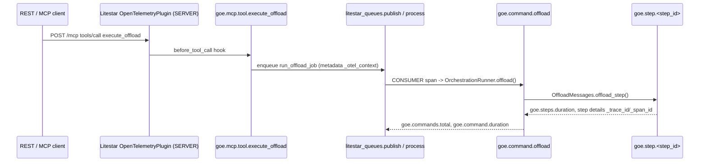

# Chapter 4.2: Orchestration Step Spans, Structured Log Correlation & Listener/Worker Telemetry

## Specification

### 1. Overview & Goals

Using the runtime and context bridge from Chapter 4.1:

1. **Command & step spans**: `OrchestrationRunner.offload()` runs inside `goe.command.offload`; every executed `OffloadMessages.offload_step()` runs inside a child `goe.step.<step_id>` span (`goe.step.status` = `success`/`error`/`skipped`); `goe.commands.total`, `goe.command.duration`, and `goe.steps.duration` are recorded; `OFFLOAD_REPO` command parameters and step details persist `_trace_id`/`_span_id` when a span is recording; warnings become `log.warning` span events.
2. **Structured log correlation**: `GOELogFileHandle` supports `GOE_LOG_FORMAT=json` and `GOE_LOG_JSON_SIDECAR=true` (`<log>.jsonl`), default text output byte-identical; Python `LogRecord`s carry `trace_id`, `span_id`, `execution_id`, `step_id`, `command_type` while tracing is active.
3. **Listener**: Litestar `OpenTelemetryPlugin` (SERVER spans), litestar-queues native W3C propagation into `run_offload_job` (PRODUCER/CONSUMER spans), `goe.mcp.tool.<name>` spans via `MCPConfig` hooks, and `goe.execution.id` on the offload request span.

### 2. Context

- Baseline commit `46890a8`. Files changed by earlier chapters: `orchestration_runner.py` (`legacy_shim_removal_and_repo_hygiene_20261010` task 1.2 removes Redis calls; `core_god_module_decomposition_20261010` task 1.1 moves `goe.goe` imports), `offload_messages.py` (`legacy_shim_removal_and_repo_hygiene_20261010` task 1.2 removes Redis cache publishing), `goe_log_fh.py` (`gcp_adc_credential_unification_20261010` task 1.2 rewrites `_get_fs`), `persistence/oracle/oracle_orchestration_repo_client.py` (`sqlspec_oracle_data_layer_migration_20261010` task 1.2 routes `start_command` through `OracleGateway`; not edited here). Tasks cite symbol names alongside HEAD line numbers.
- Source facts: `OrchestrationRunner` exposes only `offload()` (L396-445) and an always-raising `schema_sync()`; `offload_step` step functions return arbitrary values (no `step_details` tuple); the listener's `listener/config/logging.py` is unused and depends on the absent `gunicorn`; Structlog is not a dependency.
- Library facts (installed versions): litestar 2.24.0 `litestar.plugins.opentelemetry` (needs `opentelemetry-instrumentation-asgi`; `exclude_opt_key` ineffective under the plugin); litestar-queues 0.9.0 propagates context through job metadata `_otel_context` when `QueueConfig(observability=ObservabilityConfig(enable_otel=True, ...))`; litestar-mcp 0.13.1 runs tools in-process and exposes `before_tool_call`/`after_tool_call` hooks; sqlspec `async_` copies contextvars into worker threads.
- Public-Before-Private Function & Method Ordering: in every new and modified module and test file (`spans.py`, `orchestration_runner.py`, `offload_messages.py`, `log_correlation.py`, `goe_log_fh.py`, `runtime.py`, `telemetry.py`, `app.py`, `mcp.py`, `controllers/orchestration.py`, and their unit test suites), all public functions/methods and dunder lifecycle methods (`__init__`, `__enter__`, `__exit__`, `__getattr__`, etc.) are grouped at the top of each module and class body, with private (`_...`) helpers placed at the bottom.

### 3. Trace Topology



### 4. Requirement Traceability

| Requirement (PRD 4) | Task | Verification |
| :--- | :--- | :--- |
| `goe.command.*` / `goe.step.*` spans + metrics helpers | 1.1 | `test_spans.py` |
| Runner/step wiring, repo trace ids, warning events | 1.2 | `test_orchestration_telemetry.py`, `test_offload_messages.py` |
| JSON/JSONL logs, LogRecord correlation, byte-identical text | 1.3 | `test_log_correlation.py` |
| Litestar plugin, queue propagation, MCP tool spans | 1.4 | `test_listener_telemetry.py`, `tests/unit/listener/` |

### 5. Verification Plan

```bash
export GOOGLE_API_USE_CLIENT_CERTIFICATE=false
uv run python -c "import ast,sys; is_priv=lambda n:n.startswith('_') and not (n.startswith('__') and n.endswith('__')); bad=[(p,getattr(s,'name','<module>'),f.name) for p in sys.argv[1:] for s in ast.walk(ast.parse(open(p).read())) if isinstance(s,(ast.Module,ast.ClassDef)) for funcs in [[n for n in s.body if isinstance(n,(ast.FunctionDef,ast.AsyncFunctionDef))]] for i,f in enumerate(funcs) if not is_priv(f.name) and any(is_priv(g.name) for g in funcs[:i])]; assert not bad, bad" src/goe/observability/spans.py src/goe/orchestration/orchestration_runner.py src/goe/offload/offload_messages.py src/goe/observability/log_correlation.py src/goe/util/goe_log_fh.py src/goe/observability/runtime.py src/goe/listener/telemetry.py src/goe/listener/app.py src/goe/listener/mcp.py src/goe/listener/controllers/orchestration.py tests/unit/observability/test_spans.py tests/unit/observability/test_orchestration_telemetry.py tests/unit/observability/test_log_correlation.py tests/unit/observability/test_listener_telemetry.py
uv run ruff format --check src/goe tests/unit/observability
uv run ruff check src/goe tests/unit/observability
uv run mypy src/goe
uv run pytest tests/unit/observability/ tests/unit/offload/test_offload_messages.py tests/unit/listener/ tests/unit/orchestration/ -v
```

## Implementation Plan

- [ ] 1.1 Command and step span helpers (`traced_command`, `traced_step`) ([tasks/1.1.md](tasks/1.1.md))
- [ ] 1.2 Instrument `OrchestrationRunner` commands and `OffloadMessages` steps ([tasks/1.2.md](tasks/1.2.md))
- [ ] 1.3 Structured log correlation: JSON/JSONL `GOELogFileHandle` and `LogRecord` trace fields ([tasks/1.3.md](tasks/1.3.md))
- [ ] 1.4 Listener `OpenTelemetryPlugin`, litestar-queues tracing, and MCP tool spans ([tasks/1.4.md](tasks/1.4.md))

## Continuity Snapshot

- **Flow / lifecycle**: `orchestration_step_and_listener_telemetry_20261010`, `planned`.
- **Current task / claimant**: none.
- **Last verified checkpoint**: none.
- **Decisions**: trace ids persisted from the runner (`_command_begin`) and `offload_step`, not the persistence layer; native litestar-queues propagation (no manual carrier); MCP spans through `MCPConfig` hooks; listener `config/logging.py` left untouched.
- **Blockers**: Chapter 4.1 must be complete.
- **Next exact step**: execute task `1.1` (`orchestration_step_and_listener_telemetry_20261010:1.1`).
- **Plan identity**: `plan_revision: 3`, `plan_commit: null`. **State identity**: `state_revision: 0`.
- **Relevant knowledge**: `.agents/bundles/knowledge/architecture/orchestration.md`, `.agents/bundles/knowledge/listener/rest-api.md`, `.agents/bundles/knowledge/listener/worker-and-redis.md`, `.agents/bundles/knowledge/patterns/cli-architecture.md`, `.agents/bundles/knowledge/standards/testing.md`.
