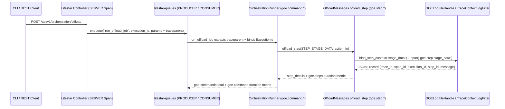

# Chapter 4.2: Orchestration Step Spans, Structured Log Correlation & Listener/Worker Telemetry

## Specification

## 1. Overview & Goals

With the OpenTelemetry runtime and `ExecutionId` context bridge established in Chapter 4.1 (`opentelemetry_foundation_and_context_propagation_20261010`), Chapter 4.2 instruments GOE's orchestration engine, logging pipeline, and Listener HTTP/MCP/Worker service:
1. **Command & Step Spans (`OrchestrationRunner` & `OffloadMessages.offload_step()`)**:
   - Wrap top-level orchestration commands (`offload`, `present`, `schema_sync`, `diag`) in `goe.command.<command_type_lower>` spans (`src/goe/orchestration/orchestration_runner.py:67-166` and `src/goe/goe.py:2386-2619`) and record `goe.commands.total` and `goe.command.duration` metrics.
   - Wrap `OffloadMessages.offload_step()` (`src/goe/offload/offload_messages.py:370-482`) in `goe.step.<step_id>` child spans via `bind_step_context(step_id)`, recording `goe.step.id`, `goe.step.code`, `goe.step.title`, `goe.step.status` (`"success"`, `"error"`, `"skipped"`), `goe.step.mandatory`, `goe.step.optional`, `goe.step.execute`, step detail dictionary entries (`staged_bytes`, `staged_rows`), exceptions (`span.record_exception`), and `goe.steps.duration` histograms.
   - Enrich `OracleOrchestrationRepoClient.start_command()` (`src/goe/persistence/oracle/oracle_orchestration_repo_client.py:256-286`) `command_parameters` JSON payload with `_trace_id` and `_span_id` when a recording span is active.
2. **Structured Log Correlation & `GOELogFileHandle` JSONL Sidecar**:
   - Implement `TraceContextLogFilter` (`src/goe/observability/logging.py`) injecting `trace_id`, `span_id`, `execution_id`, and `step_id` onto Python `logging.LogRecord` instances and Structlog contextvars.
   - Enhance `GOELogFileHandle` (`src/goe/util/goe_log_fh.py:28-74`) and `OffloadMessages.log()` (`src/goe/offload/offload_messages.py:291-327`) to support `GOE_LOG_FORMAT=json` and `GOE_LOG_JSON_SIDECAR=true` while keeping default `GOE_LOG_FORMAT=text` stdout and `.log` output 100% byte-for-byte identical.
   - Record `OffloadMessages.warning()` messages as OpenTelemetry span events (`log.warning`) on the active span.
3. **Listener HTTP, `litestar-queues` Worker & MCP Telemetry**:
   - Integrate `OpenTelemetryPlugin(OpenTelemetryConfig(...))` from `litestar.plugins.opentelemetry` into `create_app()` (`src/goe/listener/app.py:31-65`).
   - Enable `litestar_queues.observability.ObservabilityConfig(enable_otel=True, tracer_provider=..., meter_provider=...)` on `QueueConfig` and propagate W3C `traceparent` + `goe.execution.id` across `execute_offload_command` (`src/goe/listener/controllers/orchestration.py:110-127`) and `run_offload_job` (`src/goe/listener/jobs.py:17-22`).
   - Wrap Listener MCP tool invocations (`src/goe/listener/mcp.py`) in `goe.mcp.tool.<tool_name>` spans.

---

## 2. Technical Architecture



---

## 3. Task Breakdown

| Task ID | Title | Target Files | Dependencies |
| :--- | :--- | :--- | :--- |
| **Task 1.1** | `OrchestrationRunner` Command Spans & `OffloadMessages.offload_step()` Telemetry | `src/goe/observability/spans.py`, `src/goe/orchestration/orchestration_runner.py`, `src/goe/offload/offload_messages.py`, `src/goe/persistence/oracle/oracle_orchestration_repo_client.py`, `tests/unit/observability/test_step_and_command_spans.py` | Chapter 4.1 |
| **Task 1.2** | `TraceContextLogFilter`, `GOELogFileHandle` JSONL Enrichment & Warning Span Events | `src/goe/observability/logging.py`, `src/goe/util/goe_log_fh.py`, `src/goe/offload/offload_messages.py`, `src/goe/listener/config/logging.py`, `tests/unit/observability/test_log_correlation.py` | Task 1.1 |
| **Task 1.3** | Listener `OpenTelemetryPlugin`, `litestar-queues` Worker Context Propagation & MCP Tool Spans | `src/goe/listener/app.py`, `src/goe/listener/controllers/orchestration.py`, `src/goe/listener/jobs.py`, `src/goe/listener/mcp.py`, `tests/unit/observability/test_listener_and_worker_telemetry.py` | Task 1.1, Task 1.2 |

---

## 4. Verification Plan

```bash
export GOOGLE_API_USE_CLIENT_CERTIFICATE=false
uv run ruff format --check src/goe tests/unit/observability
uv run ruff check src/goe tests/unit/observability
uv run mypy src/goe
uv run pytest tests/unit/observability/ tests/unit/offload/test_offload_messages.py -v
```

## Implementation Plan

- [ ] 1.1 Implement `traced_command` and `traced_step` in `src/goe/observability/spans.py`, wire into `OrchestrationRunner`, `OffloadMessages.offload_step()`, and `OracleOrchestrationRepoClient`, and verify in `tests/unit/observability/test_step_and_command_spans.py`.
- [ ] 1.2 Implement `TraceContextLogFilter` and `structlog_trace_context_processor` in `src/goe/observability/logging.py`, wire JSON/JSONL sidecar support into `GOELogFileHandle` and `OffloadMessages`, and verify in `tests/unit/observability/test_log_correlation.py`.
- [ ] 1.3 Wire Litestar `OpenTelemetryPlugin` (`litestar.plugins.opentelemetry`), `litestar-queues` `ObservabilityConfig` and worker `traceparent` propagation, and MCP tool spans across `src/goe/listener/`, verified in `tests/unit/observability/test_listener_and_worker_telemetry.py`.

## Continuity Snapshot

- **Current State**: Planned (`plan_revision: 1`).
- **Next Action**: Execute Task `1.1` (`orchestration_step_and_listener_telemetry_20261010:1.1`).
