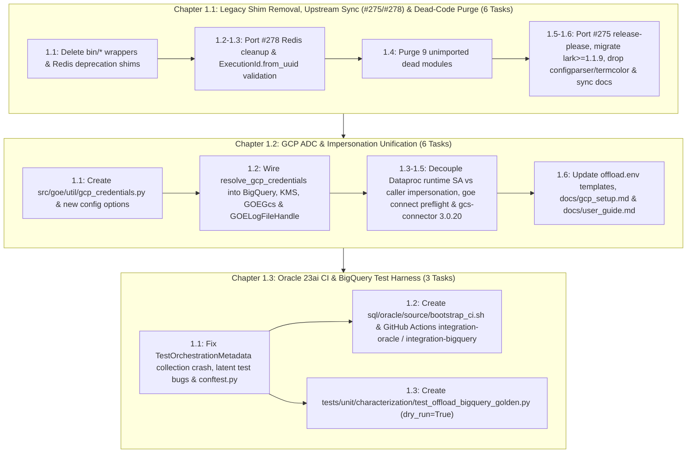

# Master PRD 1: Foundation, GCP Credential Unification & Automated Test Harness

## Specification

### 1. Executive Summary & Architectural Vision (Verified at `46890a8`)

This Master PRD establishes the Phase 1 foundation across three self-contained, sequentially ordered child flows (15 tasks total) before PRD 2's option/module/typing refactor, PRD 3's data-plane modernization, and PRD 4's OpenTelemetry observability rollout:

1. **Chapter 1.1 (`legacy_shim_removal_and_repo_hygiene_20261010`, 6 tasks `1.1`–`1.6`)**: Removes the seven `bin/*` CLI wrapper scripts and their packaging/test/shell references; deletes the `goe.util.redis_tools` and `goe.listener.utils.cache.RedisClient` deprecation shims; ports the non-listener Redis cleanup, `PRODUCT_NAME_GEL` / `src/goe/listener/utils/ping.py` removal, and `ExecutionId.from_uuid` validation (`_uuid_as_uuid`) from upstream `gluent/goe#278` (`dee61e8`) while preserving the fork's Litestar listener (`src/goe/listener/`) and `OracleOrchestrationRepoClient` introspection methods; deletes 9 confirmed unimported dead modules (`src/goe/conductor/`, `src/goe/listener/services/hybrid_view.py`, `src/goe/util/{serialization,env,text,uuids,exception_trigger,local_cache,retry_logic}.py`); ports upstream `gluent/goe#275` (`e12a818`) `release-please` + `pypi-publish` workflow, migrates `lark-parser` -> `lark>=1.1.9`, drops `configparser`/`termcolor`/`mypyc`, modernizes the Cloud Run `Dockerfile` to Python 3.12 via `uv`, and synchronizes documentation and OKF knowledge bundles.
2. **Chapter 1.2 (`gcp_adc_credential_unification_20261010`, 6 tasks `1.1`–`1.6`)**: Introduces the centralized `src/goe/util/gcp_credentials.py` resolver (`GcpCredentialBundle`, `resolve_gcp_credentials`, `resolve_gcloud_impersonation_principal`, `clear_gcp_credentials_cache`) and four `OrchestrationConfig` fields (`google_cloud_project`, `google_cloud_quota_project`, `google_impersonate_service_account`, `google_dataproc_impersonate_service_account`); wires credential bundles into `BackendBigQueryApi` (`bigquery.Client`, `kms.KeyManagementServiceClient`), `GOEGcs` (`storage.Client`, with `config` forwarded by `get_dfs_from_options`), and `GOELogFileHandle` (`gcsfs` `token=<Credentials>`, eliminating anonymous fallback); decouples Managed Spark serverless runtime `--service-account` from caller `--impersonate-service-account`; adds `goe connect` Google Cloud credential preflight and Managed Spark identity reporting; upgrades the bundled Cloud Storage Hadoop connector to `gcs-connector-3.0.20-shaded.jar` with `spark.hadoop.fs.gs.auth.type APPLICATION_DEFAULT`; and removes static key-file guidance across templates and docs.
3. **Chapter 1.3 (`oracle_ci_and_bigquery_test_harness_20261010`, 3 tasks `1.1`–`1.3`)**: Fixes the `TestOrchestrationMetadata.__init__` collection crash (`tests/integration/persistence/test_orchestration_metadata.py:139-145`), `self.config.db_type == DBTYPE_ORACLE` checks (`tests/integration/offload/test_offload_source_table.py:120,127`, `tests/unit/offload/test_offload_source_table.py:92`), and `text_in_log(messages, ...)` signature (`tests/testlib/test_framework/test_functions.py:120-124`, `tests/integration/orchestration/test_orchestration_runner.py:117`), and adds `tests/integration/conftest.py` + pytest markers; creates the non-interactive Oracle 23ai Free bootstrap script (`sql/oracle/source/bootstrap_ci.sh`), GitHub Actions CI jobs (`integration-oracle` and WIF `integration-bigquery` in `.github/workflows/test.yaml`), and `Makefile` targets; and builds the offline BigQuery dry-run golden characterization suite (`tests/unit/characterization/test_offload_bigquery_golden.py`).



---

### 2. Sequenced Chapter Roadmap

| Order | Flow ID | Title & Tasks | Scope Summary | Depends On |
| :--- | :--- | :--- | :--- | :--- |
| **1.1** | `legacy_shim_removal_and_repo_hygiene_20261010` | **Chapter 1.1: Remove Deprecated Shims, Port Upstream `#278`/`#275`, Purge Dead Modules, and Clean Up Dependencies** (6 tasks: `1.1`–`1.6`) | Delete `bin/*` wrappers and `redis_tools.py`/`RedisClient` shims (`1.1`); port upstream `#278` (`dee61e8`) non-Litestar Redis/listener cleanup, `PRODUCT_NAME_GEL`/`ping.py` removal, frontend stubs, and legacy `tools/` scripts (`1.2`); port `#278` `ExecutionId.from_uuid` validation (`1.3`); purge 9 unimported dead modules (`1.4`); port upstream `#275` (`e12a818`) `release-please` + `pypi-publish`, migrate `lark>=1.1.9`, drop `configparser`/`termcolor`/`mypyc`, and modernize Cloud Run `Dockerfile` (`1.5`); synchronize docs, `AGENTS.md`, and OKF knowledge bundles (`1.6`). | None |
| **1.2** | `gcp_adc_credential_unification_20261010` | **Chapter 1.2: Unified GCP Application Default Credentials & Service Account Impersonation** (6 tasks: `1.1`–`1.6`) | Create `src/goe/util/gcp_credentials.py` (`GcpCredentialBundle`, `resolve_gcp_credentials`, `resolve_gcloud_impersonation_principal`) and register `google_cloud_project`, `google_cloud_quota_project`, `google_impersonate_service_account`, and `google_dataproc_impersonate_service_account` (`1.1`); wire into `BackendBigQueryApi`, `GOEGcs`, `get_dfs_from_options`, and `GOELogFileHandle` (`1.2`); separate Managed Spark runtime `--service-account` from `--impersonate-service-account` (`1.3`); add `goe connect` GCP credential preflight and Managed Spark identity report (`1.4`); upgrade `gcs-connector` to `3.0.20-shaded` with `APPLICATION_DEFAULT` auth (`1.5`); update templates and docs (`1.6`). | `legacy_shim_removal_and_repo_hygiene_20261010` |
| **1.3** | `oracle_ci_and_bigquery_test_harness_20261010` | **Chapter 1.3: Oracle 23ai Free CI Container, BigQuery Integration Harness, and Golden Dry-Run Characterization Suite** (3 tasks: `1.1`–`1.3`) | Defer `TestOrchestrationMetadata` setup to `setUp()`, fix `self.config.db_type == DBTYPE_ORACLE` and `text_in_log(messages, ...)`, and add `tests/integration/conftest.py` + markers (`1.1`); create `sql/oracle/source/bootstrap_ci.sh`, GitHub Actions `integration-oracle` and WIF `integration-bigquery` jobs in `.github/workflows/test.yaml`, and `Makefile` targets (`1.2`); build `tests/unit/characterization/test_offload_bigquery_golden.py` (`1.3`). | `gcp_adc_credential_unification_20261010` |

---

### 3. Architectural Invariants & Resolved Decisions

1. **Single CLI Entrypoint**: `[project.scripts] goe = "goe.cli.main:cli"` (`pyproject.toml:71`, registered in `src/goe/cli/main.py:47-53`) is the sole CLI entrypoint across local installations, Cloud Run (`docs/google_cloud_run/goe.sh` and `Dockerfile`), and user documentation.
2. **In-Process Cache Only & Preserved Litestar Listener**: `MemoryCache` and `MemorySyncCache` (`src/goe/listener/utils/cache.py`) are the sole cache primitives for the Litestar listener (`src/goe/listener/`). All `listener_redis_*` config attributes, `cache_enabled()`, `redis_publish`, `redis_execution_id`, `goe.util.redis_tools`, `RedisClient` shims, `PRODUCT_NAME_GEL`, and `src/goe/listener/utils/ping.py` (`D-1.1-GEL` resolved) are removed while preserving `src/goe/listener/` and `OracleOrchestrationRepoClient`'s 5 schema introspection methods (`get_offloadable_schemas`, `get_schema_tables`, `get_table_columns`, `get_table_partitions`, `get_table_subpartitions`).
3. **Zero Dead Modules**: Confirmed unimported dead modules (`src/goe/conductor/`, `src/goe/listener/services/hybrid_view.py`, `src/goe/util/{serialization,env,text,uuids,exception_trigger,local_cache,retry_logic}.py`) are deleted prior to strict typing ratchets in PRD 2.
4. **Centralized Keyless GCP Credential Resolution**: Every Google Cloud SDK client (`google.cloud.bigquery.Client`, `google.cloud.kms.KeyManagementServiceClient`, `google.cloud.storage.Client`, `fsspec.filesystem("gs", ...)`) and `gcloud dataproc` command obtains credentials, target project, quota project, and caller impersonation settings exclusively via `src/goe/util/gcp_credentials.py` (`D2` resolved: project precedence `GOOGLE_CLOUD_PROJECT` -> ADC default project -> `BIGQUERY_DATASET_PROJECT`).
5. **Separation of Control-Plane Impersonation and Data-Plane Runtime SA**:
   - `GOOGLE_DATAPROC_IMPERSONATE_SERVICE_ACCOUNT` (falling back to `GOOGLE_IMPERSONATE_SERVICE_ACCOUNT`) governs `gcloud dataproc` caller impersonation (`--impersonate-service-account`) across `batches submit`, `batches describe`, and `jobs submit --cluster`.
   - `GOOGLE_DATAPROC_SERVICE_ACCOUNT` governs only the `gcloud dataproc batches submit pyspark --service-account=...` serverless workload runtime identity.
6. **Offline-Collectible Integration Suite & Golden Characterization Gate**: `GOE_NO_AUTOLOAD_ENV=1 uv run pytest tests/integration --collect-only` succeeds with zero environment variables configured (`147 tests collected`), and `tests/unit/characterization/test_offload_bigquery_golden.py` exercises RBO, IPA `RANGE`, IPA `LIST`/`RANGE`, PBO, and BigQuery `add_columns` completely offline (`dry_run=True, do_not_connect=True`).
7. **Public-Before-Private Function & Method Organization**: Every new or touched Python module and class in Chapters 1.1–1.3 groups all public and dunder (`__init__`, `__enter__`, `__exit__`, etc.) functions/methods together at the top and places private (`_...`) helper functions/methods at the bottom (moving `# PUBLIC METHODS` above `# PRIVATE METHODS` in legacy classes), verified by an AST ordering check in each task's verification block.

---

### 4. Cross-Cutting Verification Gates

Every task in Chapters 1.1–1.3 is gated by the AST public-before-private ordering check on its touched Python files plus the first four commands below, and `GOE_NO_AUTOLOAD_ENV=1 uv run pytest tests/integration --collect-only` becomes an active gate starting at Chapter 1.3 Task `1.1` (where `TestOrchestrationMetadata.__init__` is fixed):
```bash
export GOOGLE_API_USE_CLIENT_CERTIFICATE=false
uv run python -c "import ast,sys; is_priv=lambda n:n.startswith('_') and not (n.startswith('__') and n.endswith('__')); bad=[(p,getattr(s,'name','<module>'),f.name) for p in sys.argv[1:] for s in ast.walk(ast.parse(open(p).read())) if isinstance(s,(ast.Module,ast.ClassDef)) for funcs in [[n for n in s.body if isinstance(n,(ast.FunctionDef,ast.AsyncFunctionDef))]] for i,f in enumerate(funcs) if not is_priv(f.name) and any(is_priv(g.name) for g in funcs[:i])]; assert not bad, bad" <touched_python_files...>
uv run ruff check src tests
uv run ruff format --check src tests
uv run mypy src/goe
uv run pytest tests/unit
GOE_NO_AUTOLOAD_ENV=1 uv run pytest tests/integration --collect-only
```

---

## Implementation Plan

- [x] 1.1 [Chapter 1.1: Remove Deprecated Shims, Port Upstream `#278`/`#275`, Purge Dead Modules, and Clean Up Dependencies](../legacy_shim_removal_and_repo_hygiene_20261010/spec.md) — 6 tasks (`1.1`–`1.6`): remove `bin/*` wrappers and Redis shims (`1.1`), port `#278` Redis cleanup and remove `PRODUCT_NAME_GEL`/`ping.py` (`1.2`), port `#278` `ExecutionId.from_uuid` validation (`1.3`), purge 9 dead modules (`1.4`), port `#275` `release-please` and migrate dependencies/Dockerfile (`1.5`), and sync docs/OKF bundles (`1.6`).
- [x] 1.2 [Chapter 1.2: Unified GCP Application Default Credentials & Service Account Impersonation](../gcp_adc_credential_unification_20261010/spec.md) — 6 tasks (`1.1`–`1.6`): create `src/goe/util/gcp_credentials.py` and config options (`1.1`), wire BigQuery/KMS/`GOEGcs`/`GOELogFileHandle` (`1.2`), separate Managed Spark runtime SA from caller impersonation (`1.3`), add `goe connect` GCP preflight (`1.4`), upgrade `gcs-connector` to `3.0.20` (`1.5`), and update templates/docs (`1.6`).
- [x] 1.3 [Chapter 1.3: Oracle 23ai Free CI Container, BigQuery Integration Harness, and Golden Dry-Run Characterization Suite](../oracle_ci_and_bigquery_test_harness_20261010/spec.md) — 3 tasks (`1.1`–`1.3`): fix integration collection crash, latent test bugs, and `conftest.py` (`1.1`), create `sql/oracle/source/bootstrap_ci.sh` and CI jobs (`1.2`), and build `tests/unit/characterization/test_offload_bigquery_golden.py` (`1.3`).

---

## Continuity Snapshot

- **Flow / lifecycle**: `prd_01_foundation_adc_and_ci_harness_20261010` (`state: completed`).
- **Current task / claimant**: `current_task: null` / `claimed_by: null`.
- **Last verified checkpoint**: `bc6fc94`.
- **Plan identity**: `plan_revision: 3`, `plan_commit: null`.
- **State identity**: `state_revision: 3`.
- **Decisions**: `D-1.1-GEL` resolved (delete `PRODUCT_NAME_GEL` and `src/goe/listener/utils/ping.py` in Chapter 1.1 Task `1.2`) and `D2` resolved (BigQuery job project precedence: `GOOGLE_CLOUD_PROJECT` -> ADC default project -> `BIGQUERY_DATASET_PROJECT`).
- **Recent discoveries**: All 15 tasks across Chapters 1.1 (`4ecf09f`), 1.2 (`a3397e7`), and 1.3 (`bc6fc94`) are completed and verified (`644 passed` in `tests/unit`, `147 collected` in `tests/integration --collect-only`, `0` Ruff/Mypy errors).
- **Blockers**: `none`.
- **Next exact step**: Complete Flow review and proceed to Master PRD 2 (`prd_02_core_typing_options_and_decomposition_20261010`).
- **Relevant knowledge**: `.agents/bundles/knowledge/patterns/cli-architecture.md`, `.agents/bundles/knowledge/operations/configuration-and-env.md`, `.agents/bundles/knowledge/backends/bigquery.md`, `.agents/bundles/knowledge/storage/gcs.md`, `.agents/bundles/knowledge/transport/spark-dataproc.md`, `.agents/bundles/knowledge/standards/testing.md`.
