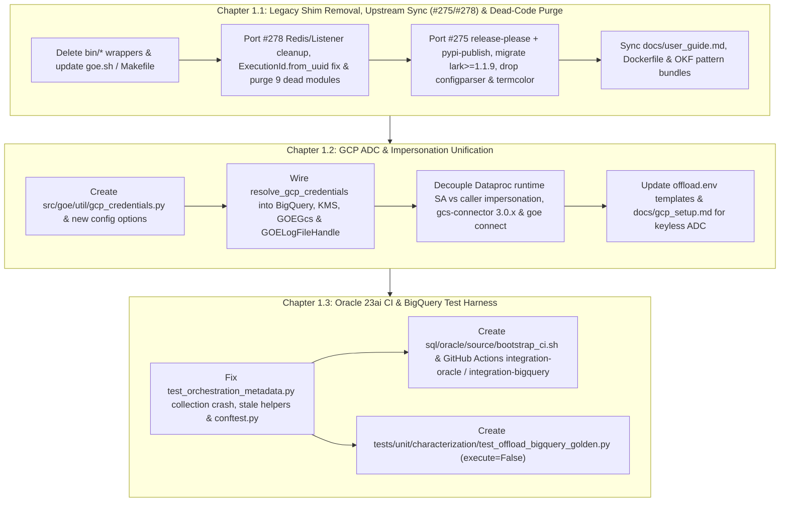

# PRD 1: Foundation Cleanup, Unified GCP ADC Auth, and CI Test Harness

## Specification

## Executive Summary & Strategic Vision

Before undertaking invasive structural refactoring of the GOE (Gluent Offload Engine) core—such as ratcheting strict `mypy` type checking, migrating options to `msgspec.Struct`, decomposing god modules, or modernizing the BigQuery/Oracle/DuckDB execution engines—the repository requires a clean, deterministic, and continuously verified foundation with zero unmerged upstream drift and zero dead code.

Currently, three foundational gaps create unnecessary surface area and operational risk:

1. **Residual Legacy Shims, Unmerged Upstream Commits (`#275` & `#278`), Stale Dependencies, & Dead Code**:
   - Seven deprecated `bin/*` CLI wrapper scripts and the `goe.util.redis_tools` / `RedisClient` deprecation shims remain in the codebase alongside legacy dependencies (`configparser`, `lark-parser`, `termcolor`) and an outdated Python 3.11 Cloud Run `Dockerfile`.
   - Two upstream `gluent/goe` commits landed after `next` branched and must be ported without losing our modernized Litestar Listener (`src/goe/listener/`):
     - **Upstream `#275` (`e12a818`, `chore: Add release-please workflow`)**: Adds `release-please-config.json`, `.release-please-manifest.json`, and `release-please` + `pypi-publish` (`pypa/gh-action-pypi-publish@release/v1` with `attestations: true`) automation to `.github/workflows/release.yaml`.
     - **Upstream `#278` (`dee61e8`, `chore: Remove Offload Listener code`)**: Removes legacy `listener_redis_*` config options and `cache_enabled()`, strips `redis_execution_id` / `redis_in_error` / `init_redis_execution_id()` / `redis_publish` / `cache.rpush` plumbing from core offload modules, removes dead `test_listener()` and `PRODUCT_NAME_GEL`, deletes legacy `tools/caller.py`, `tools/redis_subscribe.py`, `tools/goe-listener.service`, `tools/goe-listener.sh`, and `tools/migrate_spdx_headers.py`, ports `ExecutionId._uuid_as_uuid(u)` validation in `src/goe/orchestration/execution_id.py`, and removes dead `get_offloadable_schemas()` / `get_schema_tables()` stubs from Teradata and MSSQL frontend APIs while preserving `src/goe/listener/` and `OracleOrchestrationRepoClient` schema introspection methods.
   - Nine confirmed unimported dead modules (`src/goe/conductor/`, `src/goe/listener/services/hybrid_view.py`, `src/goe/util/serialization.py`, `src/goe/util/env.py`, `src/goe/util/text.py`, `src/goe/util/uuids.py`, `src/goe/util/exception_trigger.py`, `src/goe/util/local_cache.py`, `src/goe/util/retry_logic.py`) add maintenance and type-checking overhead with zero runtime callers.
2. **Fragmented GCP Credential & Project Resolution**: GOE's Google Cloud Platform integration is split across four independent code paths (`BackendBigQueryApi`, `GOEGcs`, `GOELogFileHandle`, and `OffloadTransportSparkBatchesGcloud` / `OffloadTransportSparkDataprocGcloud`) that advertise static service account JSON key files (`GOOGLE_APPLICATION_CREDENTIALS`) and conflate the caller's control-plane impersonation principal with the Dataproc worker runtime service account (`GOOGLE_DATAPROC_SERVICE_ACCOUNT`). Furthermore, `GOELogFileHandle` instantiates `fsspec.filesystem("gs")` without forwarding resolved credentials, causing `gcsfs` to silently fall back to anonymous access when ADC fails or when `GOOGLE_IMPERSONATE_SERVICE_ACCOUNT` is configured.
3. **Broken Integration Test Collection & Missing CI Safety Net**: Collecting `tests/integration` without a live `offload.env` and Oracle connection crashes immediately during `unittest.TestCase.__init__` in `tests/integration/persistence/test_orchestration_metadata.py:139-145`. Additionally, stale helper signatures (`text_in_log` in `tests/testlib/test_framework/test_functions.py:120-124` and `self.config == DBTYPE_ORACLE` in `tests/integration/offload/test_offload_source_table.py:121,128`) prevent clean execution, and CI (`test.yaml`) currently runs only unit tests (`pytest tests/unit`) without an Oracle 23ai Free container or a golden dry-run (`execute=False`) characterization suite for Oracle-to-BigQuery offloads.

This Master PRD establishes the Phase 1 foundation across three self-contained, sequentially ordered child flows:
1. **Chapter 1.1 (`legacy_shim_removal_and_repo_hygiene_20261010`)**: Removes all `bin/*` wrappers, `redis_tools.py` / `RedisClient` shims, and 9 dead modules; ports upstream `#278` (`dee61e8`) non-Litestar Redis/listener cleanup and `ExecutionId.from_uuid` validation; ports upstream `#275` (`e12a818`) `release-please` + `pypi-publish` workflow and migrates `lark-parser` -> `lark>=1.1.9` while dropping `configparser` and `termcolor`; and synchronizes documentation and OKF knowledge bundles.
2. **Chapter 1.2 (`gcp_adc_credential_unification_20261010`)**: Introduces a unified `resolve_gcp_credentials(config)` helper (`src/goe/util/gcp_credentials.py`) supporting standard ADC, Workload Identity Federation, and `GOOGLE_IMPERSONATE_SERVICE_ACCOUNT`, wires it into BigQuery, Cloud KMS, GCS (`google-cloud-storage` and `fsspec`/`gcsfs`), and `gcloud dataproc`, upgrades `gcs-connector` to `3.0.x`, and adds ADC preflight checks to `goe connect`.
3. **Chapter 1.3 (`oracle_ci_and_bigquery_test_harness_20261010`)**: Repairs integration test collection and stale helper signatures, adds a non-interactive Oracle 23ai Free bootstrap script (`sql/oracle/source/bootstrap_ci.sh`) and GitHub Actions CI job (`integration-oracle`) plus WIF-backed `integration-bigquery` workflow, and builds a deterministic golden dry-run (`execute=False`) characterization suite (`tests/unit/characterization/test_offload_bigquery_golden.py`) locking in Oracle-to-BigQuery SQL and DDL generation.

---

## Global Architecture & Boundaries



### Architectural Invariants
- **Single CLI Entrypoint**: `goe` (`src/goe/cli/__init__.py`) is the sole CLI entrypoint across local installations, Cloud Run (`docs/google_cloud_run/goe.sh` and `Dockerfile`), and user documentation.
- **In-Process Cache Only & Zero Legacy Redis Config**: `MemoryCache` and `MemorySyncCache` (`src/goe/listener/utils/cache.py`) are the sole cache primitives for the Litestar Listener (`src/goe/listener/`); all `listener_redis_*` config attributes, `cache_enabled()`, `redis_publish`, `redis_execution_id`, `goe.util.redis_tools`, and `RedisClient` shims are removed while preserving `src/goe/listener/` and `OracleOrchestrationRepoClient`'s 5 schema introspection methods (`get_offloadable_schemas`, `get_schema_tables`, `get_table_columns`, `get_table_partitions`, `get_table_subpartitions`).
- **Zero Dead Modules**: Confirmed unimported modules (`src/goe/conductor/`, `src/goe/listener/services/hybrid_view.py`, `src/goe/util/serialization.py`, `src/goe/util/env.py`, `src/goe/util/text.py`, `src/goe/util/uuids.py`, `src/goe/util/exception_trigger.py`, `src/goe/util/local_cache.py`, `src/goe/util/retry_logic.py`) are purged prior to strict typing ratchets in PRD 2.
- **Centralized GCP Credential Resolution**: Every Google Cloud SDK client (`google.cloud.bigquery.Client`, `google.cloud.kms.KeyManagementServiceClient`, `google.cloud.storage.Client`, `fsspec.filesystem("gs", ...)`) and `gcloud dataproc` subprocess obtains credentials, target project, quota project, and impersonation settings exclusively via `src/goe/util/gcp_credentials.py`.
- **Separation of Control-Plane Impersonation and Data-Plane Runtime SA**:
  - `GOOGLE_IMPERSONATE_SERVICE_ACCOUNT` (`config.google_impersonate_service_account`) governs control-plane API calls and `gcloud` CLI invocation (`CLOUDSDK_AUTH_IMPERSONATE_SERVICE_ACCOUNT` or `--impersonate-service-account`).
  - `GOOGLE_DATAPROC_SERVICE_ACCOUNT` (`config.google_dataproc_service_account`) governs only the `gcloud dataproc batches submit spark --service-account=...` runtime worker identity.
- **Offline-Collectible Integration Suite**: `uv run pytest tests/integration --collect-only` must succeed with zero environment variables or database connections configured, cleanly skipping live suites when credentials are absent while running in CI against `gvenzl/oracle-free:23-slim-faststart`.

---

## Sequenced Chapter Roadmap

| Chapter Order | Flow ID | Title | Scope Summary | Dependencies | Status |
| :--- | :--- | :--- | :--- | :--- | :--- |
| **1.1** | `legacy_shim_removal_and_repo_hygiene_20261010` | Chapter 1.1: Remove Deprecated Shims, Merge Upstream `#275`/`#278`, Purge Dead Modules, and Clean Up Dependencies | Delete `bin/*` wrappers; port upstream `#278` (`dee61e8`) non-Litestar Redis/listener cleanup and `ExecutionId.from_uuid` validation; delete `src/goe/util/redis_tools.py` and 9 dead modules (`conductor/`, `hybrid_view.py`, `serialization.py`, `env.py`, `text.py`, `uuids.py`, `exception_trigger.py`, `local_cache.py`, `retry_logic.py`); port upstream `#275` (`e12a818`) `release-please` + `pypi-publish` workflow; migrate `lark-parser` to `lark>=1.1.9`, remove `configparser` and `termcolor`, modernize Cloud Run `Dockerfile`, and update `docs/user_guide.md` and OKF bundles. | None | `planned` |
| **1.2** | `gcp_adc_credential_unification_20261010` | Chapter 1.2: Unified GCP Application Default Credentials & Service Account Impersonation | Create `src/goe/util/gcp_credentials.py` (`resolve_gcp_credentials`, `GcpCredentialBundle`, `build_gcloud_impersonation_env`), add `GOOGLE_CLOUD_PROJECT`, `GOOGLE_CLOUD_QUOTA_PROJECT`, `GOOGLE_IMPERSONATE_SERVICE_ACCOUNT`, and `GOOGLE_DATAPROC_IMPERSONATE_SERVICE_ACCOUNT` config options, wire into BigQuery, KMS, `GOEGcs`, `GOELogFileHandle`, and Dataproc transport, upgrade `gcs-connector` to `3.0.x`, add `goe connect` ADC preflight checks, and update templates/docs. | `legacy_shim_removal_and_repo_hygiene_20261010` | `planned` |
| **1.3** | `oracle_ci_and_bigquery_test_harness_20261010` | Chapter 1.3: Oracle 23ai Free CI Container, BigQuery Integration Harness, and Golden Dry-Run Characterization Suite | Fix `TestOrchestrationMetadata.__init__` collection crash and stale test helper bugs (`text_in_log`, `self.config.db_type`), add `tests/integration/conftest.py` and markers, create `sql/oracle/source/bootstrap_ci.sh` and CI workflows (`integration-oracle` and WIF `integration-bigquery`), and build `tests/unit/characterization/test_offload_bigquery_golden.py`. | `gcp_adc_credential_unification_20261010` | `planned` |

---

## Cross-Cutting Requirements & Quality Gates

Every child flow and task worksheet in this PRD must satisfy the following repository gates before completion:

1. **Static Analysis & Type Checking**:
   ```bash
   export GOOGLE_API_USE_CLIENT_CERTIFICATE=false
   uv run ruff check
   uv run ruff format --check
   uv run mypy src/goe
   ```
2. **Unit & Characterization Test Suite**:
   ```bash
   export GOOGLE_API_USE_CLIENT_CERTIFICATE=false
   uv run pytest tests/unit
   ```
3. **Offline Integration Test Collection Gate**:
   ```bash
   export GOOGLE_API_USE_CLIENT_CERTIFICATE=false
   GOE_NO_AUTOLOAD_ENV=1 uv run pytest tests/integration --collect-only
   ```
4. **Code Style & Hygiene Standards**:
   - All Python files must begin with the 2-line SPDX header (`# SPDX-FileCopyrightText: 2026 The GOE Authors` and `# SPDX-License-Identifier: Apache-2.0`).
   - All imports must be placed at module top-level (or within module-level `if TYPE_CHECKING:` blocks); nested function-scoped imports are prohibited.
   - Zero inline `#` comments inside Python code; all design rationale and step explanations belong in Google-style docstrings.
   - Modern Python >=3.12 typing (`list`, `dict`, `X | None`) throughout all touched modules.

---

## Continuity Snapshot

- **Current State**: Master PRD 1 and all three child chapter flows (`legacy_shim_removal_and_repo_hygiene_20261010`, `gcp_adc_credential_unification_20261010`, `oracle_ci_and_bigquery_test_harness_20261010`) are planned with decision-complete task worksheets (`1.1`–`1.4`, `1.1`–`1.4`, `1.1`–`1.3`), incorporating upstream commits `#275` (`e12a818`) and `#278` (`dee61e8`) and purging all 9 unimported dead modules.
- **Next Action**: Execute Chapter 1.1 (`legacy_shim_removal_and_repo_hygiene_20261010`) starting at Task `1.1`, followed sequentially by Chapter 1.2 and Chapter 1.3.
