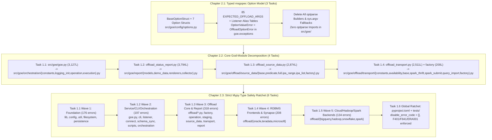

# Master PRD 2: Typed Option Models, Core God-Module Decomposition & Strict Mypy Type Safety

## Specification

### 1. Executive Summary & Architectural Vision (verified at `46890a8`)

The **Gluent Offload Engine (GOE)** v2 modernization has already migrated CLI entrypoints to `rich-click` (`src/goe/cli/`), listener endpoints to `Litestar` (`src/goe/listener/`), and persistence payloads to `msgspec` (`src/goe/persistence/schemas.py`). However, the internal orchestration core still has three structural bottlenecks:

1. **Legacy `optparse` Option Bags, Duplicate Alias Tables & Dead Parser Glue**: Even though `rich-click` parses CLI flags in `src/goe/cli/commands/*.py`, the five operational commands (`connect`, `offload`, `report`, `sync`, `validate`) convert their parsed dictionary back into a legacy `optparse.Values` instance (`from optparse import Values`) and call legacy `optparse.OptionParser` builders (`get_common_options`, `get_options`, `get_options_from_list`, `get_offload_options`, `get_connect_opts`, `get_offload_status_report_opts`, `get_schema_sync_opts`, `get_agg_validate_options`) purely to populate defaults. At baseline `46890a8`, 14 production modules plus one test module import `optparse` (`OptionParser`, `OptionGroup`, `Option`, `Values`, `SUPPRESS_HELP`, `OptionValueError`). `EXPECTED_OFFLOAD_ARGS` (`src/goe/goe.py:154-240`) defines **85** ordered keys, while `src/goe/listener/schemas.py:160-282` declares **96** REST fields (all 84 non-`operation_name` keys from `EXPECTED_OFFLOAD_ARGS` plus 10 alias fields — 6 rename aliases, 3 CSV aliases, and `subpartitions` — plus `quiet`/`verbose`) with inline alias dicts inside `OffloadOptions.to_params_dict()`.
2. **Monolithic God-Modules (12,506 Lines Across 5 Files)**: Core domain logic is concentrated in multi-thousand-line modules — `src/goe/offload/offload_status_report.py` (3,794 lines), `src/goe/goe.py` (3,127 lines), `src/goe/offload/offload_source_data.py` (2,874 lines), and `src/goe/offload/offload_transport.py` (2,511 lines) plus `src/goe/offload/factory/offload_transport_factory.py` (200 lines). These files mix option normalisation, orchestration state machines, SQL generation, transport execution, and report rendering, causing circular import hazards and high cognitive load.
3. **Suppressed Static Type Checking (`mypy`) & Dead-Code Lint**: In `pyproject.toml:279-326`, `[tool.mypy]` disables 14 core error codes (`attr-defined`, `assignment`, `arg-type`, `has-type`, `union-attr`, `misc`, `call-arg`, `call-overload`, `override`, `index`, `return-value`, `var-annotated`, `operator`, `name-defined`), leaves `check_untyped_defs` unset and `disallow_incomplete_defs = false`, and sets `ignore_errors = true` for `goe.listener.*`, `goe.connect.*`, and `goe.schema_sync.*`. Running the target strict gate (`--config-file= --ignore-missing-imports --follow-imports=silent --check-untyped-defs --disallow-incomplete-defs --warn-redundant-casts --warn-unused-ignores`) at `46890a8` reveals **1,095 errors across 106 files** in `src/goe` (**1,033** in live modules after PRD 1 deletes 10 dead modules), and `ruff check --select F401,F841,ERA001` reports **105** findings (86 in `src/`).

Master PRD 2 eliminates these three bottlenecks in strict dependency order while enforcing **100% feature parity and zero dead code — every refactor deletes the legacy parsers, dead helpers, and duplicate tables it supersedes**.

---

### 2. Ordered Child Flows (Chapters)

| Order | Flow ID | Title & Tasks | Primary Scope | Depends On |
| :--- | :--- | :--- | :--- | :--- |
| **2.1** | `typed_msgspec_option_model_20261010` | **Chapter 2.1: Typed msgspec Option Model & optparse Elimination** (3 tasks: `1.1`–`1.3`) | Define `BaseOptionStruct` and the 7 typed `msgspec.Struct` option classes (`CommonOptions`, `TableOperationOptions`, `OffloadOperationOptions`, `AggValidateOptions`, `ConnectOptions`, `StatusReportOptions`, `SchemaSyncOptions`) plus `EXPECTED_OFFLOAD_ARGS` (85 keys) and `LISTENER_OFFLOAD_RENAME_ALIASES` / `LISTENER_OFFLOAD_CSV_ALIASES` in `src/goe/config/options.py`; alias `OptionValueError = OffloadOptionError` in `src/goe/exceptions.py`; migrate all CLI commands and runners; delete all `optparse` builders (`check_posint`, `GOEOptionTypes`, `get_common_options`, `get_oracle_options`, `get_options`, `get_options_from_list`, `get_offload_options`, `get_connect_opts`, `get_offload_status_report_opts`, `get_schema_sync_opts`, `GOE_OPTIONS`, `get_agg_validate_options`, `parse_args`, `agg_validate.main`); share canonical keys and alias tables with `src/goe/listener/schemas.py` (`D-2.1-A`). | PRD 1 (`prd_01_foundation_adc_and_ci_harness_20261010`) |
| **2.2** | `core_god_module_decomposition_20261010` | **Chapter 2.2: Core God-Module Decomposition** (4 tasks: `1.1`–`1.4`) | Decompose `src/goe/goe.py` into `src/goe/orchestration/{constants,logging_init,operation,execution}.py`, `src/goe/offload/offload_status_report.py` into `src/goe/report/{models,demo_data,renderers,collector}.py`, `src/goe/offload/offload_source_data.py` into `src/goe/offload/source_data/{base,predicate,full,ipa_range,ipa_list,factory}.py`, and `src/goe/offload/offload_transport.py` + `factory/offload_transport_factory.py` into `src/goe/offload/transport/{constants,availability,base,spark_thrift,spark_submit,query_import,factory}.py` by verbatim moves; delete proven zero-caller dead code; leave each legacy module as a definition-free `from <mod> import name as name` facade over its observed import surface. | Chapter 2.1 (`typed_msgspec_option_model_20261010`) |
| **2.3** | `strict_mypy_type_safety_ratchet_20261010` | **Chapter 2.3: Strict Mypy Type Safety Ratchet** (6 tasks: `1.1`–`1.6`) | Ratchet every live package in `src/goe/` to zero errors under `--config-file= --ignore-missing-imports --follow-imports=silent --check-untyped-defs --disallow-incomplete-defs --warn-redundant-casts --warn-unused-ignores` and zero `F401`/`F841`/`ERA001` findings across five disjoint package waves (`1.1` foundation, `1.2` service/CLI/orchestration, `1.3` offload core/report, `1.4` Oracle/Teradata/Microsoft, `1.5` BigQuery/Hadoop/Snowflake/Spark), then in `1.6` clean residual `tests/` dead code and enable the strict `[tool.mypy]` and `[tool.ruff.lint]` gates in `pyproject.toml`. | Chapter 2.2 (`core_god_module_decomposition_20261010`) |

---

### 3. Cross-Cutting Architectural Invariants

1. **100% Feature Parity & Zero Dead Code**:
   - Every option field across all 85 `EXPECTED_OFFLOAD_ARGS`, every builder default (verified by the Task 2.1.1 parity gate against `parser.get_default_values().__dict__`), every environment variable fallback (`src/goe/config/orchestration_defaults.py` via `msgspec.field(default_factory=...)`), and every option normalisation and cross-field validation rule (`src/goe/offload/option_validation.py`, `normalise_options`, `normalise_offload_status_report_options`, `normalise_schema_sync_options`, `post_process_args`) is preserved with 100% behavioral parity.
   - Superseded `optparse` builders and dead functions/classes (`silent_close`, `normalise_column_transformations`, `canonical_to_rdbms_mappings`, `get_synthetic_partition_cols`, `dev_logger`, `_pretty_print_report_data`, `datetime_literal_to_hv`, `override_source_partitions`, `OffloadSourceDataIUPartitioned`) are deleted with zero-caller evidence.
2. **Slot-Based `msgspec.Struct` Option Hierarchy & Import-Leaf Discipline**:
   - `src/goe/config/options.py` is an import leaf importing only stdlib, `msgspec`, `goe.lib.schemas.BaseStruct`, and `goe.config.orchestration_defaults`. It never imports `goe.goe`, `goe.offload`, `goe.filesystem`, or `goe.listener`.
   - Every option struct declares `kw_only=True` without `dict=True`: `msgspec` stores fields in slots (`copy.copy`/`copy.deepcopy` drop undeclared side-`__dict__` attributes), so every attribute any normaliser writes is a declared struct field, undeclared attribute writes raise `AttributeError`, and `BaseOptionStruct.from_mapping()` raises `TypeError` on unknown keys.
   - Listener `OffloadOptions` (`src/goe/listener/schemas.py`) retains its REST wire defaults (`execute=True`, `None` unset sentinels) so REST payloads preserve alias mapping and record only caller-supplied parameters in `COMMAND_EXECUTION.COMMAND_INPUT`, while importing `EXPECTED_OFFLOAD_ARGS`, `LISTENER_OFFLOAD_RENAME_ALIASES`, and `LISTENER_OFFLOAD_CSV_ALIASES` from `goe.config.options` and adding `to_operation_options() -> OffloadOperationOptions` to hydrate omitted fields from canonical `OffloadOperationOptions` defaults (`D-2.1-A`).
3. **Definition-Free Re-Export Facades & Acyclic Package `__init__.py` Files**:
   - After Chapter 2.2, `src/goe/goe.py`, `src/goe/offload/offload_status_report.py`, `src/goe/offload/offload_source_data.py`, `src/goe/offload/offload_transport.py`, and `src/goe/offload/factory/offload_transport_factory.py` contain only a module docstring and `from <defining_module> import name as name` re-exports for their AST-verified import surfaces.
   - New package `__init__.py` files (`src/goe/report/__init__.py`, `src/goe/offload/source_data/__init__.py`, `src/goe/offload/transport/__init__.py`) and `src/goe/orchestration/__init__.py` contain only the SPDX header and docstring so submodule imports never trigger package-wide circular imports.
4. **Canonical Option Exception & Strict Typing Discipline**:
   - `OffloadOptionError` (`src/goe/exceptions.py`) is the single canonical option exception, with `OptionValueError = OffloadOptionError` exported from `src/goe/exceptions.py`.
   - All new and modified Python files start with the 2-line SPDX header, place imports at module top-level (or module-level `if TYPE_CHECKING:`), use PEP 585/604 syntax (`list`, `dict`, `X | None`), contain zero inline `#` comments inside functions/classes, and add zero `# type: ignore` directives.

---

### 4. Decisions Across PRD 2

- **`D-2.1-A` (Listener `OffloadOptions` schema strategy — RESOLVED)**: Subclassing `OffloadOperationOptions` in `src/goe/listener/schemas.py` would replace REST wire defaults (`None` for unset fields, `execute=True`) with CLI defaults (`execute=False`, environment-derived values) and break alias precedence. Resolved in Chapter 2.1 Task 1.3: keep the REST wire defaults on `OffloadOptions`, import `EXPECTED_OFFLOAD_ARGS`, `LISTENER_OFFLOAD_RENAME_ALIASES`, and `LISTENER_OFFLOAD_CSV_ALIASES` from `goe.config.options`, add `OffloadOptions.to_operation_options() -> OffloadOperationOptions` to hydrate omitted fields from the single canonical `OffloadOperationOptions` default set, and enforce field-set equality via `test_offload_options_fields_track_expected_offload_args`.
- **`D-2.2-A` (Missing HTML template `offload_status_report/goe_offload_status_report.html` — RESOLVED)**: The HTML report template is absent at `46890a8`, so HTML report generation raises `jinja2.TemplateNotFound` at baseline. Resolved for Chapter 2.2 Task 1.2: preserve the `src/goe/templates/` lookup path verbatim (`Path(__file__).resolve().parent.parent / "templates"`) and characterize the current `TemplateNotFound` behavior.
- **`D-2.2-B` (`OffloadStatusReport.__init__` reads `self._execute` before assignment — RESOLVED)**: In `src/goe/offload/offload_status_report.py:190,239`, `self._execute` is read before `self._execute = options.execute` at L243, and `__init__` opens a live Oracle connection. Resolved for Chapter 2.2 Task 1.2: move `__init__` verbatim to preserve 100% behavioral parity during decomposition and construct the report in unit characterization tests via `OffloadStatusReport.__new__`.

---

### 5. Verification & Acceptance Gates

Every task across Chapters 2.1, 2.2, and 2.3 is gated by:
- `export GOOGLE_API_USE_CLIENT_CERTIFICATE=false`
- `uv run ruff check --no-fix --select F401,F841,ERA001 <owned_paths>` (and repo-wide in `make lint` upon completion of Chapter 2.3 Task 1.6)
- `uv run ruff check` and `uv run ruff format --check`
- `uv run mypy src/goe` (plus the config-independent `--config-file=` strict gate per wave in Chapter 2.3)
- `uv run pytest tests/unit` and `GOE_NO_AUTOLOAD_ENV=1 uv run pytest tests/integration --collect-only -q`
- `! git grep -n optparse src/goe` upon completion of Chapter 2.1 Task 1.3
- `disable_error_code = []`, `check_untyped_defs = true`, `disallow_incomplete_defs = true`, and `! git grep -n "type: ignore" -- src/goe` upon completion of Chapter 2.3 Task 1.6.

## Implementation Plan

- [ ] 2.1 [Chapter 2.1: Typed msgspec Option Model & optparse Elimination](../typed_msgspec_option_model_20261010/spec.md) — 3 tasks (`1.1`–`1.3`): create `src/goe/config/options.py` and alias `OptionValueError` (`1.1`), migrate `connect`/`report`/`sync`/`validate` and delete their builders (`1.2`), migrate `offload`, delete core builders in `goe.py`/`offload.py`, and share listener constants (`1.3`).
- [ ] 2.2 [Chapter 2.2: Core God-Module Decomposition](../core_god_module_decomposition_20261010/spec.md) — 4 tasks (`1.1`–`1.4`): decompose `goe.py` into `src/goe/orchestration/` (`1.1`), `offload_status_report.py` into `src/goe/report/` (`1.2`), `offload_source_data.py` into `src/goe/offload/source_data/` (`1.3`), and `offload_transport.py` + `offload_transport_factory.py` into `src/goe/offload/transport/` (`1.4`).
- [ ] 2.3 [Chapter 2.3: Strict Mypy Type Safety Ratchet](../strict_mypy_type_safety_ratchet_20261010/spec.md) — 6 tasks (`1.1`–`1.6`): five package waves covering foundation (`1.1`), service/CLI/orchestration (`1.2`), offload core/report (`1.3`), RDBMS frontends & Synapse (`1.4`), and cloud/Hadoop/Spark backends (`1.5`), followed by the global `pyproject.toml` strict mypy and `F401`/`F841`/`ERA001` ratchet (`1.6`).

## Continuity Snapshot

- **Flow / lifecycle**: `prd_02_core_typing_options_and_decomposition_20261010` (`state: planned`).
- **Current task / claimant**: `current_task: null` / `claimed_by: null`.
- **Last verified checkpoint**: `none`.
- **Plan identity**: `plan_revision: 3`, `plan_commit: null`.
- **State identity**: `state_revision: 0`.
- **Decisions**: `D-2.1-A`, `D-2.2-A`, and `D-2.2-B` resolved.
- **Recent discoveries**: All 13 task worksheets across Chapters 2.1, 2.2, and 2.3 have been verified against `HEAD` (`46890a8`), including full `src/goe/config/options.py` struct definitions, deterministic SHA-256 report rendering digests, and strict mypy wave partitions.
- **Blockers**: PRD 1 (`prd_01_foundation_adc_and_ci_harness_20261010`) must complete first.
- **Next exact step**: execute Chapter 2.1 (`typed_msgspec_option_model_20261010`), Task `1.1` ([../typed_msgspec_option_model_20261010/tasks/1.1.md](../typed_msgspec_option_model_20261010/tasks/1.1.md)).
- **Relevant knowledge**: `.agents/bundles/knowledge/workflow.md`, `.agents/bundles/knowledge/patterns/cli-architecture.md`, `.agents/bundles/knowledge/patterns/serialization-and-utils.md`, `.agents/bundles/knowledge/patterns/offload-and-typing.md`.
