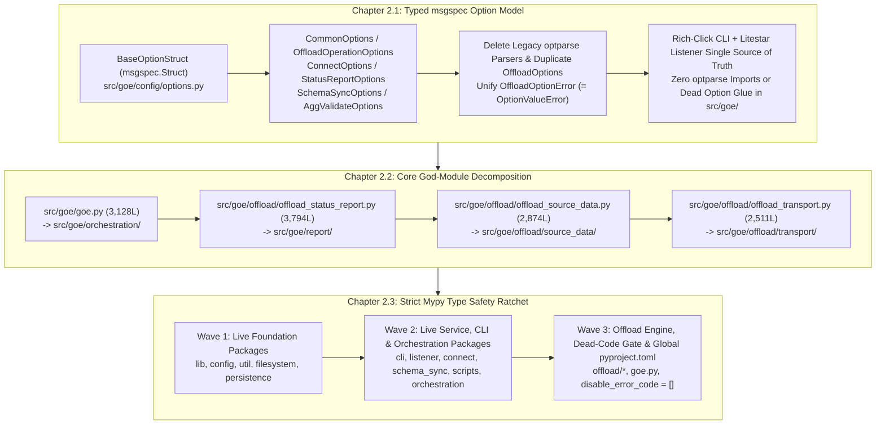

# Master PRD 2: Typed Option Models, Core God-Module Decomposition & Strict Mypy Type Safety

## Specification

### 1. Executive Summary & Architectural Vision

The **Gluent Offload Engine (GOE)** v2 modernization has already migrated CLI entrypoints to `rich-click` (`src/goe/cli/`), listener endpoints to `Litestar` (`src/goe/listener/`), and persistence payloads to `msgspec` (`src/goe/persistence/schemas.py`). However, the internal orchestration core continues to suffer from three structural bottlenecks that impede static analysis, testability, and safe evolution:

1. **Legacy `optparse` Option Bags, Duplicate Schemas & Dead Parser Glue**: Even though `rich-click` parses CLI flags in `src/goe/cli/commands/*.py`, every CLI command converts its parsed dictionary back into a legacy `optparse.Values` instance (`from optparse import Values`) and calls legacy `optparse.OptionParser` builders (`get_options`, `get_offload_options`, `get_connect_opts`, `get_offload_status_report_opts`, `get_schema_sync_opts`, `get_agg_validate_options`) purely to populate defaults. Furthermore, 14 source modules still import `optparse` (`OptionParser`, `OptionGroup`, `Option`, `Values`, `SUPPRESS_HELP`, `OptionValueError`), and `src/goe/listener/schemas.py` duplicates a 96-field `OffloadOptions` schema and custom alias normalization in `OffloadOptions.to_params_dict()` to avoid a circular import with `src/goe/goe.py`.
2. **Monolithic God-Modules (>1,500 Lines)**: Core domain logic is concentrated in multi-thousand-line modules—most notably `src/goe/offload/offload_status_report.py` (3,794 lines), `src/goe/goe.py` (3,128 lines), `src/goe/offload/offload_source_data.py` (2,874 lines), and `src/goe/offload/offload_transport.py` (2,511 lines). These files mix option parsing, orchestration state machines, SQL generation, transport execution, and console formatting, causing circular import hazards and high cognitive load.
3. **Suppressed Static Type Checking (`mypy`)**: In `pyproject.toml:279-326`, `[tool.mypy]` currently disables 14 core error codes (`attr-defined`, `assignment`, `arg-type`, `has-type`, `union-attr`, `misc`, `call-arg`, `call-overload`, `override`, `index`, `return-value`, `var-annotated`, `operator`, `name-defined`), sets `disallow_untyped_defs = false`, and completely ignores `goe.listener.*`, `goe.connect.*`, and `goe.schema_sync.*`.

Master PRD 2 eliminates these three bottlenecks in strict dependency order while enforcing a non-negotiable engineering rule: **100% feature parity and zero dead code—every refactor must delete the legacy parsers, wrappers, and duplicate schemas it supersedes**.

---

### 2. Ordered Child Flows (Chapters)

| Order | Flow ID | Title | Primary Scope | Depends On |
| :--- | :--- | :--- | :--- | :--- |
| **2.1** | `typed_msgspec_option_model_20261010` | **Chapter 2.1: Typed msgspec Option Model & optparse Elimination** | Define `BaseOptionStruct` and typed `msgspec.Struct` option hierarchies in `src/goe/config/options.py` with 100% parity across all 84 `EXPECTED_OFFLOAD_ARGS`, 12 CLI aliases, environment variable fallbacks, and `option_validation.py` rules; delete all superseded `optparse` parsers/wrappers in `goe.py`, `offload.py`, `connect.py`, `offload_status_report.py`, `schema_sync.py`, `agg_validate.py`, `logmgr.py`, and `option_mixin.py`; delete the duplicate 96-field `OffloadOptions` body in `src/goe/listener/schemas.py` by subclassing/aliasing `OffloadOperationOptions`. | PRD 1 (`cli`, `listener`, and dead-code cleanup baseline) |
| **2.2** | `core_god_module_decomposition_20261010` | **Chapter 2.2: Core God-Module Decomposition** | Decompose monolithic core files (`src/goe/goe.py`, `src/goe/offload/offload_status_report.py`, `src/goe/offload/offload_source_data.py`, `src/goe/offload/offload_transport.py`) into focused domain subpackages (`src/goe/orchestration/`, `src/goe/report/`, `src/goe/offload/source_data/`, `src/goe/offload/transport/`) while preserving public import facades and deleting duplicate in-file definitions. | Chapter 2.1 |
| **2.3** | `strict_mypy_type_safety_ratchet_20261010` | **Chapter 2.3: Strict Mypy Type Safety Ratchet** | Add PEP 585/604 type annotations across all live foundation, service, and offload packages (excluding the 10 dead modules deleted in PRD 1 Chapter 1.1); remove `ignore_errors = true` overrides for `goe.listener.*`, `goe.connect.*`, and `goe.schema_sync.*`; eliminate all 14 `disable_error_code` suppressions in `pyproject.toml`; enforce dead-code (`F401`, `F841`, `ERA001`) and strict `mypy` gates in `make lint`. | Chapter 2.1, Chapter 2.2 |

---

### 3. Cross-Cutting Architectural Invariants

1. **100% Feature Parity & Zero Dead Code**:
   - Every option field across all 84 `EXPECTED_OFFLOAD_ARGS`, all 12 CLI/API option aliases, all environment variable fallbacks (`src/goe/config/orchestration_defaults.py`), and all option normalization and cross-field validation rules (`src/goe/offload/option_validation.py`, `normalise_options`, `normalise_offload_status_report_options`, `normalise_schema_sync_options`, `post_process_args`) must be preserved with 100% behavioral parity.
   - Refactoring must never leave behind dead wrappers, unused `optparse.OptionParser` builders, duplicate schema bodies, or orphaned helper modules. Superseded `optparse` functions (`get_offload_option_parser`, `init_common_options`, `get_common_options`, `offload_options`, `get_oracle_options`, `get_options`, `get_options_from_list`, `GOEOptionTypes`, `check_posint`, `get_offload_options`, `get_connect_opts`, `get_offload_status_report_opts`, `get_schema_sync_opts`, `get_agg_validate_options`, `parse_args`), any `option_mixin.py` / `logmgr.py` `optparse` glue, and the duplicate 96-field `OffloadOptions` body in `src/goe/listener/schemas.py` must be deleted outright.
2. **`msgspec.Struct` Option Compatibility & Zero Circular Imports**:
   - `src/goe/config/options.py` is a foundational leaf module that imports only standard library types, `msgspec`, `goe.exceptions`, `goe.lib.schemas.BaseStruct`, and `goe.config.orchestration_defaults`. It must **never** import `goe.goe`, `goe.offload.offload_messages`, or `goe.filesystem.goe_dfs` at module top level so both `src/goe/cli/commands/*.py` and `src/goe/listener/schemas.py` can import canonical option structs without circular imports.
   - `BaseOptionStruct` subclasses `BaseStruct` (`kw_only=True`, `omit_defaults=False`, `dict=True`) and provides mapping-and-namespace compatibility helpers (`.get(key, default=None)`, `__contains__`, `__getitem__`, `__setitem__`, `to_dict()`, `from_mapping()`, and `copy.copy()`/`copy.deepcopy()` support) so orchestration callers that inspect `getattr(options, k)`, `options.__dict__`, or `k in options.__dict__` operate identically on typed structs.
3. **Canonical Option Exception Hierarchy**:
   - `OffloadOptionError` in `src/goe/exceptions.py:9-15` is the single canonical exception raised for invalid CLI/API option values across all GOE packages. `OptionValueError = OffloadOptionError` is exported from `src/goe/exceptions.py` so existing `except (OffloadOptionError, OptionValueError):` blocks and unit tests operate without importing `optparse`.
4. **Strict Code Style & Typing Discipline**:
   - All new and modified Python files must begin with the 2-line SPDX header (`# SPDX-FileCopyrightText: 2026 The GOE Authors` / `# SPDX-License-Identifier: Apache-2.0`), place all imports at module top-level (or `if TYPE_CHECKING:` at module top-level), use PEP 585 built-in generics (`list`, `dict`, `tuple`, `set`) and PEP 604 union types (`X | None`), use Google-style docstrings, and contain **zero** inline `#` comments inside functions or classes.

---

### 4. Verification & Acceptance Gates

Every task across Chapters 2.1, 2.2, and 2.3 is gated by:
- `uv run ruff check --select F401,F841,ERA001 src/ tests/` (zero unused imports, unused variables, or commented-out dead code)
- `uv run ruff check src/ tests/` and `uv run ruff format --check src/ tests/`
- `uv run mypy src/goe`
- `GOOGLE_API_USE_CLIENT_CERTIFICATE=false uv run pytest tests/unit`
- Zero occurrences of `import optparse` or `from optparse` in `src/goe/` upon completion of Chapter 2.1 (`! git grep optparse src/goe/`).
- Zero `disable_error_code` entries for production `src/goe` modules upon completion of Chapter 2.3.

## Implementation Plan

- [ ] 2.1 `typed_msgspec_option_model_20261010` — Replace `optparse.Values` and `OptionParser` builders with canonical `msgspec.Struct` option models in `src/goe/config/options.py`, delete all superseded `optparse` parsers and duplicate `OffloadOptions` schema definitions, and remove all `optparse` imports from `src/goe/`.
- [ ] 2.2 `core_god_module_decomposition_20261010` — Decompose `goe.py`, `offload_status_report.py`, `offload_source_data.py`, and `offload_transport.py` into focused domain packages.
- [ ] 2.3 `strict_mypy_type_safety_ratchet_20261010` — Ratchet `mypy` configuration in `pyproject.toml` across three waves of live packages to full strictness with zero suppressed error codes and zero dead code.

## Continuity Snapshot

- **Current State**: Master PRD 2 planned with 3 sequenced child flows (`2.1`, `2.2`, `2.3`) enforcing 100% feature parity and zero dead code.
- **Next Action**: Execute Chapter 2.1 (`typed_msgspec_option_model_20261010`), Task `1.1`.
