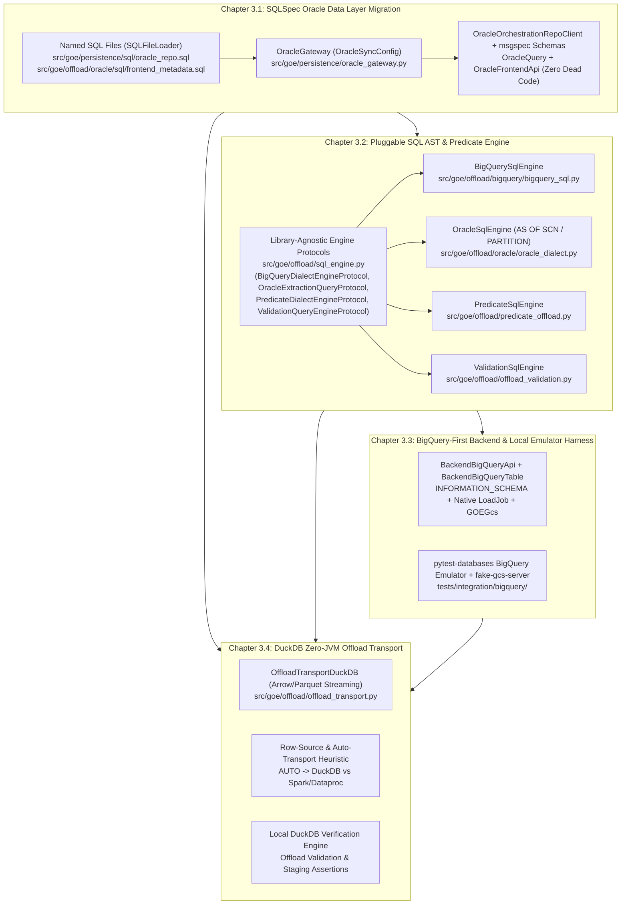

# Master PRD 3: SQLSpec Data Layer, Pluggable SQL AST Engine, BigQuery-First Backend & DuckDB Offload Transport

## Specification

## 1. Executive Summary & Architectural Vision

The **Gluent Offload Engine (GOE)** currently executes database queries, generates cross-engine SQL, and transports bulk table data through a legacy collection of ad-hoc abstractions:

1. **Fragmented Oracle Data Access**: `OracleOrchestrationRepoClient` (`src/goe/persistence/oracle/oracle_orchestration_repo_client.py`), `OracleQuery` (`src/goe/util/ora_query.py`), and `OracleFrontendApi` (`src/goe/offload/oracle/oracle_frontend_api.py`) maintain duplicate cursor lifecycles, manual `DB_TYPE_LONG_STRING` / `DB_TYPE_LONG_RAW` LOB output handlers, and multi-hundred-line inline f-string SQL queries (`get_schema_tables`, `get_offloadable_schemas`).
2. **String-Interpolated SQL, Extraction Row-Sources & Predicate Generation**: `BackendBigQueryApi` (`src/goe/offload/bigquery/bigquery_backend_api.py`), `OracleOffloadTransportRdbmsApi` (`src/goe/offload/oracle/oracle_offload_transport_rdbms_api.py`), `CrossDbValidator` (`src/goe/offload/offload_validation.py`), and the Lark-based predicate visitors (`src/goe/offload/predicate_offload.py`, `oracle_predicate.py`, `bigquery_predicate.py`) assemble DDL, DML, Oracle `AS OF SCN` / `PARTITION(...)` extraction queries, and `WHERE` clauses via f-strings, regex substitutions (`re.sub(r"^CREATE TABLE", "CREATE OR REPLACE TABLE", ...)`), and manual string concatenation. Several paths interpolate unescaped values directly into BigQuery `OPTIONS(...)` and `--filters` clauses.
3. **Heavyweight Legacy Backend Abstractions & Untestable Cloud Dependencies**: The 2,238-line `BackendBigQueryApi` inherits from a 2,389-line generic `BackendApi` designed around Hive/Impala/Hadoop assumptions, uses Legacy SQL `[$__PARTITIONS_SUMMARY__]`, and lacks a deterministic local emulator test harness (`goccy/bigquery-emulator` + `fake-gcs-server`).
4. **Heavyweight JVM/Hadoop Transport Requirements for Sub-100 GB Tables**: Offloading moderate-sized Oracle tables currently requires either local `oracledb` row-by-row Python cursor iteration into FastAvro/PyArrow (`OffloadTransportRdbms`, single-connection GIL-bound) or a full external cluster (`Spark` / `Sqoop` / `Dataproc`).

This Master PRD modernizes GOE's database, SQL generation, backend execution, and local transport engines across four tightly sequenced chapters using **SQLSpec** (`sqlspec[performance,oracledb,adbc,duckdb]>=0.61.0` — dropping the `mypyc` extra in favor of `performance`), a **Pluggable SQL Dialect / AST Engine Seam** (`src/goe/offload/sql_engine.py`, backed initially by `sqlglot>=30.17.0` plus an upstreamable custom Oracle dialect extension `src/goe/offload/oracle/oracle_dialect.py` for `AS OF SCN` and `PARTITION` / `SUBPARTITION` selection), **msgspec** (`msgspec.Struct`), and **DuckDB** (`duckdb>=1.2.0`).

---

## 2. Ordered Child Flows (Chapters)

| Order | Flow ID | Title | Primary Scope | Depends On |
| :--- | :--- | :--- | :--- | :--- |
| **3.1** | `sqlspec_oracle_data_layer_migration_20261010` | **Chapter 3.1: SQLSpec Oracle Data Layer Migration** | Migrate `OracleOrchestrationRepoClient`, `OracleQuery`, and `OracleFrontendApi` to `OracleGateway` (`OracleSyncConfig` and `SQLFileLoader`, `sqlspec[performance,oracledb,adbc,duckdb]>=0.61.0`); externalize static SQL to `.sql` files; enforce typed `msgspec.Struct` row hydration and safe PL/SQL / Oracle object-type bridge; delete inline SQL strings, raw cursor row-zipping loops, and legacy `sqlspec_client` artifacts while preserving 100% of Oracle auth/reconnect/PLSQL features. | PRD 2 (`msgspec` schemas & settings) |
| **3.2** | `sqlglot_ast_and_predicate_engine_20261010` | **Chapter 3.2: Pluggable SQL AST, Custom Oracle Dialect & Predicate Engine** | Define library-agnostic `BigQueryDialectEngineProtocol`, `OracleExtractionQueryProtocol`, `PredicateDialectEngineProtocol`, `ValidationQueryEngineProtocol`, and `RenderedSQL` in `src/goe/offload/sql_engine.py`; implement `src/goe/offload/oracle/oracle_dialect.py` (`register_oracle_dialect_extensions` + `OracleSqlEngine` supporting `AS OF SCN`, `PARTITION`, and `SUBPARTITION` ASTs for future upstreaming to `sqlspec`); implement `BigQuerySqlEngine`, `PredicateSqlEngine`, and `ValidationSqlEngine`; delete legacy string-splicing DDL/DML/extraction/predicate/validation builders. | Chapter 3.1 |
| **3.3** | `bigquery_first_backend_modernization_20261010` | **Chapter 3.3: BigQuery-First Backend & Transport Modernization** | Modernize `BackendBigQueryApi`, `BackendBigQueryTable`, `GOEGcs`, and `OffloadTransport` (GoogleSQL `INFORMATION_SCHEMA.PARTITIONS`, Parquet-first `load_table_from_uri`, `transfer_manager`, GCP transport priority); wire `goccy/bigquery-emulator` + `fake-gcs-server` integration test suite. | Chapter 3.1, Chapter 3.2 |
| **3.4** | `duckdb_oracle_offload_transport_20261010` | **Chapter 3.4: DuckDB Zero-JVM Offload Transport & Local Verification Engine** | Implement `OffloadTransportDuckDB` (`OFFLOAD_TRANSPORT_METHOD=DUCKDB`) streaming `oracledb` Arrow/record batches through in-process DuckDB directly to staged Parquet (`ZSTD`/`SNAPPY`) on local/GCS; integrate `AUTO` transport selection heuristic and DuckDB local staging verification. | Chapter 3.1, Chapter 3.2, Chapter 3.3 |

---

## 3. Cross-Cutting Architectural Invariants

1. **Pluggable SQL Dialect / AST Engine Seam (No Vendor Lock-In to `sqlglot`)**:
   - All SQL DDL/DML construction, Oracle extraction row-source construction, predicate rendering, and validation query assembly must be accessed through library-agnostic `typing.Protocol` interfaces (`BigQueryDialectEngineProtocol`, `OracleExtractionQueryProtocol`, `PredicateDialectEngineProtocol`, `ValidationQueryEngineProtocol`) and domain value objects (`RenderedSQL`, `ValidationQuerySpec`) defined in `src/goe/offload/sql_engine.py`.
   - Protocol signatures accept only GOE domain objects (`ColumnMetadataInterface`, `lark.Tree`, `Mapping[str, Any]`, primitive types) and return `str` or `RenderedSQL(sql: str, params: dict[str, Any])` — **never exposing `sqlglot.exp.Expr` in public signatures**.
   - Callers (`BackendBigQueryApi`, `OracleOffloadTransportRdbmsApi`, `oracle_predicate.py`, `bigquery_predicate.py`, `CrossDbValidator`) **never import `sqlglot`**; they call factory-provided protocol instances (`get_bigquery_dialect_engine()`, `get_oracle_dialect_engine()`, `get_predicate_dialect_engine(dialect)`, `get_validation_query_engine(dialect)`). Swapping `sqlglot` out in the future requires replacing only the encapsulated engine implementation classes.
2. **Custom Upstreamable Oracle Dialect Extension (`src/goe/offload/oracle/oracle_dialect.py`)**:
   - Modeled directly on `sqlspec.dialects.spanner` for future upstreaming to `sqlspec/dialects/oracle/`, `register_oracle_dialect_extensions()` registers `SUBPARTITION` tokenization (`TokenType.PARTITION`), `Oracle.ALIAS_POST_VERSION = True`, `OracleParser.SUPPORTS_PARTITION_SELECTION = True`, `OracleParser.VERSION_PHRASES` (`("AS", "OF", "SCN"): "SCN"`, `("AS", "OF", "TIMESTAMP"): "TIMESTAMP"`, `("VERSIONS", "SCN"): "SCN"`, `("VERSIONS", "TIMESTAMP"): "TIMESTAMP"`), and `_oracle_version_sql` on `OracleGenerator.TRANSFORMS[exp.Version]` followed by `sqlspec.builder._generation.invalidate_generator_dispatch(OracleGenerator)`.
   - Enables 100% lossless AST round-trip parsing and generation for `SELECT /*+ ... */ ... FROM "OWNER"."TABLE" PARTITION("P1") AS OF SCN 123456 g` and `SUBPARTITION("SP1") AS OF SCN :scn g` via canonical `exp.Table(..., partition=exp.Partition(...), version=exp.Version(...), alias=exp.TableAlias(...))`.
3. **Zero Feature Loss & Aggressive Dead-Code Removal**:
   - **Oracle Enterprise Features Preserved (100%)**: Oracle thick/thin mode initialization, Wallet / external auth, LDAP / EZConnect / TNS, Proxy authentication (`user[schema]`), `SYSDBA`/`SYSOPER`, `ORA-02396`/`ORA-03113`/`ORA-03114`/`ORA-03135` sniped-session reconnect (`#259`), session tracing (`MODULE`, `ACTION`, `TRACEFILE_IDENTIFIER`), and PL/SQL `OUT` binds / refcursors / Oracle UDT object types (`OFFLOAD_METADATA_OBJ`, `OFFLOAD_PARTITION_LIST_IOT`) must be preserved without regression.
   - **Dead Code Deleted**: Replaced inline SQL strings in `oracle_orchestration_repo_client.py` and `oracle_frontend_api.py`, legacy `sqlspec_client` scaffold artifacts, replaced f-string DDL/DML builders and `re.sub(r"^CREATE TABLE", ...)` in `bigquery_backend_api.py`, manual string-spliced `AS OF SCN` / `PARTITION (...)` extraction queries in `oracle_offload_transport_rdbms_api.py`, superseded `TypedPredicateToOracle*` / `TypedPredicateToBigQuery*` string-template classes in `oracle_predicate.py` and `bigquery_predicate.py`, and raw string-splicing SQL construction in `offload_validation.py` must be deleted rather than left as dead code.
4. **SQLSpec Extras (`performance`, Not `mypyc`) & Parameter Discipline**:
   - `pyproject.toml` uses `sqlspec[performance,oracledb,adbc,duckdb]>=0.61.0` (only the `performance` extra group, dropping `mypyc`).
   - Never mix positional and named bind parameters in any SQLSpec execution call. All Oracle SQLSpec queries use `NAMED_COLON` (`:param_name`) binds passed as a `dict[str, Any]`.
5. **Oracle Nanosecond Fidelity Inside the `PredicateSqlEngine` Adapter**:
   - Inside `PredicateSqlEngine`, preserve 9-digit nanosecond (`FF9`) precision in Oracle `TIMESTAMP(9)` predicates (`TIMESTAMP 'YYYY-MM-DD HH:MM:SS.fffffffff'` and `TO_TIMESTAMP(:bind, 'YYYY-MM-DD HH24:MI:SS.FF9')`) directly from `numpy.datetime64` formatting without parsing through `sqlglot.parse_one`.

---

## 4. Verification & Acceptance Gates

Each child chapter is gated by:
- `make format` (`uv run ruff format` and `uv run ruff check --fix`)
- `make lint` (`uv run ruff check` and `uv run mypy src/goe`)
- `GOOGLE_API_USE_CLIENT_CERTIFICATE=false uv run pytest tests/unit`
- Chapter-specific characterization and TDD unit suites verifying SQL equivalence, bind parameter dictionaries, protocol decoupling, Oracle `AS OF SCN` / `PARTITION` AST round-tripping, dead-code removal, and emulator/DuckDB integration.

## Implementation Plan

- [ ] 3.1 `sqlspec_oracle_data_layer_migration_20261010` — Migrate Oracle repository client, query runner, and frontend metadata queries to SQLSpec `OracleSyncConfig` and `SQLFileLoader` (`sqlspec[performance,oracledb,adbc,duckdb]`) with `msgspec.Struct` row models and dead-code deletion.
- [ ] 3.2 `sqlglot_ast_and_predicate_engine_20261010` — Introduce pluggable `sql_engine.py` dialect/AST protocols (`BigQueryDialectEngineProtocol`, `OracleExtractionQueryProtocol`, `PredicateDialectEngineProtocol`, `ValidationQueryEngineProtocol`), custom upstreamable `oracle_dialect.py` (`AS OF SCN` / `PARTITION`), and `sqlglot`-backed implementations while deleting legacy string-splicing builders.
- [ ] 3.3 `bigquery_first_backend_modernization_20261010` — Modernize `BackendBigQueryApi`, `BackendBigQueryTable`, `GOEGcs`, and `OffloadTransport`, and introduce the local BigQuery + GCS emulator test harness.
- [ ] 3.4 `duckdb_oracle_offload_transport_20261010` — Implement zero-JVM DuckDB Oracle offload transport (`OffloadTransportDuckDB`), `AUTO` transport heuristics, and DuckDB local verification.

## Continuity Snapshot

- **Current State**: Master PRD 3 planned with 4 sequenced child flows (`3.1` through `3.4`).
- **Next Action**: Execute Chapter 3.1 (`sqlspec_oracle_data_layer_migration_20261010`), Task `1.1`.
