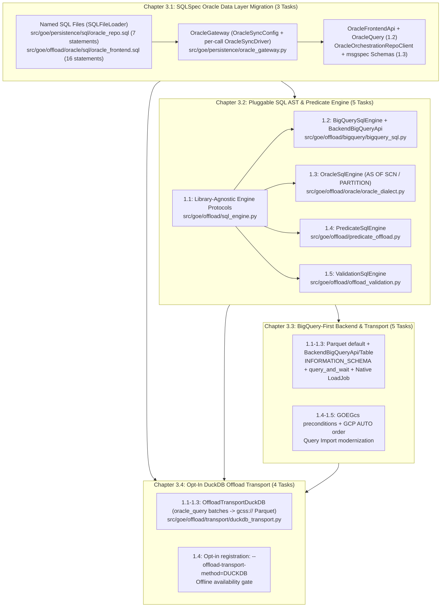

# Master PRD 3: SQLSpec Data Layer, Pluggable SQL AST Engine, BigQuery-First Backend & DuckDB Offload Transport

## Specification

## 1. Executive Summary & Architectural Vision

The **Gluent Offload Engine (GOE)** currently executes database queries, generates cross-engine SQL, and transports bulk table data through a legacy collection of ad-hoc abstractions:

1. **Fragmented Oracle Data Access**: `OracleOrchestrationRepoClient` (`src/goe/persistence/oracle/oracle_orchestration_repo_client.py`), `OracleQuery` (`src/goe/util/ora_query.py`), and `OracleFrontendApi` (`src/goe/offload/oracle/oracle_frontend_api.py`) maintain duplicate cursor lifecycles, manual `DB_TYPE_LONG_STRING` / `DB_TYPE_LONG_RAW` LOB output handlers, and multi-hundred-line inline f-string SQL queries (`get_schema_tables`, `get_offloadable_schemas`).
2. **String-Interpolated SQL, Extraction Row-Sources & Predicate Generation**: `BackendBigQueryApi` (`src/goe/offload/bigquery/bigquery_backend_api.py`), `OffloadTransportOracleApi` (`src/goe/offload/oracle/oracle_offload_transport_rdbms_api.py`), `CrossDbValidator` (`src/goe/offload/offload_validation.py`), and the Lark-based predicate visitors (`src/goe/offload/predicate_offload.py`, `oracle_predicate.py`, `bigquery_predicate.py`) assemble DDL, DML, Oracle `AS OF SCN` / `PARTITION(...)` extraction queries, and `WHERE` clauses via f-strings, regex substitutions (`re.sub(r"^CREATE TABLE", "CREATE OR REPLACE TABLE", ...)`), and manual string concatenation. Several paths interpolate unescaped values directly into BigQuery `OPTIONS(...)` and `--filters` clauses.
3. **Legacy BigQuery Paths**: The 2,237-line `BackendBigQueryApi` (baseline `46890a8`) inherits from the generic `BackendApiInterface` designed around Hive/Impala/Hadoop assumptions, uses Legacy SQL `[$__PARTITIONS_SUMMARY__]`, re-scans GCS through external staging tables, and does redundant GCS existence/poll round trips.
4. **Heavyweight JVM/Hadoop Transport Requirements for Sub-100 GB Tables**: Offloading moderate-sized Oracle tables currently requires either local `oracledb` row-by-row Python cursor iteration into FastAvro/PyArrow (`OffloadTransportRdbms`, single-connection GIL-bound) or a full external cluster (`Spark` / `Sqoop` / `Dataproc`).

This Master PRD modernizes GOE's database, SQL generation, backend execution, and local transport engines across four tightly sequenced chapters using **SQLSpec** (`sqlspec[performance,oracledb,adbc,duckdb]>=0.61.0` — dropping the `mypyc` extra in favor of `performance`), a **Pluggable SQL Dialect / AST Engine Seam** (`src/goe/offload/sql_engine.py`, backed initially by `sqlglot>=30.17.0` plus an upstreamable custom Oracle dialect extension `src/goe/offload/oracle/oracle_dialect.py` for `AS OF SCN` and `PARTITION` / `SUBPARTITION` selection), **msgspec** (`msgspec.Struct`), and **DuckDB** (`duckdb==1.5.5`, locked transitively via `sqlspec[duckdb]`, `uv.lock:886-887`; the only version `cofin/duckdb-oracle` v0.2.2 supports).

---

## 2. Ordered Child Flows (Chapters)

| Order | Flow ID | Title & Tasks | Primary Scope | Depends On |
| :--- | :--- | :--- | :--- | :--- |
| **3.1** | `sqlspec_oracle_data_layer_migration_20261010` | **Chapter 3.1: SQLSpec Oracle Data Layer Migration** (3 tasks: `1.1`–`1.3`) | Create `OracleGateway` (`OracleSyncConfig(connection_config=None, ...)` wrapping caller-validated `oracledb.Connection` instances in `OracleSyncDriver(connection=...)` per call, plus `SQLFileLoader` and `new_out_var` while keeping PL/SQL on `FrontendApi.execute_function`) (`1.1`); migrate `OracleFrontendApi` (16 named statements in `oracle_frontend.sql`, `get_validated_oracle_connection()`, substring-preserving reconnect) and `OracleQuery` (case-preserving `rows_as_dicts`) (`1.2`); migrate `OracleOrchestrationRepoClient` (7 named statements in `oracle_repo.sql`, `msgspec.Struct` row validation hydrated back via `msgspec.structs.asdict`, bound `:adm_user`/`:app_user`/`:repo_user`) (`1.3`). | PRD 1 & PRD 2 |
| **3.2** | `sqlglot_ast_and_predicate_engine_20261010` | **Chapter 3.2: Pluggable SQL AST, Custom Oracle Dialect & Predicate Engine** (5 tasks: `1.1`–`1.5`) | Define library-agnostic `BigQueryDialectEngineProtocol`, `OracleExtractionQueryProtocol`, `PredicateDialectEngineProtocol`, `ValidationQueryEngineProtocol`, and `RenderedSQL` in `src/goe/offload/sql_engine.py` (`1.1`); implement `BigQuerySqlEngine` (`src/goe/offload/bigquery/bigquery_sql.py`) and refactor `BackendBigQueryApi` DDL/DML (`1.2`); implement `register_oracle_dialect_extensions` + `OracleSqlEngine` (`src/goe/offload/oracle/oracle_dialect.py` with literal `AS OF SCN <int>` and `PARTITION`/`SUBPARTITION`) and refactor `OffloadTransportOracleApi` (`1.3`); implement `PredicateSqlEngine` and refactor `oracle_predicate.py` and `bigquery_predicate.py` while keeping `GenericPredicateToSQL` base classes for Hadoop/Synapse/Snowflake/Teradata (`1.4`); implement `ValidationSqlEngine` and refactor `CrossDbValidator` in `offload_validation.py` (`1.5`). | Chapter 3.1 |
| **3.3** | `bigquery_first_backend_modernization_20261010` | **Chapter 3.3: BigQuery-First Backend & Transport Modernization** (5 tasks: `1.1`–`1.5`) | Parquet staging default and `BIGQUERY_LOAD_TABLE_MODE` (`1.1`); GoogleSQL `INFORMATION_SCHEMA.PARTITIONS`, `ClientInfo`, idempotent `close()`, and dataset `default_kms_key_name` (`1.2`); `query_and_wait`, `sanitize_bigquery_label`, `_default_job_labels`, and native `load_table_from_uri` load tables with external-table fallback (`1.3`); `GOEGcs` `if_generation_match=0` uploads and single-pass `delete_blobs` (`1.4`); GCP-first `AUTO` order and Query Import fetch-size/cleanup modernization (`1.5`). | Chapter 3.1, Chapter 3.2 |
| **3.4** | `duckdb_oracle_offload_transport_20261010` | **Chapter 3.4: Opt-In DuckDB Oracle Offload Transport** (4 tasks: `1.1`–`1.4`) | DuckDB transport constants and `OrchestrationConfig` options (`1.1`); `duckdb_engine.py` helpers for `cofin/duckdb-oracle` (`CREATE TEMPORARY SECRET ... TYPE oracle`, `ATTACH ... AS goe_ora`, `oracle_query`) and community `gcs` (`gcss://` + ADC `ACCESS_TOKEN` secret) (`1.2`); `OffloadTransportDuckDB` (`_run_batch`, `_run_batches`, staging verification) (`1.3`); opt-in registration (`--offload-transport-method=DUCKDB`) and offline availability gate (`1.4`). | Chapter 3.1, Chapter 3.2, Chapter 3.3 |

---

## 3. Cross-Cutting Architectural Invariants

1. **Pluggable SQL Dialect / AST Engine Seam (No Vendor Lock-In to `sqlglot`)**:
   - All SQL DDL/DML construction, Oracle extraction row-source construction, predicate rendering, and validation query assembly must be accessed through library-agnostic `typing.Protocol` interfaces (`BigQueryDialectEngineProtocol`, `OracleExtractionQueryProtocol`, `PredicateDialectEngineProtocol`, `ValidationQueryEngineProtocol`) and domain value objects (`RenderedSQL`, `ValidationQuerySpec`) defined in `src/goe/offload/sql_engine.py`.
   - Protocol signatures accept only GOE domain objects (`ColumnMetadataInterface`, `lark.Tree`, `Mapping[str, Any]`, primitive types) and return `str` or `RenderedSQL(sql: str, params: dict[str, Any])` — **never exposing `sqlglot.exp.Expr` in public signatures**.
   - Callers (`BackendBigQueryApi`, `OffloadTransportOracleApi`, `oracle_predicate.py`, `bigquery_predicate.py`, `CrossDbValidator`) **never import `sqlglot`**; they call factory-provided protocol instances (`get_bigquery_dialect_engine()`, `get_oracle_dialect_engine()`, `get_predicate_dialect_engine(dialect)`, `get_validation_query_engine(dialect)`).
   - Caller-supplied SQL projections, casts, and validated filter clauses are embedded verbatim (`exp.Var` / `exp.Paren(this=exp.Var(...))`) rather than round-tripped through `sqlglot.parse_one(...).sql(...)`, preventing lossy rewrites of Oracle 9-digit `TIMESTAMP` literals, 3-arg `TO_DATE(..., 'NLS_CALENDAR=GREGORIAN')`, negative positional decimals, and BigQuery typed literals (`DATETIME '...'`).
2. **Custom Upstreamable Oracle Dialect Extension (`src/goe/offload/oracle/oracle_dialect.py`)**:
   - Modeled directly on `sqlspec.dialects.spanner` for future upstreaming to `sqlspec/dialects/oracle/`, `register_oracle_dialect_extensions()` registers `SUBPARTITION` tokenization (`TokenType.PARTITION`), `Oracle.ALIAS_POST_VERSION = True`, `OracleParser.SUPPORTS_PARTITION_SELECTION = True`, `OracleParser.VERSION_PHRASES`, and `_oracle_version_sql` on `OracleGenerator.TRANSFORMS[exp.Version]` followed by `sqlspec.builder._generation.invalidate_generator_dispatch(OracleGenerator)`.
   - `AS OF SCN <int>` in `OffloadTransportOracleApi` remains a literal integer (`exp.Literal.number(int(transport_scn))`) so both Spark JDBC and `cofin/duckdb-oracle` `oracle_query(...)` (which cannot take bind parameters) work identically.
3. **Zero Feature Loss & Aggressive Dead-Code Removal**:
   - **Oracle Enterprise Features Preserved (100%)**: `OracleGateway` does not open a competing connection pool; it wraps `OracleFrontendApi`'s validated `oracledb.Connection` per call in `OracleSyncDriver(connection=...)`, preserving Oracle thick/thin mode initialization, Wallet / external auth, LDAP / EZConnect / TNS, Proxy authentication (`user[schema]`), `SYSDBA`/`SYSOPER`, `ORA-02396`/`ORA-03113`/`ORA-03114`/`ORA-03135` sniped-session reconnect (`#259`), session tracing (`MODULE`, `ACTION`, `TRACEFILE_IDENTIFIER`), and PL/SQL `OUT` binds / refcursors / Oracle UDT object types (`OFFLOAD_METADATA_OBJ`, `OFFLOAD_PARTITION_LIST_IOT`).
   - **Dead Code Deleted**: Replaced inline SQL strings in `oracle_orchestration_repo_client.py` and `oracle_frontend_api.py`, legacy `sqlspec_client` scaffold artifacts, replaced f-string DDL/DML builders and `re.sub(r"^CREATE TABLE", ...)` in `bigquery_backend_api.py`, manual string-spliced `AS OF SCN` / `PARTITION (...)` extraction queries in `oracle_offload_transport_rdbms_api.py`, superseded `TypedPredicateToOracle*` / `TypedPredicateToBigQuery*` string-template classes in `oracle_predicate.py` and `bigquery_predicate.py`, and raw string-splicing SQL construction in `offload_validation.py` are deleted.
4. **SQLSpec Extras (`performance`, Not `mypyc`) & Parameter Discipline**:
   - `pyproject.toml` uses `sqlspec[performance,oracledb,adbc,duckdb]>=0.61.0` (only the `performance` extra group, dropping `mypyc` in Chapter 1.1 Task `1.5`).
   - Never mix positional and named bind parameters in any SQLSpec execution call. All Oracle SQLSpec queries use `NAMED_COLON` (`:param_name`) binds passed as a `dict[str, Any]`.
5. **Oracle Nanosecond Fidelity Inside `PredicateSqlEngine`**:
   - Inside `PredicateSqlEngine`, preserve 9-digit nanosecond (`FF9`) precision in Oracle `TIMESTAMP(9)` predicates (`TIMESTAMP 'YYYY-MM-DD HH:MM:SS.fffffffff'` and `TO_TIMESTAMP(:bind, 'YYYY-MM-DD HH24:MI:SS.FF9')`) directly from `numpy.datetime64` formatting without parsing through `sqlglot.parse_one`.

---

## 4. Verification & Acceptance Gates

Each child chapter is gated by:
- `make format` (`uv run ruff format` and `uv run ruff check --fix`)
- `make lint` (`uv run ruff check` and `uv run mypy src/goe`)
- `GOOGLE_API_USE_CLIENT_CERTIFICATE=false uv run pytest tests/unit`
- Chapter-specific characterization and TDD unit suites verifying SQL equivalence, bind parameter dictionaries, protocol decoupling, Oracle `AS OF SCN` / `PARTITION` AST round-tripping, dead-code removal, BigQuery load-job behavior, and DuckDB transport behavior (mocked; no network).

## Implementation Plan

- [ ] 3.1 [Chapter 3.1: SQLSpec Oracle Data Layer Migration](../sqlspec_oracle_data_layer_migration_20261010/spec.md) — 3 tasks (`1.1`–`1.3`): create `OracleGateway` (`1.1`), migrate `OracleFrontendApi` (16 statements in `oracle_frontend.sql`) and `OracleQuery` (`1.2`), and migrate `OracleOrchestrationRepoClient` (7 statements in `oracle_repo.sql`) (`1.3`).
- [ ] 3.2 [Chapter 3.2: Pluggable SQL AST, Custom Oracle Dialect & Predicate Engine](../sqlglot_ast_and_predicate_engine_20261010/spec.md) — 5 tasks (`1.1`–`1.5`): define `sql_engine.py` protocols and value objects (`1.1`), implement `BigQuerySqlEngine` and refactor `BackendBigQueryApi` DDL/DML (`1.2`), implement `oracle_dialect.py` (`AS OF SCN` / `PARTITION` / `SUBPARTITION`) and refactor `OffloadTransportOracleApi` (`1.3`), implement `PredicateSqlEngine` and refactor `oracle_predicate.py` / `bigquery_predicate.py` (`1.4`), and implement `ValidationSqlEngine` and refactor `CrossDbValidator` (`1.5`).
- [ ] 3.3 [Chapter 3.3: BigQuery-First Backend & Transport Modernization](../bigquery_first_backend_modernization_20261010/spec.md) — 5 tasks (`1.1`–`1.5`): Parquet default and `BIGQUERY_LOAD_TABLE_MODE` (`1.1`), `BackendBigQueryApi` metadata/lifecycle/KMS modernization (`1.2`), `query_and_wait`, job labels, and native `load_table_from_uri` load tables (`1.3`), `GOEGcs` precondition uploads and single-pass deletes (`1.4`), and GCP `AUTO` order and Query Import modernization (`1.5`).
- [ ] 3.4 [Chapter 3.4: Opt-In DuckDB Oracle Offload Transport](../duckdb_oracle_offload_transport_20261010/spec.md) — 4 tasks (`1.1`–`1.4`): DuckDB config options (`1.1`), `duckdb_engine.py` helpers for `cofin/duckdb-oracle` and `gcs` (`1.2`), `OffloadTransportDuckDB` (`1.3`), and registration + availability gate (`1.4`).

## Decisions

- **`BQ-D1` (RESOLVED)** — Local `goccy/bigquery-emulator` + `fake-gcs-server` harness: excluded (emulator lacks external tables, `INFORMATION_SCHEMA.PARTITIONS`, `dry_run`, and CMEK/Parquet load fidelity, and GOE will never code around emulator limitations). Live verification uses the real GCP BigQuery project (`oracle_ci_and_bigquery_test_harness_20261010` `integration-bigquery`) plus offline unit and golden suites.
- **`BQ-D2` (RESOLVED)** — Removed unwired 3.3 additions (Storage Write streamer, `transfer_manager` upload helper, `dry_run_preview`, load-dataset expiration, `BIGQUERY_BILLING_PROJECT`).
- **`DUCK-D1` (RESOLVED)** — `DUCKDB` is strictly opt-in (`--offload-transport-method=DUCKDB` / `OFFLOAD_TRANSPORT=DUCKDB`), excluded from `AUTO`, and adds no DuckDB verification engine.
- `DUCK-D2` (pending) — Runtime DuckDB version gate versus `duckdb==1.5.5` pin.
- `DUCK-D3` (pending) — Unsigned extension install from the custom repository versus mandatory `EXTENSION_PATH` + SHA-256 verification.

## Continuity Snapshot

- **Current State**: `planned`, `plan_revision: 2`, `plan_commit: null`; 4 sequenced child flows (17 tasks total: `3` in 3.1, `5` in 3.2, `5` in 3.3, `4` in 3.4), executed after PRD 1 and PRD 2.
- **Next Action**: Execute Chapter 3.1 (`sqlspec_oracle_data_layer_migration_20261010`), Task `1.1` ([../sqlspec_oracle_data_layer_migration_20261010/tasks/1.1.md](../sqlspec_oracle_data_layer_migration_20261010/tasks/1.1.md)).
- **Decisions**: `BQ-D1`, `BQ-D2`, `DUCK-D1` resolved; `DUCK-D2`, `DUCK-D3` pending.
- **Knowledge**: `.agents/bundles/specs/index.md`, `.agents/bundles/product/tech-stack.md`, `.agents/bundles/knowledge/patterns/index.md`.
