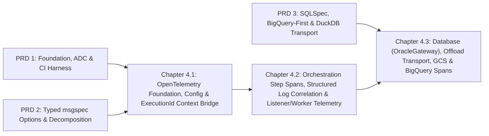

# Master PRD 4: End-to-End OpenTelemetry Observability, Step Spans, Metrics & Log Correlation

## Specification

## 1. Executive Summary & Architectural Vision

After PRD 1 (Foundation Hygiene, GCP ADC Auth Unification & CI Integration Harness), PRD 2 (Typed `msgspec` Option Model, Core God-Module Decomposition & Strict Type Safety Ratchet), and PRD 3 (SQLSpec Oracle Data Layer, Pluggable SQL AST Engine, BigQuery-First Backend & DuckDB Offload Transport), GOE possesses a clean, modular, strictly typed Python 3.12+ architecture.

**Master PRD 4** unifies observability across every layer of that architecture using **OpenTelemetry (`opentelemetry-api` + optional `opentelemetry-sdk` / OTLP / GCP Cloud Trace & Cloud Monitoring exporters)**:
1. **Zero-Overhead-by-Default Core (`src/goe/observability/`)**: `opentelemetry-api` is included in core dependencies so every instrumentation site uses standard OpenTelemetry `Tracer` and `Meter` interfaces without conditional import boilerplate. When `GOE_OTEL_ENABLED=false` (the default), all trace and metric calls execute against `NoOpTracerProvider` and `NoOpMeterProvider` with zero network I/O, zero background threads, and negligible CPU cost. When enabled (`GOE_OTEL_ENABLED=true`), operators can export telemetry to OTLP (`grpc` or `http`), Google Cloud Trace & Cloud Monitoring (reusing the unified `GCPCredentialProvider` from PRD 1 Chapter 1.2), local JSONL trace files (`$OFFLOAD_HOME/logs/`), or `InMemorySpanExporter` / `InMemoryMetricReader` for deterministic test assertions.
2. **Bidirectional `ExecutionId` <-> W3C Trace Context Correlation**: Every GOE command (`ExecutionId` in `src/goe/orchestration/execution_id.py:44-89`) is bound to `ContextVar` and W3C `Baggage` (`goe.execution.id`) and stamped onto every descendant span via `ExecutionContextSpanProcessor`, while active `(trace_id, span_id)` identifiers are persisted in `OFFLOAD_REPO` command and step metadata and injected into Python log records (`TraceContextLogFilter`) and `GOELogFileHandle` structured JSONL logs.
3. **Automatic Step, Listener, Database, Transport, GCS & BigQuery Spans**:
   - **Orchestration Commands & Steps**: `OrchestrationRunner` emits `goe.command.<type>` spans and `OffloadMessages.offload_step()` (`src/goe/offload/offload_messages.py:370-482`) automatically wraps every step in a `goe.step.<step_id>` child span with step status, details (`staged_rows`, `staged_bytes`), and `goe.steps.duration` histograms.
   - **Listener HTTP, MCP & Background Workers**: Litestar's `OpenTelemetryPlugin` (`litestar.plugins.opentelemetry`) traces incoming REST requests, `litestar-queues` (`ObservabilityConfig(enable_otel=True)`) propagates W3C `traceparent` + `goe.execution.id` into `run_offload_job` (`src/goe/listener/jobs.py:17-22`), and MCP tools (`src/goe/listener/mcp.py`) emit `goe.mcp.tool.<name>` spans.
   - **Data Plane & Cloud Backends**: `OracleGateway` (`sqlspec.observability.ObservabilityConfig`) emits query spans for all Oracle queries; Oracle sessions tag `V$SESSION.CLIENT_INFO` with W3C `traceparent` and optional `SQLCommenter` comments (`/*traceparent='...'*/`) without disturbing `V$SQL` `MODULE`/`ACTION` filters; `OffloadTransport` (DuckDB, Query Import, Spark, Dataproc) emits `goe.chunk` and `goe.transport.<method>` spans and propagates `TRACEPARENT` to subprocesses; `GOEGcs` emits `goe.storage.gcs.<op>` spans; and `BigQueryBackendApi` / `BigQueryBackendTable` emit `goe.backend.bigquery.<op>` spans, record slot/bytes-billed metrics, and stamp `goe_execution_id`, `goe_trace_id`, and `goe_step` labels onto every BigQuery `QueryJobConfig` and `LoadJobConfig`.

---

## 2. Roadmap Topology & Dependency Graph



### Child Flow Sequence

| Chapter | Flow ID | Size | Tasks | Primary Scope |
| :--- | :--- | :--- | :--- | :--- |
| **Chapter 4.1** | `opentelemetry_foundation_and_context_propagation_20261010` | L | 3 | `pyproject.toml`, `src/goe/observability/{__init__,config,runtime,context,metrics}.py`, `OrchestrationConfig` & `CommonOptions` OTel fields, `ExecutionId` <-> W3C `traceparent` / `Baggage` / `sqlspec` `CorrelationContext` bridge, and `InMemorySpanExporter` / `InMemoryMetricReader` unit test harness. |
| **Chapter 4.2** | `orchestration_step_and_listener_telemetry_20261010` | L | 3 | `OrchestrationRunner` command spans (`goe.command.<type>`), `OffloadMessages.offload_step()` step spans (`goe.step.<step_id>`), `OracleOrchestrationRepoClient` trace ID persistence, `TraceContextLogFilter` & `GOELogFileHandle` JSONL sidecar/structured logging, Litestar `OpenTelemetryPlugin`, `litestar-queues` worker `traceparent` propagation, and MCP tool spans. |
| **Chapter 4.3** | `database_transport_and_cloud_storage_spans_20261010` | L | 3 | `OracleGateway` observability integration, Oracle `V$SESSION.CLIENT_INFO` W3C `traceparent` & `SQLCommenter` tagging, `OffloadTransport` (`goe.chunk`, `goe.transport.<method>`) & `run_os_cmd` `TRACEPARENT` propagation, `GOEGcs` (`goe.storage.gcs.<op>`) spans, and `BigQueryBackendApi` / `BigQueryBackendTable` (`goe.backend.bigquery.<op>`) spans + GCP job labels + slot/bytes metrics. |

---

## 3. Cross-Cutting Architectural Invariants

1. **Zero-Overhead Default (`GOE_OTEL_ENABLED=false`)**:
   - All telemetry collection is opt-in via `GOE_OTEL_ENABLED=true` (or `--otel-enabled` on the CLI).
   - When disabled, `get_tracer()` and `get_meter()` return `opentelemetry-api` no-op instruments, and `pytest tests/unit` runs with zero external exporter network dependencies.
2. **100% CLI Output & Golden Baseline Preservation**:
   - Default CLI stdout and `.log` text output (`GOE_LOG_FORMAT=text`) remain byte-for-byte unchanged so existing operator scripts, regex parsers, and PRD 1 Chapter 1.3 golden dry-run assertions pass without modification.
   - Structured JSON log output is emitted when `GOE_LOG_FORMAT=json` or written to a companion `.jsonl` sidecar file when `GOE_LOG_JSON_SIDECAR=true`.
3. **Preservation of Oracle `V$SQL` `MODULE` / `ACTION` Invariant**:
   - `LOG_SQL_STATS_QUERY_TEXT` in `src/goe/offload/oracle/oracle_offload_transport_rdbms_api.py:66-77` queries `v$sql` by exact match on `WHERE module = :module AND action = :action`.
   - OpenTelemetry trace correlation on Oracle sessions MUST use `V$SESSION.CLIENT_INFO` (`conn.clientinfo` / `DBMS_APPLICATION_INFO.SET_CLIENT_INFO`, up to 64 bytes) and optional `/*traceparent='...'*/` SQL comments, never mutating `module` (`"GOE"`) or `action`.
4. **Canonical Litestar 2.22+ Plugin Import**:
   - Always import `OpenTelemetryConfig` and `OpenTelemetryPlugin` from `litestar.plugins.opentelemetry` (never from deprecated `litestar.contrib.opentelemetry`).
5. **Code Hygiene & Typing**:
   - Every new and modified Python file starts with the 2-line SPDX header (`# SPDX-FileCopyrightText: 2026 The GOE Authors` and `# SPDX-License-Identifier: Apache-2.0`), uses top-level imports, PEP 585 (`list`, `dict`) and PEP 604 (`X | None`) types, Google-style docstrings, and contains **zero inline `#` comments**.

---

## 4. Master Verification Matrix

```bash
export GOOGLE_API_USE_CLIENT_CERTIFICATE=false
uv run ruff format --check src/goe tests/unit
uv run ruff check src/goe tests/unit
uv run mypy src/goe
uv run pytest tests/unit/observability/ -v
uv run pytest tests/unit/ -v
```

## Implementation Plan

- [ ] 4.1 `opentelemetry_foundation_and_context_propagation_20261010` — Establish `src/goe/observability/` (`ObservabilitySettings`, `ObservabilityRuntime`, `GOEMetrics`, `JSONLSpanExporter`, `ExecutionId` <-> W3C `traceparent`/`Baggage` bridge, and CLI/config wiring).
- [ ] 4.2 `orchestration_step_and_listener_telemetry_20261010` — Instrument `OrchestrationRunner`, `OffloadMessages.offload_step()`, `GOELogFileHandle` structured log correlation, Litestar `OpenTelemetryPlugin`, `litestar-queues` worker propagation, and MCP tool spans.
- [ ] 4.3 `database_transport_and_cloud_storage_spans_20261010` — Instrument `OracleGateway` database spans, `V$SESSION.CLIENT_INFO` & `SQLCommenter` tagging, `OffloadTransport` & `run_os_cmd` `TRACEPARENT` propagation, `GOEGcs` spans, and `BigQueryBackendApi` / `BigQueryBackendTable` spans + job labels + metrics.

## Continuity Snapshot

- **Current State**: Master PRD 4 planned with 3 sequenced child flows (`4.1` through `4.3`).
- **Next Action**: Execute Chapter 4.1 (`opentelemetry_foundation_and_context_propagation_20261010`), Task `1.1`.
