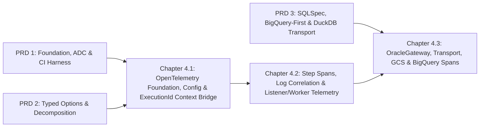

# Master PRD 4: End-to-End OpenTelemetry Observability, Step Spans, Metrics & Log Correlation

## Specification

## 1. Executive Summary & Architectural Vision

After PRD 1 (hygiene, GCP ADC unification via `goe.util.gcp_credentials.resolve_gcp_credentials`, CI harness), PRD 2 (typed `msgspec` options in `src/goe/config/options.py`, decomposition of `goe.py`/transport into `src/goe/orchestration/` and `src/goe/offload/transport/`, strict mypy), and PRD 3 (`OracleGateway` on SQLSpec, `sqlglot` engine, BigQuery-first backend, DuckDB transport), PRD 4 adds unified observability with OpenTelemetry:

1. **Zero-cost-by-default core (`src/goe/observability/`)**: `opentelemetry-api>=1.40.0` is a core dependency; the SDK, OTLP exporters, and ASGI instrumentation are the optional `otel` extra. With `GOE_OTEL_ENABLED=false` (default) every tracer/meter is an API no-op, the SDK is never imported, and Oracle sessions, SQL text, subprocess env, Spark properties, and log files are unchanged. When enabled, operators export to OTLP (gRPC or HTTP), Google Cloud via the Telemetry (OTLP) API (`https://telemetry.googleapis.com`, authenticated with `resolve_gcp_credentials`), local JSONL, console, or an in-memory test harness. Exporter construction failures degrade to no-op with one warning.
2. **`ExecutionId` <-> W3C correlation**: the bound `ExecutionId` (`src/goe/orchestration/execution_id.py:17-83`) lives in ContextVars, W3C baggage (`goe.execution.id`), and SQLSpec `CorrelationContext`; `ExecutionContextSpanProcessor` stamps it on every span (including library spans); `(trace_id, span_id)` are persisted in `OFFLOAD_REPO` command parameters and step details and written to JSON logs and Python `LogRecord`s.
3. **Spans everywhere**:
   - Commands and steps: `OrchestrationRunner.offload()` -> `goe.command.offload`; `OffloadMessages.offload_step()` (`src/goe/offload/offload_messages.py:370-481`) -> `goe.step.<step_id>` with status and `goe.steps.duration`.
   - Listener: Litestar `OpenTelemetryPlugin` (`litestar.plugins.opentelemetry`) SERVER spans; litestar-queues `QueueConfig(observability=ObservabilityConfig(enable_otel=True, ...))` natively propagates context to `run_offload_job` (`src/goe/listener/jobs.py:17-22`); MCP tools (routes with `mcp_tool=`) get `goe.mcp.tool.<name>` spans through `MCPConfig(before_tool_call=..., after_tool_call=...)`.
   - Data plane: `OracleGateway` SQLSpec `sqlspec.query` spans; `V$SESSION.CLIENT_INFO` traceparent tagging without touching `MODULE`/`ACTION`; `goe.chunk`/`goe.transport.<method>` spans for every transport (Query Import, Spark, Dataproc, Sqoop, DuckDB with per-batch spans); `TRACEPARENT` in `run_os_cmd` subprocesses and Spark executors; `GOEGcs` `goe.storage.gs.<op>` spans; `BackendBigQueryApi` `goe.backend.bigquery.<op>` spans, `goe_step`/`goe_execution_id`/`goe_trace_id` job labels, and slot/bytes-billed metrics.

---

## 2. Roadmap Topology & Dependency Graph



### Child Flow Sequence

| Chapter | Flow ID | Tasks | Primary Scope |
| :--- | :--- | :--- | :--- |
| **4.1** | `opentelemetry_foundation_and_context_propagation_20261010` | 6 | `pyproject.toml` deps/`otel` extra, `ObservabilitySettings`, `GOEMetrics`, context bridge, lazily loaded SDK builders (span processor, JSONL, OTLP, GCP Telemetry API), `ObservabilityRuntime`, CLI flags + `CommonOptions` + `offload_by_cli` bootstrap + `offload.env.template.common` docs. |
| **4.2** | `orchestration_step_and_listener_telemetry_20261010` | 4 | `traced_command`/`traced_step`, `OrchestrationRunner`/`OffloadMessages` wiring + `OFFLOAD_REPO` trace ids, `GOELogFileHandle` JSON/JSONL + `LogRecord` correlation, Litestar plugin + litestar-queues tracing + MCP tool spans. |
| **4.3** | `database_transport_and_cloud_storage_spans_20261010` | 5 | Oracle `CLIENT_INFO` + SQL comment tokens + `OracleGateway` spans, chunk/transport/subprocess spans, DuckDB batch spans, `GOEGcs` spans, BigQuery spans/labels/metrics. |

---

## 3. Cross-Cutting Architectural Invariants

1. **Zero overhead by default**: telemetry is opt-in via `GOE_OTEL_ENABLED=true` or `--otel-enabled`; the disabled path imports no SDK, starts no threads, performs no I/O, and leaves every external side effect (Oracle session attributes, SQL text, subprocess env, Spark properties, BigQuery calls, log bytes) as at baseline. `uv run pytest tests/unit` needs no exporter network access.
2. **CLI output and golden baselines preserved**: default stdout and `.log` text output (`GOE_LOG_FORMAT=text`) stay byte-for-byte identical; JSON goes to the log file only with `GOE_LOG_FORMAT=json` or to a `<log>.jsonl` sidecar with `GOE_LOG_JSON_SIDECAR=true`.
3. **Oracle `MODULE`/`ACTION` invariant**: `LOG_SQL_STATS_QUERY_TEXT` (`src/goe/offload/oracle/oracle_offload_transport_rdbms_api.py:66-77`) finds transport SQL in `gv$sql` by `module`/`action`; trace correlation uses only `CLIENT_INFO` (`conn.clientinfo` / `DBMS_APPLICATION_INFO.SET_CLIENT_INFO`, 64 bytes) and comment tokens appended after the action token.
4. **Canonical Litestar import**: `OpenTelemetryConfig`/`OpenTelemetryPlugin` come from `litestar.plugins.opentelemetry` (never the deprecated `litestar.contrib.opentelemetry`), bound lazily because the module requires the optional `opentelemetry-instrumentation-asgi`.
5. **Fail-safe**: telemetry errors never abort an offload (exporter build failures fall back to no-op; `atexit` flushes exporters).
6. **Code hygiene & Public-Before-Private Function/Method Ordering**: SPDX 2-line header, top-level imports only (optional modules via `goe.cli._lazy`), PEP 585/604 types, docstrings, no inline `#` comments, and in every new or modified module and test file all public functions/methods and dunder lifecycle methods (`__init__`, `__getattr__`, etc.) are grouped at the top of each module and class body, with private (`_...`) helpers placed at the bottom.

---

## 4. Decisions

- Google Cloud export uses the Telemetry (OTLP) API through the OTLP HTTP exporter; deprecated `opentelemetry-exporter-gcp-*` packages are not used (https://cloud.google.com/stackdriver/docs/reference/telemetry/overview).
- `ObservabilitySettings` is the single resolver of `GOE_OTEL_*`/`GOE_LOG_*`; `OrchestrationConfig` gains no telemetry fields.
- Row/byte counts are recorded on `goe.chunk`/`goe.transport.*` spans, not step spans (`offload_step` step functions return arbitrary values).
- **`D-4.3-SQLCOMMENTER` (RESOLVED)**: emit spec-compliant Google SQLCommenter comments via `sqlspec.core.sqlcommenter` (`StatementConfig.replace(enable_sqlcommenter=True, sqlcommenter_attributes={"db_driver": "oracledb", "framework": "goe"}, sqlcommenter_enable_traceparent=True, sqlcommenter_enable_context=True)` + `SQLCommenterContext.scope({"action": name})` on `OracleGateway`, and `generate_comment(attrs)` in `format_sqlcommenter` / `build_transport_sql_comment` for Spark JDBC transport queries).

---

## 5. Master Verification Matrix

```bash
export GOOGLE_API_USE_CLIENT_CERTIFICATE=false
uv run python -c "import ast,pathlib; is_priv=lambda n:n.startswith('_') and not (n.startswith('__') and n.endswith('__')); bad=[(str(p),getattr(s,'name','<module>'),f.name) for root in ('src/goe','tests') for p in sorted(pathlib.Path(root).rglob('*.py')) for s in ast.walk(ast.parse(p.read_text())) if isinstance(s,(ast.Module,ast.ClassDef)) for funcs in [[n for n in s.body if isinstance(n,(ast.FunctionDef,ast.AsyncFunctionDef))]] for i,f in enumerate(funcs) if not is_priv(f.name) and any(is_priv(g.name) for g in funcs[:i])]; assert not bad, bad"
uv run ruff format --check src/goe tests/unit
uv run ruff check src/goe tests/unit
uv run mypy src/goe
uv run pytest tests/unit/observability/ -v
uv run pytest tests/unit/ -v
```

## Implementation Plan

- [ ] 4.1 `opentelemetry_foundation_and_context_propagation_20261010` — dependencies, settings, metrics, context bridge, SDK builders, runtime, CLI/env wiring ([spec](../opentelemetry_foundation_and_context_propagation_20261010/spec.md)).
- [ ] 4.2 `orchestration_step_and_listener_telemetry_20261010` — command/step spans, repo trace ids, log correlation, Litestar/queue/MCP telemetry ([spec](../orchestration_step_and_listener_telemetry_20261010/spec.md)).
- [ ] 4.3 `database_transport_and_cloud_storage_spans_20261010` — Oracle tagging and `OracleGateway` spans, transport/DuckDB/subprocess spans, GCS and BigQuery spans/labels/metrics ([spec](../database_transport_and_cloud_storage_spans_20261010/spec.md)).

## Continuity Snapshot

- **Flow / lifecycle**: `prd_04_end_to_end_opentelemetry_observability_20261010`, `planned`; 3 sequenced child flows (15 tasks).
- **Current task / claimant**: none.
- **Last verified checkpoint**: none.
- **Decisions**: see §4 (`D-4.3-SQLCOMMENTER` resolved).
- **Blockers**: PRDs 1-3 must complete first.
- **Next exact step**: execute Chapter 4.1 task `1.1` (`opentelemetry_foundation_and_context_propagation_20261010:1.1`).
- **Plan identity**: `plan_revision: 3`, `plan_commit: null`. **State identity**: `state_revision: 0`.
- **Relevant knowledge**: `.agents/bundles/product/tech-stack.md`, `.agents/bundles/knowledge/architecture/orchestration.md`, `.agents/bundles/knowledge/listener/index.md`, `.agents/bundles/knowledge/patterns/cli-architecture.md`, `.agents/bundles/knowledge/workflow.md`.
