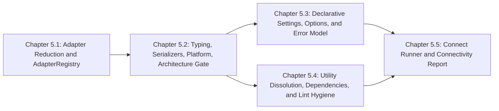

# Master PRD 5: Adapter Reduction, Core Typing, Declarative Settings, Utility Dissolution, and Connect Runner

## Specification

### 1. North Star

PRD 5 is the foundation of the GOE architecture redesign (see [the redesign dossier](research/goe-architecture-redesign.md)). It shrinks the surface every later PRD touches and installs the shared building blocks they rely on:

1. **Adapter reduction**: delete the Sqoop transport, the MapRFS filesystem scheme, and the Teradata frontend and repository client with their options, templates, extras, tests, and knowledge chapters, then collapse the eight `src/goe/offload/factory/*.py` modules and `src/goe/persistence/factory/orchestration_repo_client_factory.py` into one declarative `AdapterRegistry`.
2. **Core building blocks**: `goe.typing` / `goe._typing` (`FrozenBaseStruct`, `BaseStruct`, `UNSET`), `goe.util.module_loader` (cached optional imports and PEP 562 `lazy_exports`), `goe.util.serializers` (one `msgspec` encoder), `goe.util.platform` (`CgroupQuota`, `LameDuckController`), and `tools/verify_architecture.py` wired into `make lint` with a committed violation baseline that later chapters ratchet down.
3. **One settings and option model**: side-effect-free settings construction (no database connections, no global `oracledb.init_oracle_client()`, no `random.choice()` mutation), one `OptionSpec` registry that generates CLI flags, option groups, `OffloadOperationOptions`, and Listener request normalization, one `GOEError` hierarchy, the missing OpenTelemetry CLI flags, aligned Listener defaults, and reconciled `templates/conf/` files.
4. **Utility dissolution and dependency slimming**: delete `misc_functions.py`, `simple_timer.py`, and `sync_tools.py`, relocate the Hadoop helpers, credentials, password tools, logging, polling, and parallel execution modules to their owning packages, move `GOELogFileHandle` onto `google.cloud.storage.Blob.open` (dropping `fsspec[gcs]`), remove unused core dependencies, and fix the bug-masking Ruff rules instead of ignoring them.
5. **Connect runner**: replace module-global `failures`/`warnings` state in `src/goe/connect/` with a concurrent `ConnectRunner` returning a frozen `ConnectReport` that the CLI renders and the Listener reuses.

### 2. Roadmap Topology



| Chapter | Flow ID | Primary Scope | Owned Paths |
| :--- | :--- | :--- | :--- |
| 5.1 | `adapter_reduction_and_adapter_registry_20261024` | Delete Sqoop, MapRFS, Teradata; build `AdapterRegistry` | `src/goe/offload/hadoop/sqoop_offload_transport.py`, `src/goe/offload/teradata/**`, `src/goe/persistence/teradata/**`, `src/goe/offload/factory/**`, `src/goe/persistence/factory/**`, new `src/goe/offload/registry.py`, Sqoop/MapRFS/Teradata branches in `src/goe/offload/transport/{constants,availability,factory}.py`, `src/goe/filesystem/goe_dfs.py`, `src/goe/config/*`, `src/goe/cli/commands/offload.py`, `src/goe/cli/config.py`, `src/goe/connect/*`, `src/goe/util/hive_ddl_transform.py` (MapRFS pattern), `templates/conf/*`, `pyproject.toml` (`teradata` extra), affected tests, `.agents/bundles/knowledge/frontends/teradata.md` and its index entries |
| 5.2 | `core_typing_serializers_platform_and_architecture_gate_20261024` | Base structs, module loader, serializers, platform, AST gate | new `src/goe/typing.py`, `src/goe/_typing.py`, `src/goe/util/module_loader.py`, `src/goe/util/serializers.py`, `src/goe/util/platform.py`, `tools/verify_architecture.py`, `tools/architecture_baseline.toml`, `Makefile` (`lint`), `src/goe/cli/_lazy.py`, deletion of `src/goe/util/json_tools.py` and migration of its three callers |
| 5.3 | `declarative_settings_options_and_error_model_20261024` | Settings, option registry, errors, OTel flags, Listener defaults, templates | `src/goe/config/**` (except `password_tools.py`/`gcp_credentials.py` moves owned by 5.4), `src/goe/exceptions.py`, `src/goe/cli/common.py`, `src/goe/cli/commands/*.py` option wiring, `src/goe/orchestration/cli_entry_points.py`, `src/goe/listener/schemas.py` (`OffloadOptions` removal only), `src/goe/listener/config/application.py`, `templates/conf/**` |
| 5.4 | `util_dissolution_dependency_and_lint_hygiene_20261024` | Dissolve `src/goe/util/`, slim `pyproject.toml`, fix bug-masking Ruff rules, convert observability dataclasses | `src/goe/util/**` (except `ora_query.py`, `parquet_encoder.py`, `avro_encoder.py`), destination modules under `src/goe/offload/hadoop/`, `src/goe/config/`, `src/goe/orchestration/`, `src/goe/offload/transport/`, `src/goe/observability/{_sdk,spans,config,context,log_correlation}.py`, `pyproject.toml`, Ruff violation fixes across `src/goe/` |
| 5.5 | `connect_runner_and_connectivity_report_20261024` | Concurrent `ConnectRunner`, frozen `ConnectReport` | `src/goe/connect/**`, `src/goe/cli/commands/connect.py`, `tests/unit/connect/**` |

### 3. Global Constraints (apply to every PRD in the redesign)

1. **Language and types**: Python `>=3.12`; PEP 585/604/695 types; value objects use `FrozenBaseStruct`/`BaseStruct` from `goe.typing` (`msgspec.Struct(..., frozen=True, gc=False)` before Chapter 5.2 lands); hot-path tuple records add `array_like=True`.
2. **File hygiene**: new files start with `# SPDX-FileCopyrightText: 2026 The GOE Authors` and `# SPDX-License-Identifier: Apache-2.0`; imports at module top level only (optional dependencies through `goe.util.module_loader`, or `goe.cli._lazy` in CLI modules); no inline `#` comments in Python (Google-style docstrings instead); public functions, methods, and dunder methods precede private `_` helpers in every module and class (checked with the AST ordering command in §5).
3. **Serialization**: JSON goes through `goe.util.serializers` once Chapter 5.2 lands; no direct `json.dumps`/`json.loads` or `msgspec.json.encode`/`decode` in domain modules.
4. **Clean breaks**: superseded code is deleted in the same task that replaces it; no compatibility aliases, re-export facades, transitional flags, or fallback branches kept for old call sites. Public CLI and configuration contracts that the redesign keeps (for example `--offload-transport-method=QUERY_IMPORT`) stay stable; removed adapters remove their flags and keys outright.
5. **Testing**: every behavior change and defect fix has focused tests in the canonical module test file under `tests/unit/` (no standalone remediation or audit test files); export `GOOGLE_API_USE_CLIENT_CERTIFICATE=false` before tests; tasks run focused `uv run pytest ...` targets, `uv run ruff format --check`, `uv run ruff check`, and `uv run mypy src/goe`; full-suite runs belong to chapter checkpoints.
6. **Oracle and data invariants**: transport sessions keep `gv$sql` `MODULE`/`ACTION` tagging (`LOG_SQL_STATS_QUERY_TEXT`); `OFFLOAD`/`OFFLOAD_REPO` PL/SQL package and `*_OT`/`*_NTT` type contracts stay compatible; `PasswordTools` stays byte-compatible with AES-256-CBC + PKCS7 `$OFFLOAD_HOME` keyfiles; table locks go through `OrchestrationLockInterface`; extraction stays snapshot-consistent (`AS OF SCN`).
7. **Golden baselines**: `tests/unit/characterization/test_offload_bigquery_golden.py` and the `goe report --demo` digests stay green unless a task changes them deliberately and records why.
8. **Repository text**: no workstation paths, user names, or private application names; no exclamation marks; no count-prefixed buzzword headings.
9. **Commits**: one task per commit with a conventional message `<type>(<scope>): <summary>`; commits stay local unless delivery is requested.

### 4. Decisions

- The Sqoop transport, MapRFS scheme, and Teradata frontend are removed rather than ported; their CLI flags, environment keys, templates, extras, and tests go with them.
- `AdapterRegistry` keys adapters by frontend type, backend type, transport method, and repository type, resolves implementations through `goe.util.module_loader` lazily, and exposes one dry-run resolution path; factories are deleted.
- `tools/verify_architecture.py` fails on any violation not listed in `tools/architecture_baseline.toml`; later chapters delete baseline entries as they fix them, and an entry may never be added after Chapter 5.2.
- Settings construction is pure: it reads environment and `offload.env` (4-tier discovery in `src/goe/config/config_file.py` unchanged) and validates, and performs no I/O beyond reading files. Database client initialization happens where a connection is first opened.
- `GOEError` is the root exception; existing exception class names that callers catch either become subclasses or are removed with their callers migrated in the same task; CLI exit codes stay `0`, `1`, and `2`.
- The core engine never imports `vertebra`; ported idioms live in `goe.typing` and `goe.util`.

### 5. Master Verification Matrix

```bash
export GOOGLE_API_USE_CLIENT_CERTIFICATE=false
uv run ruff format --check src/goe tests/unit tools
uv run ruff check src/goe tests/unit tools
uv run mypy src/goe
uv run python tools/verify_architecture.py
uv run python -c "import ast,pathlib; is_priv=lambda n:n.startswith('_') and not (n.startswith('__') and n.endswith('__')); bad=[(str(p),getattr(s,'name','<module>'),f.name) for root in ('src/goe','tests/unit') for p in sorted(pathlib.Path(root).rglob('*.py')) for s in ast.walk(ast.parse(p.read_text())) if isinstance(s,(ast.Module,ast.ClassDef)) for funcs in [[n for n in s.body if isinstance(n,(ast.FunctionDef,ast.AsyncFunctionDef))]] for i,f in enumerate(funcs) if not is_priv(f.name) and any(is_priv(g.name) for g in funcs[:i])]; assert not bad, bad[:20]"
uv run pytest tests/unit -q
```

## Implementation Plan

- [x] 5.1 `adapter_reduction_and_adapter_registry_20261024` — remove Sqoop, MapRFS, and Teradata; collapse factories into `AdapterRegistry` ([spec](../adapter_reduction_and_adapter_registry_20261024/spec.md)).
- [x] 5.2 `core_typing_serializers_platform_and_architecture_gate_20261024` — `goe.typing`, `module_loader`, serializers, platform utilities, architecture gate ([spec](../core_typing_serializers_platform_and_architecture_gate_20261024/spec.md)).
- [x] 5.3 `declarative_settings_options_and_error_model_20261024` — side-effect-free settings, `OptionSpec` registry, `GOEError`, OTel flags, Listener defaults, templates ([spec](../declarative_settings_options_and_error_model_20261024/spec.md)).
- [x] 5.4 `util_dissolution_dependency_and_lint_hygiene_20261024` — dissolve `src/goe/util/`, slim dependencies, fix bug-masking Ruff rules ([spec](../util_dissolution_dependency_and_lint_hygiene_20261024/spec.md)).
- [x] 5.5 `connect_runner_and_connectivity_report_20261024` — concurrent `ConnectRunner` and `ConnectReport` ([spec](../connect_runner_and_connectivity_report_20261024/spec.md)).

## Continuity Snapshot

- **Flow / lifecycle**: `prd_05_foundation_typing_settings_and_adapter_reduction_20261024`, `planned`; five sequenced child flows.
- **Current task / claimant**: none.
- **Last verified checkpoint**: none.
- **Decisions**: see §4.
- **Discoveries**: none yet.
- **Blockers**: none; Master PRDs 1–4 are complete.
- **Next exact step**: execute Chapter 5.1 task `1.1` (`adapter_reduction_and_adapter_registry_20261024:1.1`).
- **Plan identity**: `plan_revision: 1`, `plan_commit: null`. **State identity**: `state_revision: 0`.
- **Relevant knowledge**: `AGENTS.md`, `.agents/bundles/knowledge/workflow.md`, `.agents/bundles/knowledge/patterns/index.md`, `.agents/bundles/knowledge/standards/python.md`, `.agents/bundles/knowledge/standards/testing.md`, `.agents/bundles/knowledge/operations/configuration-and-env.md`.
