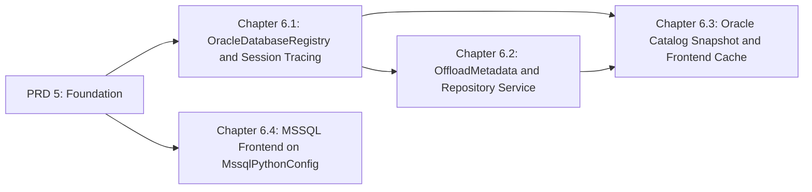

# Master PRD 6: Pooled SQLSpec Oracle Data Layer, Repository Service, Catalog Cache, and MSSQL Frontend

## Specification

### 1. North Star

Every Oracle interaction in GOE runs through pooled `sqlspec==0.68.0` configurations with one shared statement cache and one observability runtime per pool, metadata loads cost one round-trip, and catalog discovery for a table is a cached snapshot shared by the offload engine, schema sync, status report, and Listener ([research](research/sqlspec-sqlglot-and-caching-architecture.md)):

1. **`OracleDatabaseRegistry`** (`src/goe/persistence/registry.py`): `OracleSyncConfig` pools for the admin/repository role and the application/transport role (plus `OracleAsyncConfig` for Listener reads), drivers checked out only through `provide_session()` so `_prepare_driver()` attaches the shared `StatementCacheHolder`, `ALTER SESSION SET TRACEFILE_IDENTIFIER = "GOE"` and `TIME_ZONE`/`NLS_*` applied once per physical connection in `session_callback`, `enable_session_tracing=True` only on repository pools, transport sessions that keep `MODULE`/`ACTION` and receive only `client_identifier` and `econtext_id` through `apply_oracle_session_trace_attributes(conn, module=None, action=None)`, proxy DDL sessions authenticated with `ora_adm_pass`, and sniped-session retry that leaves the `except` block before reconnecting.
2. **Repository service**: `OffloadMetadata(FrozenBaseStruct)` replaces the 388-LOC active-record `OrchestrationMetadata` and `OffloadMetadataSchema`; reads select `offload_metadata_v` once with `fetch_lobs=False` (four round-trips become one); writes reuse per-connection cached `OFFLOAD_METADATA_OT`/`OFFLOAD_PARTITION_NTT` types; repository reads return typed structs end to end.
3. **Catalog snapshot and cache**: `OracleTableCatalogSnapshot` loads table, column, constraint, statistics, segment, and partition metadata in three queries without the cartesian `LONG` `high_value` transfer, decodes optimizer statistics `RAW` values in Python, resolves non-literal `HIGH_VALUE` expressions in one batched PL/SQL call, samples column precision through `select_to_arrow`, and is cached in `FrontendCatalogCache` keyed by `(dsn, owner, table)` and pinned to the execution SCN.
4. **MSSQL frontend**: `MssqlPythonConfig` replaces `pymssql` with `?` parameters, fixing the quoted `'%s'` literals.

### 2. Roadmap Topology



| Chapter | Flow ID | Primary Scope | Owned Paths |
| :--- | :--- | :--- | :--- |
| 6.1 | `oracle_database_registry_and_session_tracing_20261024` | Pools, session callback, tracing invariant, retry, `OracleGateway` replacement, proxy password and partition quoting fixes | new `src/goe/persistence/{registry,retry}.py`, `src/goe/persistence/oracle_gateway.py` (replaced or deleted), `src/goe/observability/db.py`, connection management in `src/goe/offload/oracle/oracle_frontend_api.py` and `src/goe/offload/oracle/oracle_offload_transport_rdbms_api.py`, `src/goe/persistence/sql/oracle_repo.sql`, `src/goe/offload/oracle/sql/frontend_metadata.sql` |
| 6.2 | `offload_metadata_and_repository_service_20261024` | Frozen `OffloadMetadata`, 1-RTT reads, cached UDT writes, typed repository rows | `src/goe/persistence/orchestration_metadata.py` (replaced), `src/goe/persistence/schemas.py`, new `src/goe/persistence/{models,oracle_repo_service}.py`, `src/goe/persistence/orchestration_repo_client.py`, `src/goe/persistence/oracle/oracle_orchestration_repo_client.py` (metadata and execution methods), `src/goe/offload/offload_metadata_functions.py`, metadata call sites |
| 6.3 | `oracle_catalog_snapshot_and_frontend_cache_20261024` | Snapshot models and loader, statistics decoder, batched `HIGH_VALUE`, Arrow sampler, cache, Listener introspection without leaks | new `src/goe/offload/oracle/{catalog_models,catalog_service,partition_decoder,column_sampler}.py`, new `src/goe/offload/oracle/sql/oracle_catalog.sql`, `src/goe/offload/oracle/oracle_offload_source_table.py`, query paths in `src/goe/offload/oracle/oracle_frontend_api.py`, introspection methods in `src/goe/persistence/oracle/oracle_orchestration_repo_client.py` |
| 6.4 | `mssql_frontend_on_mssql_python_20261024` | `MssqlPythonConfig` frontend | `src/goe/offload/microsoft/mssql_{frontend_api,offload_source_table,offload_transport_rdbms_api,column}.py`, `pyproject.toml` (`sql_server` extra), MSSQL tests |

### 3. Global Constraints

1. Python `>=3.12`, PEP 585/604/695 types, `FrozenBaseStruct`/`BaseStruct` from `goe.typing`, `array_like=True` for hot-path tuple records.
2. SPDX two-line header (`2026 The GOE Authors`, `Apache-2.0`) on new files; top-level imports only (optional dependencies through `goe.util.module_loader`); no inline `#` comments; Google-style docstrings; public before private in modules and classes.
3. JSON through `goe.util.serializers`.
4. Superseded code is deleted in the same task; no aliases, facades, or fallback branches for old call sites.
5. Focused tests in canonical `tests/unit/` module files; `GOOGLE_API_USE_CLIENT_CERTIFICATE=false`; `uv run pytest`, `uv run ruff format --check`, `uv run ruff check`, `uv run mypy src/goe`, `uv run python tools/verify_architecture.py`; delete fixed entries from `tools/architecture_baseline.toml`.
6. Transport sessions keep `gv$sql` `MODULE`/`ACTION`; `OFFLOAD`/`OFFLOAD_REPO` package and type contracts stay compatible; Wallet, Kerberos, LDAP, Thick, and Thin connections keep working; extraction stays `AS OF SCN` consistent.
7. Golden characterization tests stay green unless a task changes them deliberately and records why.
8. No workstation paths, user names, private application names, exclamation marks, or count-prefixed buzzword headings in repository text.
9. One task per commit, conventional commit messages, local commits only.

### 4. Decisions

- `sqlspec==0.68.0` is the minimum (`pyproject.toml` raises the floor from `>=0.61.0`).
- Repository pools enable `enable_session_tracing`; transport pools enable neither `enable_session_tracing` nor `enable_sqlcommenter` (`_session_tracing_enabled()` in `sqlspec/adapters/oracledb/driver.py:156-200` returns true for either flag and then overwrites `MODULE`/`ACTION`).
- `OracleSyncDriver.select_to_arrow` buffers every batch (`collect_oracle_arrow_batches`); it is used only for bounded samples, never for bulk transport.
- `FrontendCatalogCache` entries are pinned to the execution `snapshot_scn` inside a command and validated by TTL plus `DBA_OBJECTS.LAST_DDL_TIME` in the Listener; DDL issued by GOE invalidates the affected entry.
- Chapter 6.4 is isolated so it can be dropped if the MSSQL frontend is removed.

### 5. Master Verification Matrix

```bash
export GOOGLE_API_USE_CLIENT_CERTIFICATE=false
uv run ruff format --check src/goe tests/unit
uv run ruff check src/goe tests/unit
uv run mypy src/goe
uv run python tools/verify_architecture.py
uv run pytest tests/unit/persistence tests/unit/offload tests/unit/observability -q
uv run pytest tests/unit -q
make test-integration-oracle
```

## Implementation Plan

- [ ] 6.1 `oracle_database_registry_and_session_tracing_20261024` — pooled registry, session callback, tracing invariant, retry, `OracleGateway` replacement ([spec](../oracle_database_registry_and_session_tracing_20261024/spec.md)).
- [ ] 6.2 `offload_metadata_and_repository_service_20261024` — frozen `OffloadMetadata`, 1-RTT reads, cached UDT writes ([spec](../offload_metadata_and_repository_service_20261024/spec.md)).
- [ ] 6.3 `oracle_catalog_snapshot_and_frontend_cache_20261024` — catalog snapshot, statistics decoder, batched `HIGH_VALUE`, sampler, cache ([spec](../oracle_catalog_snapshot_and_frontend_cache_20261024/spec.md)).
- [ ] 6.4 `mssql_frontend_on_mssql_python_20261024` — MSSQL frontend on `MssqlPythonConfig` ([spec](../mssql_frontend_on_mssql_python_20261024/spec.md)).

## Continuity Snapshot

- **Flow / lifecycle**: `prd_06_sqlspec_oracle_data_layer_and_catalog_cache_20261024`, `planned`; four child flows.
- **Current task / claimant**: none.
- **Last verified checkpoint**: none.
- **Decisions**: see §4.
- **Discoveries**: none yet.
- **Blockers**: Master PRD 5 must complete first.
- **Next exact step**: execute Chapter 6.1 task `1.1` (`oracle_database_registry_and_session_tracing_20261024:1.1`).
- **Plan identity**: `plan_revision: 1`, `plan_commit: null`. **State identity**: `state_revision: 0`.
- **Relevant knowledge**: `.agents/bundles/knowledge/frontends/oracle.md`, `.agents/bundles/knowledge/standards/database-and-sql.md`, `.agents/bundles/knowledge/operations/observability.md`, `.agents/bundles/knowledge/operations/database-installation.md`.
