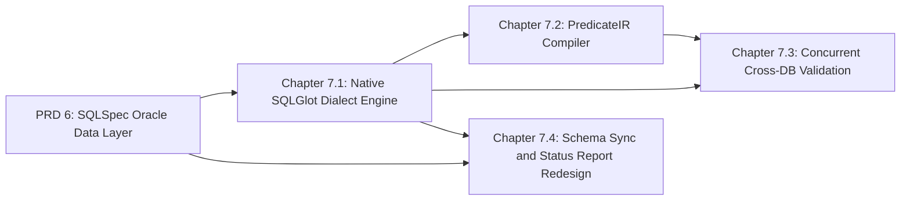

# Master PRD 7: Native SQLGlot Dialect Engine, PredicateIR, Concurrent Validation, Schema Sync, and Status Report

## Specification

### 1. North Star

All SQL GOE generates is built as `sqlglot==30.24.0` ASTs behind the `src/goe/offload/sql_engine.py` protocol seam (which itself imports no `sqlglot` symbol), predicates keep exact numeric and temporal precision, validation compares exact values concurrently, and schema sync and the status report run on set-based queries ([research](../prd_07_sqlglot_engine_predicates_validation_sync_and_report_20261024/research/sqlspec-sqlglot-and-caching-architecture.md)):

1. **Native dialect engine**: delete `register_oracle_dialect_extensions()` and the private `sqlspec.builder._generation` import in `src/goe/offload/oracle/oracle_dialect.py`; `sqlglot==30.24.0` parses and generates Oracle `PARTITION (...)`, `SUBPARTITION (...)`, and `AS OF SCN :scn` with post-version aliases natively. `src/goe/offload/sql_ast/dialect_engine.py` (`DialectSqlEngine`) consolidates `OracleSqlEngine` and `BigQuerySqlEngine` for `oracle`, `bigquery`, `snowflake`, `tsql`, and `hive`/`spark`.
2. **`PredicateIR`**: an `@lru_cache` Lark parse produces an immutable `msgspec` tagged union (`DecimalVal` stored as a string, nanosecond `TimestampVal`, and boolean/comparison/membership/null-check nodes) compiled by one dialect-profile `sqlglot` compiler (`copy=False`) in bind mode (placeholders and typed parameters returned as `sqlspec.core.SQL`) or literal mode (DDL, views, logs), cached in `sqlspec.core.NamespacedCache`. The 8 `*_literal.py` and 6 `*_predicate.py` classes are deleted. The persisted predicate DSL and `incremental_predicate_value` metadata format stay compatible.
3. **Concurrent validation**: frontend and backend validation queries are composed with `sqlspec.sql.select` (hints, `AS OF SCN`, explicit `NULLS LAST`), executed concurrently, compared in exact `Decimal` arithmetic, and aligned by normalized group key; `agg_validate.py` parses `--filter` with `sqlglot` instead of `REGEX_FILTER` and `.replace('"', '`')`; `goe validate --diff` adds DuckDB 2.0 row-level diagnostics.
4. **Schema sync and status report**: schema sync shrinks from 11 files to 3 (one catalog snapshot per side, typed `SchemaDiffAction` structs, `exp.Alter` DDL, proxy DDL through the registry, clean command files); the status report shrinks from 3,799 LOC to roughly 540 (one Oracle set-based query, one dataset-scoped BigQuery `INFORMATION_SCHEMA` query, a DuckDB 2.0 `GROUP BY ROLLUP`, `StatusReportEnvelope` with `to_report_dict()` preserving golden digests, and a compressed demo fixture replacing `demo_data.py`). `src/goe/util/ora_query.py` and its last callers are deleted.

### 2. Roadmap Topology



| Chapter | Flow ID | Primary Scope | Owned Paths |
| :--- | :--- | :--- | :--- |
| 7.1 | `native_sqlglot_dialect_engine_20261024` | Delete monkey-patching; `DialectSqlEngine`; migrate existing engine users | `src/goe/offload/oracle/oracle_dialect.py`, `src/goe/offload/bigquery/bigquery_sql.py`, `src/goe/offload/sql_engine.py`, new `src/goe/offload/sql_ast/{__init__,dialect_engine}.py`, current call sites of `OracleSqlEngine`/`BigQuerySqlEngine` |
| 7.2 | `predicate_ir_compiler_20261024` | `PredicateIR`, compiler, caches; delete literal and predicate classes | `src/goe/offload/{offload_predicate,predicate_offload}.py`, every `src/goe/offload/**/*_literal.py` and `*_predicate.py`, new `src/goe/offload/sql_ast/{predicate_ir,predicate_compiler}.py`, predicate call sites |
| 7.3 | `concurrent_cross_db_validation_20261024` | Validation package, `agg_validate` filters, `goe validate --diff` | `src/goe/offload/offload_validation.py` (replaced), new `src/goe/offload/validation/`, `src/goe/scripts/agg_validate.py`, `src/goe/cli/commands/validate.py` |
| 7.4 | `schema_sync_and_status_report_redesign_20261024` | Schema sync and report rewrites; delete `ora_query.py` | `src/goe/schema_sync/**`, `src/goe/report/**`, `src/goe/util/ora_query.py`, `tests/unit/util/test_ora_query.py`, `oracle_connection`/`oracle_offload_transport_connection` in `src/goe/orchestration/operation.py` and their re-exports in `src/goe/goe.py`, `pyproject.toml` (`jinja2`) |

### 3. Global Constraints

1. Python `>=3.12`, PEP 585/604/695 types, `FrozenBaseStruct`/`BaseStruct` from `goe.typing`.
2. SPDX two-line header on new files; top-level imports only; no inline `#` comments; Google-style docstrings; public before private.
3. JSON through `goe.util.serializers`.
4. Superseded code is deleted in the same task; no aliases or facades.
5. Focused tests in canonical `tests/unit/` files; `GOOGLE_API_USE_CLIENT_CERTIFICATE=false`; `uv run pytest`, `ruff format --check`, `ruff check`, `mypy src/goe`, `tools/verify_architecture.py`; delete fixed baseline entries.
6. `sql_engine.py` stays free of `sqlglot` imports; only `goe.offload.sql_ast.*` imports `sqlglot`. Generated SQL is never assembled by string concatenation of identifiers or literals.
7. Golden characterization tests and `goe report --demo` digests stay green unless a task changes them deliberately and records why.
8. Oracle invariants from PRD 6 hold (`MODULE`/`ACTION`, PL/SQL contracts, `AS OF SCN`).
9. No workstation paths, user names, private application names, exclamation marks, or count-prefixed buzzword headings; one task per commit.

### 4. Decisions

- Predicates are compiled in bind mode wherever the statement executes, and in literal mode only for DDL, view text, and log output.
- Validation tolerances apply only to `AVG`, `STDDEV`, and floating-point columns; every other aggregate compares exactly.
- `goe validate --diff` is opt-in and requires the DuckDB transport prerequisites; it never runs during an offload.
- The status report keeps its HTML, TEXT, JSON, RAW, and CSV outputs; `jinja2>=3.1.4` becomes an explicit dependency.

### 5. Master Verification Matrix

```bash
export GOOGLE_API_USE_CLIENT_CERTIFICATE=false
uv run ruff format --check src/goe tests/unit
uv run ruff check src/goe tests/unit
uv run mypy src/goe
uv run python tools/verify_architecture.py
uv run pytest tests/unit/offload tests/unit/schema_sync tests/unit/report tests/unit/characterization -q
uv run pytest tests/unit -q
```

## Implementation Plan

- [ ] 7.1 `native_sqlglot_dialect_engine_20261024` — native Oracle dialect support and `DialectSqlEngine` ([spec](../native_sqlglot_dialect_engine_20261024/spec.md)).
- [ ] 7.2 `predicate_ir_compiler_20261024` — `PredicateIR` compiler replacing literal and predicate classes ([spec](../predicate_ir_compiler_20261024/spec.md)).
- [ ] 7.3 `concurrent_cross_db_validation_20261024` — concurrent exact validation and `goe validate --diff` ([spec](../concurrent_cross_db_validation_20261024/spec.md)).
- [ ] 7.4 `schema_sync_and_status_report_redesign_20261024` — schema sync and status report rewrites, `ora_query.py` retirement ([spec](../schema_sync_and_status_report_redesign_20261024/spec.md)).

## Continuity Snapshot

- **Flow / lifecycle**: `prd_07_sqlglot_engine_predicates_validation_sync_and_report_20261024`, `planned`; four child flows.
- **Current task / claimant**: none.
- **Last verified checkpoint**: none.
- **Decisions**: see §4.
- **Discoveries**: none yet.
- **Blockers**: Master PRDs 5 and 6 must complete first.
- **Next exact step**: execute Chapter 7.1 task `1.1` (`native_sqlglot_dialect_engine_20261024:1.1`).
- **Plan identity**: `plan_revision: 1`, `plan_commit: null`. **State identity**: `state_revision: 0`.
- **Relevant knowledge**: `.agents/bundles/knowledge/standards/database-and-sql.md`, `.agents/bundles/knowledge/architecture/schema-evolution.md`, `.agents/bundles/knowledge/architecture/type-mapping.md`, `.agents/bundles/knowledge/operations/cli-tools.md`.
