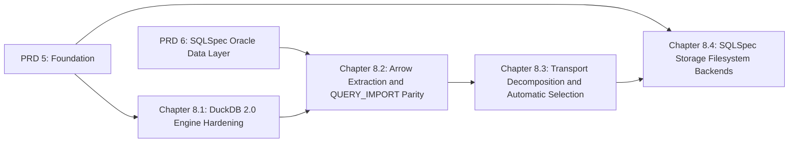

# Master PRD 8: DuckDB 2.0 Data Plane, QUERY_IMPORT Parity Replacement, Transport Decomposition, and SQLSpec Storage

## Specification

### 1. North Star

Non-Spark extraction becomes one streaming data plane with no JVM and no row-by-row Python encoding ([research](research/duckdb2-arrow-and-storage-dataplane.md)):

1. **DuckDB 2.0 engine**: `Version(duckdb.__version__) >= Version("2.0.0")` replaces the `"1.5.5"` gate (`src/goe/offload/transport/duckdb_constants.py:6`, `src/goe/config/orchestration_defaults.py:782`); the signed community `oracle` extension v0.3.1 installs with `INSTALL oracle FROM community; LOAD oracle;` and `allow_unsigned_extensions=False` (unsigned only when an explicit local extension path is configured); `northpolesec/duckdb-gcs` and `to_duckdb_gcs_uri()` are removed in favor of core `LOAD parquet; LOAD httpfs;` with `CREATE OR REPLACE TEMPORARY SECRET` for `gs://`, `s3://`, and `az://` and in-place token refresh; one execution-scoped `:memory:goe_<execution_id>` instance with per-worker `cursor()` handles replaces one instance per thread, `memory_limit` clamps to 75% of the cgroup limit through `goe.util.platform.CgroupQuota`, and every session sets `oracle_call_timeout_ms = 0`, `parquet_metadata_cache` (after `LOAD parquet`), and `preserve_insertion_order = false`; `ORA_SDTZ` is set at process start instead of from worker threads; Wallet, TNS aliases, and `RAW` become supported.
2. **Arrow extraction and `QUERY_IMPORT` parity**: `python-oracledb` Thin `fetch_df_batches` feeds a lazy `RecordBatchReader` (never `OracleSyncDriver.select_to_arrow`, which buffers) registered on a DuckDB cursor with `unregister` in `finally`. The DuckDB transport routes LOB/XML/JSON/VECTOR tables and hosts without `libclntsh` to this path. `QUERY_IMPORT` keeps its option name, configuration keys, staging locations, and staged file contract while its engine becomes Arrow batches written by DuckDB (Parquet) or `fastavro` (Avro). A differential parity suite (unit, committed golden fixtures captured from the current engine, Oracle Free integration) gates the cutover that deletes the row-by-row path, `src/goe/util/parquet_encoder.py`, and `src/goe/util/avro_encoder.py`.
3. **Transport decomposition and selection**: `src/goe/offload/transport/base.py` (1,215 LOC) splits into a batch split planner, projection planner, RDBMS SQL statistics poller, command runner (removing the duplicate SCP methods), and safe PySpark code generation; one `TransportCanaryProbe` replaces the per-transport canary subclasses and covers `DUCKDB` and `QUERY_IMPORT`; `DUCKDB` enters `GCP_AUTO_TRANSPORT_METHODS` ahead of `QUERY_IMPORT` and ahead of Spark/Dataproc below `OFFLOAD_TRANSPORT_DUCKDB_MAX_BYTES` (raised from `20G` to `100G`); `tools/` Spark listener moves to SLF4J/Log4j2 and Spark `3.5.x`, and dead shell glue is removed.
4. **`sqlspec.storage` filesystems**: `GOEDfs` keeps its interface while GCS, S3, and Azure operations run on `sqlspec.storage` (`ObStoreBackend`, `LocalStore`), keeping `if_generation_match=0` create-only uploads, `dry_run`, scheme-exact URIs, keyless ADC and impersonation, and `@traced_storage_call`, and fixing unbounded `GOEGcs.stat()` listing, the removed Azure v2 exception, and S3 deletes above 1,000 keys; `boto3`, `azure-storage-blob`, and `azure-common` leave core dependencies; HDFS, WebHDFS, and SSH remain optional extras.

### 2. Roadmap Topology



| Chapter | Flow ID | Primary Scope | Owned Paths |
| :--- | :--- | :--- | :--- |
| 8.1 | `duckdb2_engine_hardening_20261024` | Version gate, signed extension, `httpfs` secrets, shared instance, cgroup clamp, session settings, availability | `src/goe/offload/transport/duckdb_{constants,availability,engine,transport}.py`, DuckDB keys in `src/goe/config/orchestration_defaults.py` and `templates/conf/offload.env.template.*`, DuckDB tests |
| 8.2 | `arrow_extraction_and_query_import_parity_20261024` | Arrow batch source, DuckDB Clientless route, parity suite, new `QUERY_IMPORT` engine, cutover deletions, `fastavro` | new `src/goe/offload/transport/arrow_source.py`, `src/goe/offload/transport/query_import.py`, `src/goe/offload/query_import_interface.py`, `src/goe/offload/factory/query_import_factory.py` successor in `src/goe/offload/registry.py`, `src/goe/util/{parquet_encoder,avro_encoder}.py`, `src/goe/offload/oracle/oracle_offload_transport_rdbms_api.py` (output type handler), `tests/unit/offload/transport/**`, `tests/integration/scenarios/test_offload_transport.py`, `pyproject.toml` (`avro` to `fastavro`) |
| 8.3 | `transport_decomposition_and_auto_selection_20261024` | Split `base.py`, `TransportCanaryProbe`, automatic selection, `tools/` updates | `src/goe/offload/transport/{base,constants,availability,factory,spark_submit,spark_thrift,spark_livy,dataproc}.py`, new `src/goe/offload/transport/{split_planner,projection,stats_poller,command_runner,pyspark_codegen,canary}.py`, `tools/spark-listener/**`, `tools/transport/Makefile`, `tools/goe-shell-functions.sh`, `Makefile` |
| 8.4 | `sqlspec_storage_filesystem_backends_20261024` | `GOEDfs` on `sqlspec.storage`, fixes, dependency moves | `src/goe/filesystem/{goe_dfs,goe_gcs,goe_s3,goe_azure}.py`, new `src/goe/filesystem/object_store.py`, `src/goe/filesystem/goe_dfs_factory.py`, `pyproject.toml` (`aws`, `azure` extras), `tests/unit/filesystem/**` |

### 3. Global Constraints

1. Python `>=3.12`, PEP 585/604/695 types, `FrozenBaseStruct`/`BaseStruct` from `goe.typing`.
2. SPDX two-line header on new files; top-level imports only (optional dependencies through `goe.util.module_loader`); no inline `#` comments; Google-style docstrings; public before private.
3. JSON through `goe.util.serializers`.
4. Superseded code is deleted in the same task; no aliases, facades, or fallback branches. The `QUERY_IMPORT` option name and configuration keys stay because they are a public contract.
5. Focused tests in canonical `tests/unit/` files; `GOOGLE_API_USE_CLIENT_CERTIFICATE=false`; `uv run pytest`, `ruff format --check`, `ruff check`, `mypy src/goe`, `tools/verify_architecture.py`; delete fixed baseline entries.
6. Transport sessions keep `gv$sql` `MODULE`/`ACTION`; extraction stays `AS OF SCN` consistent; unbounded and high-precision `NUMBER`, `TIMESTAMP(7..9)`, and `TIMESTAMP WITH LOCAL TIME ZONE` keep their RDBMS-side `TO_CHAR` casts.
7. Golden characterization tests stay green unless a task changes them deliberately and records why.
8. No workstation paths, user names, private application names, exclamation marks, or count-prefixed buzzword headings; one task per commit.

### 4. Decisions

- The DuckDB transport and the new `QUERY_IMPORT` engine share one Arrow batch source; `QUERY_IMPORT` writes staged files without the `oracle` extension, so it works on Thin-only hosts.
- Parity is defined on staged output: Arrow schema, row count, and a canonical per-row rendering (exact decimal strings, ISO timestamps with nanoseconds, hexadecimal binary, explicit nulls, `NaN`/`Inf` handling equal to the current `nan_values_as_null` behavior), plus loaded BigQuery contents in the opt-in integration run. Golden fixtures from the current engine stay committed after the cutover.
- `fastavro` replaces the `avro` package and loads through `goe.util.module_loader` only when Avro staging is selected.
- `sqlspec.storage` credentials for GCS come from `goe.config.gcp_credentials.resolve_gcp_credentials()` so ADC and impersonation keep working.

### 5. Master Verification Matrix

```bash
export GOOGLE_API_USE_CLIENT_CERTIFICATE=false
uv run ruff format --check src/goe tests/unit
uv run ruff check src/goe tests/unit
uv run mypy src/goe
uv run python tools/verify_architecture.py
uv run pytest tests/unit/offload/transport tests/unit/filesystem tests/unit/offload/test_gcp_transport_selection.py -q
uv run pytest tests/unit -q
make test-integration-oracle
```

## Implementation Plan

- [ ] 8.1 `duckdb2_engine_hardening_20261024` — DuckDB 2.0 gate, signed extension, `httpfs`, shared instance ([spec](../duckdb2_engine_hardening_20261024/spec.md)).
- [ ] 8.2 `arrow_extraction_and_query_import_parity_20261024` — Arrow batch source, parity suite, `QUERY_IMPORT` replacement ([spec](../arrow_extraction_and_query_import_parity_20261024/spec.md)).
- [ ] 8.3 `transport_decomposition_and_auto_selection_20261024` — `base.py` decomposition, canary probe, automatic selection, `tools/` ([spec](../transport_decomposition_and_auto_selection_20261024/spec.md)).
- [ ] 8.4 `sqlspec_storage_filesystem_backends_20261024` — `GOEDfs` on `sqlspec.storage` ([spec](../sqlspec_storage_filesystem_backends_20261024/spec.md)).

## Continuity Snapshot

- **Flow / lifecycle**: `prd_08_duckdb2_transport_query_import_parity_and_storage_20261024`, `planned`; four child flows.
- **Current task / claimant**: none.
- **Last verified checkpoint**: none.
- **Decisions**: see §4.
- **Discoveries**: none yet.
- **Blockers**: Master PRDs 5 and 6 must complete first.
- **Next exact step**: execute Chapter 8.1 task `1.1` (`duckdb2_engine_hardening_20261024:1.1`).
- **Plan identity**: `plan_revision: 1`, `plan_commit: null`. **State identity**: `state_revision: 0`.
- **Relevant knowledge**: `.agents/bundles/knowledge/transport/duckdb.md`, `.agents/bundles/knowledge/transport/staging-serialization.md`, `.agents/bundles/knowledge/transport/spark-dataproc.md`, `.agents/bundles/knowledge/storage/gcs.md`, `.agents/bundles/knowledge/storage/s3.md`, `.agents/bundles/knowledge/storage/azure-blob.md`.
