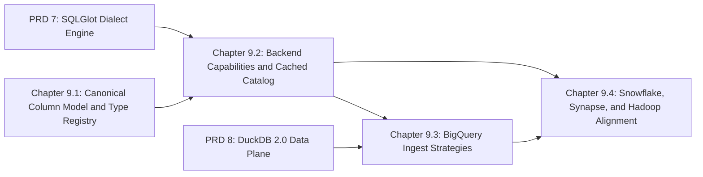

# Master PRD 9: Canonical Column Model, Composable Backends, Cached Backend Catalog, and Direct BigQuery Ingestion

## Specification

### 1. North Star

The backend layer shrinks from roughly 23,800 LOC (including the Hadoop helpers relocated in PRD 5) to roughly 4,950 LOC while BigQuery ingestion drops from six jobs and three full staging scans per chunk to one load job ([module blueprint](../prd_05_foundation_typing_settings_and_adapter_reduction_20261024/research/module-by-module-redesign.md), [data plane research](../prd_08_duckdb2_transport_query_import_parity_and_storage_20261024/research/duckdb2-arrow-and-storage-dataplane.md)):

1. **Canonical column model**: `ColumnSpec(FrozenBaseStruct)` and a table-driven `CanonicalTypeRegistry` (bidirectional canonical-to-physical mapping with precision, scale, and byte-length guards, plus synthetic partition transforms `GOE_PART_*`) replace the mutable `ColumnMetadataInterface` in `src/goe/offload/column_metadata.py` and the `*_column.py` subclasses for Oracle, MSSQL, BigQuery, Snowflake, Synapse, Hadoop, and the Parquet and Avro staging formats. Every current mapping result is preserved and pinned by characterization tests first.
2. **Capabilities and cached catalog**: `BackendCapabilities(FrozenBaseStruct)` replaces the 34-key capability dictionaries and the 57 `NotImplementedError` stubs in `src/goe/offload/backend_api.py` (96 abstract methods, 1,800 LOC) and the 50 forwarders in `src/goe/offload/backend_table.py` (2,242 LOC); `CachedBackendCatalog` stores frozen `BackendTableSnapshot`s with TTL, write-through invalidation on every mutating backend call, and `warm_schema(db)` that loads a dataset in two `INFORMATION_SCHEMA` queries (15–17 metadata RPCs per incremental offload become 3; 400–600 per 100-table report become 2).
3. **BigQuery ingest strategies**: `BigQuerySession` built on `sqlspec.adapters.bigquery.BigQueryConfig` (`default_load_job_config` carrying CMEK and `DecimalTargetTypes`, job labels, OpenTelemetry job statistics) and a per-plan `BackendIngestStrategy`: `BigQueryDirectLoadStrategy` (one `load_table_from_uri(..., WRITE_APPEND)` over target-typed Parquet with synthetic partition columns and validation computed in the DuckDB stream), `BigQueryStorageWritePendingStrategy` (opt-in `PENDING` Arrow streams committed atomically), and `StagedLoadInsertStrategy` (automatic for stringified Spark staging, backend UDF partition functions, `--offload-chunk-column`, and `--preserve-load-table`).
4. **Secondary backends**: Snowflake (`COPY INTO`/staged `INSERT`), Synapse (`COPY INTO`/PolyBase/CTAS), and Hive/Impala/Spark Thrift (`LOAD DATA`/`INSERT INTO` plus statistics) move onto capabilities, the cached catalog, `DialectSqlEngine` (PRD 7), and `StagedLoadInsertStrategy`.

### 2. Roadmap Topology



| Chapter | Flow ID | Primary Scope | Owned Paths |
| :--- | :--- | :--- | :--- |
| 9.1 | `canonical_column_model_and_type_registry_20261024` | `ColumnSpec`, `CanonicalTypeRegistry`, mapping characterization, column subclass deletion | `src/goe/offload/column_metadata.py`, every `src/goe/offload/**/*_column.py`, `src/goe/offload/staging/{parquet,avro}/*_column.py`, new `src/goe/offload/schema/{__init__,column_spec,type_registry}.py`, column call sites |
| 9.2 | `backend_capabilities_and_cached_catalog_20261024` | `BackendCapabilities`, `CachedBackendCatalog`, interface collapse | `src/goe/offload/backend_api.py`, `src/goe/offload/backend_table.py`, new `src/goe/backend/{__init__,capabilities,catalog_cache}.py`, capability call sites |
| 9.3 | `bigquery_ingest_strategies_20261024` | `BigQuerySession`, ingest strategies, selection rules | `src/goe/offload/bigquery/**`, `src/goe/observability/bigquery.py`, new `src/goe/backend/ingest.py`, BigQuery tests, golden characterization updates |
| 9.4 | `snowflake_synapse_hadoop_backend_alignment_20261024` | Secondary backends on the new protocols | `src/goe/offload/snowflake/**`, `src/goe/offload/microsoft/synapse_*.py`, `src/goe/offload/hadoop/**` (except removed Sqoop), `src/goe/offload/spark/**`, their tests |

### 3. Global Constraints

1. Python `>=3.12`, PEP 585/604/695 types, `FrozenBaseStruct`/`BaseStruct` from `goe.typing`.
2. SPDX two-line header on new files; top-level imports only; no inline `#` comments; Google-style docstrings; public before private.
3. JSON through `goe.util.serializers`.
4. Superseded code is deleted in the same task; no aliases or facades.
5. Focused tests in canonical `tests/unit/` files; `GOOGLE_API_USE_CLIENT_CERTIFICATE=false`; `uv run pytest`, `ruff format --check`, `ruff check`, `mypy src/goe`, `tools/verify_architecture.py`; delete fixed baseline entries.
6. Every backend capability that exists at `d6a02fe` for BigQuery, Snowflake, Synapse, Hive, Impala, and Spark Thrift (partitioning, clustering, bucketing, sorting, CMEK, labels, materialization, statistics, staging cleanup) is preserved.
7. `tests/unit/characterization/test_offload_bigquery_golden.py` stays green; when the direct load strategy changes the expected job sequence, the task that changes it updates the golden expectations and records why.
8. No workstation paths, user names, private application names, exclamation marks, or count-prefixed buzzword headings; one task per commit.

### 4. Decisions

- Backend priority stays BigQuery first; Snowflake and Synapse keep current behavior without new features.
- `BigQueryDirectLoadStrategy` is the default when every column satisfies the target-typed Parquet invariants; any staged-only precondition selects `StagedLoadInsertStrategy` automatically; `BigQueryStorageWritePendingStrategy` is opt-in through configuration.
- `CachedBackendCatalog` is scoped to one backend session; it never serves data across processes.

### 5. Master Verification Matrix

```bash
export GOOGLE_API_USE_CLIENT_CERTIFICATE=false
uv run ruff format --check src/goe tests/unit
uv run ruff check src/goe tests/unit
uv run mypy src/goe
uv run python tools/verify_architecture.py
uv run pytest tests/unit/offload tests/unit/characterization -q
uv run pytest tests/unit -q
make test-integration-gcp
```

## Implementation Plan

- [ ] 9.1 `canonical_column_model_and_type_registry_20261024` — `ColumnSpec` and `CanonicalTypeRegistry` ([spec](../canonical_column_model_and_type_registry_20261024/spec.md)).
- [ ] 9.2 `backend_capabilities_and_cached_catalog_20261024` — `BackendCapabilities`, `CachedBackendCatalog`, interface collapse ([spec](../backend_capabilities_and_cached_catalog_20261024/spec.md)).
- [ ] 9.3 `bigquery_ingest_strategies_20261024` — `BigQuerySession` and ingest strategies ([spec](../bigquery_ingest_strategies_20261024/spec.md)).
- [ ] 9.4 `snowflake_synapse_hadoop_backend_alignment_20261024` — secondary backends on the new protocols ([spec](../snowflake_synapse_hadoop_backend_alignment_20261024/spec.md)).

## Continuity Snapshot

- **Flow / lifecycle**: `prd_09_composable_backends_and_direct_bigquery_ingestion_20261024`, `planned`; four child flows.
- **Current task / claimant**: none.
- **Last verified checkpoint**: none.
- **Decisions**: see §4.
- **Discoveries**: none yet.
- **Blockers**: Master PRDs 5, 7, and 8 must complete first.
- **Next exact step**: execute Chapter 9.1 task `1.1` (`canonical_column_model_and_type_registry_20261024:1.1`).
- **Plan identity**: `plan_revision: 1`, `plan_commit: null`. **State identity**: `state_revision: 0`.
- **Relevant knowledge**: `.agents/bundles/knowledge/backends/bigquery.md`, `.agents/bundles/knowledge/backends/snowflake.md`, `.agents/bundles/knowledge/backends/synapse.md`, `.agents/bundles/knowledge/backends/hadoop.md`, `.agents/bundles/knowledge/architecture/type-mapping.md`, `.agents/bundles/knowledge/patterns/offload-and-typing.md`.
