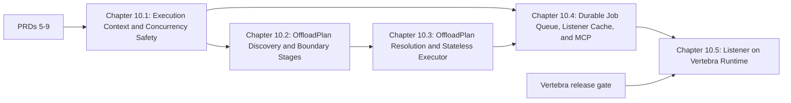

# Master PRD 10: Execution Context, Staged OffloadPlan, Durable Job Queue, and the Listener on Vertebra

## Specification

### 1. North Star

Offloads run safely side by side in one process, an offload is planned as an immutable value before anything mutates a target, the Listener coordinates jobs durably across workers and hosts, and the Listener is served by Vertebra ([Vertebra research](research/vertebra-and-runtime-evaluation.md), [module blueprint](../prd_05_foundation_typing_settings_and_adapter_reduction_20261024/research/module-by-module-redesign.md)):

1. **Execution context and concurrency safety**: a `ContextVar`-scoped `ExecutionContext(FrozenBaseStruct)` routes structured events to `ExecutionSink`s (`LogFileSink`, `ConsoleSink` with byte-identical stdout, `TelemetrySink`, `RepositoryStepSink`, `ListenerCacheSink`), replacing the module globals in `src/goe/orchestration/logging_init.py:35-145` and the shared `_runner` state in `src/goe/listener/services/orchestration.py` and `src/goe/orchestration/orchestration_runner.py:112-160`. It fixes the unraised `OffloadException` (`execution.py:438-439`), the in-place `override_offload_dfs_config` mutation (`execution.py:442`), runtime `os.environ["NLS_LANG"]` mutation (`operation.py:181-196`), the leaked backend API (`operation.py:1181`), the `get_hybrid_metadata(offload_options)` argument bug (`operation.py:1194`), the throwaway Oracle connection in `_get_max_hybrid_identifier_length` (`orchestration_runner.py:320-336`), and the double `OrchestrationConfig.from_dict` construction (`cli_entry_points.py:53-57`).
2. **Staged `OffloadPlan`**: `SourceDiscoveryStage` -> `PartitionBoundaryStage` -> `TypeResolutionStage` -> `TargetTableStage` -> `TransportPlanStage` produce an immutable, serializable `OffloadPlan(FrozenBaseStruct)` (with `SourcePartitionSlice` declared `array_like=True, frozen=True, gc=False`) that `StatelessOffloadExecutor` executes under `OrchestrationLockInterface`. `--dry-run` and the MCP `plan_offload_dry_run` tool render the plan without touching targets. The 1,735-LOC `OffloadOperation` and procedural `execution.py` are replaced; every Incremental Partition Append rule (`100/0`, `90/10`, `100/10`, `RANGE`, `LIST`, composite subpartitions, Partition-Based Offload, `--older-than-date`, `--older-than-days`, `--less-than-value`, `--equal-to-values`, predicate offload, `--reset-backend-table`, `--reset-hybrid-view`, `--offload-chunk-column`, `--offload-chunk-size`, verification) is pinned by characterization tests before code moves.
3. **Durable job queue, Listener cache, and MCP**: a GOE-owned job store on `sqlspec` uses Oracle repository tables (new repository delta script, `SELECT ... FOR UPDATE SKIP LOCKED` claims, heartbeat-renewed leases, a function-based unique index allowing one active offload per frontend table) when they exist in the repository schema and WAL SQLite under `$OFFLOAD_HOME/run/` otherwise. The job worker runs in the Listener lifespan and alone under `goe listener start --worker-only`; listener node heartbeats become durable rows reported by `/api/system/status/`. `litestar-queues`, the `queues` autowire integration, and the three periodic jobs that write unread cache keys are removed. `ListenerCache` (bounded LRU, monotonic TTL, async and sync singleflight, stale-while-revalidate, lifecycle invalidation) replaces `src/goe/listener/utils/cache.py`. Endpoints stop blocking the event loop (pooled async repository access, `409 Conflict` for held table locks, bounded asynchronous log streaming for local and `gs://` logs with path containment), `r"^/mcp"` leaves `SecurityConfig.exclude` (`src/goe/listener/security.py:114`), four read-only MCP tools (`plan_offload_dry_run`, `get_table_offload_status`, `preview_schema_drift`, `check_connectivity`) are added, and mutating MCP tools require `ConfirmationGate` tokens. Responses are typed frozen structs end to end; `src/goe/listener/config/logging.py`, `src/goe/listener/server.py`, and `src/goe/listener/utils/group_by.py` are deleted.
4. **Listener on Vertebra**: `goe listener start` runs `vtb run goe.listener.asgi:app --interface asgi` with `--topology`, `--workers`, `--threads`, TLS, and drain settings derived from Listener settings and `CgroupQuota`; `granian`, `litestar-granian`, and `GranianPlugin` are removed; `--reload` maps to Vertebra's development server. This chapter starts only after the Vertebra release gate in §4 is met.

### 2. Roadmap Topology



| Chapter | Flow ID | Primary Scope | Owned Paths |
| :--- | :--- | :--- | :--- |
| 10.1 | `execution_context_and_concurrency_safety_20261024` | `ExecutionContext`, sinks, concurrency defect fixes | `src/goe/orchestration/{logging_init,orchestration_runner,execution,cli_entry_points}.py`, new `src/goe/orchestration/{context,sinks}.py`, `src/goe/offload/offload_messages.py`, `src/goe/listener/services/orchestration.py`, defect sites in `src/goe/orchestration/operation.py` |
| 10.2 | `offload_plan_discovery_and_boundary_stages_20261024` | Plan models, discovery and boundary stages, IPA characterization | new `src/goe/offload/plan/{__init__,models,discovery,boundary}.py`, `src/goe/offload/source_data/**`, `src/goe/offload/offload_source_table.py` discovery paths, characterization tests |
| 10.3 | `offload_plan_resolution_and_stateless_executor_20261024` | Type, target, and transport stages; executor; `OffloadOperation` and `execution.py` replacement; `--dry-run` rendering | new `src/goe/offload/plan/{types,target,transport}.py`, new `src/goe/orchestration/executor.py`, `src/goe/orchestration/{operation,execution}.py` (replaced), `src/goe/offload/offload.py`, `src/goe/goe.py`, `src/goe/cli/commands/offload.py` (execution wiring) |
| 10.4 | `durable_job_queue_listener_cache_and_mcp_20261024` | Job store and worker, node heartbeat, `ListenerCache`, non-blocking endpoints, MCP | new `src/goe/listener/jobs/{__init__,store,oracle_store,sqlite_store,worker}.py`, new `sql/oracle/source/sql/create_offload_repo_<next>.sql` and its registration in `create_offload_repo.sql`/`upgrade_offload_repo_deltas.sql`, `src/goe/listener/{app,jobs,mcp,security,schemas}.py`, `src/goe/listener/controllers/**`, `src/goe/listener/services/**`, new `src/goe/listener/cache.py`, `src/goe/listener/utils/{cache,group_by}.py` (deleted), `src/goe/listener/config/logging.py` (deleted), `src/goe/cli/commands/listener.py` (`--worker-only`), `pyproject.toml` (`litestar-queues` removal) |
| 10.5 | `listener_on_vertebra_runtime_20261024` | Vertebra launcher, Granian removal, end-to-end Listener test | `src/goe/cli/commands/listener.py`, `src/goe/listener/{app,asgi,server}.py`, `src/goe/listener/__main__.py`, `src/goe/listener/config/application.py`, `pyproject.toml` (`vertebra` added; `granian`, `litestar-granian`, `uvloop`, `httptools` reviewed), `templates/conf/offload.env.template.common`, `docs/`, `tests/integration/listener/` |

### 3. Global Constraints

1. Python `>=3.12`, PEP 585/604/695 types, `FrozenBaseStruct`/`BaseStruct` from `goe.typing`.
2. SPDX two-line header on new files; top-level imports only; no inline `#` comments; Google-style docstrings; public before private.
3. JSON through `goe.util.serializers`.
4. Superseded code is deleted in the same task; no aliases or facades.
5. Focused tests in canonical `tests/unit/` files; `GOOGLE_API_USE_CLIENT_CERTIFICATE=false`; `uv run pytest`, `ruff format --check`, `ruff check`, `mypy src/goe`, `tools/verify_architecture.py`; delete fixed baseline entries.
6. Stdout and log text stay byte-identical for the default text log format; repository command and step records keep their current schema and values.
7. Table locks go through `OrchestrationLockInterface`; the durable job queue adds cluster-wide exclusivity and never replaces the host lock.
8. Golden characterization tests stay green unless a task changes them deliberately and records why.
9. No workstation paths, user names, private application names, exclamation marks, or count-prefixed buzzword headings; one task per commit.

### 4. Decisions and the Vertebra Release Gate

- The job store auto-detects its Oracle tables in `ora_repo_user`; without them it uses SQLite at `$OFFLOAD_HOME/run/listener_jobs.sqlite3` in WAL mode and logs that the deployment is single-host.
- Leases default to 120 seconds with a 30-second heartbeat; an expired lease is reclaimed and the job retried up to its attempt limit, and the per-table unique index prevents a second active job for the same table.
- Chapter 10.5 starts only when a published `vertebra` release provides, and GOE's end-to-end test proves:
  1. ASGI `lifespan.startup`/`lifespan.shutdown` delivered to mounted ASGI apps, with startup failure stopping the worker;
  2. every HTTP method, including `OPTIONS` and `HEAD`, routed to mounted apps (`src/rs/vertebra-http/src/main.rs:62-77` registers five methods at `df36a30`);
  3. `vertebra/bin/vertebra-server` inside the wheels (the `0.1.0` wheel contains only the extension module);
  4. the embedded-topology deadlock fix (Vertebra `runtime-throughput-and-315` Task 2.1), or GOE launches with `--topology shm`;
  5. a stable `vtb run` contract that keeps `VERTEBRA_*` values set by the caller (Vertebra Task 1.2);
  6. `cp312`–`cp314` wheels for Linux `x86_64`/`aarch64` and macOS `arm64`/`x86_64` on the package index GOE resolves.
- The core engine never imports `vertebra`; only the Listener launcher and app depend on it.

### 5. Master Verification Matrix

```bash
export GOOGLE_API_USE_CLIENT_CERTIFICATE=false
uv run ruff format --check src/goe tests/unit
uv run ruff check src/goe tests/unit
uv run mypy src/goe
uv run python tools/verify_architecture.py
uv run pytest tests/unit/orchestration tests/unit/offload tests/unit/listener tests/unit/characterization -q
uv run pytest tests/unit -q
make test-integration-oracle
```

## Implementation Plan

- [ ] 10.1 `execution_context_and_concurrency_safety_20261024` — `ExecutionContext`, sinks, concurrency defect fixes ([spec](../execution_context_and_concurrency_safety_20261024/spec.md)).
- [ ] 10.2 `offload_plan_discovery_and_boundary_stages_20261024` — plan models, discovery and boundary stages ([spec](../offload_plan_discovery_and_boundary_stages_20261024/spec.md)).
- [ ] 10.3 `offload_plan_resolution_and_stateless_executor_20261024` — type, target, and transport stages and the stateless executor ([spec](../offload_plan_resolution_and_stateless_executor_20261024/spec.md)).
- [ ] 10.4 `durable_job_queue_listener_cache_and_mcp_20261024` — durable job queue, `ListenerCache`, non-blocking endpoints, MCP ([spec](../durable_job_queue_listener_cache_and_mcp_20261024/spec.md)).
- [ ] 10.5 `listener_on_vertebra_runtime_20261024` — Listener on Vertebra behind the release gate ([spec](../listener_on_vertebra_runtime_20261024/spec.md)).

## Continuity Snapshot

- **Flow / lifecycle**: `prd_10_staged_orchestration_durable_jobs_and_vertebra_listener_20261024`, `planned`; five child flows.
- **Current task / claimant**: none.
- **Last verified checkpoint**: none.
- **Decisions**: see §4.
- **Discoveries**: none yet.
- **Blockers**: Master PRDs 5–9 must complete first; Chapter 10.5 also waits for the Vertebra release gate.
- **Next exact step**: execute Chapter 10.1 task `1.1` (`execution_context_and_concurrency_safety_20261024:1.1`).
- **Plan identity**: `plan_revision: 1`, `plan_commit: null`. **State identity**: `state_revision: 0`.
- **Relevant knowledge**: `.agents/bundles/knowledge/architecture/orchestration.md`, `.agents/bundles/knowledge/architecture/offload-lifecycle.md`, `.agents/bundles/knowledge/listener/index.md`, `.agents/bundles/knowledge/listener/rest-api.md`, `.agents/bundles/knowledge/listener/worker-and-redis.md`, `.agents/bundles/knowledge/operations/cloud-run-deployment.md`.
