# Chapter 2.3: Strict Mypy Type Safety Ratchet

## Specification

### 1. Problem Statement & Current `pyproject.toml` Baseline

In `pyproject.toml:279-326`, `[tool.mypy]` currently disables virtually all meaningful static type checks across `src/goe`:

1. **Disabled Strictness Flags (`pyproject.toml:280-299`)**:
   - `disallow_any_generics = false`
   - `disallow_incomplete_defs = false`
   - `disallow_untyped_decorators = false`
   - `disallow_untyped_defs = false`
   - `warn_no_return = false`
   - `warn_redundant_casts = false`
   - `warn_unused_configs = false`
   - `warn_unused_ignores = false`
2. **14 Suppressed Error Codes (`pyproject.toml:300-315`)**:
   - `"attr-defined"`, `"assignment"`, `"arg-type"`, `"has-type"`, `"union-attr"`, `"misc"`, `"call-arg"`, `"call-overload"`, `"override"`, `"index"`, `"return-value"`, `"var-annotated"`, `"operator"`, `"name-defined"`
3. **Blanket Package Exclusions (`pyproject.toml:317-325`)**:
   - `[[tool.mypy.overrides]]` sets `ignore_errors = true` for `"goe.listener.*"`, `"goe.connect.*"`, `"goe.schema_sync.*"`, and `"tests.*"`.

Once PRD 1 Chapter 1.1 deletes the 10 dead legacy modules (`src/goe/util/redis_tools.py`, `src/goe/util/serialization.py`, `src/goe/util/env.py`, `src/goe/util/text.py`, `src/goe/util/uuids.py`, `src/goe/util/exception_trigger.py`, `src/goe/util/local_cache.py`, `src/goe/util/retry_logic.py`, `src/goe/conductor/hybrid_view_service.py`, `src/goe/listener/services/hybrid_view.py`), Chapter 2.1 (`typed_msgspec_option_model_20261010`) replaces `optparse.Values` with typed `msgspec.Struct` models, and Chapter 2.2 (`core_god_module_decomposition_20261010`) decomposes the monolithic core files, we can systematically annotate all live `src/goe` packages with PEP 585 (`list`, `dict`, `tuple`, `set`) and PEP 604 (`X | None`) types, prune any unreachable branches or unused private helpers exposed during type narrowing, and ratchet `mypy` to strict enforcement.

---

### 2. Three-Wave Type Safety Ratchet Architecture

```mermaid
flowchart LR
    subgraph Wave1["Task 1.1: Live Foundation Packages"]
        Lib["src/goe/lib/* (2 files)\nsrc/goe/exceptions.py"]
        Cfg["src/goe/config/* (7 files)"]
        Util["src/goe/util/* (18 live files)"]
        Fs["src/goe/filesystem/* (8 files)"]
        Persist["src/goe/persistence/* (10 files)"]
    end

    subgraph Wave2["Task 1.2: Live Service, CLI & Orchestration Packages"]
        Cli["src/goe/cli/* (14 files)"]
        Listener["src/goe/listener/* (23 live files)\nRemove ignore_errors"]
        Connect["src/goe/connect/* (7 files)\nRemove ignore_errors"]
        Sync["src/goe/schema_sync/* (11 files)\nRemove ignore_errors"]
        Scripts["src/goe/scripts/* (2 files)"]
        Orch["src/goe/orchestration/* (7+ files)"]
    end

    subgraph Wave3["Task 1.3: Offload Engine, Dead-Code Gate & pyproject.toml"]
        Offload["src/goe/offload/* & src/goe/report/*\nsrc/goe/goe.py"]
        Pyproject["pyproject.toml:279-326\ndisable_error_code = []\ndisallow_incomplete_defs = true\nRuff F401/F841/ERA001 Gate"]
    end

    Wave1 --> Wave2 --> Wave3
```

#### Typing & Dead-Code Standards

1. **100% Feature Parity & Zero Dead Helpers**:
   - Do not annotate dead code—delete it. The 10 dead files removed in PRD 1 Chapter 1.1 are excluded from all tasks, and any unreferenced private helpers, unused imports (`F401`), unused local variables (`F841`), commented-out code blocks (`ERA001`), or unreachable `mypy` `warn_unreachable` branches discovered during type narrowing must be removed cleanly while preserving 100% of public and runtime behavior.
2. **PEP 585 & PEP 604 Exclusive Syntax**:
   - Always use built-in generic types (`list[str]`, `dict[str, Any]`, `tuple[int, ...]`, `set[str]`) and `collections.abc` protocols (`Sequence`, `Mapping`, `Iterable`, `Callable`, `Iterator`) rather than `typing.List`, `typing.Dict`, `typing.Tuple`, `typing.Set`, or `typing.Optional`.
   - Always use `X | None` union syntax instead of `Optional[X]` or `Union[X, Y]`.
3. **Module-Level `if TYPE_CHECKING:` for Heavy or Circular Imports**:
   - Place type-only imports inside a module-level `if TYPE_CHECKING:` block at the top of the file—never inside functions or methods.
   - Preserve the zero-type-loss lazy-import architecture in `src/goe/cli/_lazy.py`, `src/goe/cli/common.py`, and `src/goe/cli/commands/*.py`.
4. **Protocol & ABC Method Signature Consistency (`[override]`)**:
   - Ensure subclass overrides in `src/goe/filesystem/*` (`goe_dfs.py` subclasses: `cli_hdfs.py`, `web_hdfs.py`, `goe_gcs.py`, `goe_s3.py`, `goe_azure.py`), `src/goe/persistence/*` (`orchestration_repo_client.py` subclasses), and `src/goe/offload/*` (`backend_api.py`, `backend_table.py`, `frontend_api.py`, `offload_source_table.py`, `offload_transport.py`, `staging_file.py`) match base parameter names, defaults, and return types so `mypy` `[override]` checks pass cleanly.

---

### 3. Disjoint File Ownership & Task Breakdown

| Task ID | Title | Owned Packages / Files | Depends On |
| :--- | :--- | :--- | :--- |
| **1.1** | Wave 1 — Live Foundation Packages (`lib`, `config`, `util`, `filesystem`, `persistence`) | `src/goe/lib/`, `src/goe/config/`, `src/goe/util/` (18 live files), `src/goe/filesystem/`, `src/goe/persistence/`, `tests/unit/util/test_typing_contracts.py` | — |
| **1.2** | Wave 2 — Live Service, CLI & Orchestration Packages (`cli`, `listener`, `connect`, `schema_sync`, `scripts`, `orchestration`) | `src/goe/cli/`, `src/goe/listener/` (23 live files), `src/goe/connect/`, `src/goe/schema_sync/`, `src/goe/scripts/`, `src/goe/orchestration/` | `1.1` |
| **1.3** | Wave 3 — Offload Engine, `goe.py` & Global `pyproject.toml` Strict Mypy Ratchet | `src/goe/offload/`, `src/goe/goe.py`, `pyproject.toml`, `tests/unit/test_mypy_strict_config.py` | `1.1`, `1.2` |

## Implementation Plan

- [ ] 1.1 [Wave 1: Live Foundation Packages Type Annotations](tasks/1.1.md) — Annotate and eliminate all `mypy` errors and dead helpers across `src/goe/lib/`, `src/goe/config/`, `src/goe/util/` (live modules only), `src/goe/filesystem/`, and `src/goe/persistence/` with all 14 error codes enabled.
- [ ] 1.2 [Wave 2: Live Service, CLI & Orchestration Packages Type Annotations](tasks/1.2.md) — Annotate and eliminate all `mypy` errors and dead helpers across `src/goe/cli/`, `src/goe/listener/` (live modules only), `src/goe/connect/`, `src/goe/schema_sync/`, `src/goe/scripts/`, and `src/goe/orchestration/`.
- [ ] 1.3 [Wave 3: Offload Engine & Global pyproject.toml Strict Mypy Ratchet](tasks/1.3.md) — Resolve remaining type errors across `src/goe/offload/` and `src/goe/goe.py`, remove all 14 `disable_error_code` entries and production `ignore_errors` overrides in `pyproject.toml`, and enforce the strict mypy and dead-code gate in `make lint`.

## Continuity Snapshot

- **Current State**: Specification and 3 task worksheets (`1.1`, `1.2`, `1.3`) defined and ready for execution after Chapters 2.1 and 2.2.
- **Next Action**: Execute Task `1.1` (`tasks/1.1.md`).
