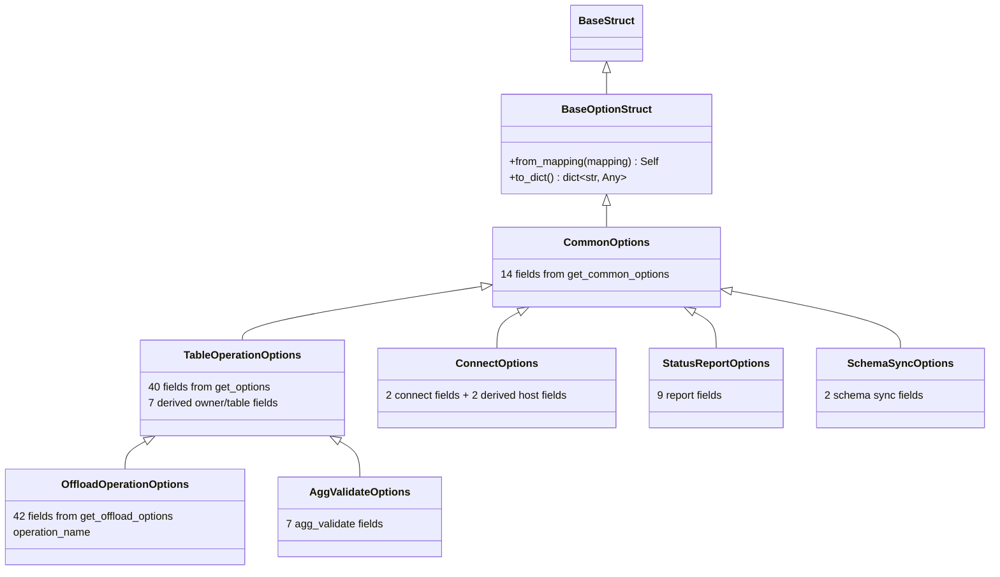

# Chapter 2.1: Typed msgspec Option Model & optparse Elimination

## Specification

### 1. Context and baseline

- **Baseline commit**: every line number in this flow refers to `46890a8`. Files that an earlier chapter edits are cited by symbol name as well; locate them by symbol before editing.
- **Earlier-chapter edits to files owned here** (PRD 1 executes first):
  - `src/goe/goe.py`, `src/goe/connect/connect.py`, `src/goe/orchestration/orchestration_runner.py`: PRD 1 Chapter 1.1 Task 1.2 (`legacy_shim_removal_and_repo_hygiene_20261010:1.2`) deletes `RedisClient` imports, `redis_execution_id`/`redis_in_error`/`init_redis_execution_id`, the `redis_publish` parameter of `log()`, Redis-only imports (`goe.py` L12 `timedelta`, L113 `ExecutionId`), and in `connect.py` lines 52, 55, 227-277 (`test_listener`) and the call at 405. `connect.py` lines after 226 therefore shift up by 54 (`get_connect_opts` L441 becomes about L387; `connect` L464 becomes about L410).
  - `src/goe/offload/predicate_offload.py`, `tests/unit/offload/test_predicate_offload.py`: PRD 1 Chapter 1.1 Task 1.5 (dependency migration to `lark>=1.1.9`) only re-runs these tests and changes no source in them; the `from optparse import OptionValueError` line (`predicate_offload.py:83`) is unchanged.
  - `src/goe/config/orchestration_defaults.py`: PRD 1 Chapter 1.1 Task 1.2 removes `cache_enabled()`/`listener_redis_*`; Chapter 1.2 Task 1.1 adds GCP options. None of the default functions used by option structs are removed.
- **Authoritative field inventory**: [research/option_inventory.md](research/option_inventory.md) lists every field, flag, default source, and annotation, extracted from source at `46890a8`. Struct field sets in this flow must match it exactly.

### 2. Problem statement (verified against `46890a8`)

`git grep -n optparse src/` returns 14 production files plus one test file:

| # | File:line | Import | Use |
| :--- | :--- | :--- | :--- |
| 1 | `src/goe/cli/commands/connect.py:6` | `Values` | `connect()` L58-66 builds defaults via `get_connect_opts()` |
| 2 | `src/goe/cli/commands/offload.py:6` | `Values` | `offload()` L522-547 builds defaults via `get_options()` + `get_offload_options()` |
| 3 | `src/goe/cli/commands/report.py:6` | `Values` | `report()` L67-80 via `get_offload_status_report_opts()` |
| 4 | `src/goe/cli/commands/sync.py:7` | `Values` | `sync()` L75-84 via `get_schema_sync_opts()` |
| 5 | `src/goe/cli/commands/validate.py:7` | `Values` | `validate()` L103-112 via `get_agg_validate_options()` |
| 6 | `src/goe/connect/connect.py:10` | `SUPPRESS_HELP` | `get_connect_opts()` L441-461; `connect()` L464-506 parses `sys.argv` when `options_override is None`; imports `OptionValueError` from `goe.goe` (L41) |
| 7 | `src/goe/goe.py:13` | `SUPPRESS_HELP, Option, OptionParser, OptionValueError` | `check_posint` L2666-2671, `GOEOptionTypes` L2674-2682, `get_common_options` L2685-2772, `get_oracle_options` L2775-2824 (zero callers), `get_options` L2827-3106, `get_options_from_list` L3109-3127 |
| 8 | `src/goe/offload/offload.py:10` | `SUPPRESS_HELP` | `get_offload_options(opt)` L379-655 |
| 9 | `src/goe/offload/offload_status_report.py:11` | `SUPPRESS_HELP, OptionGroup` | `get_offload_status_report_opts()` L3602-3673; `offload_status_report_run(options=None)` L3734-3794 parses `sys.argv` when `options is None` and calls `opt.print_help()` |
| 10 | `src/goe/offload/operation/partition_controls.py:7` | `OptionValueError` | raised at L219 |
| 11 | `src/goe/offload/option_validation.py:5` | `OptionValueError` | default `exception_class` of `check_opt_is_posint` L71 |
| 12 | `src/goe/offload/oracle/oracle_predicate.py:8` | `OptionValueError` | raised |
| 13 | `src/goe/offload/predicate_offload.py:83` | `OptionValueError` | raised |
| 14 | `src/goe/offload/teradata/teradata_predicate.py:8` | `OptionValueError` | raised |
| T | `tests/unit/offload/test_predicate_offload.py:8` | `OptionValueError` | `assertRaises` |

Additional builders without a direct `optparse` import: `get_schema_sync_opts()` (`src/goe/schema_sync/schema_sync.py:29-48`, via `get_common_options`) and `GOE_OPTIONS` (L64-78) / `get_agg_validate_options()` (L179-227) / `parse_args()` (L230-235) / `main()` (L259-266) plus the `#### MAIN PROGRAM BEGINS HERE` comment and `if __name__ == "__main__":` block (L269-271) in `src/goe/scripts/agg_validate.py` (via `get_options_from_list`). `src/goe/util/option_mixin.py` and `src/goe/logmgr.py` do not exist, and `src/goe/cli/commands/logmgr.py` has no `optparse` reference; they are out of scope.

Verified counts: `EXPECTED_OFFLOAD_ARGS` (`src/goe/goe.py:154-240`) has **85** keys. The listener `OffloadOptions` (`src/goe/listener/schemas.py:160-258`) declares **96** fields = 84 canonical keys (all `EXPECTED_OFFLOAD_ARGS` except `operation_name`) + 10 alias fields + `quiet`/`verbose`. The CLI `offload` command adds 3 derived flags (`--verify`, `--no-verify`, `--no-modify-hybrid-view`) that map onto canonical keys.

### 3. Target architecture

`src/goe/config/options.py` is an import leaf (stdlib, `msgspec`, `goe.lib.schemas`, `goe.config.orchestration_defaults`; verified at `46890a8` that importing `goe.config.orchestration_defaults` loads only `goe.config.config_file`, `goe.offload.offload_constants`, and `goe.util.misc_functions`). It never imports `goe.goe`, `goe.offload.offload_messages`, `goe.filesystem`, or `goe.listener`.

#### Design rules

1. **Field parity**: each struct's field set equals the key set of the legacy `parser.get_default_values().__dict__` for its builder (removed options keep their defaults in `optparse`, so removed keys stay as inherited fields) plus the derived attributes listed in the research file. Defaults are produced by `msgspec.field(default_factory=orchestration_defaults.<name>_default)` for every default backed by `orchestration_defaults`, so environment changes are honoured per instantiation.
2. **Strictness instead of `__dict__` emulation**: msgspec stores fields in slots; `dict=True` only adds a side `__dict__` for undeclared attributes, and `copy.copy`/`copy.deepcopy` drop those attributes (verified with msgspec 0.21.1). Therefore no struct uses `dict=True`; every attribute any normaliser assigns is a declared field, and assigning an undeclared attribute raises `AttributeError`. `from_mapping` raises `TypeError` for unknown keys. No caller reads `options.__dict__`/`vars(options)` on CLI option objects (verified by `git grep`).
3. **`kw_only=True` on every class**: msgspec applies `kw_only` per class definition, not by inheritance (verified empirically).
4. **Exception unification**: `src/goe/exceptions.py` exports `OptionValueError = OffloadOptionError`. `str()` of these errors becomes `repr(detail)` (current `OffloadOptionError.__str__`); no test asserts the old message text.
5. **Shared offload keys**: `EXPECTED_OFFLOAD_ARGS` (a `tuple[str, ...]` preserving baseline order, used by `OffloadOperation._vars`) and the listener alias tables move to `options.py`; `goe.goe` and `goe.listener.schemas` import them.
6. **Listener REST schema (`D-2.1-A` — RESOLVED)**: the listener `OffloadOptions` keeps its REST wire defaults (`execute: bool = True` so API/MCP calls execute by default, and `None` unset sentinels for optional fields so `to_params_dict()` preserves alias precedence and records only caller-supplied parameters in `COMMAND_EXECUTION.COMMAND_INPUT`), while adding `to_operation_options(self) -> OffloadOperationOptions` (`OffloadOperationOptions.from_mapping(self.to_params_dict())`) to hydrate all omitted fields from the single canonical `OffloadOperationOptions` default set (`orchestration_defaults.*_default()` and safe `False` destructive flags). Duplication is removed by importing `EXPECTED_OFFLOAD_ARGS` and the alias tables from `options.py` and by a drift test that asserts the REST field set equals `EXPECTED_OFFLOAD_ARGS - {operation_name}` plus the alias and verbosity fields.
7. **Entry-point signatures**: `goe` is the single CLI entrypoint after PRD 1 deletes `bin/*`, so `connect()`, `offload_status_report_run()`, and agg-validate no longer parse `sys.argv`. `connect(options: ConnectOptions)` and `offload_status_report_run(options: StatusReportOptions)` require an options struct; `agg_validate.parse_args()` and `agg_validate.main()` are deleted.

### 4. Requirement traceability

| Requirement (PRD 2 §1, §3) | Task | Verification |
| :--- | :--- | :--- |
| R1 Typed option structs with field/default parity | 1.1 | `tests/unit/config/test_options_model.py`; parity heredoc in 1.1 Verification |
| R2 `OptionValueError = OffloadOptionError`; predicate/validation modules off `optparse` | 1.1 | `tests/unit/offload/test_predicate_offload.py`, `tests/unit/offload/test_option_validation.py` |
| R3 connect/report/sync/validate entrypoints use structs; their builders deleted | 1.2 | `tests/unit/cli/test_{connect,report,sync,validate}_command.py`, `tests/unit/connect/test_connect.py` |
| R4 offload entrypoint uses structs; `goe.py`/`offload.py` builders deleted; zero `optparse` in `src/goe` | 1.3 | `tests/unit/cli/test_offload_command.py`, `! git grep -n optparse src/goe` |
| R5 Listener schema shares canonical keys/aliases and hydrates canonical defaults via `to_operation_options()` (`D-2.1-A`) | 1.3 | `tests/unit/listener/test_offload_options_schema.py` |

### 5. File ownership

| Task | Owned files | Depends on |
| :--- | :--- | :--- |
| 1.1 | `src/goe/exceptions.py`, `src/goe/config/options.py`, `src/goe/offload/option_validation.py`, `src/goe/offload/operation/partition_controls.py`, `src/goe/offload/oracle/oracle_predicate.py`, `src/goe/offload/predicate_offload.py`, `src/goe/offload/teradata/teradata_predicate.py`, `tests/unit/config/test_options_model.py`, `tests/unit/offload/test_predicate_offload.py` | — |
| 1.2 | `src/goe/cli/commands/connect.py`, `src/goe/cli/commands/report.py`, `src/goe/cli/commands/sync.py`, `src/goe/cli/commands/validate.py`, `src/goe/connect/connect.py`, `src/goe/offload/offload_status_report.py`, `src/goe/schema_sync/schema_sync.py`, `src/goe/scripts/agg_validate.py`, `tests/unit/cli/test_validate_command.py` | 1.1 |
| 1.3 | `src/goe/cli/commands/offload.py`, `src/goe/goe.py`, `src/goe/offload/offload.py`, `src/goe/listener/schemas.py`, `tests/unit/listener/test_offload_options_schema.py` | 1.2 |

## Implementation Plan

- [ ] 1.1 [Typed option structs, shared offload constants & exception unification](tasks/1.1.md) — create `src/goe/config/options.py`, alias `OptionValueError`, migrate five modules and one test off `optparse.OptionValueError`.
- [ ] 1.2 [Migrate connect/report/sync/validate entrypoints and delete their builders](tasks/1.2.md) — construct `ConnectOptions`/`StatusReportOptions`/`SchemaSyncOptions`/`AggValidateOptions` and delete `get_connect_opts`, `get_offload_status_report_opts`, `get_schema_sync_opts`, `GOE_OPTIONS`, `get_agg_validate_options`, `parse_args`, `main`.
- [ ] 1.3 [Migrate offload entrypoint, delete core builders, share listener constants](tasks/1.3.md) — construct `OffloadOperationOptions`, delete `check_posint`, `GOEOptionTypes`, `get_common_options`, `get_oracle_options`, `get_options`, `get_options_from_list`, `get_offload_options`, and reach zero `optparse` imports.

## Continuity Snapshot

- **Flow / lifecycle**: `typed_msgspec_option_model_20261010` (`state: planned`).
- **Current task / claimant**: `current_task: null` / `claimed_by: null`.
- **Last verified checkpoint**: `none`.
- **Plan identity**: `plan_revision: 3`, `plan_commit: null`.
- **State identity**: `state_revision: 0`.
- **Decisions**: `D-2.1-A` resolved (keep REST wire defaults `execute=True` + `None` unset sentinels on `OffloadOptions`, share canonical keys/aliases from `goe.config.options`, add `to_operation_options()` to hydrate canonical `OffloadOperationOptions` defaults, and enforce field parity via drift test).
- **Recent discoveries**: All 85 `EXPECTED_OFFLOAD_ARGS` keys, 40 + 7 `TableOperationOptions` fields, and 42 + 1 `OffloadOperationOptions` fields are written out in full in Task 1.1 with widened normaliser annotations so Chapter 2.3 strict mypy passes cleanly.
- **Blockers**: PRD 1 must be complete (Chapter 1.1 deletes `bin/*`, Redis shims and code, and 10 dead modules; Chapter 1.3 adds the golden characterization suite).
- **Next exact step**: claim Task 1.1 and run its Step 1 failing test.
- **Relevant knowledge**: `.agents/bundles/knowledge/patterns/cli-architecture.md` (lazy CLI imports), `.agents/bundles/knowledge/patterns/serialization-and-utils.md` (msgspec conventions), `research/option_inventory.md`.
