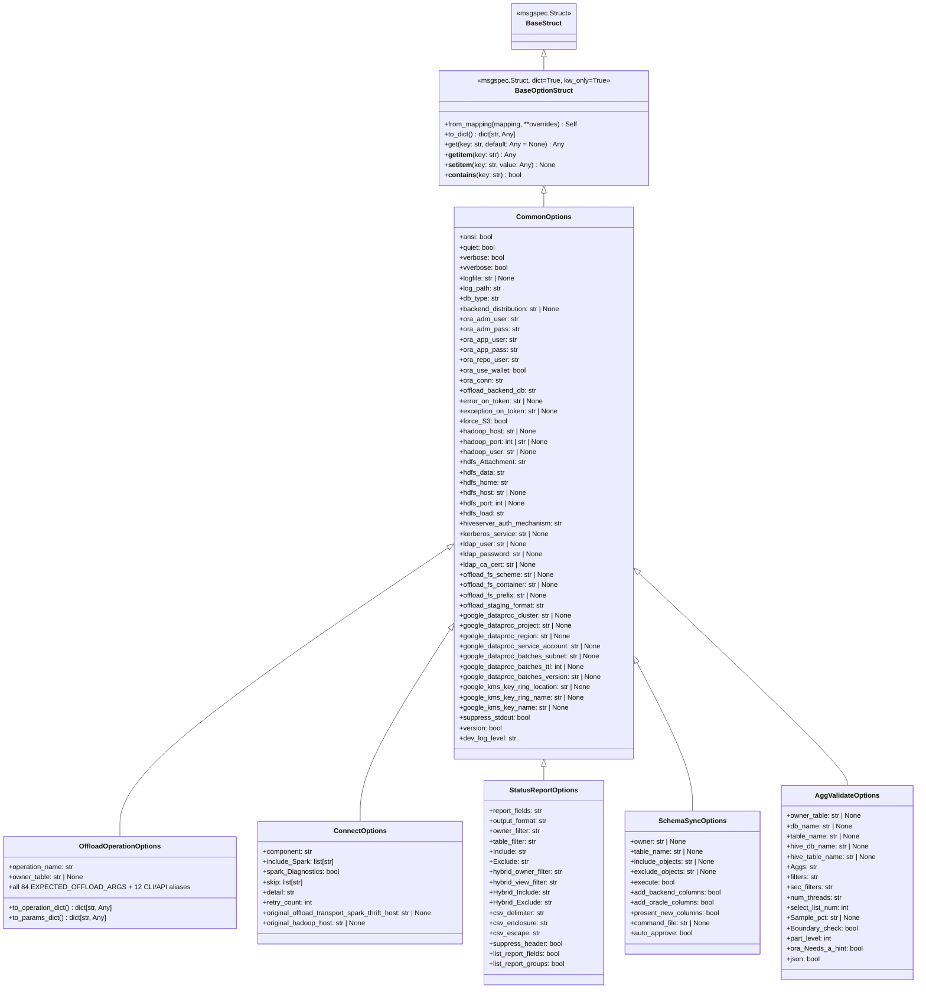

# Chapter 2.1: Typed msgspec Option Model & optparse Elimination

## Specification

### 1. Problem Statement & Current Inventory

Across `src/goe/`, command-line and programmatic options are currently constructed by instantiating legacy `optparse.OptionParser` objects solely to extract their `.defaults` dictionary, mutating that dictionary, and wrapping it in an untyped `optparse.Values` object (`options.__dict__`). A repository-wide audit (`git grep -n optparse src/`) identifies **14 production files** importing `optparse`:

1. `src/goe/cli/commands/connect.py:6` — imports `from optparse import Values`; lines `58-66` call `get_connect_opts()` (`OptionParser`) and return `Values(options_dict)`.
2. `src/goe/cli/commands/offload.py:6` — imports `from optparse import Values`; lines `522-547` call `get_options(operation_name=OFFLOAD_OP_NAME)`, `get_offload_options(parser)`, and wrap merged defaults in `Values(options_dict)`.
3. `src/goe/cli/commands/report.py:6` — imports `from optparse import Values`; lines `67-80` call `get_offload_status_report_opts()` and return `Values(options_dict)`.
4. `src/goe/cli/commands/sync.py:7` — imports `from optparse import Values`; lines `75-85` call `get_schema_sync_opts()` and return `Values(options_dict)`.
5. `src/goe/cli/commands/validate.py:7` — imports `from optparse import Values`; lines `103-113` call `get_agg_validate_options()` and return `Values(options_dict)`.
6. `src/goe/connect/connect.py:10` — imports `from optparse import SUPPRESS_HELP`, imports `OptionValueError` from `goe.goe` at line `41`, builds `OptionParser` in `get_connect_opts()` at lines `441-461`, and sets `options.original_offload_transport_spark_thrift_host` and `options.original_hadoop_host` at lines `486-489`.
7. `src/goe/goe.py:13` — imports `from optparse import SUPPRESS_HELP, Option, OptionParser, OptionValueError`; defines `EXPECTED_OFFLOAD_ARGS` at lines `154-240`, `normalise_options` at lines `906-1008`, `BaseOperation.__init__` at lines `1142-1224`, `OffloadOperation.from_options` at lines `1960-2058`, `OffloadOperation.from_dict` at lines `2060-2241`, `check_posint` at lines `2666-2671`, `GOEOptionTypes` (`Option` subclass) at lines `2674-2683`, `get_common_options` at lines `2685-2772`, `get_oracle_options` at lines `2775-2824`, `get_options` at lines `2827-3106`, and `get_options_from_list` at lines `3109-3127`.
8. `src/goe/offload/offload.py:10` — imports `from optparse import SUPPRESS_HELP` and defines `get_offload_options(opt)` at lines `379-655`.
9. `src/goe/offload/offload_status_report.py:11` — imports `from optparse import SUPPRESS_HELP, OptionGroup` and defines `get_offload_status_report_opts()` at lines `3602-3674` and `normalise_offload_status_report_options(options)` at lines `3676-3698`.
10. `src/goe/offload/operation/partition_controls.py:7` — imports `from optparse import OptionValueError` (raised at line `219`).
11. `src/goe/offload/option_validation.py:5` — imports `from optparse import OptionValueError` (used as default `exception_class=OptionValueError` in `check_opt_is_posint` at line `71`).
12. `src/goe/offload/oracle/oracle_predicate.py:8` — imports `from optparse import OptionValueError` (raised at lines `52`, `65`, `79`, `91`).
13. `src/goe/offload/predicate_offload.py:83` — imports `from optparse import OptionValueError` (raised at lines `174`, `176`, `339`, `343`, `346`).
14. `src/goe/offload/teradata/teradata_predicate.py:8` — imports `from optparse import OptionValueError` (raised at lines `43`, `57`).

Additionally:
- `src/goe/schema_sync/schema_sync.py:29-59` builds `get_schema_sync_opts()` via `get_common_options()` (`OptionParser`) and normalizes options in `normalise_schema_sync_options(options)`.
- `src/goe/scripts/agg_validate.py:64-235` builds `get_agg_validate_options()` via `get_options_from_list(GOE_OPTIONS)` (`OptionParser`), parses via `parse_args()`, and normalizes options in `post_process_args(args)`.
- `src/goe/listener/schemas.py:160-303` duplicates a 96-field `OffloadOptions(BaseStruct)` definition and a custom `to_params_dict()` method because `goe.goe` could not be imported at top-level without triggering a circular import (`goe.goe` -> `config_validation_functions` -> `goe_dfs` -> `offload_messages` -> `listener.utils.cache` -> `listener.schemas`).
- Note that `src/goe/conductor/hybrid_view_service.py` and `src/goe/listener/services/hybrid_view.py` are deleted as dead code in PRD 1 Chapter 1.1 and must not be touched or retained here.

---

### 2. Target Architecture: `src/goe/config/options.py` (100% Parity & Zero Dead Code)

We introduce `src/goe/config/options.py` as the single, zero-circular-import source of truth for all GOE option schemas, defaults, and alias normalization, and we **delete** all superseded `optparse` parsers, builders, and duplicate schema bodies:

#### Key Design Decisions & Dead-Code Deletion Rules

1. **100% Parity Across All 84 `EXPECTED_OFFLOAD_ARGS`, 12 CLI Aliases, Environment Fallbacks & Normalization Rules**:
   - Every single field in `EXPECTED_OFFLOAD_ARGS` (84 canonical keys previously in `src/goe/goe.py:154-240`), all 12 CLI/API option aliases (`verify` -> `verify_row_count` / `Verify`, `sort_columns` -> `sort_columns_csv`, `not_null_columns` -> `not_null_columns_csv`, `older_than_days` -> `offload_by_subpartition_age`, `equal_to_values` -> `offload_by_subpartition_values`, `less_than_value` -> `offload_by_subpartition_high_value`, `reset_hybrid_view` -> `reset_backend_table`, `impala_insert_hint` -> `hive_insert_hint`, `older_than_date` -> `less_than_value`, `offload_predicate_type` -> `offload_type`, `partition_names` -> `partition_names_csv`, `subpartition_names` -> `subpartition_names_csv`), all dynamic `os.environ` fallbacks in `src/goe/config/orchestration_defaults.py`, and all validation/normalization logic in `src/goe/offload/option_validation.py` (`normalise_options`, `normalise_offload_status_report_options`, `normalise_schema_sync_options`, `post_process_args`) are preserved 100%.
2. **Delete Superseded `optparse` Functions & Duplicate Schemas (Zero Dead Wrappers)**:
   - In `src/goe/goe.py`, delete `check_posint`, `GOEOptionTypes`, `get_common_options`, `get_oracle_options`, `get_options`, `get_options_from_list` (as well as any legacy `get_offload_option_parser`, `init_common_options`, `offload_options` helpers).
   - In `src/goe/offload/offload.py`, delete `get_offload_options`.
   - In `src/goe/connect/connect.py`, delete `get_connect_opts`.
   - In `src/goe/offload/offload_status_report.py`, delete `get_offload_status_report_opts`.
   - In `src/goe/schema_sync/schema_sync.py`, delete `get_schema_sync_opts`.
   - In `src/goe/scripts/agg_validate.py`, delete `GOE_OPTIONS`, `get_agg_validate_options`, and `parse_args`.
   - Delete any remaining `optparse` glue in `src/goe/util/option_mixin.py` or `src/goe/logmgr.py` / `src/goe/cli/commands/logmgr.py` if present.
   - In `src/goe/listener/schemas.py`, **delete the duplicate 96-field `OffloadOptions` struct body** and replace it by subclassing/aliasing `OffloadOperationOptions` from `src/goe/config/options.py` so there is a single source of truth for offload options across CLI, Listener, and Core!
3. **`dict=True` on `BaseOptionStruct` & Dynamic Environment Evaluation**:
   - Setting `dict=True` on `BaseOptionStruct` keeps `options.__dict__` and struct attributes synchronized (`__post_init__` and `__setattr__`), supporting dynamic runtime attributes set by orchestration classes (`options.target_owner_name`, `options.original_hadoop_host`, etc.) and `copy.deepcopy(options)`.
   - Fields backed by `src/goe/config/orchestration_defaults.py` use `msgspec.field(default_factory=...)` so patching `os.environ` in tests dynamically affects newly instantiated option structs.
4. **`OffloadOptionError` & `OptionValueError` Unification**:
   - `src/goe/exceptions.py` defines `OffloadOptionError(Exception)` and aliases `OptionValueError = OffloadOptionError`. All 7 modules that previously imported `OptionValueError` from `optparse` import `OffloadOptionError` / `OptionValueError` from `goe.exceptions`.

---

### 3. File Ownership & Task Breakdown

| Task ID | Title | Owned Files | Depends On |
| :--- | :--- | :--- | :--- |
| **1.1** | Core `msgspec.Struct` Option Hierarchy & Exception Unification | `src/goe/exceptions.py`, `src/goe/config/options.py`, `src/goe/offload/option_validation.py`, `src/goe/offload/operation/partition_controls.py`, `src/goe/offload/oracle/oracle_predicate.py`, `src/goe/offload/predicate_offload.py`, `src/goe/offload/teradata/teradata_predicate.py`, `tests/unit/config/test_options_model.py`, `tests/unit/offload/test_predicate_offload.py` | — |
| **1.2** | Delete Legacy `optparse` Parsers in Core Operations (`goe.py`, `offload.py`, `connect.py`, `offload_status_report.py`, `schema_sync.py`, `agg_validate.py`) | `src/goe/goe.py`, `src/goe/offload/offload.py`, `src/goe/connect/connect.py`, `src/goe/offload/offload_status_report.py`, `src/goe/schema_sync/schema_sync.py`, `src/goe/scripts/agg_validate.py`, `tests/unit/test_goe.py` | `1.1` |
| **1.3** | Migrate Rich-Click CLI Commands & Deduplicate Listener `OffloadOptions` Schema | `src/goe/cli/commands/offload.py`, `src/goe/cli/commands/connect.py`, `src/goe/cli/commands/report.py`, `src/goe/cli/commands/sync.py`, `src/goe/cli/commands/validate.py`, `src/goe/cli/commands/logmgr.py`, `src/goe/listener/schemas.py`, `tests/unit/cli/test_cli_options_parity.py`, `tests/unit/listener/test_schemas.py` | `1.1`, `1.2` |

## Implementation Plan

- [ ] 1.1 [Core msgspec.Struct Option Hierarchy & Exception Unification](tasks/1.1.md) — Create `src/goe/config/options.py` with `BaseOptionStruct` and all 6 domain option structs (preserving all 84 `EXPECTED_OFFLOAD_ARGS`, 12 CLI aliases, and environment variable defaults), unify `OptionValueError = OffloadOptionError` in `src/goe/exceptions.py`, and migrate predicate/validation modules off `optparse`.
- [ ] 1.2 [Delete Legacy optparse Parsers in Core Operations](tasks/1.2.md) — Delete all `OptionParser`/`OptionGroup`/`Option` builders (`get_common_options`, `get_oracle_options`, `get_options`, `get_options_from_list`, `GOEOptionTypes`, `check_posint`, `get_offload_options`, `get_connect_opts`, `get_offload_status_report_opts`, `get_schema_sync_opts`, `get_agg_validate_options`, `parse_args`) across `goe.py`, `offload.py`, `connect.py`, `offload_status_report.py`, `schema_sync.py`, and `agg_validate.py`, replacing all call sites with direct `msgspec.Struct` option instantiation.
- [ ] 1.3 [Migrate Rich-Click CLI Commands & Deduplicate Listener OffloadOptions Schema](tasks/1.3.md) — Remove `from optparse import Values` from all CLI command modules, delete any remaining `option_mixin.py` / `logmgr.py` `optparse` glue, delete the duplicate 96-field `OffloadOptions` body in `src/goe/listener/schemas.py` by subclassing/aliasing `OffloadOperationOptions`, and verify zero `optparse` imports or dead option wrappers remain in `src/goe/`.

## Continuity Snapshot

- **Current State**: Specification and 3 task worksheets (`1.1`, `1.2`, `1.3`) defined and ready for execution.
- **Next Action**: Execute Task `1.1` (`tasks/1.1.md`).
